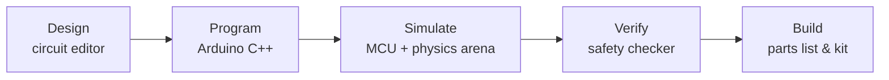

# Mehrtronic

**Mehrtronic** is an electronics and robotics company serving Persian-speaking makers, students, and educators. We supply robotics parts and kits, and we build software that helps people learn, design, and test robots before they buy hardware.

> **Our approach:** *build it virtually, verify it, then buy only what works.*

---

## What we do

| Area | Description |
|---|---|
| 🔌 **Electronics & robotics parts** | Microcontroller boards, sensors, motors, drivers, power, and prototyping parts for hobby and educational robots |
| 📦 **Robot kits** | Curated kits made from parts that work together |
| 🎓 **Education** | Persian and English learning content, guided projects, and tools for schools, academies, and universities |
| 💻 **Software** | Web platforms that connect learning, design, and simulation with the parts we sell |

## Projects

| Project | Status | Description |
|---|---|---|
| [**RoboSim**](RoboSim/README.md) | 🚧 In active development | A bilingual (English / Persian) web platform for designing robot circuits, programming them in Arduino C++, simulating them in a physics arena, checking them for wiring mistakes that would damage real hardware, and turning the result into a parts list |

### RoboSim at a glance



RoboSim is published as **"RoboSim by Mehrtronic"**. See the [RoboSim README](RoboSim/README.md) for features, architecture, and local setup.

## Repository layout

```text
Mehrtronic/
├── README.md          ← you are here (company overview)
└── RoboSim/           ← RoboSim monorepo (apps, packages, docs)
    ├── README.md      ← app overview, install, and run instructions
    └── Docs/          ← product, technical, and engineering documentation
```

## License

© 2026 Mehrtronic. All rights reserved.
