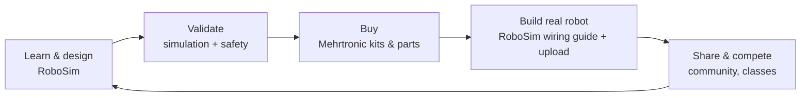

# RoboSim — Business Requirements Document (BRD)

**Version:** 1.0 · **Date:** 2026-10-13 · **Owner:** @MehranG · **Status:** Approved for planning
**Related:** [PRD](PRD.md) · [Release Plan](Release-Plan.md) · [Security & Compliance](Security-Privacy-Compliance.md)

> **Assumption markers.** Statements tagged **[A-n]** are business assumptions that must be validated by Mehrtronic management before the P2 commercial launch. They are listed in §12. Numbers in this document are **targets or model inputs**, not measured facts.

---

## 1. Executive summary

RoboSim is Mehrtronic's software platform for learning, designing, and validating small robots before any hardware is bought. A user wires an Arduino-class robot from a curated parts library, programs it in Arduino C++ or visual blocks, watches it drive in a physics-based 2D/3D arena, gets plain-language warnings about wiring that would damage real parts, and leaves with a priced parts list that can be ordered from Mehrtronic's shop as a ready kit.

The business case rests on three revenue engines that reinforce each other:

| Engine | Customer | Revenue | Why it works |
|---|---|---|---|
| **Subscriptions** | Individual makers and students | Monthly/yearly Maker plan | The simulator saves real money (burnt boards, wrong parts) and time. |
| **Institutional licences** | Schools, robotics academies, clubs, universities | Per-seat annual Classroom / Institution plans, private-cloud licences | One kit per student is expensive; virtual labs let every student practise; teachers get grading and progress tracking. |
| **Hardware commerce** | Every user who finishes a design | Margin on parts and kits | The BOM converts a validated virtual design into a cart in one click — the strongest purchase intent a parts seller can get. |

## 2. Mehrtronic context and product positioning

**[A-1]** Mehrtronic is an electronics and robotics business serving Persian-speaking makers and educators. RoboSim is positioned as Mehrtronic's **digital front door**: the place where customers learn, design, and decide *what* to buy, before Mehrtronic's commerce operation fulfils *the purchase*.



| Positioning element | Statement |
|---|---|
| **Brand architecture** | "RoboSim by Mehrtronic". RoboSim has its own product identity; Mehrtronic is shown as the publisher, the shop operator, and the kit manufacturer/curator. |
| **Strategic role** | Acquisition and retention channel for Mehrtronic hardware; recurring software revenue that smooths the seasonality of hardware sales. |
| **Differentiation** | The only bilingual (FA/EN) tool that connects circuit → code → *moving robot* → safety check → priced kit in one loop, with classroom management on top. |
| **Moat** | (1) Calibrated component models of the exact parts Mehrtronic sells, (2) Persian educational content and guided projects, (3) institutional relationships and LMS integration, (4) the BOM-to-kit fulfilment loop. |

**Relationship with other Mehrtronic assets [A-2]:** the shop catalogue, inventory, and logistics may already exist in Mehrtronic. RoboSim's shop module (§FR-SHP) is designed to either run as the primary store or **integrate with an existing Mehrtronic store** through the `CommerceBackend` interface (see [Technical Design §10](Technical-Design.md#10-commerce)). The decision is taken in P2 planning.

## 3. Problem statement

| # | Problem | Who | Consequence today |
|---|---|---|---|
| P-1 | Wiring mistakes destroy parts (motor on a GPIO pin, reversed battery, LED without resistor). | Beginners | Lost money, frustration, abandonment of the hobby. |
| P-2 | Beginners buy the wrong parts or incompatible combinations. | Beginners, hobbyists | Wasted purchases, delayed projects. |
| P-3 | Existing tools cover fragments: circuit simulators stop at the circuit; MCU simulators do not show a robot moving in a world; none is Persian-first. | All | Learners juggle 3–4 tools, most English-only. |
| P-4 | Schools cannot afford one kit per student and have no way to grade robotics work objectively. | Teachers, academies | Few students get hands-on time; assessment is subjective. |
| P-5 | Parts sellers see no purchase intent until the customer is already in the cart. | Mehrtronic | High acquisition cost, low basket size. |

## 4. Business objectives

Targets are for the **first 12 months after 1.0 GA** (end of phase P3) unless stated otherwise.

| ID | Objective | Measure | Target |
|---|---|---|---|
| BO-1 | Build a recurring software revenue base | Paying individual subscriptions (active) | 3,000 [A-3] |
| BO-2 | Win institutional customers | Paying organizations / paid seats | 60 orgs / 4,000 seats [A-4] |
| BO-3 | Convert designs into hardware sales | Share of completed projects that become a paid order | ≥ 8 % |
| BO-4 | Increase hardware basket size | Average order value of BOM-originated orders vs. non-BOM orders | ≥ 1.5× |
| BO-5 | Prove learning value | Learners completing their first guided project within 7 days of sign-up | ≥ 40 % |
| BO-6 | Retain customers | Monthly logo churn, individual / institutional | ≤ 6 % / ≤ 1.5 % |
| BO-7 | Operate reliably | Monthly availability of web + API | ≥ 99.9 % |

## 5. Market and customers

### 5.1 Segments

| Segment | Description | Buying behaviour | Plan |
|---|---|---|---|
| S1 — Self-learners | Ages 14–25, students, robot-video viewers, little electronics experience, price-sensitive | Self-serve, monthly, mobile-payment habits | Free → Maker |
| S2 — Hobby makers | Ages 20–40, built a few Arduino projects, plan bigger robots | Self-serve, yearly, buys parts | Maker |
| S3 — Schools & academies | Private schools, robotics academies (آموزشگاه رباتیک), after-school clubs | Sales-assisted, per term/year, purchase order or invoice, needs reports for parents | Classroom |
| S4 — Universities & large institutions | Engineering faculties, technical-vocational centres, provincial education programmes | Tender/contract, SSO, LMS, data residency, sometimes on-premise | Institution / Private Cloud |
| S5 — Competition organisers | National/school robotics leagues | Event-based, sponsorship | Institution + competition add-on |

### 5.2 Competitive landscape

| Alternative | Strength | Gap RoboSim exploits |
|---|---|---|
| Wokwi | Excellent MCU simulation, many boards | No robot physics arena, no safety teaching, no BOM/kit commerce, English-only, no classroom grading |
| Tinkercad Circuits | Free, education-friendly | Very limited robotics, no arena, account/availability constraints for Iranian users, English UI focus |
| Proteus / professional EDA | Accurate | Expensive, steep learning curve, no robot world, desktop-only |
| Physical kits only | Real experience | Cost, breakage, one kit per group, no objective grading |
| Local video courses | Persian content | Passive; no hands-on practice environment |

### 5.3 Market constraints specific to Iran

These constraints shape the product and are non-negotiable inputs (detailed in [Security-Privacy-Compliance §8](Security-Privacy-Compliance.md#8-iranian-legal-and-commercial-compliance)):

1. **Payments** only through Iranian Shaparak-connected gateways (e.g. Zarinpal) in IRR. International card payments are not available; international users can use Free and community features, and paid access only through Iranian payment or institutional contracts.
2. **Hosting in Iran** is required for reliable access, low latency under filtering, and gateway callbacks. Many foreign SaaS tools, CDNs, and registries are unreachable or restricted; the product must be fully self-hostable.
3. **eNamad** trust seal is required to operate a payment gateway for e-commerce.
4. **Tax:** VAT applies to subscriptions and goods; official invoices for business customers through the Moodian e-invoicing system.
5. **Third-party AI** providers are frequently unavailable from Iranian networks and their terms may restrict use; the AI strategy cannot depend on them (§7.4).

## 6. Scope

### 6.1 In scope (enterprise edition)

- Web platform (desktop-first, tablet-usable, responsive) in English and Persian.
- Circuit editor, Arduino C++ and block-based programming, cloud compilation.
- In-browser MCU emulation (AVR: Uno, Nano, Mega 2560; RP2040: Raspberry Pi Pico) with electrical and physical simulation in a 2D and 3D arena.
- Hardware safety checker with educational explanations.
- BOM, wiring guide, exports, parts shop with kits, order fulfilment.
- Accounts, personal and organization workspaces, SSO, SCIM, roles.
- Learning: guided projects, courses, classes, assignments, server-verified autograding, gradebook, LTI 1.3 for Moodle.
- Community gallery, remix, moderation, competitions.
- Real-time collaboration on projects.
- AI assistant (platform-hosted models plus bring-your-own-key where available).
- Upload to real boards from the browser (Web Serial).
- Admin back-office, analytics, audit logging.
- SaaS deployment in Iran, plus Private Cloud / on-premise licence.

### 6.2 Out of scope

| Item | Reason |
|---|---|
| SPICE-accurate analog, PCB layout, thermal/EMI | Different product category; educational fidelity is the target. |
| Native mobile apps | Responsive web covers tablets; phones are a viewing surface only. |
| ESP32 in 1.0 | No mature open-source in-browser ESP32 emulator; evaluated as a P5 research track (see Release Plan). |
| International payments | Not legally/technically available to an Iran-based merchant. |
| 3D physics beyond a flat floor (ramps, drones, legged robots) | Planar physics covers wheeled robots, the core use case. |

## 7. Business model

### 7.1 Editions and plans

Plan prices are configured in the admin panel; the structure below is fixed. The principle that drives what is free and what is paid: **only gate value the server can enforce** (compiles, saved projects, exports, AI, grading, organization features). Anything that runs only in the browser is not used as a paywall, because it cannot be enforced honestly (see [ADR-006](decisions.md#adr-006--gate-only-server-enforceable-value)).

| Edition | For | Key inclusions | Billing |
|---|---|---|---|
| **Free** | Guests (no account), registered users without a subscription, users whose trial or subscription ended | Guided project 1 in full; 2D/3D arena; Uno board; 3 cloud projects; 30 compiles/day; CSV BOM; community browsing | Free |
| **Maker** | Individuals | All boards and components; unlimited projects and version history; 500 compiles/day; PDF exports; all guided projects and courses; AI (platform credits + BYOK); real-time collaboration; community publishing; hardware upload | Monthly or yearly; 14-day free trial for new accounts |
| **Classroom** | Schools, academies, clubs | Everything in Maker per seat; classes, assignments, autograding, gradebook, teacher dashboard, roster CSV import, parent-friendly progress reports | Annual per seat (min. 10 seats); 30-day pilot |
| **Institution** | Universities, large schools, programmes | Classroom + SSO (OIDC/SAML), SCIM, LTI 1.3, org analytics, audit log export, data-processing agreement, 99.9 % SLA, priority support | Annual contract |
| **Private Cloud** | Government, institutions with on-premise mandates | Institution features deployed in the customer's infrastructure (Helm), offline licence, update channel | Annual licence + support |

**Add-ons:** AI credit packs, competition hosting, custom kit design (white-label kits for an academy), content packs (courses).

### 7.2 Revenue model (formula, not forecast)

```
Monthly recurring revenue (MRR) =
    Σ_individual (active Maker subscriptions × effective monthly price)
  + Σ_org (paid seats × seat price ÷ 12)
  + Private Cloud licences ÷ 12

Hardware gross profit per month =
    BOM-originated orders × average order value × gross margin
  + other shop orders × average order value × gross margin

Contribution = MRR + hardware gross profit + add-ons
             − (hosting + compile compute + platform AI inference
                + payment fees + shipping subsidies + support)
```

Cost drivers that must be monitored from day one (instrumented, see [PRD NFR-OBS](PRD.md#8-non-functional-requirements)):

| Cost driver | Unit metric | Control |
|---|---|---|
| Compile compute | CPU-seconds per compile; cache hit rate | Compile cache, daily quotas, warm pool sizing |
| Platform AI inference | GPU-seconds or tokens per user per month | Credits per plan, rate limits, small default model |
| Storage | GB per active workspace | Version retention policy per plan |
| Payment fees | % per transaction | Yearly plans encouraged |
| Support | Tickets per 1,000 MAU | In-product help, AI assistant, guided content |

### 7.3 Pricing principles

1. Maker monthly price is anchored **below the cost of one burnt Arduino-compatible board plus one motor driver**, so the value is obvious to S1.
2. Yearly = 10 × monthly (two months free).
3. Classroom seat price is anchored below **10 %** of the cost of a physical robotics kit per student per year.
4. Kits bundled with a Maker yearly plan get a discount funded by hardware margin.
5. Prices are shown in IRR (Toman display option), VAT-inclusive for consumers, VAT-itemized on business invoices.

### 7.4 AI strategy (business view)

The AI assistant is a retention feature, not a separate revenue line. Because foreign AI providers are often unreachable from Iranian hosting and their terms may restrict usage, **the default assistant runs on platform-hosted open-weight models** (self-hosted inference). External providers are offered only as BYOK adapters where the provider is reachable from the deployment and permitted by its terms (for example, Private Cloud deployments outside Iran). Legal review of each external provider's terms is a release gate (BR-15).

## 8. Stakeholders

| Stakeholder | Interest | Role in project | RACI for product decisions |
|---|---|---|---|
| Mehrtronic management | Revenue, brand, strategic fit | Sponsor, budget approval | A |
| Product owner (@MehranG) | Product vision and backlog | Owns PRD and priorities | R |
| Engineering team | Feasible, maintainable system | Build and operate | R (technical), C |
| Education lead | Pedagogical quality, Persian content | Authors guided projects/courses | R (content), C |
| Mehrtronic commerce/logistics | Inventory, fulfilment, kits | Operates shop | R (shop ops), C |
| Finance & legal | Tax, invoicing, eNamad, terms, privacy | Compliance sign-off | C, sign-off gates |
| Teachers and school admins | Classroom usability, grading, reports | Pilot users, advisory board | C |
| Learners (and guardians of minors) | Safe, fun, affordable learning | End users | I (research input) |

## 9. Business requirements

Each business requirement is traced to PRD functional areas.

| ID | Business requirement | Rationale | Traces to |
|---|---|---|---|
| BR-01 | A beginner must be able to build, program, and test a working robot virtually in under 60 minutes without prior electronics knowledge. | Core value proposition; drives activation (BO-5). | FR-LRN, FR-CIR, FR-ARN, NFR-UX |
| BR-02 | The platform must prevent hardware-damaging mistakes from reaching the real build by detecting them and explaining them in the user's language. | Problem P-1; trust and brand. | FR-SAF |
| BR-03 | Every completed design must produce an accurate BOM that can become a shop order in one action. | Problem P-5; BO-3, BO-4. | FR-BOM, FR-SHP |
| BR-04 | The product must operate fully in Persian (RTL) and English from launch, including content, emails, invoices, and PDFs. | Target market. | FR-I18N |
| BR-05 | Subscriptions, seats, and add-ons must be sold self-serve (individuals) and by contract (organizations), with trials and pilots. | BO-1, BO-2. | FR-BIL |
| BR-06 | Organizations must be able to manage members, classes, assignments, and grades, and see progress analytics. | Segment S3/S4; BO-2. | FR-ORG, FR-LRN, FR-ANL |
| BR-07 | Institutional customers must be able to use their own identity provider and LMS. | Segment S4 procurement requirement. | FR-IAM (SSO/SCIM), FR-LRN (LTI) |
| BR-08 | Grades and competition results must be tamper-resistant. | Fairness; institutional trust. | FR-LRN (verified runs), FR-CMY |
| BR-09 | The platform must be deployable on-premise for customers with data-residency mandates. | Segment S4 tenders. | NFR-DEP, Technical Design §14 |
| BR-10 | The platform must work for users on slow or filtered internet and keep the simulator usable during short backend outages. | Market constraint §5.3. | NFR-NET, NFR-REL |
| BR-11 | Minors must be protected: data minimization, guardian/organization consent, no private messaging, moderated community. | Target ages 14+; reputation; law. | Security-Privacy §6 |
| BR-12 | The platform must comply with Iranian e-commerce, payment, and tax obligations (eNamad, Shaparak gateways, VAT, Moodian e-invoices). | Legal operation. | FR-BIL, FR-SHP, Security-Privacy §8 |
| BR-13 | New components, boards, arenas, courses, and kits must be addable without core code changes, so the catalogue can follow what Mehrtronic sells. | Catalogue agility; hardware revenue. | FR-EXT |
| BR-14 | The business must be able to measure activation, conversion, retention, cost-to-serve, and hardware attach rate per segment. | Management steering. | FR-ANL, NFR-OBS |
| BR-15 | No feature may depend on a third-party service that is unavailable in the deployment region or whose terms prohibit the use; external AI providers pass legal review before enablement. | Market constraint; legal risk. | FR-AI, ADR-009 |
| BR-16 | Customers must be able to export their data (projects, grades) and delete their accounts. | Trust; institutional procurement. | FR-PRJ, FR-IAM, Security-Privacy §6 |

## 10. Business KPIs and reporting

KPIs are computed in the analytics module and shown on an internal management dashboard (FR-ANL-04).

| Funnel stage | KPI | Definition |
|---|---|---|
| Acquisition | Sign-ups / week by channel | Accounts created, attributed by UTM / referral / org invite |
| Activation | First successful run ≤ 10 min | Median time from sign-up to first simulation reaching a success condition or 30 s of motion |
| Activation | Guided project completion ≤ 7 days | Share of sign-ups completing any guided project in 7 days |
| Conversion | Trial → paid | Share of trials converting within 7 days after trial end |
| Conversion | BOM → order | Share of exported/viewed BOMs leading to a paid order within 30 days |
| Retention | Monthly active workspaces; logo churn | Per plan |
| Institutional | Seat utilization | Active seats ÷ paid seats per org per month |
| Quality | Crash-free sessions | Sessions without simulator/worker crash ≥ 99.5 % |
| Cost | Cost-to-serve per paid user | Infrastructure + AI + payment fees ÷ paying users |

## 11. Operating model

| Function | Responsibility | Tooling |
|---|---|---|
| Customer support | Tickets in FA/EN; SLA per plan (Institution: 4 business hours first response) | Admin back-office (read-only impersonation with consent), help centre |
| Content & education | Guided projects, courses, safety explanations, translations | Admin CMS, content packages |
| Catalogue management | Components ↔ products, prices, stock, kits | Admin catalogue and shop modules |
| Fulfilment | Picking, packing, shipping, returns | Order management in admin; carrier integrations |
| Sales (B2B) | Pilots, quotes, contracts, onboarding | Org provisioning, seat management, invoices |
| Finance | Reconciliation, refunds, tax filings | Payment reconciliation reports, Moodian integration |
| Trust & safety | Community moderation, abuse handling | Moderation queue, reports, audit log |
| SRE | Uptime, backups, incident response | Observability stack, runbooks |

## 12. Assumptions, dependencies, constraints

### 12.1 Assumptions to validate before P2 launch

| ID | Assumption | Validation method | Owner |
|---|---|---|---|
| A-1 | Mehrtronic's business is electronics/robotics for Persian-speaking makers and educators. | Management confirmation | Sponsor |
| A-2 | An existing Mehrtronic store/inventory may need to be integrated rather than replaced. | Systems inventory | Commerce lead |
| A-3 | 3,000 paying individuals in year 1 is reachable with the planned marketing budget. | Funnel model after public beta (P2) | Product |
| A-4 | 60 organizations is reachable with one B2B salesperson and the pilot programme. | Pilot conversion data from 5–10 pilot schools | Sales |
| A-5 | Users accept simulated results as "estimates" when motor/sensor models are calibrated against the parts sold. | Calibration study + user interviews | Engineering + education |
| A-6 | Platform-hosted open-weight models give acceptable assistant quality in Persian. | Evaluation set in P2 (FR-AI-09) | Engineering |
| A-7 | A team of ≈ 14 FTE (9 engineers) is funded from P0 ([Release Plan §4](Release-Plan.md#4-team-and-capacity)). | Budget approval before P0 | Sponsor |

### 12.2 Dependencies

Payment gateway contract and eNamad; Iranian cloud provider (compute, object storage, Kubernetes); SMS provider; email delivery; carrier contracts; GPU capacity for platform AI; legal counsel for terms, privacy policy, and minors' consent.

### 12.3 Constraints

Budget and team size per [Release Plan §4](Release-Plan.md#4-team-and-capacity); all runtime dependencies self-hostable; development on Windows + WSL2.

## 13. Business risks

The full risk register with owners lives in [Release Plan §6](Release-Plan.md#6-risk-register). Business-level top risks:

| Risk | Impact | Mitigation |
|---|---|---|
| Simulated behaviour differs from real hardware; users blame Mehrtronic | High | Calibrate models against the exact parts sold; label results as estimates; feedback per component |
| Low willingness to pay among S1 | High | Generous Free tier for activation; hardware bundles with yearly plans; institutional revenue as the anchor |
| Payment gateway or eNamad delays | High | Start eNamad and gateway onboarding in P0; second gateway behind the same interface |
| Network filtering/outages affect reachability | Medium | Iran hosting, self-hosted assets, PWA offline simulation |
| Institutional sales cycle longer than planned | Medium | Pilot programme from P3 start; academies (faster buyers) before universities |
| AI quality in Persian below expectations | Medium | Model evaluation gate; assistant is optional to the core loop |

## 14. Approval

| Role | Name | Decision | Date |
|---|---|---|---|
| Sponsor (Mehrtronic management) | | | |
| Product owner | @MehranG | | |
| Engineering lead | | | |
| Finance & legal | | | |
