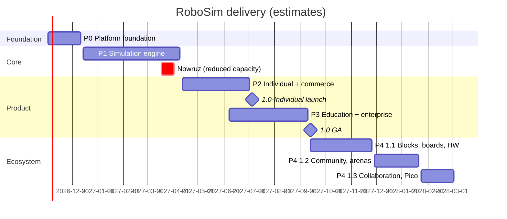

# RoboSim — Release Plan

**Version:** 1.0 · **Date:** 2026-10-13 · **Owner:** @MehranG (product), Engineering lead
**Related:** [PRD §9](PRD.md#9-release-mapping) · [BRD](BRD.md) · [User Stories](User-Stories.md)

---

## 1. Delivery approach

RoboSim is built as **one enterprise product delivered in phases**, not as an MVP that is later rewritten.

| Principle | Meaning |
|---|---|
| Production-grade from P0 | Security, tenancy (`workspace_id` + RLS), i18n, observability, CI gates, and the full data model exist from the first phase. No "we'll add it later" shortcuts. |
| Vertical slices | Each phase ends with working user journeys, not with layers. |
| Architecture for the end state | Organizations, entitlements, boards, and content registries are designed in P0/P1 even if their UI ships later, so later phases add features instead of refactoring foundations. |
| Exit criteria are tests | A phase exits when its criteria pass in CI/staging, not on a date. Dates are planning estimates. |
| Feature flags | Work for later phases may merge early behind flags. |

## 2. Phase overview

| Phase | Theme | Calendar (estimate) | Public milestone |
|---|---|---|---|
| **P0** | Platform foundation | 2026-11-02 → 2026-12-11 (6 w) | — |
| **P1** | Simulation engine | 2026-12-14 → 2027-04-09 (17 w incl. Nowruz) | Closed alpha (internal + 30 invited makers) |
| **P2** | Individual product & commerce | 2027-04-12 → 2027-07-02 (12 w) | **1.0-Individual public launch: 2027-07-05** (summer break) |
| **P3** | Education & enterprise | 2027-06-07 → 2027-09-10 (14 w, overlaps P2 tail) | **1.0 GA (Enterprise): 2027-09-13**, before the school year (1 Mehr) |
| **P4** | Ecosystem | 2027-09-13 → 2028-03-03 | 1.1 (Nov 2027), 1.2 (Jan 2028), 1.3 (Mar 2028) |
| **P5** | Expansion | from 2028-04 | 2.0 |

## 3. Phase details

### P0 — Platform foundation

**Scope**
- Monorepo per [Technical Design §3](Technical-Design.md#3-repository-layout); CI pipeline with all gates (lint, typecheck, arch rules, i18n, unit, integration, image scan, SBOM).
- Infrastructure: local Docker Compose (WSL2) and a Docker-free local mode on PGlite ([ADR-019](decisions.md#adr-019--pglite-for-docker-free-development-and-database-tests)); OpenTelemetry tracing hooks, structured JSON logs with request IDs.
- *Re-scoped 2026-10-13:* staging Kubernetes, Harbor/Verdaccio mirrors, CloudNativePG, OpenBao, observability stack, and Argo CD move to **P1 (Platform deployment track)** because no cluster or cloud provider is available yet (open question Q-5).
- `apps/web`, `apps/admin`, `apps/api` skeletons; design system (`packages/ui`) with RTL; i18n infrastructure (FR-I18N-01…04); feature flags (FR-ADM-09).
- Full database schema baseline for IAM, workspaces, memberships, audit, outbox, feature flags; RLS framework and isolation test harness.
- Personal workspace creation on user creation (internal only; auth UI comes in P2).
- Long-lead items started: eNamad, payment gateway contract, cloud contract, SMS/email providers, GPU capacity (§7).

**Exit criteria**
- `pnpm dev` brings the full stack up on a fresh WSL2 machine in < 30 min following the Engineering Guide (PGlite mode without Docker; Compose mode once Docker is installed).
- Switching to FA flips the app shell to RTL; i18n check and pseudo-locale build pass with zero hard-coded strings.
- Tenant-isolation test suite runs in CI (`pnpm verify` locally, GitHub Actions on every PR).
- API emits structured logs with correlation IDs; OTLP tracing activates when an endpoint is configured.

**P0 status (2026-10-13):** implemented. Verified: `pnpm verify` green from a clean checkout (25/25 tasks, 118 tests), all gates proven to fail on planted violations. Not yet verified: Docker Compose stack (no Docker host), GitHub Actions run (no remote yet), browser screenshot/visual check (headless Chromium system libraries missing in WSL).

### P1 — Simulation engine

**Platform deployment track (moved from P0):** staging Kubernetes (Helm umbrella chart, gVisor RuntimeClass node pool), Argo CD, Harbor + Verdaccio mirrors, CloudNativePG with PITR, Valkey, OpenBao + External Secrets, observability stack (OTel Collector, Prometheus, Loki, Tempo, Grafana, GlitchTip), outbox relay worker on BullMQ. Exit: staging deploys from `main` via Argo CD; dashboards show RED metrics and traces for the API; tenant-isolation suite also passes against real PostgreSQL 16.

**Scope** (FR-WRK-01…03, FR-CIR-01…06, 10, FR-COD-01, 03, 06, FR-BLD-01…06, FR-SIM-01…07, 09…11, FR-ARN-01…09, 11 (engine), FR-SAF-01, 02 (rules 1–11), 04…06, FR-EXT-01…03, 06)
- `sim-core`: netlist, MNA solver, scheduler, component bus, world model, physics, sensors, success-condition engine, determinism (dmath, PRNG).
- Board: Uno (avr8js). Components: all P1 rows of [PRD §7.2](PRD.md#72-components).
- Build service with gVisor sandbox, cache, fair-share, SSE.
- Circuit canvas, Monaco editor, serial monitor, pin inspector.
- 2D renderer, 3D renderer, mounting editor, built-in arenas.
- Safety checker (static + runtime) and damage model.
- Grader service skeleton running golden traces headless (used by CI now, by learning in P3).

**Exit criteria**
- Starter line-follower completes a lap of the oval in 2D and 3D; toggling views mid-run keeps time and pose identical (US-ARN-02).
- Peripheral conformance suite and golden traces pass in Node, Chrome, and Firefox. *(met 2026-10-20, Chromium + Firefox, bit-identical to Node)*
- Every GA safety rule (1–11) has trigger and clean fixtures passing.
- Sandbox escape suite passes; build p95 cold < 5 s and cached < 200 ms in staging load test.
- Simulation slice and frame budgets met on the reference laptop. *(met locally 2026-10-20; circuit canvas at 200 parts / 400 wires met 2026-10-21; `pnpm test:perf` and both frame budgets run report-only in CI)*
- Closed alpha: ≥ 20 of 30 invited makers complete the line-follower without help.

**P1 status (2026-10-14):** all 7 slices done — `packages/sim-core` foundation: contracts, `dmath` (fdlibm ports, golden bit patterns), `xoshiro128**` PRNG with per-component forks, union-find netlist, dense-LU MNA with PWL diodes, MCU component bus (output resistance, pull-ups, VIL/VIH hysteresis), fixed 1 ms slice scheduler with 2 ms physics cadence, and wall-clock pacer. **Slice 2 done (2026-10-14):** `packages/boards/avr-uno` — avr8js adapter implementing `McuCore` (cycle-exact scheduled inputs, register-derived PWM for timers 0/1/2, cycle-stamped output edges, USART0 TX/RX, ADC channels), Intel HEX loader, Uno pin map and power tree; PWM loads use phase-averaged operating points. Measured ≈ 3.3× real time in Node with a toggling pin. **Slice 3 done (2026-10-14):** catalogue components (electrical P1 set): resistor, potentiometer, LDR, LED, push button (4-leg), on/off switch, active buzzer, 9 V and 4×AA alkaline batteries, L298N, TT gear motor, SG90 servo, half/full breadboard. Plus `packages/catalog` (registry with FA/EN names), `packages/test-fixtures` (bench), and `pnpm new:component`. A drive-train test runs Uno PWM → L298N → TT motor on 4×AA end to end. Completing the PRD §7.2 basic set: HC-SR04 (cycle-precise echo, sub-millimetre ranging), TCRT5000, the 3-channel line module, and the 2WD chassis definition (geometry, inertia, mount slots). They work against the `WorldModel` interface, tested with a deterministic `TestArena`; the catalog test asserts the P1 set equals PRD §7.2's basic tier. **Slice 4 done (2026-10-14):** physics world. `PlanckWorld` (planck 1.5.0 with a deterministic-trig patch, ADR-021) provides wheel traction, lateral grip, rolling resistance, caster, walls, pushable obstacles, raycasts, a floor raster, and mounted component poses. TT motors couple to wheels as `WheelActuator`s. `packages/content` adds the built-in oval arena. The starter line follower (AVR firmware → L298N → 2 TT motors, 3-channel sensor) laps the oval in 14.47 s simulated time at ≈ 2.5× real time in Node, bit-identically across runs. **Simulator Lab (2026-10-14, pulled forward):** the web app's `/lab` page runs the engine in a Web Worker (`packages/sim-runtime`) with a Canvas 2D view (`packages/renderer-2d`). It shows the line follower lapping the oval with live telemetry, plus bench demos (blink, button, knob → LED PWM, knob → servo) in FA/EN. **Practice from here on:** every engine slice ends with a visible Lab demo. **Slice 5 done (2026-10-14):** safety checker and damage model. The FR-SAF-02 GA rules (1)–(11) run as static analysis (solved operating points, manifest-driven generic rules). Runtime rules cover pin over-current, outputs fighting, MCU total current, floating input, and component faults with sustain windows; Errors damage the part or pin (FR-SIM-10) until reset. Every rule has trigger + clean fixtures; findings are bilingual (title / why / how to fix). The Lab adds a **Safety** tab with miswired demos, a findings panel (severity filter, acknowledge warnings only) and damage badges. **Slice 6 done (2026-10-14):** success conditions (§5.7). A declarative `ChallengeSpec` covers every GA type (`reachZone`, `laps`, `checkpointsInOrder`, `timeLimit`, `noCollision`, `onLineRatio`, `serialMatches`, `pinState`, `pushOut`) with `all` / `any` / `not`, plus validation against the arena (zone and object ids, bounded regex). `ChallengeTracker` evaluates the tree live, decides on the exact slice, and computes the weighted score. Scoring was pulled forward from P2. The oval ships `oval-one-lap`: the line follower succeeds at 14.47 s with 100/100, and a stationary robot fails at the time limit. The Lab's arena tab shows a live checklist, highlights visited and next checkpoints on the canvas, pauses on decision, and shows a result card with the score breakdown (FA/EN). **Slice 7 done (2026-10-14):** worker protocol (§5.8). Snapshots are binary: the hot state (time, parts, pins, robot, challenge) is flattened into Float64 slots with a dictionary that is posted once per run. They travel through a double-buffered `SharedArrayBuffer` (seqlock via `Atomics`) or, without cross-origin isolation, as transferred `ArrayBuffer`s. Serial output, findings, faults and damage are events. Every run records a slice-stamped input log (component inputs and serial RX) with seed and `engineVersion`; replaying it reproduces the run slice for slice, through the worker or headless (`HeadlessRun`, the grader's loop). The Lab adds a Serial Monitor demo (greeting, ticks, upper-case echo), **Replay run**, and **Export input log**. **Slice 8 done (2026-10-14):** project document and loader (§8.10). There is a versioned `ProjectDocument` schema with forward migrations in `packages/shared`. A loader turns document + firmware into a run: circuit, board pins, robot from the chassis and mounts, arena, success conditions, and safety. `load { project, firmware }` and exported input logs are self-contained. The Lab demos are now documents with their Arduino sketches and replay bit-identically to the former hand-built scenarios. **Slice 9 done (2026-10-14):** grader skeleton and golden traces. `grade(job)` in `packages/sim-runtime` runs a self-contained input log headless and unpaced until the challenge decides or `maxSimSeconds` (≤ 300 s) is reached. It returns the outcome, score, findings, damage, serial output, and a 10 Hz trace (pose, pins, part states) with a SHA-256 digest. `apps/grader` wraps it as a CLI (job JSON → result + gzip trace). Eight golden fixtures (line-follower lap, bench demos with scripted inputs, serial echo, damage runs) must reproduce bit for bit in Node (`pnpm test:sim`). `pnpm golden:update` refuses to re-record without an `engineVersion` bump. The Lab adds **Verify run**: it grades the current run in a second worker and shows it is identical to the live run (checked in Chrome: arena mid-lap, end of the lap, and serial input). The Chrome/Firefox golden leg (Playwright) is still open. **Slice 10 done (2026-10-15):** build service, thin vertical (TD §6, ADR-022). `apps/compiler` compiles Arduino sketches with avr-gcc 7.3.0 against the pinned Arduino AVR core 1.8.6.
  - **Libraries:** Servo, NewPing, EEPROM, SPI, SoftwareSerial, Wire and HID. They are fetched by `pnpm compiler:setup` from GitHub/PlatformIO, because `downloads.arduino.cc` is unreachable from our network.
  - **Driver:** our own replacement for arduino-cli. It merges the `.ino` files, generates prototypes with `#line` mapping, resolves libraries from includes, links prebuilt core and library archives with LTO, and outputs HEX plus a flash/RAM report. Results are content-addressed and cached.
  - **Sandbox:** user builds run in a Linux-namespace sandbox with no network, a private `/proc`, only the work dir writable, home and project hidden, and resource and time limits.
  - **Diagnostics:** they map to the user's lines. 59 catalogued beginner errors have FA/EN explanations (FR-COD-03).
  - **API:** `POST /api/v1/builds` is synchronous, with `Idempotency-Key`, a 20/min rate limit and a 503 when the toolchain is missing. `GET /api/v1/artifacts/:id` serves the HEX.
  - **Demo firmware:** the built-in demos now run firmware compiled from their sketches, and the golden traces were re-recorded. The line follower still laps in 14.47 s. The compiled build exposed a real wiring bug: D10/IN4 was left floating, and the safety checker flagged it.
  - **Lab:** a **Your code** tab edits a demo's sketch, compiles it, shows errors on their lines with plain-language explanations, and runs the firmware on the same circuit. Replay, export and Verify all work on these runs.
  - **Next:** the queue/SSE/MinIO/quota half of §6 (with Redis), editors and renderers. *The queue, SSE and quotas were done 2026-10-21 with in-process adapters (build queue, below); Redis and MinIO adapters wait for the deployment track.*

  **Slice 11 done (2026-10-15):** circuit canvas, thin vertical (FR-CIR-01..06, 10; ADR-005).
  - **Canvas:** `packages/circuit-canvas` is a React SVG breadboard editor with one root transform for pan, wheel zoom and zoom-to-fit. Parts drag on the 0.1" grid and can be rotated, flipped, duplicated and deleted, with keyboard shortcuts and arrow-key nudging. Undo/redo keeps 200 steps.
  - **Wiring:** wires run pin to pin (board header, part pins, breadboard holes) with bend points and colour swatches. Ground and 5 V wires default to black and red. Hovering a pin shows its name and highlights its whole net.
  - **Breadboards:** legs that land on a hole are plugged in (`seats`, project schema v2). Parts plugged into a breadboard move with it. The simulator treats breadboard strips as conductors, so unused holes cost nothing; the demos' golden traces are unchanged.
  - **Library and properties:** library search works in Persian and English at once, including ي/ك, ZWNJ and Persian digits, with a category filter; click or drag to add a part. The property panel is driven by the manifest: numbers within range (out-of-range values are rejected with an explanation), the E12 picker for resistors, enums and switches. With nothing selected, it lists the parts accessibly.
  - **Art:** every catalogue part has hand-drawn art. Resistors show their colour bands, and LEDs glow live while the simulation runs.
  - **Lab:** a **Design a circuit** tab starts from an Uno + breadboard blink, opens any demo, and imports or exports the project JSON (autosaved in the browser). **Compile & run** compiles the sketch and simulates exactly the drawn circuit; a note appears when the drawing has changed since the run. Checked in Chrome with the Persian UI.
  - **Still open:** nothing from this slice: *the server projects API was done 2026-10-21 (projects API, below).* *Box select, align, minimap, the 60 FPS gate and a movable board were done 2026-10-21 (canvas completion, below).*

  **Slice 12 done (2026-10-15):** editor workspace (FR-WRK-01…03, FR-SIM-11).
  - **Workspace:** `/editor` is the app's project screen: parts library with properties, circuit canvas, simulation view (robot projects), code, and a bottom dock with serial monitor, pin inspector, safety findings and the challenge. Panes resize with keyboard-accessible splitters (they mirror in RTL), collapse to rails, and the layout is saved in the browser. Drag-to-rearrange docking comes later.
  - **Toolbar:** project name, New, Open demo, Import, Export, Save; Run/Pause, Step, Stop, Reset, speed 0.25–4×, and the real-time factor. Shortcuts: F5, Shift+F5, F10, F6, Ctrl+S and F1 (help).
  - **Run model:** one Run button compiles only when the code changed (an unchanged demo runs without the build service), loads exactly the drawn project and starts it. Any edit while running stops the run, so the simulation always matches the drawing.
  - **Inputs on the canvas:** while running, hold a push button, toggle a switch, or click a knob or sensor for sliders. LEDs, buttons, the servo horn, motor speed and the buzzer show live state, and damaged parts show an icon with text.
  - **Small screens:** below 1024 px the panes become tabs; below 768 px the workspace is view-and-run only, with a banner.
  - **Lab:** the Design tab moved into the workspace; every Lab demo has **Open in editor**. Checked in Chrome (Persian UI): compile and run, button held on the canvas, edit stops the run, demos open with confirmation, line follower in the arena pane, narrow view.
  - **Still open:** drag-docking, Monaco (slice 13), 2D/3D toggle (slice 17), Versions/Share (P2).

  **Slice 13 done (2026-10-17):** code editor, pin inspector and serial monitor (FR-COD-01, 03; FR-SIM-06; FR-SIM-07 monitor).
  - **Code editor:** Monaco, lazy-loaded and self-hosted (≈ 0.87 MB gz, initial JS unchanged at 256 KB gz). Arduino-aware highlighting, basic completions for the core API, Serial, Servo, NewPing and String (`Serial.` lists Serial's methods), find/replace, bracket matching and folding. It is always LTR, with no ligatures. Sketches can have several files: add, rename and delete `.h`/`.cpp` tabs, and all files build together (US-COD-01 AC2). Compile errors are underlined in their file, tabs show error counts, and clicking an explanation opens the right file and line. The Lab's **Your code** tab uses the same editor.
  - **Pin inspector:** every Uno pin with mode (including pull-up), level, PWM duty **and frequency** (`analogWrite(5, 64)` → 25 % at 977 Hz, US-SIM-02 AC1), voltage, and the `analogRead` value on A0–A5. Unconnected pins are dimmed and can be hidden; floating inputs are flagged.
  - **Serial monitor:** baud selection, line ending (none / NL / CR / both), simulated-time timestamps, autoscroll, clear. The monitor decodes the raw UART bytes at its own baud: when it differs from `Serial.begin`, the output is garbled exactly as on a real board, with a bilingual hint and a one-click switch to the sketch's rate.
  - **Engine:** `sim-runtime` 0.2.0 (pin views carry `freqHz`; goldens re-recorded, otherwise identical). Checked in Chrome (Persian UI): completions, a header tab, an inline error with its explanation, garbled → clean serial with timestamps, PWM Hz on the dimmer, the Lab editor.
  - **Still open:** hover docs in FA/EN and the library manager (FR-COD-02, 07, P2); the plotter (P2); characters sent at a mismatched baud are not garbled on the way in.

  **Slice 14 done (2026-10-17):** the arena in the workspace (FR-ARN-05, 06, 07; US-ARN-04, 05).
  - **Built-in arenas:** eight arenas in five families. Line tracks: the oval, the oval with four 4 cm gaps, a track with 90° turns, and a figure eight crossing at 90°. Also an obstacle course, a 5 × 5 maze, a 1.54 m sumo ring with a pushable 500 g block, and an open floor. Each has a default challenge (none for the open floor). They are plain data in `@robosim/content/arenas`, so the editor uses them without the engine. Run headless, the stock line follower completes all four line tracks: oval 14.47 s, gaps 14.47 s, 90° turns 17.58 s, figure eight 16.85 s.
  - **Arena picker:** a dialog with thumbnails drawn from each spec, plus "No arena". Picking an arena takes its start pose and challenge, and asks first if the success conditions were edited.
  - **Start pose:** while stopped, drag the robot to move it and drag the orange handle to turn it (Shift snaps to 15°). Exact x / y (cm) and heading (°) fields and **Arena start** are also available. A pose that puts the robot off the mat or onto an obstacle is refused in the editor and rejected by the loader (same deterministic check). The pose is saved in the project.
  - **2D view:** the floor is painted from vectors, crisp at any zoom. Zoom with the wheel, the buttons or + / − / 0; drag to pan; **Fit**. The view also has **Follow**, **Trail** and **Sensors**, the last showing line-sensor spots with their reading, the ultrasonic 15° cone with its range, and wheel speeds in m/s. Obstacles are drawn, and pushable ones move. The Lab's arena tab uses the same view.
  - **Engine:** live frames carry pushable-obstacle poses and the scene carries mount positions. The grader trace is unchanged: goldens are identical and there is no `engineVersion` bump. Checked in Chrome (Persian UI): drag, rotate, a refused drag into the wall, picker thumbnails, a figure-eight lap with Follow and Sensors, the sumo ring, and wheel zoom on the maze.
  - **Still open:** firmware for the non-line arenas (obstacle avoider, maze solver, sumo); arena editor (FR-ARN-10, P4); bump switches (slice 16c); 3D view (slice 17).

  **Slice 15 done (2026-10-17):** mounting editor (FR-ARN-09; US-ARN-06).
  - **Robot view:** the editor's centre pane switches between **Circuit** and **Robot** (a tab on small screens). The Robot view shows the chassis from above with its wheels, caster, slots and the front overhang zone. Drag a part to move it: it snaps to a slot or the 1 mm grid, and Shift places it freely. The orange handle turns it in 15° steps. Exact x / y / height / turn fields are also available. Arrow keys nudge a part, R turns it, and Delete takes it off. An "On the robot" list selects parts hidden under the stack, and a tray holds parts not yet mounted, ready to drag or click on. The board can be placed too. TT motors only switch sides, and the track width and wheel diameter are editable chassis props that move the motors with them.
  - **Rules:** a spot off the chassis is refused with an explanation, in the editor and by the loader alike. Sensors may overhang the front by up to 6 cm. Parts that take the same space are flagged, as is a missing motor on either side.
  - **Mass distribution:** every part is a point mass with its own inertia, so moving the battery moves the centre of mass, changes the inertia and shifts the load between the drive wheels and the caster. The Robot view shows total mass, the centre of mass (also drawn as a marker) and the drive-wheel share. It uses the same function as physics, and a test checks that the two agree.
  - **Engine:** `sim-core` 0.2.0 and `sim-runtime` 0.3.0 (physics changed, goldens re-recorded). Project schema v3 adds `board.mount`. Manifests gain `mounting` footprints. The stock line follower was re-laid out without overlaps and now laps the oval in 14.43 s (was 14.47 s). US-ARN-06 AC1 is a loader test: moving the line sensor 2 cm forward moves its sample point by exactly 2 cm.
  - **Checked in Chrome (Persian UI):** the line sensor dragged 2 cm forward, a refused drag off the side, a 90° turn with the handle, deck stacking from the tray, track width 150 mm moving the motors, and the edited robot lapping the oval.
  - **Still open:** the 3D model showing the mount (US-ARN-06 AC1, second half; slice 17); servo-mounted sensors (a sonar on a sweeping servo); a chassis drawn from per-part art.

  **Catalogue expansion, Tier A (slices 16a–c, planned):** 31 parts that the P1 engine can already simulate ([PRD §7.2](PRD.md#72-components)). Every part ships with a datasheet-calibrated model and tests, FA/EN name, art with live state, safety limits, a mounting footprint when it fits on a robot, and a demo project. Fundamentals are `basic`, modules are `pro`. New manifest categories: `semiconductor` and `ic`.
  - **16a — discrete parts, outputs, power (done 2026-10-17):** 1N4007, 1N4148, 5.1 V Zener (two PWL diodes back to back); RGB LED (common cathode or anode); passive buzzer (tone frequency from cycle-stamped edges, audible in the browser); 1-channel 5 V relay module (H/L trigger, coil current, COM/NO/NC contacts with switching delay); MG996R servo; single 7-segment digit (CC/CA); LM7805 and AMS1117-3.3 (dropout, current limit, power dissipation); LM2596 buck module (set output, efficiency, input current from output power). No engine change; goldens identical.
  - **16a delivered:** 11 parts in 7 new packages (`diode`, `led-rgb`, `buzzer-passive`, `relay-module`, `seven-segment`, `linear-regulator`, `lm2596`), with `sg90-servo` generalised to `servo` (SG90 + MG996R). Categories `semiconductor` and `ic` are in the library filter. Each part has art with live state: mixed RGB colour, lit segments, the relay contact arm, the regulator heating up, the buzzer's tone in Hz. The editor has a **Sound** toggle that plays both buzzers through Web Audio (off by default, remembered). Two demos, both free of safety findings: *RGB mood light + melody* and *Relay counter* (7-segment, relay switching a separate 9 V → LM7805 lamp circuit).
    - **Engine fixes found along the way:** inputs settle at power-on and on pin-mode changes (a fresh `INPUT_PULLUP` read 0 V for up to 1 ms, a phantom button press at start-up). MCU edges and PWM pass through series resistors (`signalPassthrough`), so a buzzer or servo behind its resistor hears its signal. New manifest fields `bondedPins` (a simulated part's internal joins) and `isolationGroups` (relay coil vs contacts) make the common-ground rule precise.
    - **Versions:** `sim-core` 0.3.0, `board-avr-uno` 0.2.0, components 0.2.0, `safety-rules` 0.2.0, `sim-runtime` 0.4.0. Only the servo-sweep golden changed in substance (its first `analogRead` now sees the knob); the others differ only in the engine version. The line follower still laps the oval in 14.43 s.
    - **Checked in Chrome (Persian UI):** library filtered to semiconductors, the relay counter counting 0 → 2 with the relay closing on even numbers, and the RGB demo at 331 Hz with the button held, all at 1.0× real time.
  - **16b — drivers and logic ICs (done 2026-10-17):** TB6612FNG and L9110S (H-bridges with MOSFET on-resistance, standby, brake/coast); ULN2003A Darlington array (saturation voltage, COM clamp diodes) and the 28BYJ-48 stepper (coil sequence → step, missed steps above the pull-in rate, 2048 steps per output turn); 74HC00/08/32/86 gates, 74HC14 Schmitt inverter, 74HC595 shift register (clocked from cycle-stamped edges, so `shiftOut` works), CD4017 decade counter. DIP parts straddle the breadboard channel. Engine: an opt-in `settle()` pass resolves gate chains inside one slice, and an MCU-edge fast path lets a part answer the firmware within the same CPU cycle. Neither changes existing goldens. The Arduino Stepper library joins the build allow-list.
  - **16b delivered:** 11 parts in 7 packages (`logic-74hc` with five variants, `shift-register-595`, `counter-4017`, `uln2003`, `stepper-28byj48`, `tb6612`, `l9110s`). DIP chips draw as chips straddling the channel, with lit output dots while running; the stepper's shaft turns on the canvas. Engine: `settle()`, `logicNets()` + `mcuEdge()` (a gate read back by the firmware answers at the next instruction, proven against real AVR code), `io.emitEdge()` with producer-first ordering, and the `SAF-LOGIC-OSCILLATION` warning. All are opt-in, so goldens are unchanged. Arduino **Stepper 1.1.3** and **Keypad 3.1.1** are pinned in the toolchain lock, with editor completions. Four demos, all free of findings: *Half adder* (74HC86 + 74HC08, Uno reads and prints), *LED bar* (`shiftOut` into a 74HC595), *Stepper follows a knob* (Stepper library → ULN2003A → 28BYJ-48), and *Two motors on a TB6612FNG*. The CD4017 and L9110S are covered by model tests.
    - **Checked in Chrome (Persian UI):** half adder with serial output, LED bar mid-sweep, stepper shaft at 180° after 2.5 s at 12 rpm, and both motors at ±117 rpm, all at 1.0× real time.
  - **16c — sensors and input modules (done 2026-10-17):** bump/limit switch (lever reach on the robot, pressed by walls and obstacles); 5-channel line array; FC-51 IR obstacle sensor; HC-SR501 PIR (hold time, retrigger); KY-038 sound sensor; soil-moisture probe; KY-023 joystick; 4×4 membrane keypad (row scanning through the fast path, Keypad library); KY-040 rotary encoder (quadrature with detents and bounce-free contacts).
  - **Exit:** every part passes its model tests and has trigger + clean fixtures for the safety rules it touches; one demo per slice runs in the editor and the Lab; `pnpm verify` green; browser check in Persian. The bump-switch obstacle avoider reaches the goal of the obstacle course.
  - **16c delivered:** 9 parts in 9 packages (`bump-switch`, `line-5ch`, `ir-obstacle`, `pir`, `sound-sensor`, `soil-moisture`, `joystick`, `keypad`, `rotary-encoder`). In run mode, a keypad's keys and a joystick or encoder push are pressed where they are drawn (`data-input` in the art, interaction kind `keys`). The arena overlay shows the 5-channel spots and the FC-51 beam. Three demos, all free of findings: *Keypad lock* (Keypad library, 1234#), *Encoder and joystick* (quadrature counting, both axes), and *Bump-and-turn obstacle avoider* (three lever switches, reaches the obstacle-course goal in 23 s simulated).
    - **Engine fixes found along the way:** planck's 1 cm contact skin kept every two boxes 2 cm apart, so bumpers never touched. Polygons are now inset and the perimeter moved out by the skin, and ray casts add it back, so contact and distances match the true outlines. Goldens are unchanged. `io.scheduleMcuInput` never overrides a pin the firmware is driving. The floating-input rule skips multiplexed lines (a pin that was an output within the last 0.5 s, such as keypad columns between scans).
    - **Checked in Chrome (Persian UI):** keypad unlocked by clicking 1-2-3-4-#, the encoder counting 1…5 from its slider, and the avoider working around the first block.

**P1 hardening done (2026-10-20):** (1) Golden traces: 31 fixtures, one per built-in scenario (a suite test asserts coverage of `SCENARIOS`), now also run in headless Chromium + Firefox via Vitest browser mode (Playwright), on the main thread and inside a Web Worker. Results are bit-identical to Node, not within tolerance (dmath/fdlibm). (2) Peripheral conformance: 10 sketches / 33 tests in `packages/boards/avr-uno/test/conformance`, passing in Node and both browsers (66 browser tests). It found and fixed EEPROM, double-buffered UART TX and UCSRA read-only bits (board-avr-uno 0.4.0). Kept as real-Uno behaviour or documented gaps: watchdog not emulated; `pulseIn` under-reads long pulses (millis ISR), ISR jitter, Timer0 PWM 1-tick. (3) Performance: `pnpm test:perf` (Node script against built dist) measures the line-follower lap at 0.303 ms/slice (budget 0.35), static analysis at 200 parts ≈ 14 ms, netlist at 200 parts within budget. Speed-ups: table-dispatched AVR decoder generated from avr8js (about 2×) and LU factor reuse in `MnaCircuit` (bit-identical). The 2D frame budget (< 8 ms, 8 arenas × fit/zoom, Chromium + Firefox, mean + p95) measures a worst mean ≈ 2.9 ms and worst frame 5.8 ms. Slow demos not gated: mosfet-ramp ≈ 0.37, transistor-motor and motor-driver ≈ 0.26–0.28 ms/slice. (4) Robustness: seeded fuzzing at the grader trust boundary, corrupted Intel HEX and runaway-firmware cases, and a full 300 s long run. Input logs are now validated before slice 0 (typed `InputLogError` lists every bad entry; out-of-range values are refused, not clamped), and the project loader checks initial `inputs` against the manifest. Runaway firmware is bounded by the deterministic sim-time cap only, with no wall-clock limit. Earlier: serial output cap, O(1) UART RX queue, Lab stall watchdog, worker error → Restart. (5) Scripts: `pnpm test:sim` = `test:sim:node` + `test:sim:browser` + 2D frame budget; `pnpm test:perf` for slice budgets. (6) CI: new `sim` job gates `test:sim:node` and `test:sim:browser`; the 2D frame budget and `test:perf` are report-only (`continue-on-error`, noisy shared runners). Browser cache is a follow-up.

**Code-aware safety done (2026-10-20):** FR-COD-06 and FR-SAF-03 (pulled forward from P2). New `packages/code-analysis` (tree-sitter C++ via WASM, lazy-loaded, outside the initial bundle) extracts pin usage from the sketch; constants it cannot resolve are reported as unresolved, never guessed. Four static rules: PWM on a non-PWM pin, output conflict, floating input, servo vs Timer1 PWM, with file/line/column refs shown as Monaco markers and a "Safety checks in the code" list (EN + FA, checked in Chromium). Drive probes now follow the sketch when the facts are complete. Engine versions: sim-core 0.5.0, safety-rules 0.4.0, sim-runtime 0.6.0, code-analysis 0.1.0. Goldens re-recorded; only floating-input and outputs-fighting results changed (one added static finding each), all traces bit-identical. `pnpm verify` and `test:sim` (Node + browser) green.

**Arena demos done (2026-10-20):** starter robots for the last two arena families (closes slice 14's open item).
  - **Maze solver** (`maze-solver`): three HC-SR04s (front, left, right) with NewPing on the line follower's drive train. It moves one 45 cm cell at a time: in the middle of a cell it turns right if it can, else goes straight, else left, else turns around. Between cells it steers to the middle of the corridor (PD on the side walls), and the front sonar is its odometer (a cell ends when the wall ahead is 45 cm closer). Turns are timed with active braking on the L298N. It reaches the maze goal in 27.6 s with no collisions, also from starts moved ±2 cm or turned ±5°.
  - **Sumo bot** (`sumo-bot`): an HC-SR04 searches by turning slowly and charges anything within 85 cm; the 3-channel line sensor sees the white edge and the robot backs off toward the middle. When it presses against the block, the echo is under the HC-SR04's 2 cm minimum, so it keeps pushing for 400 ms after last sight. It pushes the block out at 6.5 s from the default start (score 100) and wins from any start heading (8–29 s).
  - **New constraint `stayInZone`:** the robot's axle midpoint must not leave a zone (FR-ARN-11). The sumo challenge is now push-out ∧ stay in the ring ∧ 60 s. All built-in challenges have FA/EN names in the challenge panel; before this, only the oval's had one.
  - **Engine:** `sim-core` 0.6.0, `sim-runtime` 0.7.0. Goldens re-recorded: 32 existing results differ only in `engineVersion`; 2 new fixtures (`maze-solver`, `sumo-bot`). The browser golden leg also runs `sumo-bot`.

**Canvas completion done (2026-10-21):** the circuit canvas leftovers of slice 11 (FR-CIR-01, FR-CIR-06; US-CIR-05).
  - **Selection:** dragging the background draws a selection band; parts entirely inside it are selected (Shift adds to the selection). Shift- or Ctrl-click toggles a part, and Ctrl+A selects everything. Panning moved to Space + drag, the middle mouse button or a finger.
  - **Group editing:** move, rotate, flip, duplicate (Ctrl+D) and delete work on the whole selection as one undo step. A group turns and mirrors as one rigid body around the grid point nearest its centre; a single part still turns around its first leg. A breadboard always takes the parts plugged into it along. Duplicate copies the wires that run between copied parts, and a copied breadboard is placed below the original, so its parts do not plug back into the old one.
  - **Align and distribute:** a toolbar appears for two or more parts: left / centre / right / top / middle / bottom, and distribute horizontally or vertically for three or more, with equal gaps between the parts' outlines. Results stay on the 0.1" grid, so edges line up to within half a pitch, and legs are re-seated.
  - **Movable board:** the Uno can be selected, dragged, nudged, turned and aligned like a part, but not mirrored, copied or deleted. Project schema v4 adds optional `board.position { x, y, rotation }` (identity migration from v3). The loader ignores it, because it is layout only: there was no engine bump and the goldens are unchanged.
  - **Minimap:** an overview in the corner shows the board and every part with the visible area outlined. Click or drag on it to move the view. Toggle it with its button or M; the choice is saved in the browser.
  - **60 FPS at 200 parts / 400 wires:** the scene is split into memoised layers (board, parts, pin targets, wires), so pan and zoom only change the root transform and a drag re-renders just what moves. `packages/circuit-canvas/src/canvas-frame.browser.test.tsx` builds 4 full breadboards, 196 parts and 400 bent wires (≈ 11 500 SVG nodes) on a 1280 × 800 canvas. It pans, wheel-zooms, drags one part, drags 20 parts and hovers pins, one event per animation frame, in Chromium and Firefox with the production React build. It gates the p95 of the main-thread work (event, render, commit, layout) at < 16.7 ms and of the frame interval at < 25 ms (no dropped frames). Measured locally: worst work p95 ≈ 8–10 ms (Firefox, 1 ms timer resolution), frames ≈ 16.7–17.2 ms. It is part of `pnpm test:sim`, and report-only in CI.
  - **Fixed along the way:** Duplicate in the property panel and adding a part from the library read the new ids from inside a state updater that React runs later, so the copies were not selected reliably.

**Projects API done (2026-10-21):** server projects with versions (FR-PRJ-01/03 thin, pulled forward from P2; API Spec §4.4; closes slice 11's open item).
  - **API:** `apps/api` module `projects` with `projects` + `project_versions` (migration `0002_projects`, RLS on the workspace). List with search, tag, sort and keyset cursors; create, get, rename/retag, save the document, soft delete with a 30-day trash and restore, duplicate. Saves need `If-Match` (`412` when someone saved first). Versions: named checkpoints, an automatic version for every successful build of the saved sources (deduplicated), and restore as a new version. Documents are migrated, validated and capped at 1 MiB. Contracts live in `packages/shared` (`project-api.ts`).
  - **Identity until sign-in (P2):** a development identity (`DEV_IDENTITY`, `X-Dev-User`) creates the user and personal workspace on first use; it is refused in staging and production, where tenant routes answer `401`.
  - **Web:** a **My projects** page (`/projects`: search, sort, new, import, rename, duplicate, delete with undo, trash). `/editor/$projectId` opens a cloud project: autosave every 30 s, on Ctrl+S, when the tab is hidden and when the connection returns; a per-project draft in the browser keeps unsaved work across closed tabs and offline periods; a conflict dialog when another tab or device saved first; a **Versions** dialog (checkpoint, restore). Run saves first and builds with the project id, so the build becomes a version. The browser project in `/editor` gets **Save to my projects**.
  - **Not yet:** move between workspaces, diff and `.robosim` files stay in P2; the trash is not purged yet. (Plan quotas `projects.cloud_max` and version retention landed with Plans & entitlements; sharing landed on 2026-10-21.)

**Build queue done (2026-10-21):** the queue/SSE/quota half of the build service (TD §6, API Spec §4.5; closes slice 10's "Next").
  - **API:** `POST /builds` answers a cache hit with `200 BuildResult` and queues everything else (`202` + `Location`). `GET /builds/:id` returns the job status, and `GET /builds/:id/events` streams it over SSE: `queued{position}` → `running` → `succeeded` / `failed` with the result, or `error` with a code. Each connection starts with the current status. Builds are scoped to the user (guests by client address).
  - **Fair share:** deficit round robin across workspace queues, weighted by `build.priority`, with at most 2 running builds per user. A crashed build is retried once.
  - **Limits:** 20 builds/min per user and 5 per guest. A daily quota of queued builds per user (`build.daily_quota` from the plan: Free 30; guests 10 per address; Tehran day since 2026-10-24, it was `BUILD_DAILY_QUOTA` = 200 per UTC day) answers `429 build_quota_exceeded` with the reset time; cache hits are free.
  - **Ports:** queue (`BuildQueue`) and firmware store (`ArtifactStore`) have in-process and filesystem adapters (`.local/artifacts`), because there is no Docker in development. The Redis and S3/MinIO adapters, and the shared rate/quota/idempotency store, come with the platform deployment track.
  - **Web:** the editor and the Lab follow a queued build over `EventSource`, falling back to polling. The status bar and the Run/Compile buttons show "Queued, #n in line" and then "Compiling" (FA/EN).
  - **Not yet:** cancellation and per-IP limits for signed-in users. (Plan entitlements landed on 2026-10-24: the quota and the queue weight come from the plan.) A restart forgets jobs that were queued or running.

**Authentication done (2026-10-21):** email + password accounts with sessions and recovery (FR-IAM-01 email half, FR-IAM-03; US-IAM-02 AC2; API Spec §2, §4.1; pulled forward from P2).
  - **API:** sign-up (date of birth applies the minors rules), sign-in, sign-out, email verification with resend, password reset, password change, profile (`/me`), and session list / revoke / sign out everywhere else. Migration `0003_auth` adds `sessions` and `auth_tokens` (TD §8.2) and lockout columns on `users`; sessions are readable only by their owner under RLS, tokens only by system code.
  - **Security:** argon2id (m = 64 MiB, t = 3, p = 1) from `node:crypto` (Node ≥ 24.7); `__Host-` HttpOnly Secure SameSite=Lax cookies; double-submit CSRF; a new session on every sign-in; sessions bound to the browser family and ended after 30 idle days; 10 auth requests/min per address; five failures lock sign-in for 15 minutes; the same `invalid_credentials` (and the same argon2 time) for unknown emails; reset requests always answer `202`.
  - **Mail:** a `Mailer` port with a development sink. Messages (verify, reset, password changed) are FA/EN in the user's language; the web app's **/dev/mail** page shows them with a one-click link.
  - **Web:** Sign in, Create account, Forgot / Reset password, Verify email and Account (profile and language, password, sessions) pages, an account menu in the header, an email-verification banner, and a sign-in prompt on My projects and cloud projects that returns to the page afterwards (FA/EN, RTL).
  - **Development identity:** now opt-in (`DEV_IDENTITY=true`), meant for tests and scripts; local development signs in like production.
  - **Not yet (auth):** SMS OTP (US-IAM-01 AC1), TOTP and recovery codes (US-IAM-02 AC1), guardian consent (13–15 accounts stay `pending_consent` with a notice), the breached-password list (a short common-password list stands in), the SMTP adapter, `/me/workspaces`, data export and deletion, and a Jalali date picker for the date of birth.

**Sharing done (2026-10-21):** share links and sharing with people (FR-PRJ-04 without org policy; US-PRJ-03 AC1; API Spec §4.4; pulled forward from P2).
  - **Links:** the owner turns on a read-only link, optionally remixable, can copy it again at any time, make a new one (the old stops working) or turn it off. Anyone with the link opens the project in the editor read-only and can run it (builds as a guest); **Remix** copies it into the visitor's account with "Remixed from … by …", and asks a signed-out visitor to sign in first.
  - **People:** share by email with an existing account as **Can view** or **Can edit**, change the role or remove them; the person gets an email (FA/EN) and finds it under **Shared with me** on the projects page, where they can also leave it. Editors save with the usual autosave and conflict handling and take versions; viewers get the read-only editor with **Make a copy**; only the owner deletes, tags or shares.
  - **Data and security:** migration `0004_sharing` (`project_shares`, link and attribution columns). Access is enforced twice, in the services and by RLS policies for sharees. Link tokens are HMAC-derived from `SHARE_LINK_SECRET` and stored only as a hash; link lookups are limited per address.
  - **Not yet:** the `comment` role (comments are P4), workspace-wide sharing and org policy limits (US-PRJ-03 AC2, with organizations in P3), invitations for emails without an account, and real-time co-editing (FR-PRJ-08).

**Plans & entitlements done (2026-10-24):** the entitlement resolver, plan versions, enforcement and the first back office (FR-BIL-01 thin, FR-BIL-04, FR-BIL-05, FR-ADM-02/06 thin, FR-PRJ-03 retention; US-BIL-04 AC; API Spec §4.1, §4.9, §4.13; TD §8.7, §9.1; [ADR-023](decisions.md#adr-023--entitlements-resolved-in-process-from-plan-versions--overrides-grants-only-raise); pulled forward from P2).
  - **Decisions:** no trial yet, so every workspace (existing and new) is on Free until staff set a plan (the 14-day Maker trial waits for checkout). Over the Free cap the most recently updated projects stay editable and the rest are read-only. Retention keeps named checkpoints. Upgrade buttons lead to `/plans`, where checkout says "coming soon". Staff use the same accounts plus `staff_roles`. Daily quotas reset at 00:00 Asia/Tehran (TD §9.1).
  - **Data:** migration `0005_entitlements`: `plans`, `plan_versions`, `subscriptions` (one per workspace), `entitlement_overrides`, and v1 of Free, Maker, Classroom and Institution seeded from the PRD §3 values (prices not set). Plans and versions are a read-only catalogue for the app role; a workspace sees only its own subscription and overrides under RLS; every write is staff or system code. `app_project_rank(project)` (SECURITY DEFINER) lets a request, including a sharee's, tell whether a project is over the cap.
  - **Resolver:** `EntitlementsService` resolves `(workspace, user)` as the live subscription's plan version (active or trialing, period not ended), else the current Free version (shown as `expired` after a lapse), merged with unexpired overrides. Quotas add (null = unlimited wins), booleans OR, ordered settings take the higher, boards are united, so overrides only raise. Keys added after a version was published fall back to Free's value. Results are cached in-process for `ENTITLEMENTS_CACHE_MS` (60 s at most) and dropped when staff change something. `QuotaService` keeps daily counters in process (a restart refills them).
  - **API:** `GET /me/entitlements` (plan, features, quotas with `used` and `resetsAt` for cloud projects and builds, settings, restrictions), public `GET /plans`, and under `/admin` (staff only; read = platform admin, finance or support; plans and subscriptions = platform admin or finance; overrides = all three): `me`, `plans`, publish a plan version, workspace search and detail, set a workspace's plan (`free` removes the subscription), grant and remove overrides. Every admin change is audited as `staff` and drops the cache; subscription changes emit `bil.subscription_changed`. A new plan version retires the current one: Free applies to everyone at once, paid subscribers keep theirs until set again. `pnpm admin:grant <email> <role> [--revoke]` bootstraps staff roles.
  - **Enforcement:** builds check `boards.allowed` (`403 entitlement_required`) and consume `build.daily_quota` per user (`429 build_quota_exceeded` with `limit`, `resetAt` and `suggestedPlan` for signed-in users); `build.priority` sets the queue weight (low 1, normal 2, high 4). Projects check `projects.cloud_max` on create (and import), duplicate, remix and restore from the trash (`403 quota_exceeded`). Over the cap, saves, renames, checkpoints and version restores answer `403 quota_exceeded` with `locked: true`; delete still works and automatic build versions skip locked projects. The cap and the tier are the project owner's, so sharees inherit them. With `components.tier` basic, saving, creating or restoring a document with a pro part answers `403 entitlement_required` listing the parts (17 catalogue parts are `pro`). `projects.version_retention_days`: a daily in-process job (`VERSION_RETENTION_INTERVAL_HOURS`, default 24, 0 = off) deletes automatic and restore versions past the owner's retention, keeps named checkpoints and each project's latest version, and audits per workspace; `pnpm versions:purge [--dry-run]` runs it by hand. `BUILD_DAILY_QUOTA` is gone.
  - **Web:** public `/plans` page (Free and Maker, current plan marked, Upgrade disabled with "Payments are coming soon") and a header link; **Account → Plan & usage** with meters and the reset time; a paywall dialog for `quota_exceeded`, `entitlement_required` and `build_quota_exceeded` (what is blocked, why, Maker, pro parts by name; **See plans**, **Download a copy**, **Not now**); locked projects show a "Read-only" badge and open read-only with a banner; "n of 3 cloud projects" on My projects; a refused autosave shows the paywall once and is not resent until the document changes; Pro badges in the parts library. New `plans` namespace (FA/EN).
  - **Admin:** the first real back office in `apps/admin`: staff gate (`401` → sign in, `403` → no access), Plans (versions by group, history, publish a new version with a change summary), Workspaces (search, detail with effective entitlements and override marks, change plan with reason and end date, grant and remove overrides, live project count), FA/EN with RTL, permission-aware. Initial JS 288 KB of the 300 KB gzip budget.
  - **Tests:** `test/entitlements.test.ts` (15) and `quota.service.test.ts`; API suite 156 tests.
  - **Not yet:** checkout and payments, trials, coupons, wallet, invoices; the Redis cache and quota store with event-driven invalidation; org policy and age-band limits (P3); pooling `projects.cloud_max` for organizations; admin overrides for members other than the owner; `export.pdf` and AI credit enforcement (those features are not built); the trash purge.

**Parts list done (2026-10-25):** parts list (BOM), wiring guide, exports and `.robosim` files (FR-BOM-01, FR-BOM-02 thin, FR-BOM-03, FR-BOM-04, FR-BOM-05 partial, FR-PRJ-06; API Spec §4.3, §4.4, §4.12, §4.13; TD §8.4, §15; [ADR-024](decisions.md#adr-024--parts-list-computed-in-the-browser-from-the-document-interim-staff-price-list-keyed-by-part-key); pulled forward from P2).
  - **Decisions:** prices come from an admin-editable price list (`catalog_prices`) until the shop catalogue (FR-SHP-01) replaces it, and the BOM shows "price as of" = the latest change. Parts the user owns are kept per user on the server when signed in; guests keep them in the browser (`robosim.inventory.v1`), and on sign-in the guest marks merge into the account (the larger count wins) and leave the browser. All exports in this slice (`.robosim`, CSV, XLSX, SVG, PNG) are free on every plan and for guests; only the future PDF exports need `export.pdf`, and PDF waits for the server-side export service ([ADR-008](decisions.md#adr-008--server-side-pdf-rendering-with-headless-chromium)). The BOM and the wiring guide are two new tabs in the editor's bottom dock, and printing uses a print-only sheet with `window.print()` (no separate route).
  - **Core:** pure and engine-free in `packages/circuit-canvas`: `bom.ts` (`buildBom`, `priceBom`, `connectorOf`, `jumperOf`) and `wiring.ts` (`wiringGuide`, `stepFocus`, `stripOf`). Lines group by catalogue type plus the props that make a different physical part (`variantPropsOf(id)` in `@robosim/catalog/manifests`: resistor and pot ohms, capacitor value and, for electrolytic, rated voltage, LED colour, RGB LED and 7-segment common pin and colour, WS2812 strip length); other props are settings. Part keys are `type` or `type?prop=value&…` (sorted), boards `board:avr-uno`, jumpers `consumable.jumper-mm|mf|ff`; a price on the bare type applies to every variant without its own price. Jumpers are inferred from connector kinds (board headers, breadboard holes and servo cables are sockets and need a male end; screw terminals need a male end; other module pins are headers and need a female end; parts with their own leads need none), counted M-M, M-F and F-F, and sold in packs of 10 with 20 % spare. Contracts live in `packages/shared` (`bom-api.ts`).
  - **Wiring guide:** subsystems come from the manifest `category` (power → Power; driver, actuator → Motors and actuators; sensor → Sensors; display, comms → Displays and communication; others → Other parts); a supply wire touching a battery or regulator is Power. Within a group: parts to plug into the breadboard first, then supply and ground wires, then signals in drawing order; every wire appears once. Each step has a mini diagram (a read-only SVG of the step's parts with its wire in colour and everything else faded, from `CircuitPicture`, and `Scene` got an optional `focus`); **Show on canvas** selects the wire or part. The guide is printable.
  - **Files:** `.robosim` is a zip (fflate) with `manifest.json` (`format: "robosim"`, `formatVersion: 1`, `schemaVersion`, `exportedAt`) and `project.json`, with room for assets later. Import accepts `.robosim`, the older `.robosim.json` and exported input logs, migrates and validates, and refuses a newer `formatVersion` with a message. The editor's Export/Import and the projects page Import use it. CSV has a UTF-8 BOM (Excel shows Persian) and CRLF; XLSX is a minimal hand-written one-sheet workbook (inline strings, bold header, right-to-left sheet in FA) with no spreadsheet library; the SVG export is the serialized picture and PNG is rasterized in the browser on white at 8 px/mm.
  - **Data:** migration `0006_bom`: `catalog_prices` (`part_key` PK, `price_irr` bigint nullable, `stock` enum `stock_status` `in_stock|low|out_of_stock|unknown`, `updated_by`, `updated_at`), a global catalogue that `robosim_app` can read and staff write as the owning role; `user_inventory` (`user_id`, `part_key` PK pair, `quantity` > 0, `updated_at`) under the RLS policy `user_inventory_owner`.
  - **API:** `apps/api/src/modules/bom`: public `GET /catalog/prices` → `{ items, asOf }`; `GET /me/inventory` and `PUT /me/inventory` (replaces the list; at most 500 items; an unknown part or variant answers `400 validation_failed`); and under `/admin`: `GET /admin/catalog/prices` (every priceable part with its variant props and rows), `PUT /admin/catalog/prices/:partKey` `{ priceIrr | null, stock }` (upsert) and `DELETE /admin/catalog/prices/:partKey` (`204`/`404`). Admin writes are audited as `catalog_price.set` and `catalog_price.removed`. New staff permission `prices` = `platform_admin`, `finance`, `shop_operator`.
  - **Web:** Two new tabs in the editor's bottom dock, **Parts list** (lines with "I already own", prices and "price as of"; CSV, XLSX, circuit SVG and PNG exports; print) and **Wiring** (steps by subsystem with diagrams; print). The editor's Export and Import and the projects page Import read and write `.robosim` and show readable file errors (`editor.fileError.*`). New `bom` namespace (FA/EN).
  - **Admin:** a `/prices` page (filter, set, edit or remove a price, add a variant price) and a nav link shown only with the `prices` permission, FA/EN.
  - **Tests:** circuit-canvas `bom.test.ts` (8), the catalogue variant-props test, API `test/bom.test.ts` (6), admin prices (2), web `project-file.test.ts` (5), `bom/exports.test.ts` (3) and `bom/bom-panel.test.tsx` (4).
  - **Not yet:** PDF exports (BOM, wiring guide, project report) through the server export service; "Buy this kit" and the cart from the BOM (FR-BOM-06, with the shop); `GET /projects/:id/bom`, `GET /projects/:id/wiring-guide` and `POST /exports` (the BOM is computed in the browser for now); stock from real inventory; per-step diagrams are not cropped for breadboard-only steps; wire types (male or female) are inferred, not drawn; asset files inside `.robosim`.

**Guided projects done (2026-10-26):** the first two guided projects (FR-LRN-01 P2 set, US-LRN-01; API Spec §4.6; TD §8.5; [ADR-025](decisions.md#adr-025--guided-projects-as-built-in-content-with-declarative-checks-evaluated-in-the-browser); pulled forward from P2).
  - **Decisions:** content is built in (`packages/content/src/guided`) and served by the API, which applies `learning.guided_projects` (Free and guests: only the Line-follower; Maker: both). Step checks are declarative data evaluated live in the browser; steps run in order, auto-advance when they pass, and a completed step that breaks again asks for attention. Code steps are fill-in-the-blank pin constants (plus the avoider's distance) checked with the sketch analyser. Starting a project creates a project in the account (signed in) or in this browser (guests, after asking before replacing their own work). Progress is kept per user on the server (`guided_progress`) or in the browser for guests, merged on sign-in. Step text is a safe Markdown subset with inline SVG images; videos wait for asset storage.
  - **Content:** *Line-follower robot* (oval, 11 steps: base, L298N + jumpers, two TT motors, motor wiring, power, ENA/ENB on PWM, IN1–IN4, 3-channel line sensor, pin constants, a lap) and *Obstacle-avoiding robot* (obstacle course, HC-SR04 instead of the line sensor, `TOO_CLOSE` to choose: 18–30 cm reach the goal, the reference uses 25). Both start from the 2WD chassis with the Uno, a 4×AA pack and its switch.
  - **Engine-free core:** `evaluateStep` / `evaluateGuide` / `boardPinsOfKind` in `@robosim/circuit-canvas/guided`; contracts in `packages/shared/src/guided.ts`; the project document gains an optional `guided` link (additive, no schema version bump).
  - **API:** module `learning`: `GET /guided-projects`, `GET /guided-projects/:slug`, `GET /progress/guided`, `PUT /progress/guided/:contentVersionId`. Migration `0007_guided`: `guided_progress` (`user_id`, `content_version_id` PK pair, `workspace_id`, `project_id`, `completed_steps text[]`, `completed_at`, `updated_at`) under the RLS policy `guided_progress_owner`.
  - **Web:** `/learn` catalogue (cards with cover, Free/Maker badge, progress, Start/Continue, teaser + plans link when locked) and a collapsible, resizable **Guide** pane in the editor (a tab on smaller screens): step text and images, live hints, "Show me" (selects the parts on the canvas), "Reveal solution" for code steps, a step list with status, and a completion card that opens the parts list. FA/EN, RTL; i18n namespace `guided`; nav link "Learn".
  - **Tests:** circuit-canvas `guided.test.ts` (10, incl. US-LRN-01 AC1), sim-runtime `guided.test.ts` (12: documents valid, every step passes on the reference build, the blank sketch is flagged, the compiled solutions meet their challenges), API `test/learning.test.ts` (7), web `guide-panel` (6), `learn-page` (5), `markdown` (1), editor (2).
  - **Not yet:** the content CMS and `content_items` tables (FR-ADM-04, FR-EXT-04); videos; kits and kit prices in the project (FR-SHP-06); the safety-error moment of Journey A as a scripted step; the remaining four GA projects (P3).

### P2 — Individual product & commerce

**Scope** (FR-WRK-04…06, FR-CIR-09, FR-COD-02, 05, 07, FR-BLD-07, FR-SIM-07 (plotter), 08, FR-SAF-03 (pulled forward to P1, done 2026-10-20), 07, FR-BOM-* (01, 02 thin, 03, 04, 05 partial pulled forward to P1, done 2026-10-25), FR-PRJ-01…04, 06 (06 done 2026-10-25), FR-LRN-01 (2 projects), FR-BIL-01…06 (01 thin, 04, 05 pulled forward to P1, done 2026-10-24), 09, FR-SHP-01…06, 08, FR-AI-01…05, 07…10, FR-I18N-05, FR-EXT-04, 05, FR-IAM-01…03, 04, 07, FR-ADM-01…06, 08, 10, FR-NTF-*, FR-ANL-01, 04)
- Authentication (email/phone OTP, TOTP), minors' consent flow, sessions, data export/deletion.
- Projects, versions, sharing, import/export. (Versions and sharing are done; `.robosim` import/export landed with "Parts list done" above.)
- Guided projects: Line-follower, Obstacle avoider; kits for both in the shop. (Both guided projects are done; see "Guided projects done" above. Kits wait for the shop.)
- BOM, wiring guide, server-rendered exports. (BOM, wiring guide, CSV/XLSX/SVG/PNG exports are done in the browser; see "Parts list done" above. The server-rendered PDFs remain.)
- Plans, trial, entitlements, paywall, Zarinpal, coupons, wallet, refunds, reconciliation. (Plans, entitlements and the paywall are done, without a trial or payments; see "Plans & entitlements done" above.)
- Shop: catalogue, inventory, cart from BOM, checkout, shipping, order lifecycle, fulfilment admin.
- AI assistant with platform model + BYOK adapters (enabled per legal review), evaluation harness.
- Admin back-office for users, catalogue, content CMS, commerce, finance, AI, audit.
- **Catalogue expansion, Tier B — reactive elements and transistors** ([TD §5.4](Technical-Design.md#54-electrical-model)):
  - Engine: capacitors and inductors as companion models, with adaptive sub-steps inside a slice when the circuit has a time constant shorter than the slice. BJT (cutoff / active / saturation) and MOSFET (cutoff / saturation / linear) region models, solved by region iteration like the PWL diodes, with junction power dissipation and a thermal time constant per package.
  - Parts: ceramic and electrolytic capacitors (polarity, voltage rating, ESR), NE555 (astable / monostable), 2N2222, BC547, 2N3906, TIP120, IRLZ44N, IRF520 module.
  - Safety rules: transistor base without a resistor, inductive load switched without a flyback diode (the voltage spike is now simulated), MOSFET gate not fully enhanced at 5 V (heating), reversed or overvolted electrolytic.
  - `engineVersion` bump; goldens re-recorded only where the solver result changes.
  - **B1 — reactive elements, capacitors, NE555 (done 2026-10-19):** capacitor and inductor branch elements with a BDF2 integrator (LTE-controlled steps of 1 µs–1 ms, MCU edges as breakpoints, MCU inputs every step, `pendingSwitch` event location, slice-averaged operating point, per-net envelope); static analysis solves DC (capacitors open). The TT motor gains its 1.5 mH winding (kickback source), and the L298N, TB6612FNG and L9110S stamp their clamp diodes. Parts: ceramic and electrolytic capacitors (ESR, leakage, reverse conduction, venting) and the NE555. Rule `SAF-CAPACITOR` (reversed or over-voltage). Demos: *555 blinker* (the Uno measures the period with `pulseIn()`) and *Capacitor charging curve* (A0 follows R·C = 1 s). Engine version `sim-core@0.4.0+components@0.3.0+safety-rules@0.3.0+sim-runtime@0.5.0`: the line-follower lap moves by 10 ms (14.45 s → 14.46 s in the golden trace), and *motor-on-pin* now shows the coasting motor's back-EMF current in its damping losses; other goldens are unchanged apart from the version.
  - The editor's parts library lists P2 parts.
  - **B2 — transistors (done 2026-10-19):** BJT (region model, NPN/PNP) and MOSFET (level 1, Newton) elements; per-operating-point dissipation feeding a first-order junction temperature; avalanche breakdown, body and package diodes; PWM pins that reach a base or gate are integrated edge by edge in reactive circuits; a time-integrated switch-off probe for static analysis. Parts: 2N2222, BC547, 2N3906, TIP120, IRLZ44N, IRF520 module (no flyback diode on board, like the real one). Rules: `SAF-BASE-NO-RESISTOR`, `SAF-MOSFET-GATE` (warning), `SAF-FLYBACK` (the probe sees the spike: 60 V on a TIP120 without a diode, ≈ 7 V with a 1N4007). Demos: *Motor speed with a TIP120*, *MOSFET soft start* (IRLZ44N) and the safety case *Motor without a flyback diode*, where the PWM kickbacks destroy the TIP120.
- **Catalogue expansion, Tier C — MCU buses** ([TD §5.4](Technical-Design.md#54-electrical-model)):
  - Engine: avr8js TWI and SPI in `boards/avr-uno` behind `McuCore.i2c()` / `spi()`, an I²C/SPI device framework (address, pull-up and level checks), and timed single-wire protocols decoded from cycle-stamped edges (DHT11, DS18B20, WS2812 at 800 kHz).
  - Parts: MPU-6050 (accelerometer and gyro from the robot body plus seeded noise), BMP280, VL53L0X (ray-cast distance), 16×2 LCD with PCF8574 backpack (HD44780 emulation), SSD1306 OLED (framebuffer on the canvas), DHT11, DS18B20, WS2812 strip.
  - Libraries: Wire-based device libraries, Adafruit SSD1306 + GFX, LiquidCrystal_I2C, DHT, OneWire + DallasTemperature, Adafruit NeoPixel, all pinned in `toolchain.lock.json`.
  - **C1 — I²C and SPI (done 2026-10-19):** avr8js TWI and SPI with byte-accurate timing, I²C/SPI routers, register-port and pull-up helpers, a `powerOn` hook (modules are ready when `setup()` runs, as on a real Uno), the Uno's 3V3 pin. Parts: SSD1306 OLED, 16×2 LCD with PCF8574 backpack, MPU-6050, BMP280 (I²C or SPI), VL53L0X. Rules: `SAF-I2C-PULLUP` (warning), `SAF-I2C-ADDRESS`, `SAF-I2C-LEVEL`. Eight libraries pinned (Adafruit BusIO, Unified Sensor, GFX, SSD1306, MPU6050, BMP280; Pololu VL53L0X; LiquidCrystal_I2C); the build service links interdependent libraries and reads CRLF headers. Demos: *OLED display*, *Character LCD*, *Tilt sensor (MPU-6050)*, *Weather station (BMP280)* on 3.3 V, and the robot *Laser-ranging obstacle avoider*. Engine version `board-avr-uno@0.3.0`; goldens unchanged apart from the version.
  - **C2 — single-wire buses (done 2026-10-19):** the core reports pin mode changes with their level and parts get `mcuMode` next to `mcuEdge`, so open-drain masters are followed slot by slot; parts answer with cycle-exact scheduled pulses. Parts: DHT11 module, DS18B20 (search ROM, several on one bus, parasite power), WS2812B strip (chained through DOUT, supply current from the colours; `peakCurrentPer` scales the supply check with the strip length). Libraries: Adafruit DHT 1.4.7, OneWire 2.3.8, DallasTemperature 4.0.6, Adafruit NeoPixel 1.15.5. Demos: *Two thermometers* (DHT11 + DS18B20) and *NeoPixel rainbow*.

**Exit criteria**
- Journey A and B pass as Playwright E2E in FA and EN.
- Moderated usability test: ≥ 80 % of ≥ 8 beginners complete Journey A in < 60 min in each language (NFR-UX-01).
- Payment: trial expiry (time-mocked) → Free fallback; gateway sandbox payment restores Maker within 5 s; duplicate callbacks idempotent; reconciliation report clean for a 7-day staging run.
- BOM → paid order → shipped flow completed end to end in staging with real fulfilment staff.
- AI eval baseline recorded; Persian quality accepted by product owner (Q-8).
- eNamad active; legal pages (terms, privacy, returns) published in FA/EN; external pen test of P2 scope with no open high/critical findings.

### P3 — Education & enterprise

**Scope** (FR-WRK-07, FR-PRJ-07, FR-LRN-01 (6 projects), 02…09, FR-IAM-02 (passkeys), 05, 06, FR-ORG-*, FR-BIL-07, 08, 10, FR-SHP-07, FR-AI-06, FR-ANL-02, 03, FR-ARN-11 (scoring))
- Organizations, members, roles, seats, branches, policies.
- SSO (OIDC/SAML), SCIM, passkeys.
- Classes, assignments, verified-run grading, gradebook, teacher live dashboard, guardian reports.
- Courses and certificates; four more guided projects.
- LTI 1.3 Advantage with Moodle.
- Organization billing: quotes, proforma, bank transfer, official invoices, Moodian adapter; second gateway.
- Org analytics and audit export; outbound webhooks.
- **Pilot programme:** 5–10 schools/academies from P3 week 4.

**Exit criteria**
- Journeys C and D pass E2E; LTI suite passes against Moodle 4.x.
- 40 simultaneous submissions graded in < 5 min p95; regrade reproduces identical scores.
- Cross-tenant isolation suite and SSO/SCIM conformance tests pass; external pen test of P3 scope clean (no high/critical).
- At least 3 pilot organizations used assignments with real classes and confirm readiness.
- Load test at NFR-SCALE-01 targets passes in staging; DR restore drill completed within RTO.
- Official invoice issued and accepted through the Moodian adapter in the test environment.

### P4 — Ecosystem (1.1 – 1.3)

| Release | Scope | Exit criteria |
|---|---|---|
| **1.1** (Nov 2027) | Blockly (FR-COD-04), Nano + Mega boards, hardware bridge (FR-HWB-*), code-aware rules complete, schematic view (FR-CIR-07) | Block programs match golden C++ behaviour; upload verified on real Uno/Nano/Mega in a hardware lab test rig |
| **1.2** (Jan 2028) | Community gallery, remix, moderation, competitions, badges (FR-CMY-*, FR-ADM-07), arena editor (FR-ARN-10), plagiarism signal (FR-LRN-10), replays (FR-SIM-12) | Moderation SLA tooling in place; minors' protections verified by test suite; first public competition run |
| **1.3** (Mar 2028) | Real-time collaboration (FR-PRJ-08), comments (FR-PRJ-05), Pico board (rp2040js), wheel encoders, IR receiver, safety rules 12–13, comms components (HC-05); displays and the IMU moved to P2 (catalogue Tier C) | 2-user and 5-user collaboration E2E; offline merge test; Pico conformance suite |

### P5 — Expansion (2.0)

| Track | Description | Go/no-go criteria |
|---|---|---|
| ESP32 (research spike, 6 w) | Evaluate (a) server-side Espressif QEMU fork streaming pin/UART state to the browser, (b) any viable in-browser ESP32 emulation. | GPIO, LEDC PWM, ADC, UART, I²C supported; end-to-end latency < 100 ms at p95; cost per active session within budget; determinism achievable for grading. If no-go, ESP32 remains out of scope. |
| MicroPython on Pico | Run MicroPython firmware in rp2040js with a Python editor | Conformance + course content ready |
| Multi-robot arenas | FR-ARN-12 (sumo, races) | Deterministic multi-firmware scheduling |
| Private Cloud v2 | Self-service upgrades, multi-site HA | Two customer deployments upgraded without downtime |
| Mobile companion | Phone as Bluetooth controller panel for real robots | User research supports it |

## 4. Team and capacity

**Planning assumption [A-7]:** the team below is in place from P0. With fewer engineers, durations scale roughly linearly (e.g. 6 engineers instead of 9 → P1–P3 take about 1.5×).

| Role | FTE | Focus |
|---|---|---|
| Product owner / PM | 1 | Backlog, acceptance, pilots, launch |
| Product designer (bilingual UX, RTL) | 1 | Design system, journeys, usability tests |
| Simulation engineers | 3 | sim-core, boards, components, physics, renderers, circuit canvas |
| Frontend engineer | 1 | App shell, projects, learning, billing, shop UI |
| Backend engineers | 3 | IAM/org, billing/commerce, learning/LTI, AI, build service |
| DevOps / SRE | 1 | Infrastructure, CI/CD, sandbox, observability, on-prem packaging |
| QA engineer (automation) | 1 | E2E, visual, a11y, load, hardware test rig |
| Education content lead | 1 | Guided projects, courses, safety texts, FA/EN quality |
| Hardware/calibration technician | 0.5 | Calibration measurements, hardware lab rig |
| Security consultant | 0.2 | Reviews, threat models, pen-test coordination |
| Legal & finance | 0.3 | eNamad, terms, privacy, tax, invoicing |
| **Total** | **≈ 14** | |

Squads: **Simulation** (3 sim + designer share), **Platform & Commerce** (backend 2 + frontend), **Education** (backend 1 + content lead; ramps in P2), with SRE and QA shared.

## 5. Release governance

| Gate | Applies to | Checklist |
|---|---|---|
| Phase exit review | Every phase | Exit criteria evidence (CI runs, test reports, load/pen-test reports), open risks, go/no-go by PO + engineering lead + sponsor |
| Launch readiness | 1.0-Individual, 1.0 GA | Support staffed (FA/EN), help centre, status page, on-call rota, runbooks, legal pages, pricing approved, marketing site, analytics dashboards, backup/restore drill, rollback plan |
| Content readiness | Each release with content | All content in both locales reviewed by the education lead and a native reviewer |
| Security | Each phase | Threat models updated; pen test (P2, P3); no high/critical findings open |
| Private Cloud | LTS releases | Install and upgrade tested on the reference on-prem environment; air-gapped bundle verified |

Release channels: `alpha` (P1, invite-only), `beta` (feature flags for opted-in users), `stable` (SaaS weekly), `lts` (Private Cloud quarterly).

## 6. Risk register

Probability (P) and impact (I): H/M/L.

| ID | Risk | P | I | Mitigation | Trigger / early signal | Owner |
|---|---|---|---|---|---|---|
| R-01 | Simulated behaviour differs from real parts; users lose trust | M | H | Calibrate every sold part; "estimate" labelling; per-component feedback; hardware test rig in CI for key behaviours | Calibration error > 5 %; support tickets tagged "sim vs real" | Simulation lead |
| R-02 | Sandbox escape or abuse of build farm | L | H | §5 of Security; gVisor; isolated node pool; escape suite; bug bounty after GA | Sandbox anomaly alerts | SRE |
| R-03 | Simulation performance insufficient on low-end school PCs | M | H | Performance budgets in CI; 2D default; adaptive 3D quality; profiling on a low-end reference device from P1 | RTF < 1× on reference device | Simulation lead |
| R-04 | Determinism breaks across engines/versions, disputing grades | M | H | dmath, seeded PRNG, golden traces in CI across browsers; engine version pinning in grader; only verified runs count | Golden trace drift | Simulation lead |
| R-05 | eNamad/gateway onboarding delays block P2 launch | M | H | Start in P0; second gateway; `fake` provider keeps development unblocked | Not approved by P2 week 6 | Finance |
| R-06 | Network filtering/outages make the service unreachable for some users | M | M | Iran hosting, no foreign runtime dependencies, PWA offline simulation, local build cache | Regional error-rate spikes | SRE |
| R-07 | External AI providers unreachable or terms prohibit use | H | M | Platform-hosted open-weight model as default (ADR-009); BYOK only after legal review | Provider blocks/ToS change | Engineering lead |
| R-08 | GPU capacity for platform AI unavailable or costly in-region | M | M | Small efficient default model; CPU fallback; credits limit usage; AI optional to the core loop | Cost per user above budget | Engineering lead |
| R-09 | Scope of P1 (2D + 3D + electrical + physics) overruns | M | H | Shared world model (3D is view-only); vertical-slice sequencing (2D first inside P1); weekly burn-up; descoping candidates pre-agreed: logic analyzer (Should), plotter (P2) | Burn-up < 80 % of plan at P1 mid-point | Product owner |
| R-10 | Institutional sales cycle longer than planned | M | M | Pilot programme from P3 week 4; academies before universities; LTI/SSO ready at GA | < 3 pilots active by P3 week 8 | Sales |
| R-11 | Persian content quality or volume insufficient | M | M | Dedicated education lead; native review gate; content CMS from P2 | Content backlog > 4 weeks | Education lead |
| R-12 | Child-safety incident in community | L | H | No DMs; pre-moderation for minors; contact-info filters; moderation SLA; incident playbook | Reports volume spike | Trust & safety |
| R-13 | Tax/e-invoicing requirements change or are misinterpreted | M | M | Effective-dated tax settings; adapter for Moodian; accountant review per release | Rejected invoices | Finance |
| R-14 | Key-person dependency in simulation squad | M | H | Pairing, ADRs, design docs, ≥ 2 people per subsystem | Single reviewer for sim-core PRs | Engineering lead |
| R-15 | Upstream registry/package outages break CI/deploys | M | M | Harbor and Verdaccio mirrors; pinned versions; offline build caches | Pull failures in CI | SRE |
| R-16 | Real-time collaboration complexity delays 1.3 | M | L | Yjs/Hocuspocus proven stack; collab isolated behind flag; not a GA dependency | Merge bugs in beta | Platform lead |

## 7. Dependencies and long-lead items

| Item | Needed by | Start | Owner |
|---|---|---|---|
| Iranian cloud contract (Kubernetes, object storage, 2 sites) | P0 week 2 | Immediately | Engineering lead |
| eNamad application | P2 launch | P0 | Legal |
| Payment gateway contracts (primary + secondary) and sandbox access | P2 week 1 (sandbox), launch (production) | P0 | Finance |
| SMS and email providers | P2 week 1 | P0 | Engineering lead |
| GPU capacity for platform AI | P2 week 4 | P1 | Engineering lead |
| Calibration lab equipment and parts from the Mehrtronic catalogue | P1 week 4 | P0 | Simulation lead |
| Hardware test rig (Uno, Nano, Mega, Pico with USB hub) | P4 1.1 | P3 | QA |
| Pilot schools/academies (5–10) | P3 week 4 | P2 | Sales |
| Moodle test instance and LTI registration with a pilot institution | P3 week 6 | P2 | Backend lead |
| Moodian trusted-provider contract | P3 week 8 | P2 | Finance |
| External penetration testing vendor | P2 week 10, P3 week 12 | P1 | Security consultant |
