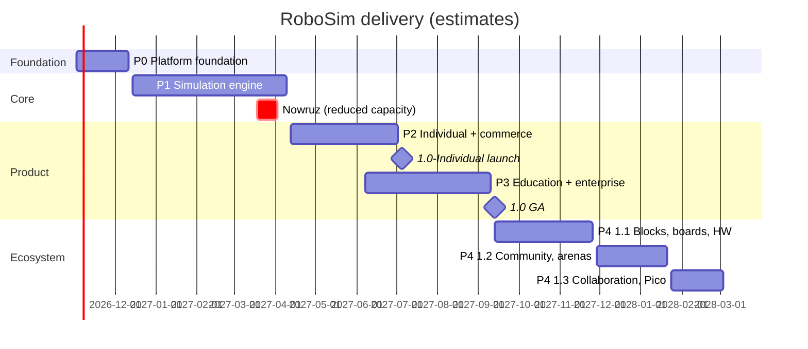

# RoboSim — Release Plan

**Version:** 1.0 · **Date:** 2026-10-13 · **Owner:** @MehranG (product), Engineering lead
**Related:** [PRD §9](PRD.md#9-release-mapping) · [BRD](BRD.md) · [User Stories](User-Stories.md)

---

## 1. Delivery approach

RoboSim is built as **one enterprise product delivered in phases**, not as an MVP that is later rewritten.

| Principle | Meaning |
|---|---|
| Production-grade from P0 | Security, tenancy (`workspace_id` + RLS), i18n, observability, CI gates, and the full data model exist from the first phase. No "we'll add it later" shortcuts. |
| Vertical slices | Each phase ends with working user journeys, not with layers. |
| Architecture for the end state | Organizations, entitlements, boards, and content registries are designed in P0/P1 even if their UI ships later, so later phases add features instead of refactoring foundations. |
| Exit criteria are tests | A phase exits when its criteria pass in CI/staging, not on a date. Dates are planning estimates. |
| Feature flags | Work for later phases may merge early behind flags. |

## 2. Phase overview

| Phase | Theme | Calendar (estimate) | Public milestone |
|---|---|---|---|
| **P0** | Platform foundation | 2026-11-02 → 2026-12-11 (6 w) | — |
| **P1** | Simulation engine | 2026-12-14 → 2027-04-09 (17 w incl. Nowruz) | Closed alpha (internal + 30 invited makers) |
| **P2** | Individual product & commerce | 2027-04-12 → 2027-07-02 (12 w) | **1.0-Individual public launch: 2027-07-05** (summer break) |
| **P3** | Education & enterprise | 2027-06-07 → 2027-09-10 (14 w, overlaps P2 tail) | **1.0 GA (Enterprise): 2027-09-13**, before the school year (1 Mehr) |
| **P4** | Ecosystem | 2027-09-13 → 2028-03-03 | 1.1 (Nov 2027), 1.2 (Jan 2028), 1.3 (Mar 2028) |
| **P5** | Expansion | from 2028-04 | 2.0 |

## 3. Phase details

### P0 — Platform foundation

**Scope**
- Monorepo per [Technical Design §3](Technical-Design.md#3-repository-layout); CI pipeline with all gates (lint, typecheck, arch rules, i18n, unit, integration, image scan, SBOM).
- Infrastructure: local Docker Compose (WSL2) and a Docker-free local mode on PGlite ([ADR-019](decisions.md#adr-019--pglite-for-docker-free-development-and-database-tests)); OpenTelemetry tracing hooks, structured JSON logs with request IDs.
- *Re-scoped 2026-10-13:* staging Kubernetes, Harbor/Verdaccio mirrors, CloudNativePG, OpenBao, observability stack, and Argo CD move to **P1 (Platform deployment track)** because no cluster or cloud provider is available yet (open question Q-5).
- `apps/web`, `apps/admin`, `apps/api` skeletons; design system (`packages/ui`) with RTL; i18n infrastructure (FR-I18N-01…04); feature flags (FR-ADM-09).
- Full database schema baseline for IAM, workspaces, memberships, audit, outbox, feature flags; RLS framework and isolation test harness.
- Personal workspace creation on user creation (internal only; auth UI comes in P2).
- Long-lead items started: eNamad, payment gateway contract, cloud contract, SMS/email providers, GPU capacity (§7).

**Exit criteria**
- `pnpm dev` brings the full stack up on a fresh WSL2 machine in < 30 min following the Engineering Guide (PGlite mode without Docker; Compose mode once Docker is installed).
- Switching to FA flips the app shell to RTL; i18n check and pseudo-locale build pass with zero hard-coded strings.
- Tenant-isolation test suite runs in CI (`pnpm verify` locally, GitHub Actions on every PR).
- API emits structured logs with correlation IDs; OTLP tracing activates when an endpoint is configured.

**P0 status (2026-10-13):** implemented. Verified: `pnpm verify` green from a clean checkout (25/25 tasks, 118 tests), all gates proven to fail on planted violations. Not yet verified: Docker Compose stack (no Docker host), GitHub Actions run (no remote yet), browser screenshot/visual check (headless Chromium system libraries missing in WSL).

### P1 — Simulation engine

**Platform deployment track (moved from P0):** staging Kubernetes (Helm umbrella chart, gVisor RuntimeClass node pool), Argo CD, Harbor + Verdaccio mirrors, CloudNativePG with PITR, Valkey, OpenBao + External Secrets, observability stack (OTel Collector, Prometheus, Loki, Tempo, Grafana, GlitchTip), outbox relay worker on BullMQ. Exit: staging deploys from `main` via Argo CD; dashboards show RED metrics and traces for the API; tenant-isolation suite also passes against real PostgreSQL 16.

**Scope** (FR-WRK-01…03, FR-CIR-01…06, 10, FR-COD-01, 03, 06, FR-BLD-01…06, FR-SIM-01…07, 09…11, FR-ARN-01…09, 11 (engine), FR-SAF-01, 02 (rules 1–11), 04…06, FR-EXT-01…03, 06)
- `sim-core`: netlist, MNA solver, scheduler, component bus, world model, physics, sensors, success-condition engine, determinism (dmath, PRNG).
- Board: Uno (avr8js). Components: all P1 rows of [PRD §7.2](PRD.md#72-components).
- Build service with gVisor sandbox, cache, fair-share, SSE.
- Circuit canvas, Monaco editor, serial monitor, pin inspector.
- 2D renderer, 3D renderer, mounting editor, built-in arenas.
- Safety checker (static + runtime) and damage model.
- Grader service skeleton running golden traces headless (used by CI now, by learning in P3).

**Exit criteria**
- Starter line-follower completes a lap of the oval in 2D and 3D; toggling views mid-run keeps time and pose identical (US-ARN-02).
- Peripheral conformance suite and golden traces pass in Node, Chrome, and Firefox.
- Every GA safety rule (1–11) has trigger and clean fixtures passing.
- Sandbox escape suite passes; build p95 cold < 5 s and cached < 200 ms in staging load test.
- Simulation slice and frame budgets met on the reference laptop.
- Closed alpha: ≥ 20 of 30 invited makers complete the line-follower without help.

**P1 status (2026-10-14):** all 7 slices done — `packages/sim-core` foundation: contracts, `dmath` (fdlibm ports, golden bit patterns), `xoshiro128**` PRNG with per-component forks, union-find netlist, dense-LU MNA with PWL diodes, MCU component bus (output resistance, pull-ups, VIL/VIH hysteresis), fixed 1 ms slice scheduler with 2 ms physics cadence, and wall-clock pacer. **Slice 2 done (2026-10-14):** `packages/boards/avr-uno` — avr8js adapter implementing `McuCore` (cycle-exact scheduled inputs, register-derived PWM for timers 0/1/2, cycle-stamped output edges, USART0 TX/RX, ADC channels), Intel HEX loader, Uno pin map and power tree; PWM loads use phase-averaged operating points. Measured ≈ 3.3× real time in Node with a toggling pin. **Slice 3 done (2026-10-14):** catalogue components (electrical P1 set): resistor, potentiometer, LDR, LED, push button (4-leg), on/off switch, active buzzer, 9 V and 4×AA alkaline batteries, L298N, TT gear motor, SG90 servo, half/full breadboard. Plus `packages/catalog` (registry with FA/EN names), `packages/test-fixtures` (bench), and `pnpm new:component`. A drive-train test runs Uno PWM → L298N → TT motor on 4×AA end to end. Completing the PRD §7.2 basic set: HC-SR04 (cycle-precise echo, sub-millimetre ranging), TCRT5000, the 3-channel line module, and the 2WD chassis definition (geometry, inertia, mount slots). They work against the `WorldModel` interface, tested with a deterministic `TestArena`; the catalog test asserts the P1 set equals PRD §7.2's basic tier. **Slice 4 done (2026-10-14):** physics world. `PlanckWorld` (planck 1.5.0 with a deterministic-trig patch, ADR-021) provides wheel traction, lateral grip, rolling resistance, caster, walls, pushable obstacles, raycasts, a floor raster, and mounted component poses. TT motors couple to wheels as `WheelActuator`s. `packages/content` adds the built-in oval arena. The starter line follower (AVR firmware → L298N → 2 TT motors, 3-channel sensor) laps the oval in 14.47 s simulated time at ≈ 2.5× real time in Node, bit-identically across runs. **Simulator Lab (2026-10-14, pulled forward):** the web app's `/lab` page runs the engine in a Web Worker (`packages/sim-runtime`) with a Canvas 2D view (`packages/renderer-2d`). It shows the line follower lapping the oval with live telemetry, plus bench demos (blink, button, knob → LED PWM, knob → servo) in FA/EN. **Practice from here on:** every engine slice ends with a visible Lab demo. **Slice 5 done (2026-10-14):** safety checker and damage model. The FR-SAF-02 GA rules (1)–(11) run as static analysis (solved operating points, manifest-driven generic rules). Runtime rules cover pin over-current, outputs fighting, MCU total current, floating input, and component faults with sustain windows; Errors damage the part or pin (FR-SIM-10) until reset. Every rule has trigger + clean fixtures; findings are bilingual (title / why / how to fix). The Lab adds a **Safety** tab with miswired demos, a findings panel (severity filter, acknowledge warnings only) and damage badges. **Slice 6 done (2026-10-14):** success conditions (§5.7). A declarative `ChallengeSpec` covers every GA type (`reachZone`, `laps`, `checkpointsInOrder`, `timeLimit`, `noCollision`, `onLineRatio`, `serialMatches`, `pinState`, `pushOut`) with `all` / `any` / `not`, plus validation against the arena (zone and object ids, bounded regex). `ChallengeTracker` evaluates the tree live, decides on the exact slice, and computes the weighted score. Scoring was pulled forward from P2. The oval ships `oval-one-lap`: the line follower succeeds at 14.47 s with 100/100, and a stationary robot fails at the time limit. The Lab's arena tab shows a live checklist, highlights visited and next checkpoints on the canvas, pauses on decision, and shows a result card with the score breakdown (FA/EN). **Slice 7 done (2026-10-14):** worker protocol (§5.8). Snapshots are binary: the hot state (time, parts, pins, robot, challenge) is flattened into Float64 slots with a dictionary that is posted once per run. They travel through a double-buffered `SharedArrayBuffer` (seqlock via `Atomics`) or, without cross-origin isolation, as transferred `ArrayBuffer`s. Serial output, findings, faults and damage are events. Every run records a slice-stamped input log (component inputs and serial RX) with seed and `engineVersion`; replaying it reproduces the run slice for slice, through the worker or headless (`HeadlessRun`, the grader's loop). The Lab adds a Serial Monitor demo (greeting, ticks, upper-case echo), **Replay run**, and **Export input log**. **Slice 8 done (2026-10-14):** project document and loader (§8.10). There is a versioned `ProjectDocument` schema with forward migrations in `packages/shared`. A loader turns document + firmware into a run: circuit, board pins, robot from the chassis and mounts, arena, success conditions, and safety. `load { project, firmware }` and exported input logs are self-contained. The Lab demos are now documents with their Arduino sketches and replay bit-identically to the former hand-built scenarios. **Slice 9 done (2026-10-14):** grader skeleton and golden traces. `grade(job)` in `packages/sim-runtime` runs a self-contained input log headless and unpaced until the challenge decides or `maxSimSeconds` (≤ 300 s) is reached. It returns the outcome, score, findings, damage, serial output, and a 10 Hz trace (pose, pins, part states) with a SHA-256 digest. `apps/grader` wraps it as a CLI (job JSON → result + gzip trace). Eight golden fixtures (line-follower lap, bench demos with scripted inputs, serial echo, damage runs) must reproduce bit for bit in Node (`pnpm test:sim`). `pnpm golden:update` refuses to re-record without an `engineVersion` bump. The Lab adds **Verify run**: it grades the current run in a second worker and shows it is identical to the live run (checked in Chrome: arena mid-lap, end of the lap, and serial input). The Chrome/Firefox golden leg (Playwright) is still open. **Slice 10 done (2026-10-15):** build service, thin vertical (TD §6, ADR-022). `apps/compiler` compiles Arduino sketches with avr-gcc 7.3.0 against the pinned Arduino AVR core 1.8.6.
  - **Libraries:** Servo, NewPing, EEPROM, SPI, SoftwareSerial, Wire and HID. They are fetched by `pnpm compiler:setup` from GitHub/PlatformIO, because `downloads.arduino.cc` is unreachable from our network.
  - **Driver:** our own replacement for arduino-cli. It merges the `.ino` files, generates prototypes with `#line` mapping, resolves libraries from includes, links prebuilt core and library archives with LTO, and outputs HEX plus a flash/RAM report. Results are content-addressed and cached.
  - **Sandbox:** user builds run in a Linux-namespace sandbox with no network, a private `/proc`, only the work dir writable, home and project hidden, and resource and time limits.
  - **Diagnostics:** they map to the user's lines. 59 catalogued beginner errors have FA/EN explanations (FR-COD-03).
  - **API:** `POST /api/v1/builds` is synchronous, with `Idempotency-Key`, a 20/min rate limit and a 503 when the toolchain is missing. `GET /api/v1/artifacts/:id` serves the HEX.
  - **Demo firmware:** the built-in demos now run firmware compiled from their sketches, and the golden traces were re-recorded. The line follower still laps in 14.47 s. The compiled build exposed a real wiring bug: D10/IN4 was left floating, and the safety checker flagged it.
  - **Lab:** a **Your code** tab edits a demo's sketch, compiles it, shows errors on their lines with plain-language explanations, and runs the firmware on the same circuit. Replay, export and Verify all work on these runs.
  - **Next:** the queue/SSE/MinIO/quota half of §6 (with Redis), editors and renderers.

  **Slice 11 done (2026-10-15):** circuit canvas, thin vertical (FR-CIR-01..06, 10; ADR-005).
  - **Canvas:** `packages/circuit-canvas` is a React SVG breadboard editor with one root transform for pan, wheel zoom and zoom-to-fit. Parts drag on the 0.1" grid and can be rotated, flipped, duplicated and deleted, with keyboard shortcuts and arrow-key nudging. Undo/redo keeps 200 steps.
  - **Wiring:** wires run pin to pin (board header, part pins, breadboard holes) with bend points and colour swatches. Ground and 5 V wires default to black and red. Hovering a pin shows its name and highlights its whole net.
  - **Breadboards:** legs that land on a hole are plugged in (`seats`, project schema v2). Parts plugged into a breadboard move with it. The simulator treats breadboard strips as conductors, so unused holes cost nothing; the demos' golden traces are unchanged.
  - **Library and properties:** library search works in Persian and English at once, including ي/ك, ZWNJ and Persian digits, with a category filter; click or drag to add a part. The property panel is driven by the manifest: numbers within range (out-of-range values are rejected with an explanation), the E12 picker for resistors, enums and switches. With nothing selected, it lists the parts accessibly.
  - **Art:** every catalogue part has hand-drawn art. Resistors show their colour bands, and LEDs glow live while the simulation runs.
  - **Lab:** a **Design a circuit** tab starts from an Uno + breadboard blink, opens any demo, and imports or exports the project JSON (autosaved in the browser). **Compile & run** compiles the sketch and simulates exactly the drawn circuit; a note appears when the drawing has changed since the run. Checked in Chrome with the Persian UI.
  - **Still open:** multi-select box, align, minimap, the 60 FPS @ 200 parts perf gate, the server projects API (save and versions), and a movable board.

  **Slice 12 done (2026-10-15):** editor workspace (FR-WRK-01…03, FR-SIM-11).
  - **Workspace:** `/editor` is the app's project screen: parts library with properties, circuit canvas, simulation view (robot projects), code, and a bottom dock with serial monitor, pin inspector, safety findings and the challenge. Panes resize with keyboard-accessible splitters (they mirror in RTL), collapse to rails, and the layout is saved in the browser. Drag-to-rearrange docking comes later.
  - **Toolbar:** project name, New, Open demo, Import, Export, Save; Run/Pause, Step, Stop, Reset, speed 0.25–4×, and the real-time factor. Shortcuts: F5, Shift+F5, F10, F6, Ctrl+S and F1 (help).
  - **Run model:** one Run button compiles only when the code changed (an unchanged demo runs without the build service), loads exactly the drawn project and starts it. Any edit while running stops the run, so the simulation always matches the drawing.
  - **Inputs on the canvas:** while running, hold a push button, toggle a switch, or click a knob or sensor for sliders. LEDs, buttons, the servo horn, motor speed and the buzzer show live state, and damaged parts show an icon with text.
  - **Small screens:** below 1024 px the panes become tabs; below 768 px the workspace is view-and-run only, with a banner.
  - **Lab:** the Design tab moved into the workspace; every Lab demo has **Open in editor**. Checked in Chrome (Persian UI): compile and run, button held on the canvas, edit stops the run, demos open with confirmation, line follower in the arena pane, narrow view.
  - **Still open:** drag-docking, Monaco (slice 13), 2D/3D toggle (slice 16), Versions/Share (P2).

  **Slice 13 done (2026-10-17):** code editor, pin inspector and serial monitor (FR-COD-01, 03; FR-SIM-06; FR-SIM-07 monitor).
  - **Code editor:** Monaco, lazy-loaded and self-hosted (≈ 0.87 MB gz, initial JS unchanged at 256 KB gz). Arduino-aware highlighting, basic completions for the core API, Serial, Servo, NewPing and String (`Serial.` lists Serial's methods), find/replace, bracket matching and folding. It is always LTR, with no ligatures. Sketches can have several files: add, rename and delete `.h`/`.cpp` tabs, and all files build together (US-COD-01 AC2). Compile errors are underlined in their file, tabs show error counts, and clicking an explanation opens the right file and line. The Lab's **Your code** tab uses the same editor.
  - **Pin inspector:** every Uno pin with mode (including pull-up), level, PWM duty **and frequency** (`analogWrite(5, 64)` → 25 % at 977 Hz, US-SIM-02 AC1), voltage, and the `analogRead` value on A0–A5. Unconnected pins are dimmed and can be hidden; floating inputs are flagged.
  - **Serial monitor:** baud selection, line ending (none / NL / CR / both), simulated-time timestamps, autoscroll, clear. The monitor decodes the raw UART bytes at its own baud: when it differs from `Serial.begin`, the output is garbled exactly as on a real board, with a bilingual hint and a one-click switch to the sketch's rate.
  - **Engine:** `sim-runtime` 0.2.0 (pin views carry `freqHz`; goldens re-recorded, otherwise identical). Checked in Chrome (Persian UI): completions, a header tab, an inline error with its explanation, garbled → clean serial with timestamps, PWM Hz on the dimmer, the Lab editor.
  - **Still open:** hover docs in FA/EN and the library manager (FR-COD-02, 07, P2); the plotter (P2); characters sent at a mismatched baud are not garbled on the way in.

### P2 — Individual product & commerce

**Scope** (FR-WRK-04…06, FR-CIR-09, FR-COD-02, 05, 07, FR-BLD-07, FR-SIM-07 (plotter), 08, FR-SAF-03, 07, FR-BOM-*, FR-PRJ-01…04, 06, FR-LRN-01 (2 projects), FR-BIL-01…06, 09, FR-SHP-01…06, 08, FR-AI-01…05, 07…10, FR-I18N-05, FR-EXT-04, 05, FR-IAM-01…03, 04, 07, FR-ADM-01…06, 08, 10, FR-NTF-*, FR-ANL-01, 04)
- Authentication (email/phone OTP, TOTP), minors' consent flow, sessions, data export/deletion.
- Projects, versions, sharing, import/export.
- Guided projects: Line-follower, Obstacle avoider; kits for both in the shop.
- BOM, wiring guide, server-rendered exports.
- Plans, trial, entitlements, paywall, Zarinpal, coupons, wallet, refunds, reconciliation.
- Shop: catalogue, inventory, cart from BOM, checkout, shipping, order lifecycle, fulfilment admin.
- AI assistant with platform model + BYOK adapters (enabled per legal review), evaluation harness.
- Admin back-office for users, catalogue, content CMS, commerce, finance, AI, audit.

**Exit criteria**
- Journey A and B pass as Playwright E2E in FA and EN.
- Moderated usability test: ≥ 80 % of ≥ 8 beginners complete Journey A in < 60 min in each language (NFR-UX-01).
- Payment: trial expiry (time-mocked) → Free fallback; gateway sandbox payment restores Maker within 5 s; duplicate callbacks idempotent; reconciliation report clean for a 7-day staging run.
- BOM → paid order → shipped flow completed end to end in staging with real fulfilment staff.
- AI eval baseline recorded; Persian quality accepted by product owner (Q-8).
- eNamad active; legal pages (terms, privacy, returns) published in FA/EN; external pen test of P2 scope with no open high/critical findings.

### P3 — Education & enterprise

**Scope** (FR-WRK-07, FR-PRJ-07, FR-LRN-01 (6 projects), 02…09, FR-IAM-02 (passkeys), 05, 06, FR-ORG-*, FR-BIL-07, 08, 10, FR-SHP-07, FR-AI-06, FR-ANL-02, 03, FR-ARN-11 (scoring))
- Organizations, members, roles, seats, branches, policies.
- SSO (OIDC/SAML), SCIM, passkeys.
- Classes, assignments, verified-run grading, gradebook, teacher live dashboard, guardian reports.
- Courses and certificates; four more guided projects.
- LTI 1.3 Advantage with Moodle.
- Organization billing: quotes, proforma, bank transfer, official invoices, Moodian adapter; second gateway.
- Org analytics and audit export; outbound webhooks.
- **Pilot programme:** 5–10 schools/academies from P3 week 4.

**Exit criteria**
- Journeys C and D pass E2E; LTI suite passes against Moodle 4.x.
- 40 simultaneous submissions graded in < 5 min p95; regrade reproduces identical scores.
- Cross-tenant isolation suite and SSO/SCIM conformance tests pass; external pen test of P3 scope clean (no high/critical).
- At least 3 pilot organizations used assignments with real classes and confirm readiness.
- Load test at NFR-SCALE-01 targets passes in staging; DR restore drill completed within RTO.
- Official invoice issued and accepted through the Moodian adapter in the test environment.

### P4 — Ecosystem (1.1 – 1.3)

| Release | Scope | Exit criteria |
|---|---|---|
| **1.1** (Nov 2027) | Blockly (FR-COD-04), Nano + Mega boards, hardware bridge (FR-HWB-*), code-aware rules complete, schematic view (FR-CIR-07) | Block programs match golden C++ behaviour; upload verified on real Uno/Nano/Mega in a hardware lab test rig |
| **1.2** (Jan 2028) | Community gallery, remix, moderation, competitions, badges (FR-CMY-*, FR-ADM-07), arena editor (FR-ARN-10), plagiarism signal (FR-LRN-10), replays (FR-SIM-12) | Moderation SLA tooling in place; minors' protections verified by test suite; first public competition run |
| **1.3** (Mar 2028) | Real-time collaboration (FR-PRJ-08), comments (FR-PRJ-05), Pico board (rp2040js), encoders + IMU, safety rules 12–13, displays and comms components | 2-user and 5-user collaboration E2E; offline merge test; Pico conformance suite |

### P5 — Expansion (2.0)

| Track | Description | Go/no-go criteria |
|---|---|---|
| ESP32 (research spike, 6 w) | Evaluate (a) server-side Espressif QEMU fork streaming pin/UART state to the browser, (b) any viable in-browser ESP32 emulation. | GPIO, LEDC PWM, ADC, UART, I²C supported; end-to-end latency < 100 ms at p95; cost per active session within budget; determinism achievable for grading. If no-go, ESP32 remains out of scope. |
| MicroPython on Pico | Run MicroPython firmware in rp2040js with a Python editor | Conformance + course content ready |
| Multi-robot arenas | FR-ARN-12 (sumo, races) | Deterministic multi-firmware scheduling |
| Private Cloud v2 | Self-service upgrades, multi-site HA | Two customer deployments upgraded without downtime |
| Mobile companion | Phone as Bluetooth controller panel for real robots | User research supports it |

## 4. Team and capacity

**Planning assumption [A-7]:** the team below is in place from P0. With fewer engineers, durations scale roughly linearly (e.g. 6 engineers instead of 9 → P1–P3 take about 1.5×).

| Role | FTE | Focus |
|---|---|---|
| Product owner / PM | 1 | Backlog, acceptance, pilots, launch |
| Product designer (bilingual UX, RTL) | 1 | Design system, journeys, usability tests |
| Simulation engineers | 3 | sim-core, boards, components, physics, renderers, circuit canvas |
| Frontend engineer | 1 | App shell, projects, learning, billing, shop UI |
| Backend engineers | 3 | IAM/org, billing/commerce, learning/LTI, AI, build service |
| DevOps / SRE | 1 | Infrastructure, CI/CD, sandbox, observability, on-prem packaging |
| QA engineer (automation) | 1 | E2E, visual, a11y, load, hardware test rig |
| Education content lead | 1 | Guided projects, courses, safety texts, FA/EN quality |
| Hardware/calibration technician | 0.5 | Calibration measurements, hardware lab rig |
| Security consultant | 0.2 | Reviews, threat models, pen-test coordination |
| Legal & finance | 0.3 | eNamad, terms, privacy, tax, invoicing |
| **Total** | **≈ 14** | |

Squads: **Simulation** (3 sim + designer share), **Platform & Commerce** (backend 2 + frontend), **Education** (backend 1 + content lead; ramps in P2), with SRE and QA shared.

## 5. Release governance

| Gate | Applies to | Checklist |
|---|---|---|
| Phase exit review | Every phase | Exit criteria evidence (CI runs, test reports, load/pen-test reports), open risks, go/no-go by PO + engineering lead + sponsor |
| Launch readiness | 1.0-Individual, 1.0 GA | Support staffed (FA/EN), help centre, status page, on-call rota, runbooks, legal pages, pricing approved, marketing site, analytics dashboards, backup/restore drill, rollback plan |
| Content readiness | Each release with content | All content in both locales reviewed by the education lead and a native reviewer |
| Security | Each phase | Threat models updated; pen test (P2, P3); no high/critical findings open |
| Private Cloud | LTS releases | Install and upgrade tested on the reference on-prem environment; air-gapped bundle verified |

Release channels: `alpha` (P1, invite-only), `beta` (feature flags for opted-in users), `stable` (SaaS weekly), `lts` (Private Cloud quarterly).

## 6. Risk register

Probability (P) and impact (I): H/M/L.

| ID | Risk | P | I | Mitigation | Trigger / early signal | Owner |
|---|---|---|---|---|---|---|
| R-01 | Simulated behaviour differs from real parts; users lose trust | M | H | Calibrate every sold part; "estimate" labelling; per-component feedback; hardware test rig in CI for key behaviours | Calibration error > 5 %; support tickets tagged "sim vs real" | Simulation lead |
| R-02 | Sandbox escape or abuse of build farm | L | H | §5 of Security; gVisor; isolated node pool; escape suite; bug bounty after GA | Sandbox anomaly alerts | SRE |
| R-03 | Simulation performance insufficient on low-end school PCs | M | H | Performance budgets in CI; 2D default; adaptive 3D quality; profiling on a low-end reference device from P1 | RTF < 1× on reference device | Simulation lead |
| R-04 | Determinism breaks across engines/versions, disputing grades | M | H | dmath, seeded PRNG, golden traces in CI across browsers; engine version pinning in grader; only verified runs count | Golden trace drift | Simulation lead |
| R-05 | eNamad/gateway onboarding delays block P2 launch | M | H | Start in P0; second gateway; `fake` provider keeps development unblocked | Not approved by P2 week 6 | Finance |
| R-06 | Network filtering/outages make the service unreachable for some users | M | M | Iran hosting, no foreign runtime dependencies, PWA offline simulation, local build cache | Regional error-rate spikes | SRE |
| R-07 | External AI providers unreachable or terms prohibit use | H | M | Platform-hosted open-weight model as default (ADR-009); BYOK only after legal review | Provider blocks/ToS change | Engineering lead |
| R-08 | GPU capacity for platform AI unavailable or costly in-region | M | M | Small efficient default model; CPU fallback; credits limit usage; AI optional to the core loop | Cost per user above budget | Engineering lead |
| R-09 | Scope of P1 (2D + 3D + electrical + physics) overruns | M | H | Shared world model (3D is view-only); vertical-slice sequencing (2D first inside P1); weekly burn-up; descoping candidates pre-agreed: logic analyzer (Should), plotter (P2) | Burn-up < 80 % of plan at P1 mid-point | Product owner |
| R-10 | Institutional sales cycle longer than planned | M | M | Pilot programme from P3 week 4; academies before universities; LTI/SSO ready at GA | < 3 pilots active by P3 week 8 | Sales |
| R-11 | Persian content quality or volume insufficient | M | M | Dedicated education lead; native review gate; content CMS from P2 | Content backlog > 4 weeks | Education lead |
| R-12 | Child-safety incident in community | L | H | No DMs; pre-moderation for minors; contact-info filters; moderation SLA; incident playbook | Reports volume spike | Trust & safety |
| R-13 | Tax/e-invoicing requirements change or are misinterpreted | M | M | Effective-dated tax settings; adapter for Moodian; accountant review per release | Rejected invoices | Finance |
| R-14 | Key-person dependency in simulation squad | M | H | Pairing, ADRs, design docs, ≥ 2 people per subsystem | Single reviewer for sim-core PRs | Engineering lead |
| R-15 | Upstream registry/package outages break CI/deploys | M | M | Harbor and Verdaccio mirrors; pinned versions; offline build caches | Pull failures in CI | SRE |
| R-16 | Real-time collaboration complexity delays 1.3 | M | L | Yjs/Hocuspocus proven stack; collab isolated behind flag; not a GA dependency | Merge bugs in beta | Platform lead |

## 7. Dependencies and long-lead items

| Item | Needed by | Start | Owner |
|---|---|---|---|
| Iranian cloud contract (Kubernetes, object storage, 2 sites) | P0 week 2 | Immediately | Engineering lead |
| eNamad application | P2 launch | P0 | Legal |
| Payment gateway contracts (primary + secondary) and sandbox access | P2 week 1 (sandbox), launch (production) | P0 | Finance |
| SMS and email providers | P2 week 1 | P0 | Engineering lead |
| GPU capacity for platform AI | P2 week 4 | P1 | Engineering lead |
| Calibration lab equipment and parts from the Mehrtronic catalogue | P1 week 4 | P0 | Simulation lead |
| Hardware test rig (Uno, Nano, Mega, Pico with USB hub) | P4 1.1 | P3 | QA |
| Pilot schools/academies (5–10) | P3 week 4 | P2 | Sales |
| Moodle test instance and LTI registration with a pilot institution | P3 week 6 | P2 | Backend lead |
| Moodian trusted-provider contract | P3 week 8 | P2 | Finance |
| External penetration testing vendor | P2 week 10, P3 week 12 | P1 | Security consultant |
