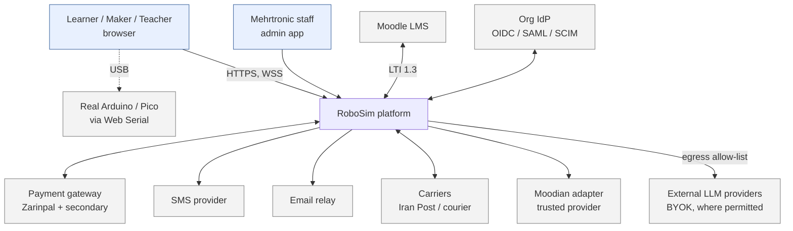
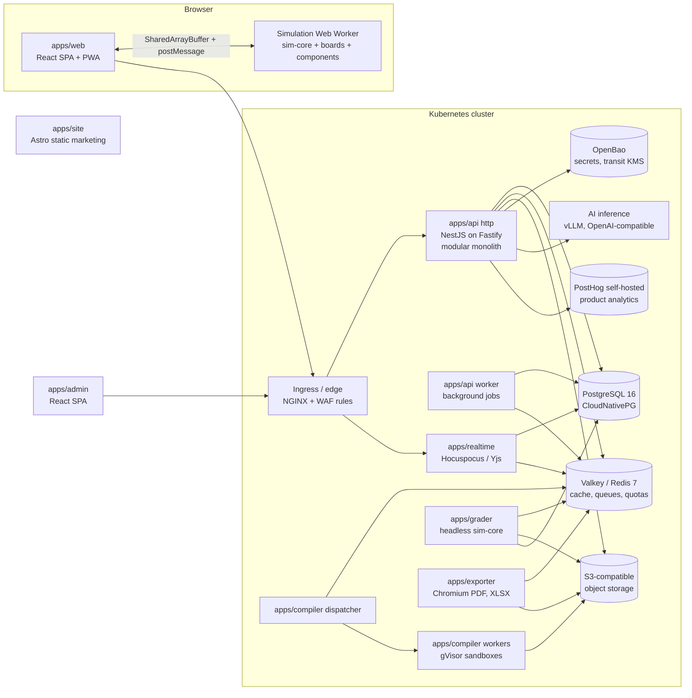
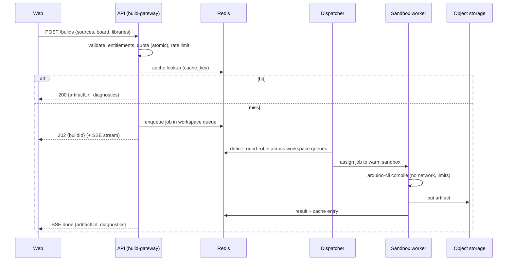
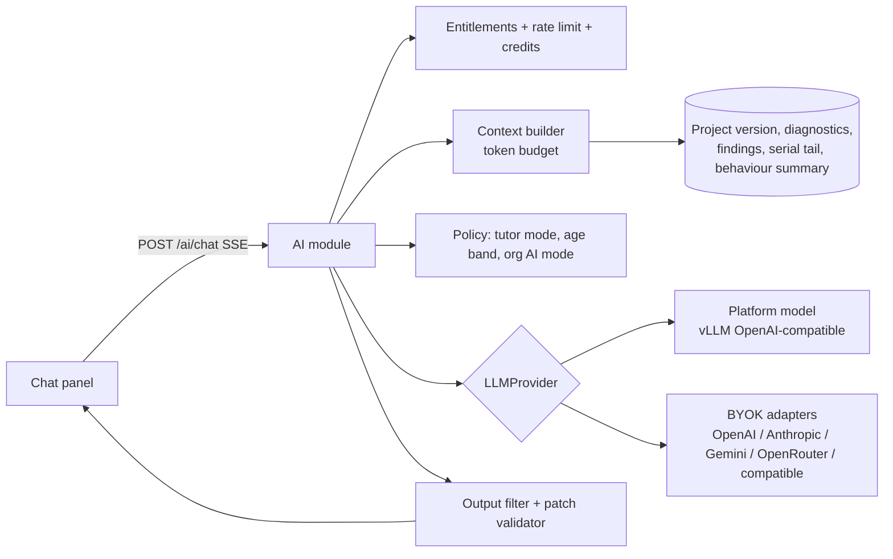

# RoboSim — Technical Design

**Version:** 1.0 · **Date:** 2026-10-13 · **Owner:** Engineering lead · **Status:** Approved for implementation
**Related:** [PRD](PRD.md) · [API Spec](API-Spec.md) · [Security](Security-Privacy-Compliance.md) · [Engineering Guide](Engineering-Guide.md) · [ADRs](decisions.md)

This document is the authoritative technical reference. When code and this document disagree, fix one of them in the same pull request.

---

## 1. Quality goals and architectural drivers

| Priority | Quality goal | Driver | Architectural consequence |
|---|---|---|---|
| 1 | **Simulation correctness and determinism** | Grading and competitions depend on reproducible results (FR-SIM-09) | Framework-free `sim-core` with fixed time steps, seeded PRNG, deterministic math; same package runs in browser and grader |
| 2 | **Security of untrusted code** | Every user submits C++ to our build farm | gVisor-sandboxed, network-less, disposable build containers (§6) |
| 3 | **Tenant isolation** | Schools and institutions | Workspace-scoped data, PostgreSQL RLS + application guards (§8.1) |
| 4 | **Works under poor connectivity** | Iranian network conditions | Client-side simulation, PWA, self-hosted everything, small bundles |
| 5 | **Extensibility by data** | Catalogue follows what Mehrtronic sells | Package registries for components, boards, rules; content registry for arenas/courses |
| 6 | **Operability in SaaS and on-prem** | Institution / Private Cloud editions | One Helm chart, no cloud-proprietary dependencies |

## 2. System context and containers

### 2.1 Context



### 2.2 Containers



| Container | Tech | Responsibility | Scales by |
|---|---|---|---|
| `apps/web` | React 19, Vite, TypeScript, Tailwind v4, shadcn/ui | Workspace, editor, simulator host, all user UI | Static (CDN/edge cache) |
| `apps/admin` | Same stack | Back-office (separate origin `admin.`) | Static |
| `apps/site` | Astro (static, SSR-free) | Marketing pages, docs, SEO in FA/EN | Static |
| `apps/api` (http) | Node.js 24 LTS, NestJS 12 (ESM) on Fastify 5, Drizzle ORM, Zod via Standard Schema | REST API, auth, all business modules | Replicas (HPA on CPU/RPS) |
| `apps/api` (worker) | Same codebase, `worker` entrypoint, BullMQ | Outbox relay, emails/SMS, reconciliation, retention, Moodian, search indexing | Replicas (KEDA on queue depth) |
| `apps/realtime` | Hocuspocus (Yjs) | Real-time collaboration documents and presence | Replicas with Redis extension |
| `apps/compiler` | Node.js dispatcher + worker; `arduino-cli` in sandbox image | Builds, cache, fair-share scheduling | Worker pods (KEDA on queue depth) |
| `apps/grader` | Node.js + `sim-core` | Verified runs for grading/competitions | Pods (KEDA) |
| `apps/exporter` | Node.js + Playwright Chromium, exceljs | PDF/XLSX/CSV/SVG exports | Pods (KEDA) |
| AI inference | vLLM (GPU) or Ollama (CPU/dev) | Platform-hosted open-weight models | GPU nodes |

Why a modular monolith for the API: one team, strong consistency needs across billing/entitlements/learning, and on-prem simplicity. Services are split out only where the runtime profile differs (untrusted code, CPU-bound simulation, headless browser, long-lived WebSockets) — see [ADR-002](decisions.md#adr-002--modular-monolith-api-with-separate-runtime-specific-services).

## 3. Repository layout

pnpm workspaces + Turborepo. Dependency direction is enforced by `dependency-cruiser` rules in CI (§3.1).

```
robosim/
├── apps/
│   ├── web/                    # Learner/teacher SPA (Vite)
│   ├── admin/                  # Back-office SPA (Vite)
│   ├── site/                   # Marketing site (Astro)
│   ├── api/                    # NestJS modular monolith (entrypoints: http, worker)
│   │   └── src/modules/        # iam, org, projects, build-gateway, learning, community,
│   │                           # billing, entitlements, commerce, ai, notifications,
│   │                           # analytics, admin, audit, content, search, lti
│   ├── realtime/               # Hocuspocus collaboration server
│   ├── compiler/               # Arduino build driver (avr-gcc), sandbox runner, CLI; toolchain.lock.json pins core + libraries
│   ├── grader/                 # Headless verified-run service; golden/ holds the golden-trace jobs + results
│   └── exporter/               # PDF/XLSX/CSV export service
├── packages/
│   ├── shared/                 # Domain types, Zod schemas, API contracts, error codes, project schema + migrations
│   ├── sim-core/               # Netlist, electrical solver, scheduler, component bus, world model, physics, sensors,
│   │                           # success-condition engine, deterministic math/PRNG. NO DOM, NO React.
│   ├── boards/
│   │   ├── avr-uno/            # Board impl (avr8js adapter, pin map, power tree, FQBN, upload protocol)
│   │   ├── avr-nano/
│   │   ├── avr-mega/
│   │   └── rp2040-pico/        # rp2040js adapter
│   ├── components/
│   │   └── <slug>/             # manifest.json, model.ts, model.test.ts, assets/ (svg, glb), calibration.json
│   ├── safety-rules/
│   │   └── <rule-id>/          # rule.ts, rule.test.ts, fixtures/, messages (i18n keys)
│   ├── sim-runtime/            # Worker host (SimHost), worker protocol types, circuit builder, demo scenarios + firmware
│   ├── renderer-2d/            # Canvas 2D arena renderer (consumes snapshots only)
│   ├── renderer-3d/            # three.js / @react-three/fiber renderer (consumes snapshots only)
│   ├── circuit-canvas/         # SVG breadboard editor + netlist builder bindings
│   ├── code-analysis/          # tree-sitter C++ (WASM) pin-usage extraction (implemented 2026-10-20)
│   ├── blockly-arduino/        # Block definitions, generators, translations
│   ├── hw-bridge/              # Web Serial STK500v1/v2, UF2 helpers
│   ├── ai-providers/           # LLMProvider adapters (server-only)
│   ├── ui/                     # Design system (shadcn-based, RTL-aware), icons, tokens
│   ├── i18n/                   # en/ and fa/ namespaces, ICU messages, key linter
│   ├── content/                # Built-in arenas, guided projects, courses (JSON + assets), content schema
│   ├── catalog/                # Registry of all component definitions (worker + grader) + cross-component tests
│   ├── test-fixtures/          # Test bench (part.pin wiring), AVR assembler firmware, golden circuits
│   └── config/                 # tsconfig, eslint, prettier, dependency-cruiser presets
├── infra/
│   ├── docker/                 # docker-compose.yml for local dev (WSL2-compatible)
│   ├── helm/robosim/           # Umbrella chart (values: saas, staging, onprem)
│   ├── argocd/                 # GitOps application manifests
│   └── images/                 # Base images (sandbox, chromium, node)
├── tools/                      # Scaffolders (new:component, new:rule, new:board), i18n checks, release scripts
├── Docs/                       # This documentation set
└── .github/workflows/          # CI pipelines
```

### 3.1 Dependency rules

| From | May depend on | Must not depend on |
|---|---|---|
| `sim-core` | `shared` | Anything with DOM, React, Node-only APIs |
| `boards/*`, `components/*`, `safety-rules/*` | `sim-core`, `shared` | `apps/*`, renderers, other component packages |
| `renderer-2d`, `renderer-3d` | `shared` (snapshot types) | `sim-core` internals (consume snapshots only) |
| `apps/web` | all browser packages | `ai-providers`, any server module |
| `apps/api` modules | `shared`, own module internals, other modules' **public** `index.ts` | Another module's repositories/tables |
| `apps/grader` | `sim-core`, `boards/*`, `components/*`, `safety-rules/*`, `shared` | `apps/api` internals |

## 4. Frontend architecture (`apps/web`)

| Concern | Choice | Notes |
|---|---|---|
| Routing | TanStack Router (code-based route tree, type-safe) | No generated route file, so typecheck needs no codegen step; route-level code splitting |
| Server state | TanStack Query | Generated client from OpenAPI (§API-Spec) |
| Editor state | Zustand stores per domain (`circuitStore`, `codeStore`, `simStore`, `uiStore`) | Collaboration mode binds stores to Yjs documents. *Current (slice 12):* the `/editor` workspace (`apps/web/src/editor`) keeps state in hooks: `useCircuitEditor` (document history), `useRun` (Run model), `useLayout` (pane sizes, `localStorage`); the browser project autosaves to `localStorage`. *Projects API (2026-10-21):* `/editor/$projectId` opens a cloud project; `useCloudSync` keeps a per-project draft in `localStorage` and saves to the server every 30 s, on Ctrl+S, on tab hide and on reconnect, with `If-Match` (412 → conflict dialog); `/projects` lists them |
| Forms | react-hook-form + Zod (`packages/shared`) | Same schemas as API |
| Circuit canvas | SVG rendered by React with memoized component nodes; pan/zoom by a single transform on the root group | [ADR-005](decisions.md#adr-005--svg-circuit-canvas); hit-testing via DOM, accessible component list mirrors canvas. *Current (slice 11):* `packages/circuit-canvas` — footprints and hand-drawn art on the 0.1" grid (document mm), pure document operations with undo/redo (200 steps), seats from geometry, `CircuitNets` (union-find, < 16 ms @ 200 parts / 400 wires), manifest-driven property panel, FA/EN library search. *Canvas completion (2026-10-21):* the scene renders in memoised layers (`scene.tsx`: board, parts, pin targets, wires), so pan and zoom only change the root transform. Band selection, group rotate/flip around the selection's centre, align/distribute (`alignComponents`, `distributeComponents`), a movable board (part id `board`, schema v4 `board.position`), and a minimap. Reads the catalogue through the engine-free `@robosim/catalog/manifests` entry; editor state is a hook until the Zustand stores land |
| Code editor | Monaco (lazy) | C++ grammar, Arduino completions from `packages/shared/arduino-api.json`. *Current (slice 13):* `apps/web/src/code-editor` — Monaco 0.57 self-hosted as its own lazy chunk (≈ 0.87 MB gz; editor worker via Vite `?worker`), trimmed to the editor contributions a sketch needs, plus an `arduino` Monarch grammar (C++ + Arduino functions/constants/types). Completions and the grammar's name lists come from `ARDUINO_API` in `packages/shared/src/arduino-api.ts` (TS, not JSON: typed and tree-shaken); English details only until FR-COD-02. One model per sketch file (tabs; `.h`/`.hpp`/`.c`/`.cpp` can be added, renamed and deleted, the `.ino` stays), build diagnostics as markers, theme follows `prefers-color-scheme`, no ligatures, always LTR. A textarea editor stands in while the chunk loads, if it fails, and under jsdom tests |
| Blocks | Blockly (lazy) | `packages/blockly-arduino` |
| Simulation host | Dedicated module Web Worker | §5.8 protocol. *Workspace Run model (slice 12):* Run compiles when the project's code changed since the last build (an unchanged demo runs its prebuilt firmware via `load { scenario }`), then `load { project, firmware }` + `run`. Any edit to circuit or code while live stops the run (`pause`, back to edit mode). While live the canvas is in run mode: parts take inputs (button held, switch toggled, popover sliders from manifest `inputs`) and show live state |
| 2D/3D | `renderer-2d` (Canvas 2D), `renderer-3d` (r3f + drei, lazy) | Both subscribe to the same snapshot buffer. *Current (slice 14):* `renderer-2d` paints the floor from the arena's vectors (the scene no longer ships a raster), draws obstacles (live poses of pushable ones from `Frame.obstacles`), has a camera (zoom/pan/follow), a trail, a sensor/wheel overlay and start-pose handles. The overlay is built on the main thread from part states and `RobotScene.mounts`, so it is live-view only and the grader trace is unchanged |
| i18n | i18next + ICU, namespaces per feature | `dir` attribute on `<html>`; Tailwind logical utilities only |
| Offline | Workbox service worker: app shell, fonts, component assets, last-used arenas; IndexedDB for projects, build cache | Background sync for pending saves |
| Isolation | `Cross-Origin-Opener-Policy: same-origin`, `Cross-Origin-Embedder-Policy: require-corp` | Enables SharedArrayBuffer; all assets same-origin (no third-party CDNs anyway) |

**Bundle budget:** app shell < 300 KB gz; lazy chunks: Monaco (~1 MB gz, cached), Blockly (~350 KB), 3D (~250 KB + models), sim worker (~200 KB + board/component chunks loaded per project).

## 5. Simulation engine (`packages/sim-core`)

### 5.1 Responsibilities

`sim-core` turns a **project** (netlist + properties + mounting), a **firmware artifact**, an **arena**, a **start pose**, a **seed**, and an **input log** into a stream of **snapshots** and **events**. It runs unchanged in a browser Web Worker and in Node (`apps/grader`).

### 5.2 Core interfaces

```ts
// packages/sim-core/src/contracts.ts (abridged)

export type Level = 0 | 1;

export interface FirmwareImage {
  format: 'ihex' | 'uf2' | 'elf';
  bytes: Uint8Array;
  sha256: string;
}

export interface McuCore {
  readonly clockHz: number;
  readonly cycle: number;                     // monotonically increasing CPU cycle count
  run(untilCycle: number): void;              // executes, applying scheduled input events at their exact cycles
  scheduleInput(pin: PinId, value: PinDrive, atCycle: number): void;
  pinOutputs(): ReadonlyMap<PinId, PinOutput>; // mode, level, pwm {dutyRatio, freqHz} derived from timer registers
  onPinEdge(cb: (pin: PinId, level: Level, cycle: number) => void): Unsubscribe; // for software PWM, servo pulses, TRIG
  uart(index: number): UartPort;
  i2c(index: number): I2cBus;
  spi(index: number): SpiBus;
  reset(): void;
}

export interface Board {
  id: string;                                 // 'avr-uno'
  fqbn: string;                               // 'arduino:avr:uno'
  pins: readonly BoardPinDef[];               // id, label, capabilities (pwm, adc, i2c…), absMax, maxCurrentMa
  power: PowerTreeDef;                        // USB 5 V, VIN → regulator → 5 V/3.3 V rails, limits
  createCore(fw: FirmwareImage): McuCore;
  upload: UploadProtocolDef;                  // used by hw-bridge
}

export interface ComponentModel<Props = unknown, State = unknown> {
  readonly type: string;                      // manifest id, e.g. 'driver.l298n'
  init(ctx: ModelContext, props: Props): void;
  stamp(s: MnaStamper): void;                 // electrical contribution (resistors, sources, PWL diodes, behavioural blocks)
  step(dt: number, io: ComponentIO): void;    // reads node voltages / branch currents, MCU signals; writes mechanical outputs
  faults(): readonly Fault[];                 // runtime fault detection feeding the damage model
  snapshot(): State;                          // render + inspector data (plain, structured-clone-able)
}

export interface WorldModel {
  step(dt: number): void;                     // fixed-step physics
  raycast(origin: Vec2, dir: Vec2, maxDist: number): RayHit | null;
  sampleFloor(p: Vec2, radius: number): number; // luminance 0..1
  bodies(): readonly BodySnapshot[];
}

export interface ComponentDefinition {       // exported by every packages/components/<slug>
  manifest: ComponentManifest;                // pins, props (defaults/ranges), inputs, limits, mass, nameKey
  create(): ComponentModel;
  internalConnections?(): [pin, pin][];       // same-conductor pins (breadboard strips) merged by the netlist; the part is topological only
  // Manifest wiring hints (slice 16a): bondedPins (pins joined inside a simulated part, e.g. a display's two
  // commons, a buck module's shared ground), signalPassthrough (a series resistor: MCU edges and PWM reach parts
  // behind it through io.edges / io.pwm), isolationGroups (pins with no path between them, e.g. relay coil vs contacts).
}
// WorldModel.componentPose(id) gives a mounted part's arena pose (null on the bench); sim-core/sensors.ts has the
// shared optics (irReflectance, sonarRange). io.scheduleMcuInput(net, level, time) drives MCU inputs at an exact cycle
// (e.g. an HC-SR04 echo), bypassing per-slice thresholding.
// ComponentIO also offers io.pwm(net) (MCU PWM duty on a net) and io.edges(net) (cycle-stamped pin edges),
// and ComponentModel.input(name, value) receives user interaction (button, pot, light level).

export interface SuccessCondition { /* declarative JSON, see §5.7 */ }
```

### 5.3 Scheduler

Fixed slices of simulated time drive everything; wall-clock only decides **how many** slices to run.

```
SLICE      = 1 ms simulated              // MCU ↔ component bus exchange
PHYS_DT    = 2 ms simulated              // planck.js step (every 2nd slice)
SNAPSHOT   ≤ 60 Hz wall-clock            // to renderers

loop (worker, requestAnimationFrame-independent timer):
  target = simTimeAtStart + wallElapsed × speed
  budget = 12 ms wall per tick
  while simTime < target and budget left:
      core.run(cycleAt(simTime + SLICE))            // inputs scheduled with cycle precision
      bus.readMcuOutputs()                          // levels, PWM duty/freq from timer registers
      if bus.dirty: mna.solve()                     // §5.4, only when topology/values/drives changed
      for c in components: c.step(SLICE, io)        // motors → torque, servos → angle, LEDs → brightness
      if slice is even: world.step(PHYS_DT); sensors.sample(world) → core.scheduleInput(...)
      safety.runtime(mna, components)               // §5.6; may set components damaged
      conditions.evaluate(state)                    // §5.7
      simTime += SLICE
  realTimeFactor = (simTime − simTimeAtTickStart) / wallTickElapsed
  publishSnapshot()
```

- If the budget is exhausted before reaching `target`, simulation **slows down**; it never drops cycles (FR-SIM-05).
- The grader runs the same loop without wall-clock pacing (as fast as possible) and with a maximum simulated duration.
- Simulated time is an integer slice counter (`simTime = slice / 1000`), so no floating-point drift accumulates; the MCU cycle at a slice boundary is `round(slice × clockHz / 1000)`. Components that invalidate the circuit during their `step` are re-solved within the same slice, so sensor outputs reach MCU inputs without an extra slice of latency.
- **Input settling (slice 16a).** Inputs are otherwise thresholded at the end of each slice. The scheduler also solves once at power-on, before the first instruction, and again whenever firmware changes a pin's mode (`McuCore.onPinModeChange`), applying inputs at that cycle. A fresh `INPUT_PULLUP` or a knob on A0 therefore reads its real level at once, as on hardware, instead of 0 V for up to 1 ms (which looked like a button press at start-up).
- Board adapters (e.g. `boards/avr-uno`) apply scheduled inputs at their exact CPU cycle, between instructions. PWM duty and frequency come from WGM/COM/CS/OCR/ICR registers per the ATmega328P datasheet. avr8js's emulated waveform can differ from the datasheet by one timer tick, which the conformance tests tolerate.
- PWM duty is derived from timer configuration registers (TOP/OCR, prescaler, mode) — not by sampling edges at 1 ms, which would be wrong. Software-generated pulses (Servo library, bit-banged PWM, HC-SR04 TRIG) are measured from cycle-stamped edges via `onPinEdge`.

### 5.4 Electrical model

A small **modified nodal analysis (MNA)** solver covers the whole circuit at DC operating points:

| Element | Stamp |
|---|---|
| Wire / breadboard strip | Node merge (union-find) during netlist build |
| Resistor, potentiometer, LDR | Conductance |
| Battery, regulator output, USB | Voltage source with internal resistance; regulators as behavioural sources with dropout and current limit |
| MCU output pin | Voltage source (0 V / Vcc) with output resistance from the board manifest (~25 Ω for ATmega328P), so pin current falls out of the solution |
| MCU input pin | High impedance + optional internal pull-up (~35 kΩ) when `INPUT_PULLUP` |
| LED, diode | Piecewise-linear model (Vf, Rs), solved by iterating region selection (≤ 10 iterations) |
| DC motor | Resistance + back-EMF source `Ke·ω` (ω from the mechanical model of the previous slice) |
| L298N / TB6612 | Behavioural: logic inputs high-Z, read as MCU PWM duty (`io.pwm`) or as thresholded DC levels. Each enabled output is a PWM-averaged leg (transformer element): `V = f·(Vs − 1.6 V) − 0.5 Ω·I`, drawing `f·I` from VS. That gives a total drop of 1.75 V at 0.15 A and 2.1 V at 0.5 A. The onboard 78M05 needs VS ≥ 7 V; below that the logic browns out. ENA/ENB jumpers are installed by default, as shipped |
| Servo, sensors, modules | Behavioural current sinks from manifest (`idle`, `active`, `stall` currents) |
| Zener diode (Tier A) | Two PWL diodes in anti-parallel: forward (Vf ≈ 0.7 V) and reverse breakdown (Vf = Vz, Rs = Zzt) |
| Linear regulator (Tier A) | `voltageSource(out, gnd, Vout, r, { supplyFrom: in })` while `Vin − Vout ≥ dropout`; in dropout the output follows `Vin − dropout` (re-stamped by `step`). Current limit and `P = (Vin − Vout)·I` against the package rating feed faults |
| Buck module (Tier A) | `transformer` from input to output with `ratio = Vset / Vin` updated each slice from the solved input, so input current = `Vout·I / (η·Vin)` |
| Logic IC output (Tier A) | Voltage source to VCC or GND with the family's output resistance (74HC ≈ 50 Ω at 4.5 V); inputs are high impedance and thresholded at `0.3·VCC` / `0.7·VCC` (74HC14 with Schmitt hysteresis) |
| Relay coil, stepper coil (Tier A) | Conductance with `traits: ['inductive']`; relay contacts are a conductance between COM and NO/NC that changes after the operate/release time |
| Capacitor (Tier B, B1) | Branch element `capacitor(a, b, C, state, { esr })`: across a step h, `V(a) − V(b) = (ESR + 1/(a₀·C))·I + v_hist` (BDF2 companion, below); open in a DC solve. Electrolytics add leakage (≈ 0.002·C·V µA), a reverse-conduction PWL diode above ≈ 1 V reverse bias, and ESR from tan δ at 120 Hz |
| Inductor, motor winding (Tier B, B1) | Branch element `inductor(a, b, L, state, { seriesResistance, emf })`: `V = r·I + L·dI/dt + emf`, short in a DC solve. The TT motor is now R + L (1.5 mH) + back-EMF with 2.2 kΩ of brush/eddy losses across it, so interrupting its current produces a real kickback. L298N, TB6612FNG and L9110S stamp their clamp/body diodes, so a coasting motor's current recirculates |
| NE555 (Tier B, B1) | Internal divider stamped (5 kΩ to CTRL, 10 kΩ below, so CTRL works); comparators and flip-flop evaluated in `settle` on the instantaneous solution; output high as a ratio-1 transformer leg from VCC (VCC − 1.4 V, 3 Ω), low 0.05 V + 7 Ω; discharge 15 Ω; 3 mA quiescent |
| BJT (Tier B, B2) | `bjt(c, b, e, { polarity, beta, vbe, rb, vceSat, rceSat })`, solved by region iteration with the diodes: cutoff; active, with the base-emitter junction as a PWL diode (`Vbe = vbe + rb·Ib`) and `Ic = β·Ib` as a voltage-controlled current source; saturation, `Vce = Vce(sat) + r·Ic`. NPN and PNP share the equations with every polarity reversed |
| MOSFET (Tier B, B2) | `mosfet(d, g, s, { polarity, vth, k, gateScale })`, level 1: cutoff, saturation `K·(Vgs − Vth)²`, triode `K·(2·Vov·Vds − Vds²)` (so `Rds(on) = 1/(2K·Vov)`), symmetric for reverse Vds. Linearised at its operating point and solved by Newton steps (Vgs limited to 2 V per step) in the same loop as the PWL elements, up to 60 passes |
| Transistor packages (Tier B, B2) | Parts add what the package has: an avalanche PWL diode at BVceo / BVdss (where an unclamped kickback ends up), the MOSFET body diode, the TIP120's 8 kΩ base resistor and emitter-collector diode. The solver reports each device's dissipation per operating point (`TransistorReading.power`), so PWM and slice averaging give the real mean power; it heats a first-order junction model (θJA, τ; TO-92 200 °C/W, 15 s; TO-220 62.5 °C/W, 45 s) and a part past Tj(max) or its current rating fails short |

Besides R/G, current sources, voltage sources and PWL diodes, the stamper offers two branch elements. `voltageSource(…, { supplyFrom })` draws the delivered current from another net, so a linear regulator loads the battery behind it. `transformer(…)` is an ideal averaged DC transformer, `V(sec) = ratio·V(pri) − offset − r·I`, with `ratio·I` drawn from the primary, for PWM-averaged bridges and buck stages.

Implementation notes: every net has GMIN = 10⁻¹² S to ground (as in SPICE), so floating islands solve to 0 V instead of producing a singular matrix. Off diodes leak 10⁻⁹ S. Voltage sources add one branch unknown each; their reported current is the current delivered out of the + terminal. Diode regions warm-start from the previous solve; a result that has not settled after 10 passes is returned with `converged: false`. PWM pins are not stamped at their average voltage, because that is wrong for nonlinear loads: a 25 % LED would sit below Vf and stay dark. Instead the scheduler solves k + 1 operating points (all PWM pins low, then each PWM pin high on its own) and blends them as `avg = base + Σ dutyᵢ·(solᵢ − base)`. This is exact when PWM-driven sub-circuits are independent (separate LEDs, motor channels) and an approximation when they are coupled. Behavioural drivers can still read the duty directly.

Circuits are small (< 200 nodes), so a dense LU decomposition is used; solves only happen when something changed (typically ≤ 1 kHz, microseconds each). Digital levels seen by MCU inputs are thresholded from node voltages using the board's `VIL`/`VIH`.

**Digital timing within a slice (catalogue Tier A, slice 16b).** MCU inputs are thresholded once per slice, and a component that changes its stamp in `step` is re-solved once after all components stepped. That is enough for LEDs and motors, but not for two digital cases. Two opt-in hooks cover them. Components that implement neither behave exactly as before, so existing goldens do not change.

| Hook | Problem it solves | Behaviour |
|---|---|---|
| `settle(io): boolean` | A chain of gates (74HC00 → 74HC86 → LED) would advance one stage per slice | After the post-step solve, the scheduler calls `settle` on combinational parts, re-solves while any returns `true`, at most 16 passes. Then it reports `SAF-LOGIC-OSCILLATION` (a ring oscillator never settles) |
| `mcuEdge(net, level, time, io)` | The Keypad library pulls a row LOW for a few microseconds and reads the columns in that window. A per-slice solve never sees it | Called synchronously from the core's edge callback for the input nets in the part's `logicNets()` (directly or behind series resistors). The part answers with `io.scheduleMcuInput(net, level, time)` at the same cycle, which avr-uno applies before the next instruction. The slice-end DC solve then makes the circuit consistent again |
| `io.emitEdge(net, level, time)` | A 74HC595's QH′ feeds the next 595, and a ULN2003A passes step timing on to a stepper. Both happen faster than a slice | A part publishes the timed edges it drives. Parts reading `io.edges(net)` later in the slice see them; logic parts step producers-first (topological order of `logicNets()` inputs and outputs, feedback loops by document order) |

`io.edges(net)` remains the way to consume pulse trains after the fact: servo pulses, `tone()` (passive buzzer frequency), and `shiftOut` into a 74HC595, which samples SER at each rising SRCLK edge and copies to its outputs on the rising RCLK edge (equal-time ties: clocks before data, so a chained QH′ is sampled before it changes). A level that comes from the operating point instead of edges (a button, a tied pin) is applied at the start of the slice, since user inputs land between slices. The 28BYJ-48 follows timed coil edges the same way, so stepping faster than its pull-in rate (≈ 1200 half-steps/s) loses steps instead of aliasing against the 1 ms slice. Shared CMOS behaviour (thresholds as fractions of VCC, Schmitt levels, push-pull outputs drawing from VCC, 74HC and CD4000 families) lives in `sim-core/src/logic.ts`.

`io.scheduleMcuInput` drives only pins currently in input mode, so a part's answer never overrides a pin the firmware drives. The floating-input rule ignores pins that were outputs within the last 0.5 s (`Simulation.lastDrivenAt`): scanned lines such as keypad columns float between scans by design. In the editor, an art element marked `data-input="<name>"` is a momentary button for that input, and parts whose inputs are all buttons (a keypad) get the `keys` interaction instead of a popover.

**Reactive circuits (catalogue Tier B, slice B1).** A circuit without capacitors or inductors still solves DC operating points only, exactly as before. As soon as one is stamped, `Simulation.transient` turns on and every slice is integrated in time:

- **Steps.** Each capacitor and inductor is a branch whose companion depends on the step h and on its `ReactiveState` (`volts`, `amps` and one step of history), which the part owns and the integrator updates after every accepted step. Steps use variable-step **BDF2** (Gear 2: second order and L-stable, so a stiff decoupling capacitor never rings) and fall back to backward Euler for the first step after a discontinuity, as SPICE does. Step length follows the local truncation error (1 mV / 0.1 mA plus 0.1 %), between 1 µs and the 1 ms slice, so a quiet circuit costs one step per slice.
- **MCU in chunks.** The MCU runs ahead one step at a time, and its inputs are thresholded after every chunk. A 555 output on D2 therefore reaches `pulseIn()` within one step, not at the end of the slice.
- **Edges as breakpoints.** MCU pins whose signal reaches a reactive net (directly or through a series resistor, via `signalPassthrough`) are stamped at their real level between their cycle-stamped edges, instead of being PWM-averaged. An RC filter on a PWM pin ripples, and a timer sees every edge. Other PWM pins keep the k + 1 averaging.
- **Switching parts.** After each step, `settle` runs on the instantaneous operating point. A part whose comparator is about to switch says so in `pendingSwitch(solution)`, and the integrator halves the step until the switch lands within a microsecond. An NE555 astable then runs within 2 % of `1 / (ln 2 · (R1 + 2·R2) · C)`.
- **What parts see.** Components `step` on the slice's time-weighted average (`WeightedSolution`), like PWM averaging, so an LED blinked at 1 kHz shows its mean brightness. `ComponentIO.now` gives the time of the operating point being read (a sub-step during integration). `Simulation.netEnvelope(net)` keeps each net's minimum and maximum over the slice's sub-steps, so a microsecond kickback that the average hides stays visible.
- **DC-only analysis.** Static safety probes run with `dcOnly`: capacitors are open (as when charged) and inductors short, so a large electrolytic across a battery is not an inrush short, and a reversed one shows its reverse bias.
- **Cost.** A 1 Hz 555 blinker takes about 5 ms of CPU per simulated second, a 690 Hz astable about 90 ms, a 6.9 kHz one about 630 ms.

**Transistors (catalogue Tier B, slice B2).**
- **Switching inductive loads edge by edge.** In a reactive circuit, MCU pins whose signal reaches a transistor's base or gate are also edge-driven. Averaging a PWM-switched motor's on and off phases would make its freewheeling diode chatter around zero current and collapse the step size; with real edges a 490 Hz TIP120 motor costs about 25 steps per slice. If a core reports no edges (the static analyzer's fixed outputs), edge-driven pins follow their output level.
- **Kickback.** The TT motor's 1.5 mH winding keeps its current when the switch opens. A flyback diode clamps the collector one drop above the supply. Without one, the collector rises to the transistor's breakdown voltage, and the energy goes into the avalanche diode. A BJT has no avalanche rating, so it reports `OVER_VOLTAGE` for 10 ms after each breakdown. Kickbacks repeated by PWM therefore add up to sustained abuse that the damage model acts on, while a single switch-off does not. A MOSFET is avalanche-rated: it reports `AVALANCHE`, which is not damaging, and heats up.
- **Static switch-off probe.** `StaticContext.transition(pin, from, to)` integrates the circuit in time with the pin at `from` for 30 ms, switches it, and returns each net's peak over the next 5 ms. `SAF-FLYBACK` probes only pins whose signal reaches a transistor's control input, and only when the circuit has both a coil and a transistor.
- **Gate drive.** A MOSFET whose scaled Vgs is between Vth and its full-enhancement voltage while carrying more than 50 mA reports `PARTIAL_ENHANCEMENT` (not damaging). The IRF520 module, rated at 10 V and seeing 10/11 of SIG through its divider, reports it from a 5 V pin, current-limits at about 0.6 A and heats.

**MCU buses (catalogue Tier C, slice C1).**
- **Peripherals.** `boards/avr-uno` wires avr8js `AVRTWI` and `AVRSPI` to the core (`McuCore.busPins`, `attachI2c`, `attachSpi`; Uno: SDA A4, SCL A5, MOSI D11, MISO D12, SCK D13). A TWI byte completes after 9 SCL periods (start and stop after one), so `Wire` at 100 kHz takes ≈ 90 µs per byte; an SPI byte after the prescaler's 8 SCK periods.
- **Routing.** `I2cRouter` and `SpiRouter` (`sim-core/src/buses.ts`) deliver a transaction to the parts whose `i2c()` / `spi()` device sits on the MCU's bus nets (directly or behind series resistors). An I²C transfer starts only when both lines idle at or above the MCU's VIH: without pull-ups nothing answers, as on hardware. Every part that matches the address takes the transfer, reads are wired-AND, and an unanswered address NACKs. An SPI target takes part while its CS is driven or tied low. `RegisterPort` implements the register-pointer protocol that most sensors share; `stampPullUp` stamps a breakout's pull-ups to its VCC or to its onboard 3.3 V regulator.
- **Manifests.** An `i2c` block names the bus pins, the default address, an enum prop or a pin that selects another address (`addressProp`, `addressPin`), the highest tolerated bus voltage (`maxBusV`) and a reset pin (`resetPin`, VL53L0X XSHUT). The static rules read it: `SAF-I2C-PULLUP` (a line that idles below 1.5 V has no pull-up, warning), `SAF-I2C-ADDRESS` (two parts answer the same address; parts whose reset pin the MCU controls can be re-addressed one by one and do not count), `SAF-I2C-LEVEL` (a 3.3 V part on a bus pulled up above its `maxBusV` + 0.3 V).
- **Power-on.** A real Uno runs `setup()` about 65 ms after power is applied (start-up delay fuses), so modules are powered and booted by then. The scheduler calls the optional `powerOn(io)` hook once at the power-on operating point; the BMP280 and VL53L0X use it to skip their start-up and boot times at t = 0, and still apply them after a later power-up or XSHUT release.
- **Parts.** SSD1306 OLED (full command set, page/horizontal/vertical addressing, scrolling; the frame buffer travels in the snapshot and the canvas draws it pixel for pixel), 16×2 LCD with PCF8574 backpack (HD44780 with busy times, 4-bit mode, CGRAM; the canvas renders a 5×8 character ROM), MPU-6050 (bench tilt or the robot's body acceleration and yaw rate via `WorldModel.componentMotion`, DLPF, sample-rate divider, offsets and noise from the seed, data-ready INT), BMP280 (datasheet compensation inverted to raw ADC words, oversampling noise, IIR filter, forced and normal modes; I²C or SPI once CSB is pulled low), VL53L0X (the register protocol of the Pololu library, timing budget from its timeout registers, 25° cone ray cast, 1.2 m default range, GPIO1 interrupt, `setAddress`, XSHUT).
- **3.3 V.** The project loader maps the Uno's 3V3 pin to a 3.3 V source (0.5 Ω, 150 mA) like the 5V pin.

**Single-wire buses (catalogue Tier C, slice C2).**
- **Seeing the master.** DHT and 1-Wire libraries pull the line low with `pinMode(OUTPUT)` while the port bit is already low, and release it by turning the pin into an input. Neither is an output edge, so the core also reports mode changes with the output level, and parts get `mcuMode(net, mode, level, time, io)` next to `mcuEdge` (after the scheduler re-settled the inputs). `OpenDrainWatch` (`sim-core/src/single-wire.ts`) turns both into *fall* and *release (low for t)* events.
- **Answering.** A part answers with cycle-exact `scheduleMcuInput` pulses scheduled ahead (`pullLow`); after each pulse the input returns to the level the circuit gives without the part, so a missing pull-up still breaks the bus. Several DS18B20 schedule their zeros identically, which gives the wired-AND of a shared bus.
- **Parts.** DHT11 module (≥ 18 ms start signal, 80/80 µs response, 40 bits of 50 µs LOW + 27 or 70 µs HIGH, checksum; one sample per second, none in the first second; seeded ±1 °C / ±3 %RH error), DS18B20 (reset/presence, READ/MATCH/SKIP/SEARCH/ALARM SEARCH ROM with a seeded ROM code and CRC-8, CONVERT T in 94–750 ms by resolution with busy read slots, scratchpad with CRC, EEPROM copy/recall, parasite power when VDD is grounded), WS2812B strip (HIGH time < 0.55 µs is a 0, longer a 1, 24 GRB bits per LED, the rest regenerated on DOUT with `emitEdge` for the next strip, latched after 50 µs LOW; supply current from the colours). A strip's `peakCurrentMa` is per LED (`peakCurrentPer: "count"`), so `SAF-SUPPLY-OVERLOAD` flags long strips on the Uno's 5 V pin.

### 5.5 Physics and sensors

| Model | Implementation |
|---|---|
| Chassis | planck.js dynamic body (`PlanckWorld`, deterministic trig per [ADR-021](decisions.md#adr-021--planckjs-with-trigonometry-routed-through-dmath)), zero gravity (top-down). Mass and inertia come from the chassis geometry plus mounted components (manifest masses), plus the gearbox inertia reflected to each wheel (J/r²). The static load is split between axle and caster by the lever rule. *Current (slice 15, FR-ARN-09):* every mounted part, and the board, is a point mass at its mount with its own box inertia m(l² + w²)/12 from the manifest's `mounting` footprint. Parts plugged into a mounted part ride at their host's mount. `robotMass` (`@robosim/sim-core/mass`, engine-free, only + − × ÷) gives the centre of mass, the inertia about the axle midpoint and the axle share. Physics and the mounting editor use the same function, and `RobotScene.centerOfMass` carries the result to the UI |
| Wheels | Longitudinal force `F = τ/r` at each wheel's mount point; lateral friction impulse cancels sideways slip up to `μ·N`; rolling resistance; caster as low-friction contact |
| Motor dynamics | `τ = Kt·i`, `i = (V − Ke·ω)/R`, with gearbox ratio and efficiency. Drive motors implement `WheelActuator`: every physics step the world reads `shaftTorque()`, applies `F = τ/r` capped at μ·N, and imposes the resulting wheel ground speed via `setShaftSpeed()` (no-slip coupling). That speed sets the back-EMF of the next electrical solve. On the bench (no world) the motor integrates its own first-order mechanics |
| Battery | Open-circuit voltage curve by state of charge + internal resistance → sag under load |
| Line sensor | Floor is a luminance raster (1 px = 1 mm), rasterised deterministically from the arena's vector paint (`rasterizeFloor`); built-in arenas live in `packages/content` (*current, slice 14:* eight arenas in `BUILTIN_ARENAS`, engine-free subpath `@robosim/content/arenas` with default challenges and the start-pose fit check `startPoseProblem`, which the loader and the editor share). Sensor samples a disc whose radius depends on mount height; reflectance → analog voltage via calibration curve; digital modules apply comparator threshold (potentiometer property) with hysteresis |
| Ultrasonic | On a valid TRIG pulse (≥ 10 µs, cycle-stamped), cast 7 rays across a 15° cone; nearest hit distance `d` within 2–400 cm → ECHO HIGH after calibrated latency for `2d / 343 m·s⁻¹`; no hit → timeout pulse like the real module |
| Contact skin | planck separates polygons and edges by `polygonRadius` (1 cm each). `PlanckWorld` insets polygon fixtures and moves the perimeter out by that skin, so bodies touch at their true outlines, and `raycast` subtracts it again (`skin / cos(incidence)`), so ranging measures the true faces (slice 16c) |
| Bump switch | *Tier A (slice 16c):* the lever is a short ray cast from the switch's mount pose (reach from the manifest). A wall or obstacle within reach closes the contact; the robot body's own collision still stops it. Avoids contact listeners, so it stays deterministic and engine-free |
| IR obstacle, line array (Tier A) | FC-51 uses `sonarRange`-style ray casts with an IR reflectance threshold set by its potentiometer prop. The 5-channel array samples the floor raster like the 3-channel module |
| Encoder (P4) | Ticks from wheel angle with slots-per-revolution from manifest |
| IMU (Tier C) | MPU-6050: gravity rotated by the bench tilt or, mounted, the body's acceleration and yaw rate (`componentMotion`) in the sensor frame, plus seeded offsets and noise, through its I²C register map |
| Laser ranger (Tier C) | VL53L0X: 5 rays across a 25° cone from its mount pose; nearest hit within 1.2 m (2 m with a lowered signal-rate limit), σ = 2 mm + 1.5 % scaled by the timing budget; 8190 mm when nothing is in range |

### 5.6 Safety in the engine

- **Static rules** (`packages/safety-rules`) run on the netlist + manifests + code-analysis facts, in the main thread (debounced 300 ms) and once before each run. *Implementation:* static analysis currently runs when a run is loaded (on Run) inside the sim worker, not debounced while typing. `analyzeCircuit` does not guess from topology. It **solves** the circuit with fresh models at power-on (every MCU pin high-Z), and on demand with one pin driven HIGH or LOW (memoised). Rules then read voltages, pin currents and component faults. Drive probes follow the sketch (2026-10-20): when the code facts are complete (no unresolved calls or registers, and only `Arduino.h`/`Servo.h`/`Wire.h`/`EEPROM.h` includes), worst-case drive probes run only on pins the sketch drives. Otherwise the conservative set applies (every wired pin not on a part output), so sketches using libraries such as LiquidCrystal, SPI or SoftwareSerial keep the old behaviour.
- **Code analysis** (`packages/code-analysis`, `@robosim/code-analysis` 0.1.0, FR-COD-06, 2026-10-20): tree-sitter C++ through WASM (`web-tree-sitter` 0.27.0 + `tree-sitter-cpp` 0.23.4; their native node-gyp builds are disabled in `pnpm-workspace.yaml` `allowBuilds`). `tree-sitter-cpp.wasm` (3.3 MB, 273 KB gz) is fetched lazily, outside the initial bundle. The build copies both WASM files to `dist/wasm/`, exported as `@robosim/code-analysis/web-tree-sitter.wasm` and `/tree-sitter-cpp.wasm` (the web app imports them with `?url`). API: async `initCodeAnalysis({ runtime, cpp })` (URL strings in browsers, bytes in Node via `@robosim/code-analysis/node` `nodeCodeAnalysisWasm()`), then sync `analyzeSketch(files) → CodeFacts` (type in `sim-core/src/safety/types.ts`): `uses` (pin D0–D13/A0–A5, use `pinMode|digitalWrite|digitalRead|analogWrite|analogRead|servo|tone`, pinMode mode, `at` = file + 1-based line/column), `unresolved` (pin calls whose pin or mode is not a constant, plus DDRx/PORTx register access) and `includes` (library includes; the project's own files left out). Constants resolve from literals (dec/hex/bin/octal, suffixes), A0–A5, `LED_BUILTIN`, `HIGH`/`LOW`, `INPUT`/`OUTPUT`/`INPUT_PULLUP`, `#define`, const/constexpr integers, `+ − ×` and parentheses. Names defined twice with different values, or circularly, are not constants. `analogRead` takes channel 0–5 or pin 14–19. `Servo.attach` counts only on objects declared `Servo` (including class members). Anything else is `unresolved`, never guessed.
- **Code-aware rules** (FR-SAF-03, `packages/safety-rules/src/rules/code-rules.ts`, part of `STATIC_RULES`, silent without a sketch; findings carry `codeRefs` file/line/column): `SAF-CODE-PWM-PIN` (warning; `analogWrite` on a non-PWM pin), `SAF-CODE-OUTPUT-CONFLICT` (error; pin driven as output via `pinMode OUTPUT`, `analogWrite`, `tone` or `Servo.attach` on a net with a part's `output` pin or another driven MCU pin), `SAF-CODE-FLOATING-INPUT` (warning; plain input whose net has > 10 MΩ to ground in the power-on probe, via `StaticProbe.netResistance`; skipped while any `pinMode` is unresolved, for pins also driven or pulled up, and for nets shared with a driven pin), `SAF-CODE-SERVO-PWM` (warning; Servo attached makes `analogWrite` on D9/D10 unreliable, Timer1). EN + FA texts in `packages/i18n` `safety.json`.
- **Integration:** the project loader analyses `doc.code.files` and passes the facts to `analyzeCircuit(circuit, rules, board, code)`, so Lab, editor and grader share findings. Loading and grading stay synchronous, so every host awaits `initCodeAnalysis` first (sim and verify workers via `apps/web/src/lab/code-analysis.ts`, which queues commands until ready; grader CLI; perf script; test setups). The sketch panel (editor and Lab "Your code" tab) shows each code reference as a Monaco marker and lists "Safety checks in the code" under the editor; clicking jumps to the line.
- **Generic rules read manifests** (FR-SAF-05): `traits` (`inductive`, `led`, `source`), `polarity` [+, −], `supplyPins` (with an optional enabling prop, e.g. the L298N regulator jumper), `pinMaxVolts`, `isolationGroups`, and `limits.maxVoltageV` / `limits.peakCurrentMa`. `validateManifest` checks that they reference real pins. The common-ground rule only warns when a separately grounded supply's circuit reaches the Arduino side through some part; a circuit isolated behind relay contacts needs no common ground.
- *Packaging:* one `packages/safety-rules` package with a folder per rule group and trigger/clean fixture tests per rule. The framework (`analyzeCircuit`, `SafetyMonitor`, rule and finding types) lives in `sim-core/src/safety`.
- **Runtime rules** (`SafetyMonitor`, a slice observer evaluated every 5 ms; rules may declare a slower `periodS`) run on MNA results: pin current over limits, rail over-current, two outputs fighting, over-voltage after a battery change. A sustained violation (configurable duration per rule, e.g. 50 ms over 40 mA) marks the component `damaged`; damaged models return a failure behaviour (pin stuck, motor stops) until reset after the fault is removed.
- Rule interface:

```ts
export interface SafetyRule {
  id: string;                                   // 'SAF-PIN-OVERCURRENT'
  severity: 'error' | 'warning';
  kind: 'static' | 'runtime';
  check(ctx: StaticContext | RuntimeContext): readonly Finding[];
}
export interface Finding {
  ruleId: string; severity: 'error' | 'warning';
  componentIds: string[]; wireIds: string[]; pinIds: string[];
  messageKey: string; params: Record<string, string | number>; // i18n
  learnMoreSlug: string;
}
```

### 5.7 Success conditions

Declarative JSON evaluated each slice (no user-supplied code on the server):

```json
{
  "all": [
    { "type": "laps", "track": "main", "count": 1 },
    { "type": "timeLimit", "seconds": 60 },
    { "type": "noCollision", "tolerance": 0 },
    { "type": "onLineRatio", "min": 0.85 }
  ],
  "score": [
    { "type": "laps", "weight": 60 },
    { "type": "timeBonus", "under": 45, "weight": 25 },
    { "type": "onLineRatio", "weight": 15 }
  ]
}
```

Types at GA: `reachZone`, `laps`, `checkpointsInOrder`, `timeLimit`, `noCollision`, `onLineRatio`, `serialMatches` (regex, bounded), `pinState`, `pushOut` (sumo), `stayInZone` (the robot's axle midpoint never leaves a zone; sumo ring), combined with `all` / `any` / `not`.

**Implementation notes (P1 slice 6, `sim-core/src/challenge`):**

| Topic | Rule |
|---|---|
| Node status | `pending` / `met` / `failed`, each with a `final` flag. Goals start pending and finalise when reached. Constraints (`timeLimit`, `noCollision`, `onLineRatio`, `stayInZone`) start met and finalise only on violation or at the end of the run. |
| Combinators | `all` fails on the first final failure and succeeds when every child is met *and* final, or at end of run. `any` is the dual. `not` inverts. The run is decided when the root becomes final. |
| `laps` | Every `checkpoint` zone in arena order, then back into the `start` zone. |
| `onLineRatio` | Sampled every 10 ms: on-line = floor darker than 0.5 within ±25 mm of the axle midpoint, along the lateral axis. It stays provisional until the run ends. |
| `noCollision` | Each new contact (planck `begin-contact`) between the robot and a wall or obstacle counts once. `tolerance` = contacts allowed. |
| `serialMatches` | UART0 output is kept as a 4 KB tail. Patterns are ≤ 200 chars with no nested quantifiers (`isSafePattern`). |
| Decision | `Pacer({ stopWhen })` halts on the exact slice the tree decides, so the Lab pauses without overshoot. `maxSimSeconds` ends open-ended specs. |
| Score | `Σ weight × fraction`. `laps` and `checkpoints` use progress; `timeBonus` scales linearly from full at ≤ `under` to 0 at the time limit, and only on success; `onLineRatio` uses the measured ratio; `noCollision` counts only if contacts stayed within `tolerance`. |

### 5.8 Worker protocol

| Direction | Message | Payload |
|---|---|---|
| main → worker | `load` | project (netlist + props + mounting), firmware, arena, startPose, seed, engineVersion |
| main → worker | `control` | `run` · `pause` · `step` · `stop` · `reset` · `speed(x)` |
| main → worker | `input` | user interaction (button, pot, light, obstacle move) — also appended to the input log |
| worker → main | `snapshot` | written into a double-buffered `SharedArrayBuffer` (pose, wheel speeds, component visuals, pin table); sequence number via `Atomics` |
| worker → main | `event` | `serial`, `finding`, `damaged`, `conditionMet`, `rtf`, `error` (postMessage) |

Without cross-origin isolation (rare embed cases) snapshots fall back to transferable `ArrayBuffer` messages.

*Current implementation (`packages/sim-runtime`):*

- **Snapshots** (`snapshot-codec`, `snapshot-channel`): the hot state — time, RTF, running flag, part states, pin table (all 20 Uno I/O pins: mode, level, volts, PWM duty and `freqHz`; unwired pins flagged with ideal values, grader traces keep the wired ones), robot pose and sensors, challenge view — is flattened into leaf paths. Each path owns a Float64 slot plus a tag byte (number, null, boolean, string id, empty array/object, absent). Paths and strings form an append-only dictionary, posted as `dict` before the first snapshot that needs it, so steady-state snapshots carry only numbers. With cross-origin isolation, `SimHost` writes into a double-buffered `SharedArrayBuffer` (per-half seqlock and publish counter via `Atomics`; the UI polls once per animation frame and never reads a torn half). A new buffer is posted as `channel` per run or when snapshots outgrow it. Without isolation, each snapshot is a transferred `ArrayBuffer` (`snapshot`). Snapshots go out at most every 33 ms of wall time.
- **Events**: `serial` (raw UART bytes in chunks `{ slice, baud, bytes }`, where `baud` is the USART's real rate from UBRR0/U2X0, so the Serial Monitor decodes at its own baud and re-frames the bit stream on a mismatch exactly as a real receiver would; `SimClient` also keeps the UTF-8 text tail), `findings` (the full sorted latched list, whenever it grows), `faults`, `damaged` (on change), `inputLog` (answer to `exportLog`), `error`. RTF and the challenge view ride in the snapshot because they change continuously. `SimClient` (`@robosim/sim-runtime/client`, engine-free) merges both into the UI's `Frame`.
- **Input log** (`input-log`): live `input` / `serial` messages are applied between slices and stamped with the current slice. `load { inputLog }` replays entries after that slice's observers, at the same point in the loop, so the replay is identical to the live run. `HeadlessRun` runs a log without a wall clock (the grader's loop). `loaded` echoes `seed` and `engineVersion` (`ENGINE_VERSION`, kept in sync with package versions by a test).
- `load` takes a built-in demo id or `{ project, firmware }` (§8.10). An exported input log carries the project and firmware itself, so it replays anywhere with the same engine version (`HeadlessRun`). `control` covers `run · pause · step · reset`, and speed is its own `speed` message; `stop` arrives with the editor.

### 5.9 Determinism

1. Fixed slices; no wall-clock inside the engine.
2. All randomness from `xoshiro128**` seeded per run. Each component gets its own stream, forked from the run seed and the component id, so adding a component never shifts another component's random numbers.
3. Transcendental functions via `sim-core/dmath` (fdlibm ports that use only correctly rounded IEEE-754 operations), never `Math.sin` etc., so results are bit-identical across JavaScript engines. Golden bit patterns in `dmath.test.ts` guard against accidental changes. `Math.sqrt`, `abs`, `floor`, and `round` are exact and allowed.
4. Stable iteration order (arrays, never object key order or `Set` of objects for logic).
5. Every run records `engineVersion` (package versions of `ENGINE_PACKAGES`: sim-core, boards, components, safety-rules, code-analysis, sim-runtime; e.g. `sim-core@0.5.0+board-avr-uno@0.4.0+components@0.3.0+safety-rules@0.4.0+code-analysis@0.1.0+sim-runtime@0.6.0`). The grader keeps the last 6 engine versions deployable so regrades reproduce the original result.
6. Golden-trace tests in CI compare browser (Playwright) and Node runs for the fixture suite.

*Current implementation:* golden traces run in Node (`pnpm test:sim:node`, also part of `pnpm test`) and in headless Chromium and Firefox (`pnpm test:sim:browser`; Vitest browser mode with the Playwright provider, `apps/grader/test/golden.browser.test.ts` on the main thread and inside a Web Worker, config `apps/grader/vitest.browser.config.ts`). Each fixture in `apps/grader/src/golden.ts` has a frozen job (`golden/<name>.job.json`: project, firmware, seed, input log) and a committed result (`golden/<name>.result.json`, one trace sample per line). Comparison is exact: JSON numbers round-trip doubles, so equal JSON means bit-identical runs, and a failure names the first diverging sample. `pnpm golden:update` records missing fixtures and re-records after an `engineVersion` bump; it refuses to overwrite a changed result under the same engine version. There are 31 fixtures, one per built-in scenario (a suite test asserts coverage of `SCENARIOS`). Browser results are bit-identical to Node, not within tolerance, because all trig and transcendental math goes through `dmath` (fdlibm).

## 6. Build service (`apps/compiler`)



| Aspect | Design |
|---|---|
| Cache key | `sha256(normalize(sources) ‖ fqbn ‖ coreVersion ‖ sorted(libraries@version) ‖ buildFlags ‖ toolchainImageDigest)` |
| Normalization | LF line endings, trailing whitespace stripped, file order sorted |
| Fair share | Per-workspace Redis lists; dispatcher uses deficit round robin weighted by `build.priority`; per-user concurrency 2 |
| Sandbox | One disposable container per job from a warm pool; `runsc` (gVisor) RuntimeClass; `--network=none`; read-only root; tmpfs 64 MB for `/work`; 1 vCPU, 512 MB, 128 PIDs, 30 s wall; non-root UID; seccomp default; destroyed after the job |
| Image | Pinned `arduino-cli`, cores (`arduino:avr`, `rp2040:rp2040`), allow-listed libraries pre-installed, **pre-built core archives** per FQBN so a cold build compiles only the sketch (~1–2 s typical) |
| Input limits | ≤ 100 KB total, ≤ 20 files, names `^[A-Za-z0-9_\-]+\.(ino|h|hpp|c|cpp)$`, includes resolved only from sketch dir + allow-list |
| Diagnostics | GCC `file:line:col: severity: message` parsed; arduino-cli preprocessing emits `#line` directives, so lines map to the user's files; known messages mapped to explanation keys (FR-COD-03) |
| Outputs | HEX (AVR) / UF2 + ELF (RP2040), size report (flash/RAM % of board), stored 30 days; content-addressed |
| Scaling | KEDA scales workers on queue depth; warm pool target = p50 arrival rate × 10 s |
| Failure | Sandbox crash → retry once on a fresh sandbox; then `build_internal_error` with correlation ID |

*Current implementation (P1 slice 10, thin vertical, [ADR-022](decisions.md#adr-022--build-service-drives-avr-gcc-directly-linux-namespace-sandbox-for-development)):*

- **Compiler.** `apps/compiler` is a library plus CLI (`robosim-compile <main.ino> [files…] [--out firmware.hex] [--json]`). It drives avr-gcc 7.3.0 directly, without arduino-cli, against the pinned Arduino AVR core 1.8.6.
  - **Libraries:** the core's built-ins (EEPROM, HID, SPI, SoftwareSerial, Wire), plus Servo 1.3.0 and NewPing 1.9.7, all in `toolchain.lock.json` and fetched by `pnpm compiler:setup`. Catalogue Tier A adds Stepper (16b) and Keypad (16c). Tier C (C1) adds Adafruit BusIO 1.17.4, Unified Sensor 1.1.15, GFX 1.12.6, SSD1306 2.5.17, MPU6050 2.2.9 and BMP280 3.0.0, Pololu VL53L0X 1.3.1 and LiquidCrystal_I2C 1.1.3; C2 adds Adafruit DHT 1.4.7, OneWire 2.3.8, DallasTemperature 4.0.6 and Adafruit NeoPixel 1.15.5. Every library is pinned to a git tag and commit, or a PlatformIO tarball with its sha256. Libraries may depend on each other: archives link as one group, and the include scanner reads CRLF sources (driver version 2).
  - **Pipeline:**
    1. Validate (`buildRequestSchema` in `packages/shared`).
    2. Normalise and compute the cache key: sha256 of sources, main file, FQBN, declared libraries and toolchain id. The toolchain id covers the lock, the gcc build, the flags and the driver version.
    3. Apply the source guards.
    4. Preprocess the `.ino` files: merge them, add `#include <Arduino.h>`, insert prototypes before the first function definition, and emit `#line` directives.
    5. Resolve libraries from `#include`s, transitively. Declared libraries must match the pinned version.
    6. Compile each translation unit with the `platform.txt` flags (LTO, `-Wall` on user code).
    7. Link against prebuilt `core.a` and library archives, built once per toolchain id.
    8. Produce HEX (normalised to LF), a size report (flash/RAM of 32 256 / 2 048 B), and a low-memory warning at ≥ 75 % RAM.
  - **Caching:** results and artifacts are content-addressed in `.local/compiler-cache`. Timeouts are never cached.
  - **Performance:** a cold user build takes ≈ 0.1–0.5 s once the archives exist.
- **Sandbox (`COMPILER_RUNTIME=local`).** Every gcc/ld invocation runs under `unshare` in new user, mount, PID and network namespaces, with `prlimit` limits and a wall-clock kill (Security §5 has the full list). The API refuses this runtime in staging and production.
- **Diagnostics.** gcc and ld output is parsed into `{file, line, column, severity, message, explanationKey}`.
  - User files keep their names. Toolchain paths are shortened (`arduino:avr/…`, `avr-libc/…`), so host paths never reach clients.
  - 59 catalogued beginner errors map to `build:explain.<key>` (FA/EN). A content test proves each key with a real gcc message and checks both locales (FR-COD-03 AC2).
- **API.** `build-gateway` provides `POST /api/v1/builds` and `GET /api/v1/artifacts/:id`.
  - `POST /builds` is synchronous and always returns `200 BuildResult`, since a failed build is a result.
  - It requires an `Idempotency-Key` UUID. A replay returns the original result; the same key with another body returns 409.
  - It sends `RateLimit-*` headers, at 20 per minute per client; over the limit it returns `429` with `Retry-After`.
  - The compiler starts lazily. A missing toolchain gives `503 compiler_unavailable`, and the API's other routes keep working.
  - `GET /artifacts/:id` serves the HEX by sha256, immutable.
  - Not yet built: Redis queue and fair share, SSE, MinIO, entitlements/quota, and per-user scoping (until sessions land, scoping is per client IP).
- **Demo firmware.** The Lab's built-in demos are compiled from their sketches (`packages/sim-runtime/src/firmware/sketches.ts` → `generated.ts`, `pnpm firmware:gen`). A compiler test fails if the committed HEX drifts from its sketch.

## 7. Backend (`apps/api`)

### 7.1 Module structure

Each module follows the same internal layout and exposes only `index.ts`:

```
modules/<name>/
├── index.ts            # public API: service interfaces, DTO types, event types
├── http/               # controllers, guards, request/response mapping (Zod)
├── application/        # use cases (commands/queries), transactions, authorization checks
├── domain/             # entities, value objects, state machines, domain events
└── infra/              # Drizzle repositories, external adapters, mappers
```

| Module | Owns tables (prefix) | Key collaborators |
|---|---|---|
| `iam` | users, sessions, auth_tokens, mfa, identities, guardian_consents | notifications, org |
| `org` | workspaces, memberships, groups, invitations, domains, sso, scim, policies | iam, billing |
| `entitlements` | entitlement_overrides (+ Redis cache) | billing, org |
| `projects` | projects, versions, shares, comments, crdt, owned_parts | entitlements, build-gateway |
| `build-gateway` | build_jobs, build_artifacts | entitlements, compiler (via Redis) |
| `content` | boards, components, calibrations, libraries, arenas, guided projects, courses | admin |
| `learning` | classes, assignments, submissions, verified_runs, enrollments, progress, certificates | projects, grader (via Redis), lti |
| `lti` | lti_platforms, lti_deployments, lti_contexts, lti_line_items | learning, iam |
| `community` | gallery, likes, comments, follows, reports, competitions, badges | projects, learning (verified runs) |
| `billing` | plans, plan_versions, subscriptions, payments, refunds, invoices, coupons, wallets, quotes | entitlements, notifications |
| `commerce` | products, kits, stock, reservations, carts, orders, shipping, returns | billing (payments), projects (BOM) |
| `ai` | ai_provider_configs, ai_keys, conversations, messages, usage, credit ledger | entitlements, projects |
| `notifications` | notifications, preferences, templates, deliveries | — |
| `analytics` | event pipeline, aggregates | all (consumes events) |
| `audit` | audit_logs (append-only) | all (consumes events) |
| `admin` | impersonation_sessions, feature_flags | all public services |

### 7.2 Cross-cutting

| Concern | Design |
|---|---|
| Transactions | Use-case level; one DB transaction per command; `SET LOCAL app.workspace_id`, `app.user_id` for RLS |
| Domain events | Written to `outbox_events` in the same transaction; relay (worker) publishes to BullMQ; consumers idempotent by event ID |
| Authorization | `@RequirePermission('project.edit')` guard → policy service (role × resource ownership × org policy × age band) |
| Entitlements | `@RequireEntitlement('export.pdf')` guard; quotas via `QuotaService.consume(key, n)` (atomic Lua script in Redis, daily reset at 00:00 Asia/Tehran) |
| Validation | Zod schemas from `packages/shared` at the edge; domain invariants in entities |
| Errors | RFC 9457 problem details with stable `code` ([API Spec §3](API-Spec.md#3-errors)) |
| Idempotency | `Idempotency-Key` header for POSTs that create payments, orders, submissions; stored 24 h |
| IDs | UUIDv7 (time-ordered) everywhere; human-readable numbers for orders/invoices |
| Time | `timestamptz` UTC in storage; Asia/Tehran for business-day boundaries; Jalali only in presentation |
| Money | `bigint` IRR; VAT computed with banker-safe integer arithmetic; display in Toman = IRR / 10 |
| Search | PostgreSQL FTS (`simple` config) + `pg_trgm`, with a `fa_normalize()` SQL function (ي→ی, ك→ک, diacritics removed, ZWNJ → space) applied to documents and queries |
| Feature flags | DB-backed, cached; evaluation context = env, plan, workspace, user hash |

## 8. Data model

PostgreSQL 16. Conventions: UUIDv7 PKs (`id`), `created_at`/`updated_at` `timestamptz`, soft delete `deleted_at` where noted, money in `bigint` IRR, enums as PostgreSQL enums, JSONB only for documents whose shape is validated by Zod schemas in `packages/shared`.

### 8.1 Tenancy and RLS

- Every tenant-owned table has `workspace_id uuid not null`.
- RLS policy on those tables: `workspace_id = current_setting('app.workspace_id')::uuid`. Requests act in exactly one workspace (header `X-Workspace-Id`, validated against membership).
- Cross-workspace reads that are legitimate (public gallery, shared-link projects) go through explicit read models (`gallery_items`, share-token lookups) owned by a separate DB role with narrowly scoped policies.
- The admin API uses a dedicated DB role with `BYPASSRLS`; every query from it is audited.
- CI runs a tenant-isolation test suite that attempts cross-workspace access for every repository method.

### 8.2 Identity & organizations

| Table | Columns (key) |
|---|---|
| `users` | id, email (citext, unique, null), phone (E.164, unique, null), password_hash (argon2id, null for SSO-only), display_name, locale (`fa`/`en`), date_of_birth, age_band (`u13`,`13_15`,`16_17`,`adult`), status (`pending_consent`,`active`,`suspended`,`deleted`), email_verified_at, phone_verified_at, personal_workspace_id, created_at, deleted_at |
| `auth_identities` | id, user_id, kind (`oidc`,`saml`,`lti`), issuer, subject, workspace_id, last_login_at — unique (kind, issuer, subject) |
| `auth_tokens` | id, user_id (null for pre-signup OTP), purpose (`email_verify`,`password_reset`,`otp_login`,`guardian_consent`,`invite`,`email_change`), token_hash, target (email/phone), attempts, expires_at, consumed_at |
| `sessions` | id, user_id, created_at, last_seen_at, expires_at, revoked_at, ip, user_agent, mfa_level, impersonator_id (null) |
| `mfa_factors` | id, user_id, kind (`totp`,`webauthn`,`recovery`), secret_ciphertext / credential_id + public_key + sign_count, label, created_at, last_used_at |
| `guardian_consents` | id, minor_user_id, guardian_name, guardian_contact, channel (`email`,`sms`), status (`pending`,`granted`,`revoked`), token_hash, granted_at, revoked_at |
| `staff_roles` | user_id, role (`platform_admin`,`content_editor`,`shop_operator`,`finance`,`support_agent`,`moderator`), granted_by, granted_at |
| `workspaces` | id, kind (`personal`,`organization`,`branch`), parent_id (branch → org), name, slug (unique), logo_key, owner_user_id, economic_code, national_id, billing_address (jsonb), created_at, deleted_at |
| `memberships` | id, workspace_id, user_id, role (`org_owner`,`org_admin`,`billing_manager`,`teacher`,`assistant_teacher`,`student`), status (`invited`,`active`,`deactivated`), seat_assigned (bool), branch_id, joined_at — unique (workspace_id, user_id) |
| `groups`, `group_members` | id, workspace_id, name, scim_external_id / group_id, user_id |
| `invitations` | id, workspace_id, email/phone, role, class_id (null), token_hash, invited_by, expires_at, status |
| `org_domains` | id, workspace_id, domain, verification_token, verified_at |
| `sso_connections` | id, workspace_id, protocol (`oidc`,`saml`), config (jsonb; secrets as ciphertext), role_mapping (jsonb), enforced, status |
| `scim_tokens` | id, workspace_id, token_hash, created_by, last_used_at, revoked_at |
| `org_policies` | workspace_id (PK), version, policy (jsonb: allowed boards/components, ai mode, tutor default, publishing per age band, external sharing, retention, mfa required, ip allow-list), updated_by, updated_at |

### 8.3 Catalogue & content

| Table | Columns (key) |
|---|---|
| `boards` | id (slug), fqbn, mcu, name_en, name_fa, status, package_version |
| `components` | id (slug), version, category, tier (`basic`,`all`), manifest (jsonb, validated by manifest schema), enabled, package_version — PK (id, version) |
| `component_calibrations` | id, component_id, component_version, params (jsonb), source_note, measured_by, measured_at |
| `libraries` | id, name, version, boards (text[]), allowed, licence, added_by — unique (name, version) |
| `arenas` | id, workspace_id (null = platform), slug, name_en, name_fa, visibility (`platform`,`workspace`,`public`), current_version_id, status |
| `arena_versions` | id, arena_id, version, definition (jsonb: size, walls, obstacles, lines, zones, checkpoints), floor_texture_key, created_at |
| `content_items` | id, kind (`guided_project`,`course`,`lesson`,`article`), slug, tier, status (`draft`,`in_review`,`published`,`archived`), current_version_id, workspace_id (null = platform) |
| `content_versions` | id, content_item_id, version, body_fa (jsonb), body_en (jsonb), locale_status (jsonb), assets (jsonb), starter_project (jsonb), arena_version_id, success_conditions (jsonb), published_at, published_by |
| `course_structure` | course_id, position, lesson_id |

### 8.4 Projects & builds

| Table | Columns (key) |
|---|---|
| `projects` | id, workspace_id, owner_user_id, name, board_id, language (`cpp`,`blocks`), current_version_id, arena_version_id, visibility (`private`,`link`,`workspace`), share_token_hash, link_remixable, tags (text[]), thumbnail_key, schema_version, archived_at, deleted_at, created_at, updated_at |
| `project_versions` | id, project_id, workspace_id, number, label, source (`manual`,`auto_build`,`restore`,`ai_apply`,`submission`,`import`), document (jsonb ≤ 1 MB; larger → `document_key` in object storage), document_sha256, artifact_id, created_by, created_at |
| `project_shares` | project_id, principal_kind (`user`,`workspace`), principal_id, role (`view`,`comment`,`edit`) |
| `project_crdt_docs` | project_id (PK), state (bytea), state_vector (bytea), updated_at |
| `project_comments` | id, project_id, workspace_id, author_id, anchor (jsonb: component/wire/line/version), body, resolved_at, created_at, deleted_at |
| `owned_parts` | user_id, component_id, variant, quantity |
| `build_jobs` | id, workspace_id, user_id, project_id, cache_key, fqbn, status (`queued`,`running`,`succeeded`,`failed`,`cancelled`), queued_at, started_at, finished_at, error_code, diagnostics (jsonb), artifact_id |
*Implemented (projects API, 2026-10-21, migration `0002_projects`):* `projects` (id, workspace_id, owner_user_id, name, board_id, language, visibility, tags, schema_version, **document**, **document_sha256**, **revision**, created_at, updated_at, deleted_at) and `project_versions` as above (inline `document`, no object storage yet). Deviation from the table: instead of `current_version_id`, the working copy lives on `projects.document` and saves overwrite it under optimistic concurrency (`revision` is the ETag, `"r<n>"`); `project_versions` holds only immutable snapshots (checkpoints, successful builds, restores), so a 30 s autosave does not create a version. The project `name` is the document's `meta.title`. Both tables have RLS on `workspace_id` (versions also require their project in the workspace); `robosim_app` has no DELETE (soft delete, immutable versions). Sharing, CRDT, comments, `arena_version_id` and `thumbnail_key` arrive with their features.

| `build_artifacts` | id, cache_key (unique), fqbn, format, storage_key, size_bytes, flash_pct, ram_pct, sha256, toolchain_digest, created_at, expires_at |

### 8.5 Learning & grading

| Table | Columns (key) |
|---|---|
| `classes` | id, workspace_id, branch_id, name, term, join_code_hash, join_enabled, status, archived_at |
| `class_members` | class_id, user_id, role (`teacher`,`assistant_teacher`,`student`), joined_at |
| `assignments` | id, workspace_id, class_id, title, description (jsonb per locale), template_version_id, arena_version_id, success_conditions (jsonb), rubric (jsonb), settings (jsonb: locks, attempts, late policy, group mode, ai_mode, seed), opens_at, due_at, published_at, lti_resource_link_id |
| `submissions` | id, workspace_id, assignment_id, user_id, group_id, attempt, project_version_id, submitted_at, is_late, verified_run_id, auto_score, rubric_scores (jsonb), total_score, feedback, status (`submitted`,`grading`,`graded`,`released`,`returned`), released_at — unique (assignment_id, user_id, attempt) |
| `verified_runs` | id, workspace_id, purpose (`grading`,`competition`,`manual`), project_version_id, artifact_id, arena_version_id, start_pose (jsonb), seed, input_log_key, engine_version, status, result (jsonb: conditions, metrics), score, trace_key, replay_key, requested_by, created_at, finished_at |
| `enrollments`, `lesson_progress` | user_id, workspace_id, course_id / lesson_id, status, score, started_at, completed_at |
| `guided_progress` | user_id, workspace_id, content_version_id, project_id, completed_steps (int[]), completed_at |
| `certificates` | id, user_id, course_id, issued_at, verification_code (unique), pdf_key |
| `guardian_contacts` | id, workspace_id, student_user_id, name, channel, contact, opt_in_at |
| `lti_platforms` | id, workspace_id, issuer, client_id, auth_login_url, auth_token_url, jwks_url, tool_key_id |
| `lti_deployments` | platform_id, deployment_id |
| `lti_contexts` | id, platform_id, context_id, class_id |
| `lti_line_items` | id, assignment_id, line_item_url |

### 8.6 Community

| Table | Columns (key) |
|---|---|
| `gallery_items` | id, project_version_id, author_id, workspace_id, title, description, licence, tags, cover_key, remix_of_id, moderation_status (`pending`,`approved`,`rejected`,`removed`), published_at, like_count, remix_count, view_count |
| `likes`, `follows` | user_id, target id, created_at |
| `comments` | id, target_kind, target_id, author_id, body, status, created_at, deleted_at |
| `reports` | id, target_kind, target_id, reporter_id, reason, details, status, handled_by, handled_at |
| `moderation_actions` | id, moderator_id, target_kind, target_id, action, reason, created_at |
| `competitions` | id, organizer_workspace_id, title (jsonb), rules (jsonb: scoring, limits), arena_version_id, eligibility (jsonb), team_size_max, opens_at, closes_at, frozen_at, status |
| `competition_entries` | id, competition_id, team_name, members (uuid[]), project_version_id, verified_run_id, score, rank, submitted_at |
| `badges`, `user_badges` | id, code, criteria (jsonb); user_id, badge_id, awarded_at |

### 8.7 Billing

| Table | Columns (key) |
|---|---|
| `plans` | id, code (`free`,`maker`,`classroom`,`institution`,`private_cloud`), edition, status |
| `plan_versions` | id, plan_id, version, interval (`month`,`year`,`term`), price_irr, seat_based, min_seats, trial_days, entitlements (jsonb), effective_from, effective_to |
| `subscriptions` | id, workspace_id, plan_version_id, status (`trialing`,`active`,`expired`,`canceled`), seats, source (`self_serve`,`contract`,`pilot`), trial_ends_at, current_period_start, current_period_end, auto_renew_from_wallet, contract_ref |
| `entitlement_overrides` | id, workspace_id, user_id (null), key, value (jsonb), reason, granted_by, expires_at |
| `addon_purchases` | id, workspace_id, kind (`ai_credits`,`competition`,`content_pack`), quantity, payment_id, created_at |
| `ai_credit_ledger` | id, workspace_id, user_id, delta_tokens, reason (`monthly_grant`,`purchase`,`usage`,`adjustment`), ref, created_at |
| `wallets` / `wallet_transactions` | workspace_id, balance_irr / id, wallet_id, delta_irr, reason, ref, created_at |
| `coupons` / `coupon_redemptions` | id, code (unique, case-insensitive), kind (`percent`,`amount`), value, constraints (jsonb), max_redemptions, per_user_limit, expires_at / coupon_id, workspace_id, payment_id |
| `payments` | id, workspace_id, user_id, purpose (`subscription`,`seats`,`order`,`wallet`,`addon`), purpose_ref, amount_irr, provider, provider_authority (unique per provider), provider_ref_id, status (`initiated`,`pending`,`verified`,`failed`,`reversed`,`refunded`,`partially_refunded`), idempotency_key, card_mask, raw (jsonb, redacted), created_at, verified_at |
| `refunds` | id, payment_id, amount_irr, reason, method (`gateway`,`wallet`,`bank_transfer`), status, created_by, created_at |
| `quotes` | id, workspace_id, items (jsonb), valid_until, status, created_by |
| `invoices` | id, workspace_id, number (unique per fiscal year), kind (`receipt`,`proforma`,`official`), buyer (jsonb: name, economic code, national ID, address), lines (jsonb), subtotal_irr, discount_irr, vat_irr, total_irr, issued_at, payment_id, moodian_status (`n_a`,`queued`,`sent`,`accepted`,`rejected`), moodian_ref, pdf_key |

### 8.8 Commerce

| Table | Columns (key) |
|---|---|
| `products` | id, sku (unique), kind (`component`,`kit`,`accessory`), component_id, component_variant, name_en, name_fa, description (jsonb), specs (jsonb), price_irr, weight_g, images (jsonb), max_per_order, status |
| `kit_items` | kit_product_id, product_id, quantity |
| `warehouses` | id, name, province, address |
| `stock_levels` | product_id, warehouse_id, on_hand, reserved — check `reserved ≤ on_hand` |
| `stock_reservations` | id, cart_id, product_id, warehouse_id, quantity, expires_at |
| `carts` / `cart_items` | id, user_id, workspace_id, status (`open`,`checking_out`,`converted`,`abandoned`), source (`manual`,`bom`), source_project_version_id / cart_id, product_id, quantity |
| `addresses` | id, user_id, recipient, phone, province, city, postal_code, line1, line2, is_default |
| `shipping_methods` / `shipping_rates` | id, code, name_en, name_fa, provider / method_id, province, weight_min_g, weight_max_g, price_irr, eta_days |
| `orders` | id, number, user_id, workspace_id, status (`pending_payment`,`paid`,`preparing`,`shipped`,`delivered`,`cancelled`,`return_requested`,`returned`,`refunded`), address (jsonb snapshot), shipping_method_id, shipping_irr, subtotal_irr, discount_irr, vat_irr, total_irr, payment_id, tracking_number, source_project_version_id, created_at |
| `order_items` | order_id, product_id, sku, name_snapshot, quantity, unit_price_irr |
| `order_events` | id, order_id, from_status, to_status, actor_id, note, created_at |
| `returns` | id, order_id, items (jsonb), reason, status, created_at |

### 8.9 AI, notifications, platform

| Table | Columns (key) |
|---|---|
| `ai_provider_configs` | id, provider, enabled, base_url, models (jsonb), is_platform, legal_approved_at, legal_ref |
| `ai_keys` | id, owner_kind (`user`,`workspace`), owner_id, provider, ciphertext, wrapped_dek, key_last4, base_url, status (`pending`,`active`,`invalid`), validated_at, created_at |
| `ai_conversations` / `ai_messages` | id, workspace_id, project_id, user_id, mode (`full`,`hints`), expires_at / id, conversation_id, role, content, provider, model, tokens_in, tokens_out, created_at |
| `ai_usage` | id, workspace_id, user_id, provider, model, tokens_in, tokens_out, latency_ms, created_at |
| `notifications` | id, user_id, workspace_id, type, payload (jsonb), read_at, created_at |
| `notification_preferences` | user_id, category, channel, enabled |
| `message_templates` | id, key, channel, locale, subject, body, version |
| `deliveries` | id, channel, to (hashed), template_key, provider_ref, status, created_at |
| `feature_flags` | key, description, rules (jsonb), updated_by, updated_at |
| `impersonation_sessions` | id, staff_user_id, target_user_id, consent_token_id, reason, started_at, ended_at |
| `audit_logs` | id, at, actor_id, actor_kind, workspace_id, action, target_kind, target_id, ip, user_agent, request_id, before (jsonb), after (jsonb) — append-only (no UPDATE/DELETE grants), monthly partitions |
| `outbox_events` | id, aggregate_kind, aggregate_id, type, payload (jsonb), created_at, published_at |
| `data_requests` | id, user_id, kind (`export`,`delete`), status, requested_at, completed_at, artifact_key |

### 8.10 Project document schema

`project_versions.document` follows `ProjectDocument` (Zod, `packages/shared/project-schema`), versioned by `schemaVersion` with pure forward migrations:

```ts
type ProjectDocument = {
  schemaVersion: number;
  board: { id: string; version: string; mount?: Mount;     // v3: where the board sits on the robot
           position?: { x: number; y: number; rotation: 0 | 90 | 180 | 270 } };  // v4: on the circuit canvas
  components: Array<{ id: string; type: string; typeVersion: string; x: number; y: number;
                      rotation: 0 | 90 | 180 | 270; flipped: boolean; props: Record<string, unknown>;
                      mount?: { x: number; y: number; z: number; yaw: number };
                      seats?: Record<string, PinRef> }>;   // v2: legs plugged into breadboard holes
  wires: Array<{ id: string; from: PinRef; to: PinRef; color: string; points: Array<[number, number]> }>;
  code: { language: 'cpp' | 'blocks'; files: Array<{ name: string; content: string }>; blocksXml?: string };
  libraries: Array<{ name: string; version: string }>;
  arena: { arenaVersionId: string; startPose: { x: number; y: number; heading: number } };
  successConditions?: SuccessConditionSpec;
  meta: { title: string; description?: string };
};
```

*Current implementation (`packages/shared/src/project-schema.ts`, loader in `packages/sim-runtime/src/project-loader.ts`):*

- `parseProjectDocument` runs forward migrations (`PROJECT_MIGRATIONS`, one per schema version), then strict Zod validation. Unknown keys, duplicate ids, dangling wire ends and arena-only conditions without an arena are rejected. `successConditions` has its own schema, the JSON form of `ChallengeSpec` (§5.7), so the API can validate documents without the engine.
- `PinRef = { part, pin }`. The board is part `board`: MCU pins (`D0…D13`, `A0…A5`) are wired as is, `GND1…3` are ground, and `5V` is the rail stand-in. `3V3` and `VIN` are rejected until the board power tree is in the netlist.
- Additions to the sketch above: `arena` is optional (bench projects have none). A component's `inputs` holds its interaction state at power-on (a switch left ON, a knob position), applied before slice 0 and not logged. Units are mm for `x`, `y` and `mount`, and degrees for `rotation`, `mount.yaw` and `startPose.heading`.
- `loadProject(document, firmware, seed)` checks every component against the catalogue at its exact `typeVersion`. Components without pins (the chassis) stay out of the circuit. The robot is built from the chassis plus every mounted part: the payload is their mass plus the Uno, and the TT motor with `mount.y > 0` drives the left wheel. The loader also validates success conditions against the arena and runs static safety analysis. It reports all problems at once (`ProjectLoadError`).
- *Schema v2 (slice 11):* `components[].seats` maps a part's own pin to another part's pin (a breadboard hole): the leg is plugged in there. The circuit canvas writes it whenever a seatable part's leg lands exactly on a hole; the v1 → v2 migration is the identity. Seats into `board` or into the part itself are rejected.
- *Schema v3 (slice 15):* optional `board.mount`, a pose like a component's `mount`. Without it, the board sits at the plate centre (the v2 → v3 migration is the identity).
- *Schema v4 (canvas completion, 2026-10-21):* optional `board.position`, where the Uno sits on the circuit canvas (mm, quarter turns; it never flips). Without it, the board is at the origin (the v3 → v4 migration is the identity). It is layout only: the loader ignores it, like component `x`/`y`.
- *Mounting (slice 15, FR-ARN-09):* parts with a manifest `mounting` footprint (`{ lengthMm, widthMm, heightMm }`) can be mounted. The rules live in `@robosim/component-chassis-2wd/mounting` and are shared by the loader and the editor. A mount point must lie on the plate. Sensors may overhang the front by up to 60 mm. Height must be 0–150 mm. A part off the chassis, or a mounted part without a footprint, is a `ProjectLoadError`. Parts that overlap (outline plus height range) only produce a warning in the editor. Drags snap to the chassis slots within 8 mm, or else to a 1 mm grid. When slots coincide from above, the one closest in height wins.
- Breadboards (any part whose definition has `internalConnections`) are topological only: the loader merges their holes with union-find over wires and seats and chains the real terminals of each merged group, so unused strips never become MNA nets. Projects without a breadboard keep exactly their previous wiring order (golden traces unchanged).
- Firmware is not part of the document: `load` takes `{ project, firmware }`, where the firmware is the Intel HEX the build service produced (§6). The Lab's built-in demos are documents, each with its Arduino sketch and the firmware compiled from it. `load { template, files, firmware }` runs a demo's circuit with the user's own files and firmware (the Lab's sketch tab), and `SceneInfo.code` carries the project's files to the UI.

## 9. Billing, entitlements, and payments

### 9.1 Entitlement resolution

```
effective(user, workspace) =
    planVersion(workspace.subscription or Free).entitlements
  ⊕ addons(workspace)
  ⊕ overrides(workspace, user)               // admin grants, contracts
  ⊓ orgPolicy(workspace)                     // org can only restrict
  ⊓ ageBandRestrictions(user.age_band)       // minors' defaults
```

- `⊕` merges by key (numeric quotas add, booleans OR); `⊓` restricts (booleans AND, quotas min).
- Cached in Redis per `(workspace, user)` for 60 s; invalidated by `subscription.changed`, `policy.changed`, `override.changed` events.
- Classroom/Institution quotas such as `build.daily_quota` can be **pooled** at org level (seat count × per-seat quota) with a per-user ceiling.

### 9.2 Payment flow (gateway-agnostic, Zarinpal reference)

```mermaid
sequenceDiagram
  participant U as Browser
  participant A as API (billing)
  participant G as Gateway
  U->>A: POST /billing/checkout (Idempotency-Key)
  A->>A: create payment(initiated), price snapshot, coupon
  A->>G: payment request (amount, callback URL, description)
  G-->>A: authority
  A-->>U: redirect URL
  U->>G: pay
  G-->>U: redirect to callback (authority, status)
  U->>A: GET /billing/callback?authority=…
  A->>G: verify(authority, amount)
  G-->>A: ref_id / failure
  A->>A: tx: payment verified → subscription/order/wallet updated → outbox events
  A-->>U: result page
  Note over A: Reconciliation job every 5 min verifies payments stuck in pending;<br/>gateways reverse unverified transactions after their timeout
```

- `PaymentProvider` interface: `request()`, `verify()`, `inquire()`, `refund()` (where supported), `reconcileReport(date)`.
- Amounts verified server-side against the stored price snapshot; callbacks never trusted without `verify`.
- Renewal: no stored-card recurring billing on Iranian gateways → prepaid periods + reminders + optional wallet auto-renew (FR-BIL-03).

## 10. Commerce

- `CommerceBackend` interface (`catalog`, `inventory`, `orders`) with two implementations: **builtin** (tables in §8.8) and **external** (adapter syncing with an existing Mehrtronic store via its API; catalogue and stock pulled every 5 min and on webhook; orders pushed). Selected by deployment config (FR-SHP-08).
- **BOM → cart:** BOM lines map `component@variant → product` through `products.component_id`; missing mappings are reported to admins; unavailable products are replaced by in-stock products of the same component (never a different component).
- **Reservations:** checkout locks `stock_levels` rows (`SELECT … FOR UPDATE`) in product-ID order to avoid deadlocks, increments `reserved`, and inserts `stock_reservations` with a 15-minute expiry; payment verification converts reservations into stock decrements; an expiry job releases stale reservations.
- **Order state machine** is enforced in the domain layer; every transition writes `order_events` and an outbox event (notifications, analytics).
- **Shipping:** rate tables by province and weight; `ShippingProvider` interface for carrier APIs (label creation, tracking) where carriers provide them.

## 11. Learning, grading, and LTI

### 11.1 Verified runs (`apps/grader`)

1. `learning` creates a `verified_runs` row and enqueues a job with `{projectVersionId, artifactId, arenaVersionId, startPose, seed, inputLog?, engineVersion, maxSimSeconds}`.
2. The grader pod for that `engineVersion` loads `sim-core`, board, components, and runs headless (unpaced) until conditions resolve or `maxSimSeconds` (≤ 300 s) is reached.
3. Outputs: `result` (per-condition outcomes, metrics), `score`, trace (pose at 10 Hz, gzip, object storage), replay (seed + input log).
4. Grader pods: no network except Redis and object storage; 1 vCPU, 1 GB, wall timeout 300 s as an infrastructure kill switch only — a run that hits it is a grader error, never a graded outcome; runaway firmware is bounded by the deterministic `maxSimSeconds` cap (≤ 300 s simulated ≈ 110 s wall at the slowest measured 0.37 ms/slice); firmware executes only inside the emulator.
5. Throughput target: 40 submissions graded in < 5 min p95 (most runs finish in a few seconds of CPU).

*Current implementation (skeleton, P1):* `grade(job)` lives in `packages/sim-runtime` (DOM- and Node-free) so the grader and the Lab's verify worker share it. A job is a self-contained input log (project, firmware, seed, inputs, `engineVersion`, optional `endSlice`) plus `maxSimSeconds` (≤ 300). Resolving stored ids into that log is P3 work. `grade` rejects other engine versions (`EngineVersionMismatchError`), then runs slice by slice until the challenge decides (the same decisive slice as the live pacer's `stopWhen`) or the cap. It returns the outcome (`success` · `failure` · `unresolved`), score, challenge view, static findings, damage, the final state, all serial output, and the trace. The trace has samples every 100 slices plus the final slice: robot pose, pin views, and part states. Serial chunks and runtime findings are stamped with their slice. `traceDigest` is the SHA-256 of the trace JSON. Pin, robot, and challenge views come from the same functions the worker host uses (`views.ts`), so a verified run compares field for field with a paused live frame. `apps/grader` is a CLI for now (`robosim-grade <job.json> [--max-seconds N] [--out result.json] [--trace trace.json.gz]`; exit 0 graded, 1 challenge failed, 2 invalid job or engine error), with Zod validation of the job. The Redis queue, pods, and storage arrive with learning (P3). Input logs are validated before slice 0: `InputLogError` (exported from `@robosim/sim-runtime`) lists every bad entry (slice order, unknown component, undeclared input name, wrong value type, value outside the manifest's `[min, max]`), and the project loader checks a document's initial `inputs` the same way (`ProjectLoadError` issues). Previously a bad entry failed only when the run reached it, and out-of-range values were clamped. `apps/grader/test/robustness.test.ts` fuzzes this trust boundary (`parseGradeJob` → `grade`): every input must grade with an all-finite final state or fail with a typed error (`ZodError`, `ProjectDocumentError`, `ProjectLoadError`, `IntelHexError`, `InputLogError`, `EngineVersionMismatchError`). Runaway firmware (interrupts-off loop, stack-wrapping recursion, empty or random flash) is bounded by the deterministic sim-time cap only, never by a wall-clock limit, which would make results machine-dependent; `apps/grader/test/long-run.long.test.ts` (`pnpm --filter @robosim/grader test:long`, ~80 s) grades a full 300 s run. Serial output is capped at `MAX_SERIAL_CHARS` (1 M chars, `serialTruncated` flag). The Lab's **Verify run** pauses the live run, grades its input log up to the same slice in a separate worker, and reports whether the result is identical.

### 11.2 LTI 1.3

Implemented directly per IMS specifications using `jose` (no third-party LTI framework): OIDC third-party-initiated login, `id_token` validation (issuer, audience, nonce, deployment), Deep Linking 2.0 (assignment selection), Names and Role Provisioning Services (roster sync), Assignment and Grade Services (line items, score publish). Tool keys rotate via JWKS endpoint. Certified against Moodle 4.x in CI (Moodle container in the integration test suite).

## 12. Real-time collaboration (`apps/realtime`)

- Yjs document per project: `Y.Map components`, `Y.Map wires`, `Y.Map meta`, `Y.Map files → Y.Text`, `Y.Array blocks`.
- Hocuspocus server with: `onAuthenticate` (session cookie → user → `project.edit` permission + `collab.realtime` entitlement), Redis extension (multi-instance), database extension (debounced 2 s persistence to `project_crdt_docs`), periodic version snapshot into `project_versions` (every 10 min of activity and on build).
- Zustand stores bind to Yjs (`y-zustand` style adapter); undo/redo uses `Y.UndoManager` scoped per user.
- Shared simulation: the session host runs the simulation; pose/visual snapshots are broadcast at 10 Hz as stateless messages; other participants render them read-only.

## 13. AI assistant



| Aspect | Design |
|---|---|
| Context budget | Default 12k tokens: system + policy (fixed) → active guided step → safety findings → diagnostics → current file → netlist summary → behaviour summary → serial tail → older chat (trimmed first) |
| Untrusted content | Project content and serial output are wrapped as quoted data; the system prompt instructs the model to treat them as data; no tools with side effects exist |
| Tools | `propose_code_patch` (unified diff, validated by applying to the current file) and `propose_circuit_change` (JSON Patch over `ProjectDocument`, validated by Zod + netlist build). Results are shown to the user for Apply/Reject |
| Keys | Envelope encryption: per-key DEK (AES-256-GCM), DEK wrapped by OpenBao Transit; decrypted in memory only for the outbound call; never logged; redaction middleware on logs |
| Egress | AI module egress through an allow-list proxy with the hostnames of enabled providers only |
| Metering | Tokens counted from provider responses (or tokenizer estimate); `ai_usage` + credit ledger debit in the same transaction after the stream completes |
| Evaluation | `tools/ai-eval`: 200+ FA/EN tasks with graded rubrics; run in CI for prompt/model changes (FR-AI-09) |

## 14. Deployment and infrastructure

### 14.1 Environments

| Environment | Purpose | Platform |
|---|---|---|
| Local | Development | Docker Compose under WSL2 (Postgres, Valkey, MinIO, OpenBao dev, Mailpit, compiler with Docker runtime fallback, Ollama on host) |
| Preview | Per-PR review (optional for large PRs) | Namespace per PR on staging cluster |
| Staging | Release candidate, load and security tests, payment sandbox | Kubernetes (same chart, `values-staging`) |
| Production | SaaS in Iran | Kubernetes on an Iranian cloud provider, primary site |
| DR | Disaster recovery | Second site/region: Postgres replica + object storage replication; warm standby |
| Private Cloud | Customer-hosted | Same Helm chart, `values-onprem`, bundled dependencies |

### 14.2 Platform components

| Component | Choice | Notes |
|---|---|---|
| Kubernetes | Provider-managed Kubernetes or RKE2 on VMs | Node pools: `general`, `sandbox` (gVisor RuntimeClass, tainted), `gpu` |
| Ingress | ingress-nginx + cert-manager | Rate-limit annotations, ModSecurity CRS rules on public routes |
| PostgreSQL | CloudNativePG (3 instances, synchronous replica) | Continuous WAL archiving to object storage (PITR, RPO ≤ 15 min) |
| Redis | Valkey with Sentinel (3 nodes) | AOF for queues |
| Object storage | Provider S3-compatible or MinIO (on-prem) | Versioning on; lifecycle rules for artifacts/exports |
| Secrets | OpenBao (Transit + KV) + External Secrets Operator | No secrets in Git or images |
| Registry | Harbor in-region with proxy cache | All images mirrored; deploys never pull from public registries |
| Packages | Verdaccio npm mirror for CI | Resilience against upstream outages |
| GitOps | Argo CD | Environments promoted by Git tag |
| Autoscaling | HPA (CPU/RPS) + KEDA (queue depth) | |

### 14.3 Initial production sizing (estimate, revisit after load tests)

| Workload | Initial | Max (autoscale) |
|---|---|---|
| api-http | 3 × (2 vCPU, 4 GB) | 12 |
| api-worker | 2 × (1 vCPU, 2 GB) | 8 |
| realtime | 2 × (1 vCPU, 2 GB) | 8 |
| compiler workers | 8 vCPU warm | 64 vCPU |
| grader | 2 × (1 vCPU, 1 GB) | 20 |
| exporter | 2 × (2 vCPU, 2 GB) | 8 |
| PostgreSQL | 3 × (8 vCPU, 32 GB, NVMe) | vertical |
| Valkey | 3 × (2 vCPU, 4 GB) | vertical |
| AI inference | 1 GPU node (≥ 24 GB VRAM) | 3 |

### 14.4 Private Cloud / on-premise

- Same images and chart; `values-onprem.yaml` enables bundled CloudNativePG, Valkey, MinIO, OpenBao, and the Ollama/vLLM option.
- **Air-gapped bundle:** image tarballs + chart + content packs + checksums, installed with `tools/onprem/install.sh` into the customer's registry.
- **Licence:** Ed25519-signed licence file (edition, seats, expiry, features) verified offline at startup and daily.
- **Updates:** quarterly LTS releases; database migrations backward-compatible for one release (NFR-DEP-01).
- **Minimum footprint:** 3 nodes × (8 vCPU, 32 GB) + 500 GB storage for up to 2,000 users (estimate).

## 15. Exports and notifications

| Concern | Design |
|---|---|
| PDF | `apps/exporter` renders React SSR HTML templates with embedded Vazirmatn and Noto Sans in headless Chromium (Playwright) → PDF. Chromium's HarfBuzz shaping renders Persian correctly ([ADR-008](decisions.md#adr-008--server-side-pdf-rendering-with-headless-chromium)). |
| XLSX / CSV | exceljs; CSV as UTF-8 **with BOM** and CRLF so Excel opens Persian text correctly |
| Delivery | Export jobs via queue; result in object storage; signed URL valid 15 min; entitlement checked at job creation |
| Notifications | `notifications` module renders `message_templates` (ICU, per locale) and dispatches through `EmailProvider` (SMTP relay) and `SmsProvider` (adapters for Iranian SMS providers) with retries and delivery tracking |

## 16. Observability and SLOs

| Signal | Tooling |
|---|---|
| Traces | OpenTelemetry SDK (Node + web) → OTel Collector → Tempo |
| Metrics | Prometheus (RED per endpoint, queue depths, cache hit rate, sandbox failures, gateway errors) → Grafana |
| Logs | JSON logs (pino) with `trace_id`, `request_id`, `workspace_id`, redaction of secrets/PII → Loki |
| Errors | GlitchTip (Sentry-compatible, self-hosted) for web, worker, and services |
| Product analytics | PostHog self-hosted, server-side event capture, consent-aware |
| Alerting | Alertmanager → on-call (SMS + email) |

| SLO | Target | Window |
|---|---|---|
| API availability (non-5xx) | 99.9 % | 30 days |
| API latency p95 | < 300 ms | 30 days |
| Build success (non-user errors) | 99.5 % | 30 days |
| Build latency p95 (cold) | < 5 s | 7 days |
| Grading completion p95 | < 5 min | 7 days |
| Payment verification success | 99.9 % of gateway-approved payments verified within 15 min | 30 days |

## 17. Performance budgets

| Budget | Value | Verified by |
|---|---|---|
| Netlist incremental update | < 16 ms @ 200 components | Vitest benchmark in CI |
| Simulation slice (Uno + 15 components + physics) | < 0.35 ms average on reference laptop (≥ 2.8× real-time headroom) | Benchmark suite, Playwright on reference profile |
| 2D frame | < 8 ms | Playwright trace |
| Circuit canvas interaction (200 parts, 400 wires) | p95 main-thread work < 16.7 ms, p95 frame interval < 25 ms | Vitest browser mode (Chromium + Firefox) |
| 3D frame | < 25 ms with adaptive quality | Playwright trace |
| Static safety pass | < 50 ms @ 200 components | Benchmark |
| App shell JS | < 300 KB gz | Bundle-size check in CI |
| Build cold p95 | < 5 s | k6 load test in staging |

*Current implementation (2026-10-20):*

- **Slice, analysis, netlist:** `pnpm test:perf` runs `packages/sim-runtime/scripts/perf-budgets.ts`, a Node script against the built dist (Vitest's transform adds about 20 %, which is not what the worker runs). Line-follower lap: 0.303 ms/slice average (budget 0.35). Static analysis at 200 parts: about 14 ms. Netlist at 200 parts: within budget. `ROBOSIM_PERF_SCALE` scales every budget for slower machines. Known slow demos, not gated: mosfet-ramp about 0.37, transistor-motor and motor-driver about 0.26-0.28 ms/slice.
- **Speed-ups:** a table-dispatched AVR decoder generated from avr8js (`packages/boards/avr-uno/scripts/gen-decoder.ts` → `src/decoder.generated.ts`; drift test plus a 65 536-opcode differential test; about 2×) and LU factor reuse in `MnaCircuit` (bit-identical results).
- **2D frame:** `packages/renderer-2d/src/frame-budget.browser.test.ts` renders 8 arenas × fit/zoom in Chromium and Firefox and gates on mean and p95 against 8 ms, each the best of 3 batches of 60 frames (OS / GC hiccups rarely hit every batch; a regression does). Worst mean about 2.9 ms, worst frame 5.8 ms.
- **Circuit canvas (2026-10-21):** `packages/circuit-canvas/src/canvas-frame.browser.test.tsx` measures pan, wheel zoom, a one-part drag, a 20-part drag and pin hover on 200 parts / 400 wires (≈ 11 500 SVG nodes), one event per animation frame, with the production React build (`vitest.browser.config.ts` defines `NODE_ENV` and compiles JSX without the dev runtime). Work = event → render → commit → forced layout. React commits continuous events (pointermove, wheel) in a scheduler task, so the test waits for a microtask plus a posted message before stopping the clock. Each step starts after the previous frame's paint, so paint is counted in the frame interval and not in the work. Gates: the p95 of each, best of 3 batches; `ROBOSIM_PERF_SCALE` applies. Measured: work p95 ≤ ≈ 10 ms, no dropped frames.
- **CI:** the budgets are gated locally; in CI `pnpm test:perf` and the frame budgets run report-only because shared runners are noisy. The 3D frame, app-shell, and build budgets are unchanged.
