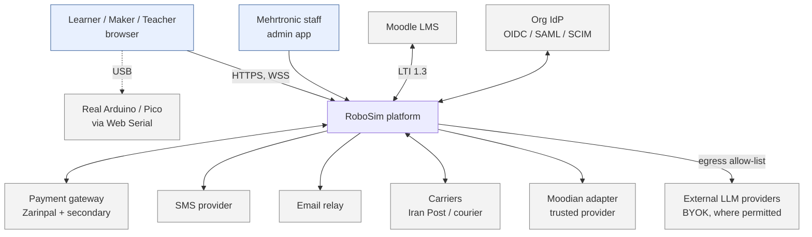
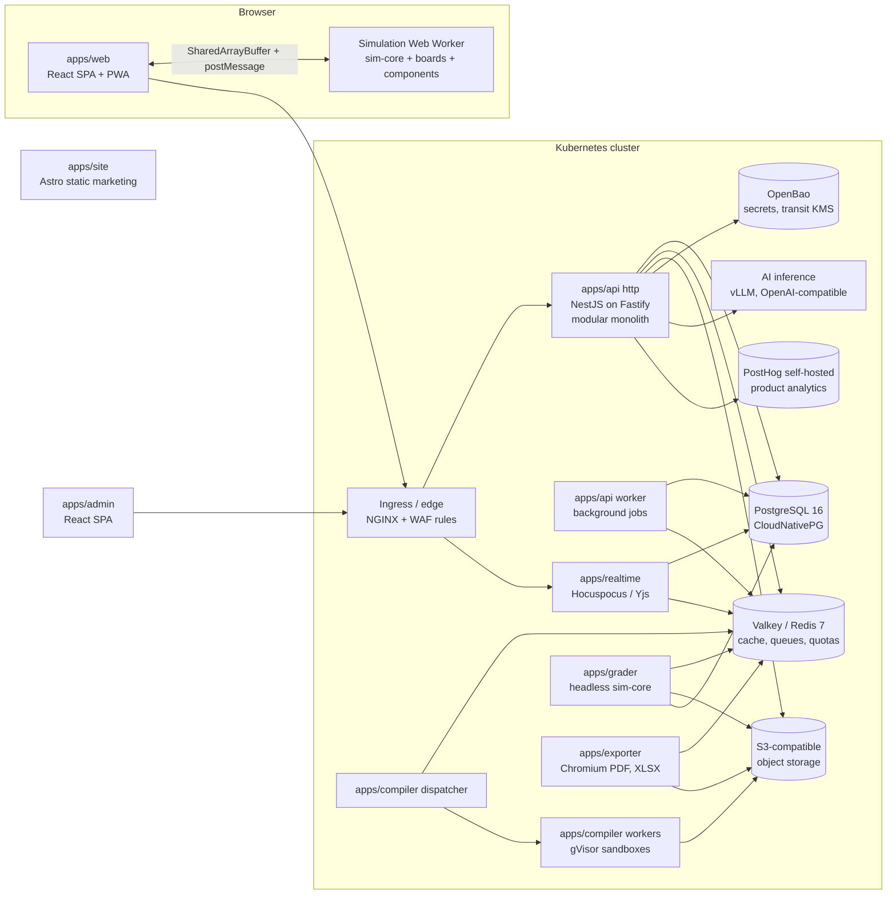
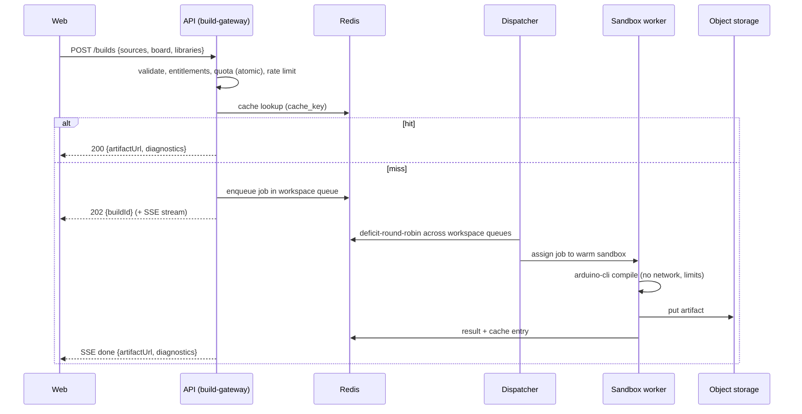
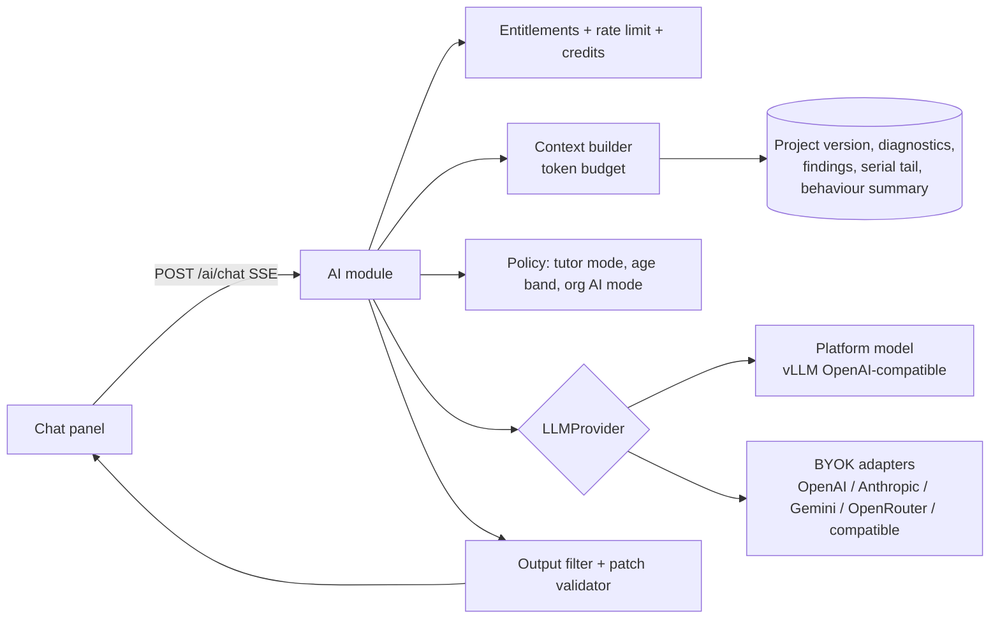

# RoboSim — Technical Design

**Version:** 1.0 · **Date:** 2026-10-13 · **Owner:** Engineering lead · **Status:** Approved for implementation
**Related:** [PRD](PRD.md) · [API Spec](API-Spec.md) · [Security](Security-Privacy-Compliance.md) · [Engineering Guide](Engineering-Guide.md) · [ADRs](decisions.md)

This document is the authoritative technical reference. When code and this document disagree, fix one of them in the same pull request.

---

## 1. Quality goals and architectural drivers

| Priority | Quality goal | Driver | Architectural consequence |
|---|---|---|---|
| 1 | **Simulation correctness and determinism** | Grading and competitions depend on reproducible results (FR-SIM-09) | Framework-free `sim-core` with fixed time steps, seeded PRNG, deterministic math; same package runs in browser and grader |
| 2 | **Security of untrusted code** | Every user submits C++ to our build farm | gVisor-sandboxed, network-less, disposable build containers (§6) |
| 3 | **Tenant isolation** | Schools and institutions | Workspace-scoped data, PostgreSQL RLS + application guards (§8.1) |
| 4 | **Works under poor connectivity** | Iranian network conditions | Client-side simulation, PWA, self-hosted everything, small bundles |
| 5 | **Extensibility by data** | Catalogue follows what Mehrtronic sells | Package registries for components, boards, rules; content registry for arenas/courses |
| 6 | **Operability in SaaS and on-prem** | Institution / Private Cloud editions | One Helm chart, no cloud-proprietary dependencies |

## 2. System context and containers

### 2.1 Context



### 2.2 Containers



| Container | Tech | Responsibility | Scales by |
|---|---|---|---|
| `apps/web` | React 19, Vite, TypeScript, Tailwind v4, shadcn/ui | Workspace, editor, simulator host, all user UI | Static (CDN/edge cache) |
| `apps/admin` | Same stack | Back-office (separate origin `admin.`) | Static |
| `apps/site` | Astro (static, SSR-free) | Marketing pages, docs, SEO in FA/EN | Static |
| `apps/api` (http) | Node.js 24 LTS, NestJS 12 (ESM) on Fastify 5, Drizzle ORM, Zod via Standard Schema | REST API, auth, all business modules | Replicas (HPA on CPU/RPS) |
| `apps/api` (worker) | Same codebase, `worker` entrypoint, BullMQ | Outbox relay, emails/SMS, reconciliation, retention, Moodian, search indexing | Replicas (KEDA on queue depth) |
| `apps/realtime` | Hocuspocus (Yjs) | Real-time collaboration documents and presence | Replicas with Redis extension |
| `apps/compiler` | Node.js dispatcher + worker; `arduino-cli` in sandbox image | Builds, cache, fair-share scheduling | Worker pods (KEDA on queue depth) |
| `apps/grader` | Node.js + `sim-core` | Verified runs for grading/competitions | Pods (KEDA) |
| `apps/exporter` | Node.js + Playwright Chromium, exceljs | PDF/XLSX/CSV/SVG exports | Pods (KEDA) |
| AI inference | vLLM (GPU) or Ollama (CPU/dev) | Platform-hosted open-weight models | GPU nodes |

Why a modular monolith for the API: one team, strong consistency needs across billing/entitlements/learning, and on-prem simplicity. Services are split out only where the runtime profile differs (untrusted code, CPU-bound simulation, headless browser, long-lived WebSockets) — see [ADR-002](decisions.md#adr-002--modular-monolith-api-with-separate-runtime-specific-services).

## 3. Repository layout

pnpm workspaces + Turborepo. Dependency direction is enforced by `dependency-cruiser` rules in CI (§3.1).

```
robosim/
├── apps/
│   ├── web/                    # Learner/teacher SPA (Vite)
│   ├── admin/                  # Back-office SPA (Vite)
│   ├── site/                   # Marketing site (Astro)
│   ├── api/                    # NestJS modular monolith (entrypoints: http, worker)
│   │   └── src/modules/        # iam, org, projects, build-gateway, learning, community,
│   │                           # billing, entitlements, commerce, ai, notifications,
│   │                           # analytics, admin, audit, content, search, lti
│   ├── realtime/               # Hocuspocus collaboration server
│   ├── compiler/               # Arduino build driver (avr-gcc), sandbox runner, CLI; toolchain.lock.json pins core + libraries
│   ├── grader/                 # Headless verified-run service; golden/ holds the golden-trace jobs + results
│   └── exporter/               # PDF/XLSX/CSV export service
├── packages/
│   ├── shared/                 # Domain types, Zod schemas, API contracts, error codes, project schema + migrations
│   ├── sim-core/               # Netlist, electrical solver, scheduler, component bus, world model, physics, sensors,
│   │                           # success-condition engine, deterministic math/PRNG. NO DOM, NO React.
│   ├── boards/
│   │   ├── avr-uno/            # Board impl (avr8js adapter, pin map, power tree, FQBN, upload protocol)
│   │   ├── avr-nano/
│   │   ├── avr-mega/
│   │   └── rp2040-pico/        # rp2040js adapter
│   ├── components/
│   │   └── <slug>/             # manifest.json, model.ts, model.test.ts, assets/ (svg, glb), calibration.json
│   ├── safety-rules/
│   │   └── <rule-id>/          # rule.ts, rule.test.ts, fixtures/, messages (i18n keys)
│   ├── sim-runtime/            # Worker host (SimHost), worker protocol types, circuit builder, demo scenarios + firmware
│   ├── renderer-2d/            # Canvas 2D arena renderer (consumes snapshots only)
│   ├── renderer-3d/            # three.js / @react-three/fiber renderer (consumes snapshots only)
│   ├── circuit-canvas/         # SVG breadboard editor + netlist builder bindings
│   ├── code-analysis/          # tree-sitter C++ (WASM) pin-usage extraction (implemented 2026-10-20)
│   ├── blockly-arduino/        # Block definitions, generators, translations
│   ├── hw-bridge/              # Web Serial STK500v1/v2, UF2 helpers
│   ├── ai-providers/           # LLMProvider adapters (server-only)
│   ├── ui/                     # Design system (shadcn-based, RTL-aware), icons, tokens
│   ├── i18n/                   # en/ and fa/ namespaces, ICU messages, key linter
│   ├── content/                # Built-in arenas, guided projects, courses (JSON + assets), content schema
│   ├── catalog/                # Registry of all component definitions (worker + grader) + cross-component tests
│   ├── test-fixtures/          # Test bench (part.pin wiring), AVR assembler firmware, golden circuits
│   └── config/                 # tsconfig, eslint, prettier, dependency-cruiser presets
├── infra/
│   ├── docker/                 # docker-compose.yml for local dev (WSL2-compatible)
│   ├── helm/robosim/           # Umbrella chart (values: saas, staging, onprem)
│   ├── argocd/                 # GitOps application manifests
│   └── images/                 # Base images (sandbox, chromium, node)
├── tools/                      # Scaffolders (new:component, new:rule, new:board), i18n checks, release scripts
├── Docs/                       # This documentation set
└── .github/workflows/          # CI pipelines
```

### 3.1 Dependency rules

| From | May depend on | Must not depend on |
|---|---|---|
| `sim-core` | `shared` | Anything with DOM, React, Node-only APIs |
| `boards/*`, `components/*`, `safety-rules/*` | `sim-core`, `shared` | `apps/*`, renderers, other component packages |
| `renderer-2d`, `renderer-3d` | `shared` (snapshot types) | `sim-core` internals (consume snapshots only) |
| `apps/web` | all browser packages | `ai-providers`, any server module |
| `apps/api` modules | `shared`, own module internals, other modules' **public** `index.ts` | Another module's repositories/tables |
| `apps/grader` | `sim-core`, `boards/*`, `components/*`, `safety-rules/*`, `shared` | `apps/api` internals |

## 4. Frontend architecture (`apps/web`)

| Concern | Choice | Notes |
|---|---|---|
| Routing | TanStack Router (code-based route tree, type-safe) | No generated route file, so typecheck needs no codegen step; route-level code splitting |
| Server state | TanStack Query | Generated client from OpenAPI (§API-Spec) |
| Editor state | Zustand stores per domain (`circuitStore`, `codeStore`, `simStore`, `uiStore`) | Collaboration mode binds stores to Yjs documents. *Current (slice 12):* the `/editor` workspace (`apps/web/src/editor`) keeps state in hooks: `useCircuitEditor` (document history), `useRun` (Run model), `useLayout` (pane sizes, `localStorage`); the browser project autosaves to `localStorage`. *Projects API (2026-10-21):* `/editor/$projectId` opens a cloud project; `useCloudSync` keeps a per-project draft in `localStorage` and saves to the server every 30 s, on Ctrl+S, on tab hide and on reconnect, with `If-Match` (412 → conflict dialog); `/projects` lists them |
| Forms | react-hook-form + Zod (`packages/shared`) | Same schemas as API |
| Circuit canvas | SVG rendered by React with memoized component nodes; pan/zoom by a single transform on the root group | [ADR-005](decisions.md#adr-005--svg-circuit-canvas); hit-testing via DOM, accessible component list mirrors canvas. *Current (slice 11):* `packages/circuit-canvas` — footprints and hand-drawn art on the 0.1" grid (document mm), pure document operations with undo/redo (200 steps), seats from geometry, `CircuitNets` (union-find, < 16 ms @ 200 parts / 400 wires), manifest-driven property panel, FA/EN library search. *Canvas completion (2026-10-21):* the scene renders in memoised layers (`scene.tsx`: board, parts, pin targets, wires), so pan and zoom only change the root transform. Band selection, group rotate/flip around the selection's centre, align/distribute (`alignComponents`, `distributeComponents`), a movable board (part id `board`, schema v4 `board.position`), and a minimap. Reads the catalogue through the engine-free `@robosim/catalog/manifests` entry; editor state is a hook until the Zustand stores land |
| Code editor | Monaco (lazy) | C++ grammar, Arduino completions from `packages/shared/arduino-api.json`. *Current (slice 13):* `apps/web/src/code-editor` — Monaco 0.57 self-hosted as its own lazy chunk (≈ 0.87 MB gz; editor worker via Vite `?worker`), trimmed to the editor contributions a sketch needs, plus an `arduino` Monarch grammar (C++ + Arduino functions/constants/types). Completions and the grammar's name lists come from `ARDUINO_API` in `packages/shared/src/arduino-api.ts` (TS, not JSON: typed and tree-shaken), one table per library in `arduino-api/` with classes, bases and global objects; `declaredClass`/`membersOf` resolve `x.` members. *D2 (2026-10-27):* hover provider and completion docs from the `apidocs` i18n namespace (`@robosim/i18n/apidocs`, loaded with this chunk; key `docKey(entry)`), clang-format WASM as a document formatter (`code-editor/format.ts`, own chunk), library manager (`ARDUINO_LIBRARIES`, parity-tested against `toolchain.lock.json`). One model per sketch file (tabs; `.h`/`.hpp`/`.c`/`.cpp` can be added, renamed and deleted, the `.ino` stays), build diagnostics as markers, theme follows `prefers-color-scheme`, no ligatures, always LTR. A textarea editor stands in while the chunk loads, if it fails, and under jsdom tests |
| Blocks | Blockly (lazy) | `packages/blockly-arduino` |
| Simulation host | Dedicated module Web Worker | §5.8 protocol. *Workspace Run model (slice 12):* Run compiles when the project's code changed since the last build (an unchanged demo runs its prebuilt firmware via `load { scenario }`), then `load { project, firmware }` + `run`. Any edit to circuit or code while live stops the run (`pause`, back to edit mode). While live the canvas is in run mode: parts take inputs (button held, switch toggled, popover sliders from manifest `inputs`) and show live state |
| 2D/3D | `renderer-2d` (Canvas 2D), `renderer-3d` (r3f + drei, lazy) | Both subscribe to the same snapshot buffer. *Current (slice 14):* `renderer-2d` paints the floor from the arena's vectors (the scene no longer ships a raster), draws obstacles (live poses of pushable ones from `Frame.obstacles`), has a camera (zoom/pan/follow), a trail, a sensor/wheel overlay and start-pose handles. The overlay is built on the main thread from part states and `RobotScene.mounts`, so it is live-view only and the grader trace is unchanged |
| i18n | i18next + ICU, namespaces per feature | `dir` attribute on `<html>`; Tailwind logical utilities only |
| Offline | Workbox service worker: app shell, fonts, component assets, last-used arenas; IndexedDB for projects, build cache | Background sync for pending saves |
| Isolation | `Cross-Origin-Opener-Policy: same-origin`, `Cross-Origin-Embedder-Policy: require-corp` | Enables SharedArrayBuffer; all assets same-origin (no third-party CDNs anyway) |

**Bundle budget:** app shell < 300 KB gz; lazy chunks: Monaco (~1 MB gz, cached), Blockly (~350 KB), 3D (~250 KB + models), sim worker (~200 KB + board/component chunks loaded per project).

## 5. Simulation engine (`packages/sim-core`)

### 5.1 Responsibilities

`sim-core` turns a **project** (netlist + properties + mounting), a **firmware artifact**, an **arena**, a **start pose**, a **seed**, and an **input log** into a stream of **snapshots** and **events**. It runs unchanged in a browser Web Worker and in Node (`apps/grader`).

### 5.2 Core interfaces

```ts
// packages/sim-core/src/contracts.ts (abridged)

export type Level = 0 | 1;

export interface FirmwareImage {
  format: 'ihex' | 'uf2' | 'elf';
  bytes: Uint8Array;
  sha256: string;
}

export interface McuCore {
  readonly clockHz: number;
  readonly cycle: number;                     // monotonically increasing CPU cycle count
  run(untilCycle: number): void;              // executes, applying scheduled input events at their exact cycles
  scheduleInput(pin: PinId, value: PinDrive, atCycle: number): void;
  pinOutputs(): ReadonlyMap<PinId, PinOutput>; // mode, level, pwm {dutyRatio, freqHz} derived from timer registers
  onPinEdge(cb: (pin: PinId, level: Level, cycle: number) => void): Unsubscribe; // for software PWM, servo pulses, TRIG
  uart(index: number): UartPort;
  i2c(index: number): I2cBus;
  spi(index: number): SpiBus;
  reset(): void;
}

export interface Board {
  id: string;                                 // 'avr-uno'
  fqbn: string;                               // 'arduino:avr:uno'
  pins: readonly BoardPinDef[];               // id, label, capabilities (pwm, adc, i2c…), absMax, maxCurrentMa
  power: PowerTreeDef;                        // USB 5 V, VIN → regulator → 5 V/3.3 V rails, limits
  createCore(fw: FirmwareImage): McuCore;
  upload: UploadProtocolDef;                  // used by hw-bridge
}

export interface ComponentModel<Props = unknown, State = unknown> {
  readonly type: string;                      // manifest id, e.g. 'driver.l298n'
  init(ctx: ModelContext, props: Props): void;
  stamp(s: MnaStamper): void;                 // electrical contribution (resistors, sources, PWL diodes, behavioural blocks)
  step(dt: number, io: ComponentIO): void;    // reads node voltages / branch currents, MCU signals; writes mechanical outputs
  faults(): readonly Fault[];                 // runtime fault detection feeding the damage model
  snapshot(): State;                          // render + inspector data (plain, structured-clone-able)
}

export interface WorldModel {
  step(dt: number): void;                     // fixed-step physics
  raycast(origin: Vec2, dir: Vec2, maxDist: number): RayHit | null;
  sampleFloor(p: Vec2, radius: number): number; // luminance 0..1
  bodies(): readonly BodySnapshot[];
}

export interface ComponentDefinition {       // exported by every packages/components/<slug>
  manifest: ComponentManifest;                // pins, props (defaults/ranges), inputs, limits, mass, nameKey
  create(): ComponentModel;
  internalConnections?(): [pin, pin][];       // same-conductor pins (breadboard strips) merged by the netlist; the part is topological only
  // Manifest wiring hints (slice 16a): bondedPins (pins joined inside a simulated part, e.g. a display's two
  // commons, a buck module's shared ground), signalPassthrough (a series resistor: MCU edges and PWM reach parts
  // behind it through io.edges / io.pwm), isolationGroups (pins with no path between them, e.g. relay coil vs contacts).
}
// WorldModel.componentPose(id) gives a mounted part's arena pose (null on the bench). A part on a servo horn
// (MountSpec.onHorn) turns about the servo's mount point by HornActuator.hornAngle() (Servo: angleDeg − 90°, CCW,
// read live each step); PlanckWorld.bind resolves the horn by component id. sim-core/sensors.ts has the
// shared optics (irReflectance, sonarRange). io.scheduleMcuInput(net, level, time) drives MCU inputs at an exact cycle
// (e.g. an HC-SR04 echo), bypassing per-slice thresholding.
// ComponentIO also offers io.pwm(net) (MCU PWM duty on a net) and io.edges(net) (cycle-stamped pin edges),
// and ComponentModel.input(name, value) receives user interaction (button, pot, light level).

export interface SuccessCondition { /* declarative JSON, see §5.7 */ }
```

### 5.3 Scheduler

Fixed slices of simulated time drive everything; wall-clock only decides **how many** slices to run.

```
SLICE      = 1 ms simulated              // MCU ↔ component bus exchange
PHYS_DT    = 2 ms simulated              // planck.js step (every 2nd slice)
SNAPSHOT   ≤ 60 Hz wall-clock            // to renderers

loop (worker, requestAnimationFrame-independent timer):
  target = simTimeAtStart + wallElapsed × speed
  budget = 12 ms wall per tick
  while simTime < target and budget left:
      core.run(cycleAt(simTime + SLICE))            // inputs scheduled with cycle precision
      bus.readMcuOutputs()                          // levels, PWM duty/freq from timer registers
      if bus.dirty: mna.solve()                     // §5.4, only when topology/values/drives changed
      for c in components: c.step(SLICE, io)        // motors → torque, servos → angle, LEDs → brightness
      if slice is even: world.step(PHYS_DT); sensors.sample(world) → core.scheduleInput(...)
      safety.runtime(mna, components)               // §5.6; may set components damaged
      conditions.evaluate(state)                    // §5.7
      simTime += SLICE
  realTimeFactor = (simTime − simTimeAtTickStart) / wallTickElapsed
  publishSnapshot()
```

- If the budget is exhausted before reaching `target`, simulation **slows down**; it never drops cycles (FR-SIM-05).
- The grader runs the same loop without wall-clock pacing (as fast as possible) and with a maximum simulated duration.
- Simulated time is an integer slice counter (`simTime = slice / 1000`), so no floating-point drift accumulates; the MCU cycle at a slice boundary is `round(slice × clockHz / 1000)`. Components that invalidate the circuit during their `step` are re-solved within the same slice, so sensor outputs reach MCU inputs without an extra slice of latency.
- **Input settling (slice 16a).** Inputs are otherwise thresholded at the end of each slice. The scheduler also solves once at power-on, before the first instruction, and again whenever firmware changes a pin's mode (`McuCore.onPinModeChange`), applying inputs at that cycle. A fresh `INPUT_PULLUP` or a knob on A0 therefore reads its real level at once, as on hardware, instead of 0 V for up to 1 ms (which looked like a button press at start-up).
- Board adapters (e.g. `boards/avr-uno`) apply scheduled inputs at their exact CPU cycle, between instructions. PWM duty and frequency come from WGM/COM/CS/OCR/ICR registers per the ATmega328P datasheet. avr8js's emulated waveform can differ from the datasheet by one timer tick, which the conformance tests tolerate.
- PWM duty is derived from timer configuration registers (TOP/OCR, prescaler, mode) — not by sampling edges at 1 ms, which would be wrong. Software-generated pulses (Servo library, bit-banged PWM, HC-SR04 TRIG) are measured from cycle-stamped edges via `onPinEdge`.

### 5.4 Electrical model

A small **modified nodal analysis (MNA)** solver covers the whole circuit at DC operating points:

| Element | Stamp |
|---|---|
| Wire / breadboard strip | Node merge (union-find) during netlist build |
| Resistor, potentiometer, LDR | Conductance |
| Battery, regulator output, USB | Voltage source with internal resistance; regulators as behavioural sources with dropout and current limit |
| MCU output pin | Voltage source (0 V / Vcc) with output resistance from the board manifest (~25 Ω for ATmega328P), so pin current falls out of the solution |
| MCU input pin | High impedance + optional internal pull-up (~35 kΩ) when `INPUT_PULLUP` |
| LED, diode | Piecewise-linear model (Vf, Rs), solved by iterating region selection (≤ 10 iterations) |
| DC motor | Resistance + back-EMF source `Ke·ω` (ω from the mechanical model of the previous slice) |
| L298N / TB6612 | Behavioural: logic inputs high-Z, read as MCU PWM duty (`io.pwm`) or as thresholded DC levels. Each enabled output is a PWM-averaged leg (transformer element): `V = f·(Vs − 1.6 V) − 0.5 Ω·I`, drawing `f·I` from VS. That gives a total drop of 1.75 V at 0.15 A and 2.1 V at 0.5 A. The onboard 78M05 needs VS ≥ 7 V; below that the logic browns out. ENA/ENB jumpers are installed by default, as shipped |
| Servo, sensors, modules | Behavioural current sinks from manifest (`idle`, `active`, `stall` currents) |
| Zener diode (Tier A) | Two PWL diodes in anti-parallel: forward (Vf ≈ 0.7 V) and reverse breakdown (Vf = Vz, Rs = Zzt) |
| Linear regulator (Tier A) | `voltageSource(out, gnd, Vout, r, { supplyFrom: in })` while `Vin − Vout ≥ dropout`; in dropout the output follows `Vin − dropout` (re-stamped by `step`). Current limit and `P = (Vin − Vout)·I` against the package rating feed faults |
| Buck module (Tier A) | `transformer` from input to output with `ratio = Vset / Vin` updated each slice from the solved input, so input current = `Vout·I / (η·Vin)` |
| Logic IC output (Tier A) | Voltage source to VCC or GND with the family's output resistance (74HC ≈ 50 Ω at 4.5 V); inputs are high impedance and thresholded at `0.3·VCC` / `0.7·VCC` (74HC14 with Schmitt hysteresis) |
| Relay coil, stepper coil (Tier A) | Conductance with `traits: ['inductive']`; relay contacts are a conductance between COM and NO/NC that changes after the operate/release time |
| Capacitor (Tier B, B1) | Branch element `capacitor(a, b, C, state, { esr })`: across a step h, `V(a) − V(b) = (ESR + 1/(a₀·C))·I + v_hist` (BDF2 companion, below); open in a DC solve. Electrolytics add leakage (≈ 0.002·C·V µA), a reverse-conduction PWL diode above ≈ 1 V reverse bias, and ESR from tan δ at 120 Hz |
| Inductor, motor winding (Tier B, B1) | Branch element `inductor(a, b, L, state, { seriesResistance, emf })`: `V = r·I + L·dI/dt + emf`, short in a DC solve. The TT motor is now R + L (1.5 mH) + back-EMF with 2.2 kΩ of brush/eddy losses across it, so interrupting its current produces a real kickback. L298N, TB6612FNG and L9110S stamp their clamp/body diodes, so a coasting motor's current recirculates |
| NE555 (Tier B, B1) | Internal divider stamped (5 kΩ to CTRL, 10 kΩ below, so CTRL works); comparators and flip-flop evaluated in `settle` on the instantaneous solution; output high as a ratio-1 transformer leg from VCC (VCC − 1.4 V, 3 Ω), low 0.05 V + 7 Ω; discharge 15 Ω; 3 mA quiescent |
| BJT (Tier B, B2) | `bjt(c, b, e, { polarity, beta, vbe, rb, vceSat, rceSat })`, solved by region iteration with the diodes: cutoff; active, with the base-emitter junction as a PWL diode (`Vbe = vbe + rb·Ib`) and `Ic = β·Ib` as a voltage-controlled current source; saturation, `Vce = Vce(sat) + r·Ic`. NPN and PNP share the equations with every polarity reversed |
| MOSFET (Tier B, B2) | `mosfet(d, g, s, { polarity, vth, k, gateScale })`, level 1: cutoff, saturation `K·(Vgs − Vth)²`, triode `K·(2·Vov·Vds − Vds²)` (so `Rds(on) = 1/(2K·Vov)`), symmetric for reverse Vds. Linearised at its operating point and solved by Newton steps (Vgs limited to 2 V per step) in the same loop as the PWL elements, up to 60 passes |
| Transistor packages (Tier B, B2) | Parts add what the package has: an avalanche PWL diode at BVceo / BVdss (where an unclamped kickback ends up), the MOSFET body diode, the TIP120's 8 kΩ base resistor and emitter-collector diode. The solver reports each device's dissipation per operating point (`TransistorReading.power`), so PWM and slice averaging give the real mean power; it heats a first-order junction model (θJA, τ; TO-92 200 °C/W, 15 s; TO-220 62.5 °C/W, 45 s) and a part past Tj(max) or its current rating fails short |

Besides R/G, current sources, voltage sources and PWL diodes, the stamper offers two branch elements. `voltageSource(…, { supplyFrom })` draws the delivered current from another net, so a linear regulator loads the battery behind it. `transformer(…)` is an ideal averaged DC transformer, `V(sec) = ratio·V(pri) − offset − r·I`, with `ratio·I` drawn from the primary, for PWM-averaged bridges and buck stages.

Implementation notes: every net has GMIN = 10⁻¹² S to ground (as in SPICE), so floating islands solve to 0 V instead of producing a singular matrix. Off diodes leak 10⁻⁹ S. Voltage sources add one branch unknown each; their reported current is the current delivered out of the + terminal. Diode regions warm-start from the previous solve; a result that has not settled after 10 passes is returned with `converged: false`. PWM pins are not stamped at their average voltage, because that is wrong for nonlinear loads: a 25 % LED would sit below Vf and stay dark. Instead the scheduler solves k + 1 operating points (all PWM pins low, then each PWM pin high on its own) and blends them as `avg = base + Σ dutyᵢ·(solᵢ − base)`. This is exact when PWM-driven sub-circuits are independent (separate LEDs, motor channels) and an approximation when they are coupled. Behavioural drivers can still read the duty directly.

Circuits are small (< 200 nodes), so a dense LU decomposition is used; solves only happen when something changed (typically ≤ 1 kHz, microseconds each). Digital levels seen by MCU inputs are thresholded from node voltages using the board's `VIL`/`VIH`.

**Digital timing within a slice (catalogue Tier A, slice 16b).** MCU inputs are thresholded once per slice, and a component that changes its stamp in `step` is re-solved once after all components stepped. That is enough for LEDs and motors, but not for two digital cases. Two opt-in hooks cover them. Components that implement neither behave exactly as before, so existing goldens do not change.

| Hook | Problem it solves | Behaviour |
|---|---|---|
| `settle(io): boolean` | A chain of gates (74HC00 → 74HC86 → LED) would advance one stage per slice | After the post-step solve, the scheduler calls `settle` on combinational parts, re-solves while any returns `true`, at most 16 passes. Then it reports `SAF-LOGIC-OSCILLATION` (a ring oscillator never settles) |
| `mcuEdge(net, level, time, io)` | The Keypad library pulls a row LOW for a few microseconds and reads the columns in that window. A per-slice solve never sees it | Called synchronously from the core's edge callback for the input nets in the part's `logicNets()` (directly or behind series resistors). The part answers with `io.scheduleMcuInput(net, level, time)` at the same cycle, which avr-uno applies before the next instruction. The slice-end DC solve then makes the circuit consistent again |
| `io.emitEdge(net, level, time)` | A 74HC595's QH′ feeds the next 595, and a ULN2003A passes step timing on to a stepper. Both happen faster than a slice | A part publishes the timed edges it drives. Parts reading `io.edges(net)` later in the slice see them; logic parts step producers-first (topological order of `logicNets()` inputs and outputs, feedback loops by document order) |

`io.edges(net)` remains the way to consume pulse trains after the fact: servo pulses, `tone()` (passive buzzer frequency), and `shiftOut` into a 74HC595, which samples SER at each rising SRCLK edge and copies to its outputs on the rising RCLK edge (equal-time ties: clocks before data, so a chained QH′ is sampled before it changes). A level that comes from the operating point instead of edges (a button, a tied pin) is applied at the start of the slice, since user inputs land between slices. The 28BYJ-48 follows timed coil edges the same way, so stepping faster than its pull-in rate (≈ 1200 half-steps/s) loses steps instead of aliasing against the 1 ms slice. Shared CMOS behaviour (thresholds as fractions of VCC, Schmitt levels, push-pull outputs drawing from VCC, 74HC and CD4000 families) lives in `sim-core/src/logic.ts`.

`io.scheduleMcuInput` drives only pins currently in input mode, so a part's answer never overrides a pin the firmware drives. The floating-input rule ignores pins that were outputs within the last 0.5 s (`Simulation.lastDrivenAt`): scanned lines such as keypad columns float between scans by design. In the editor, an art element marked `data-input="<name>"` is a momentary button for that input, and parts whose inputs are all buttons (a keypad) get the `keys` interaction instead of a popover.

**Reactive circuits (catalogue Tier B, slice B1).** A circuit without capacitors or inductors still solves DC operating points only, exactly as before. As soon as one is stamped, `Simulation.transient` turns on and every slice is integrated in time:

- **Steps.** Each capacitor and inductor is a branch whose companion depends on the step h and on its `ReactiveState` (`volts`, `amps` and one step of history), which the part owns and the integrator updates after every accepted step. Steps use variable-step **BDF2** (Gear 2: second order and L-stable, so a stiff decoupling capacitor never rings) and fall back to backward Euler for the first step after a discontinuity, as SPICE does. Step length follows the local truncation error (1 mV / 0.1 mA plus 0.1 %), between 1 µs and the 1 ms slice, so a quiet circuit costs one step per slice.
- **MCU in chunks.** The MCU runs ahead one step at a time, and its inputs are thresholded after every chunk. A 555 output on D2 therefore reaches `pulseIn()` within one step, not at the end of the slice.
- **Edges as breakpoints.** MCU pins whose signal reaches a reactive net (directly or through a series resistor, via `signalPassthrough`) are stamped at their real level between their cycle-stamped edges, instead of being PWM-averaged. An RC filter on a PWM pin ripples, and a timer sees every edge. Other PWM pins keep the k + 1 averaging.
- **Switching parts.** After each step, `settle` runs on the instantaneous operating point. A part whose comparator is about to switch says so in `pendingSwitch(solution)`, and the integrator halves the step until the switch lands within a microsecond. An NE555 astable then runs within 2 % of `1 / (ln 2 · (R1 + 2·R2) · C)`.
- **What parts see.** Components `step` on the slice's time-weighted average (`WeightedSolution`), like PWM averaging, so an LED blinked at 1 kHz shows its mean brightness. `ComponentIO.now` gives the time of the operating point being read (a sub-step during integration). `Simulation.netEnvelope(net)` keeps each net's minimum and maximum over the slice's sub-steps, so a microsecond kickback that the average hides stays visible.
- **DC-only analysis.** Static safety probes run with `dcOnly`: capacitors are open (as when charged) and inductors short, so a large electrolytic across a battery is not an inrush short, and a reversed one shows its reverse bias.
- **Cost.** A 1 Hz 555 blinker takes about 5 ms of CPU per simulated second, a 690 Hz astable about 90 ms, a 6.9 kHz one about 630 ms.

**Transistors (catalogue Tier B, slice B2).**
- **Switching inductive loads edge by edge.** In a reactive circuit, MCU pins whose signal reaches a transistor's base or gate are also edge-driven. Averaging a PWM-switched motor's on and off phases would make its freewheeling diode chatter around zero current and collapse the step size; with real edges a 490 Hz TIP120 motor costs about 25 steps per slice. If a core reports no edges (the static analyzer's fixed outputs), edge-driven pins follow their output level.
- **Kickback.** The TT motor's 1.5 mH winding keeps its current when the switch opens. A flyback diode clamps the collector one drop above the supply. Without one, the collector rises to the transistor's breakdown voltage, and the energy goes into the avalanche diode. A BJT has no avalanche rating, so it reports `OVER_VOLTAGE` for 10 ms after each breakdown. Kickbacks repeated by PWM therefore add up to sustained abuse that the damage model acts on, while a single switch-off does not. A MOSFET is avalanche-rated: it reports `AVALANCHE`, which is not damaging, and heats up.
- **Static switch-off probe.** `StaticContext.transition(pin, from, to)` integrates the circuit in time with the pin at `from` for 30 ms, switches it, and returns each net's peak over the next 5 ms. `SAF-FLYBACK` probes only pins whose signal reaches a transistor's control input, and only when the circuit has both a coil and a transistor.
- **Gate drive.** A MOSFET whose scaled Vgs is between Vth and its full-enhancement voltage while carrying more than 50 mA reports `PARTIAL_ENHANCEMENT` (not damaging). The IRF520 module, rated at 10 V and seeing 10/11 of SIG through its divider, reports it from a 5 V pin, current-limits at about 0.6 A and heats.

**MCU buses (catalogue Tier C, slice C1).**
- **Peripherals.** `boards/avr-uno` wires avr8js `AVRTWI` and `AVRSPI` to the core (`McuCore.busPins`, `attachI2c`, `attachSpi`; Uno: SDA A4, SCL A5, MOSI D11, MISO D12, SCK D13). A TWI byte completes after 9 SCL periods (start and stop after one), so `Wire` at 100 kHz takes ≈ 90 µs per byte; an SPI byte after the prescaler's 8 SCK periods.
- **Routing.** `I2cRouter` and `SpiRouter` (`sim-core/src/buses.ts`) deliver a transaction to the parts whose `i2c()` / `spi()` device sits on the MCU's bus nets (directly or behind series resistors). An I²C transfer starts only when both lines idle at or above the MCU's VIH: without pull-ups nothing answers, as on hardware. Every part that matches the address takes the transfer, reads are wired-AND, and an unanswered address NACKs. An SPI target takes part while its CS is driven or tied low. `RegisterPort` implements the register-pointer protocol that most sensors share; `stampPullUp` stamps a breakout's pull-ups to its VCC or to its onboard 3.3 V regulator.
- **Manifests.** An `i2c` block names the bus pins, the default address, an enum prop or a pin that selects another address (`addressProp`, `addressPin`), the highest tolerated bus voltage (`maxBusV`) and a reset pin (`resetPin`, VL53L0X XSHUT). The static rules read it: `SAF-I2C-PULLUP` (a line that idles below 1.5 V has no pull-up, warning), `SAF-I2C-ADDRESS` (two parts answer the same address; parts whose reset pin the MCU controls can be re-addressed one by one and do not count), `SAF-I2C-LEVEL` (a 3.3 V part on a bus pulled up above its `maxBusV` + 0.3 V).
- **Power-on.** A real Uno runs `setup()` about 65 ms after power is applied (start-up delay fuses), so modules are powered and booted by then. The scheduler calls the optional `powerOn(io)` hook once at the power-on operating point; the BMP280 and VL53L0X use it to skip their start-up and boot times at t = 0, and still apply them after a later power-up or XSHUT release.
- **Parts.** SSD1306 OLED (full command set, page/horizontal/vertical addressing, scrolling; the frame buffer travels in the snapshot and the canvas draws it pixel for pixel), 16×2 LCD with PCF8574 backpack (HD44780 with busy times, 4-bit mode, CGRAM; the canvas renders a 5×8 character ROM), MPU-6050 (bench tilt or the robot's body acceleration and yaw rate via `WorldModel.componentMotion`, DLPF, sample-rate divider, offsets and noise from the seed, data-ready INT), BMP280 (datasheet compensation inverted to raw ADC words, oversampling noise, IIR filter, forced and normal modes; I²C or SPI once CSB is pulled low), VL53L0X (the register protocol of the Pololu library, timing budget from its timeout registers, 25° cone ray cast, 1.2 m default range, GPIO1 interrupt, `setAddress`, XSHUT).
- **3.3 V.** The project loader maps the Uno's 3V3 pin to a 3.3 V source (0.5 Ω, 150 mA) like the 5V pin.

**Single-wire buses (catalogue Tier C, slice C2).**
- **Seeing the master.** DHT and 1-Wire libraries pull the line low with `pinMode(OUTPUT)` while the port bit is already low, and release it by turning the pin into an input. Neither is an output edge, so the core also reports mode changes with the output level, and parts get `mcuMode(net, mode, level, time, io)` next to `mcuEdge` (after the scheduler re-settled the inputs). `OpenDrainWatch` (`sim-core/src/single-wire.ts`) turns both into *fall* and *release (low for t)* events.
- **Answering.** A part answers with cycle-exact `scheduleMcuInput` pulses scheduled ahead (`pullLow`); after each pulse the input returns to the level the circuit gives without the part, so a missing pull-up still breaks the bus. Several DS18B20 schedule their zeros identically, which gives the wired-AND of a shared bus.
- **Parts.** DHT11 module (≥ 18 ms start signal, 80/80 µs response, 40 bits of 50 µs LOW + 27 or 70 µs HIGH, checksum; one sample per second, none in the first second; seeded ±1 °C / ±3 %RH error), DS18B20 (reset/presence, READ/MATCH/SKIP/SEARCH/ALARM SEARCH ROM with a seeded ROM code and CRC-8, CONVERT T in 94–750 ms by resolution with busy read slots, scratchpad with CRC, EEPROM copy/recall, parasite power when VDD is grounded), WS2812B strip (HIGH time < 0.55 µs is a 0, longer a 1, 24 GRB bits per LED, the rest regenerated on DOUT with `emitEdge` for the next strip, latched after 50 µs LOW; supply current from the colours). A strip's `peakCurrentMa` is per LED (`peakCurrentPer: "count"`), so `SAF-SUPPLY-OVERLOAD` flags long strips on the Uno's 5 V pin.

### 5.5 Physics and sensors

| Model | Implementation |
|---|---|
| Chassis | planck.js dynamic body (`PlanckWorld`, deterministic trig per [ADR-021](decisions.md#adr-021--planckjs-with-trigonometry-routed-through-dmath)), zero gravity (top-down). Mass and inertia come from the chassis geometry plus mounted components (manifest masses), plus the gearbox inertia reflected to each wheel (J/r²). The static load is split between axle and caster by the lever rule. *Current (slice 15, FR-ARN-09):* every mounted part, and the board, is a point mass at its mount with its own box inertia m(l² + w²)/12 from the manifest's `mounting` footprint. Parts plugged into a mounted part ride at their host's mount. `robotMass` (`@robosim/sim-core/mass`, engine-free, only + − × ÷) gives the centre of mass, the inertia about the axle midpoint and the axle share. Physics and the mounting editor use the same function, and `RobotScene.centerOfMass` carries the result to the UI |
| Wheels | Longitudinal force `F = τ/r` at each wheel's mount point; lateral friction impulse cancels sideways slip up to `μ·N`; rolling resistance; caster as low-friction contact |
| Motor dynamics | `τ = Kt·i`, `i = (V − Ke·ω)/R`, with gearbox ratio and efficiency. Drive motors implement `WheelActuator`: every physics step the world reads `shaftTorque()`, applies `F = τ/r` capped at μ·N, and imposes the resulting wheel ground speed via `setShaftSpeed()` (no-slip coupling). That speed sets the back-EMF of the next electrical solve. On the bench (no world) the motor integrates its own first-order mechanics |
| Battery | Open-circuit voltage curve by state of charge + internal resistance → sag under load |
| Line sensor | Floor is a luminance raster (1 px = 1 mm), rasterised deterministically from the arena's vector paint (`rasterizeFloor`); built-in arenas live in `packages/content` (*current, slice 14:* eight arenas in `BUILTIN_ARENAS`, nine since 2026-10-31 with `oval-wide-gaps`, engine-free subpath `@robosim/content/arenas` with default challenges and the start-pose fit check `startPoseProblem`, which the loader and the editor share). Sensor samples a disc whose radius depends on mount height; reflectance → analog voltage via calibration curve; digital modules apply comparator threshold (potentiometer property) with hysteresis |
| Ultrasonic | On a valid TRIG pulse (≥ 10 µs, cycle-stamped), cast 7 rays across a 15° cone; nearest hit distance `d` within 2–400 cm → ECHO HIGH after calibrated latency for `2d / 343 m·s⁻¹`; no hit → timeout pulse like the real module |
| Contact skin | planck separates polygons and edges by `polygonRadius` (1 cm each). `PlanckWorld` insets polygon fixtures and moves the perimeter out by that skin, so bodies touch at their true outlines, and `raycast` subtracts it again (`skin / cos(incidence)`), so ranging measures the true faces (slice 16c) |
| Bump switch | *Tier A (slice 16c):* the lever is a short ray cast from the switch's mount pose (reach from the manifest). A wall or obstacle within reach closes the contact; the robot body's own collision still stops it. Avoids contact listeners, so it stays deterministic and engine-free |
| IR obstacle, line array (Tier A) | FC-51 uses `sonarRange`-style ray casts with an IR reflectance threshold set by its potentiometer prop. The 5-channel array samples the floor raster like the 3-channel module |
| Encoder (P4) | Ticks from wheel angle with slots-per-revolution from manifest |
| IMU (Tier C) | MPU-6050: gravity rotated by the bench tilt or, mounted, the body's acceleration and yaw rate (`componentMotion`) in the sensor frame, plus seeded offsets and noise, through its I²C register map |
| Laser ranger (Tier C) | VL53L0X: 5 rays across a 25° cone from its mount pose; nearest hit within 1.2 m (2 m with a lowered signal-rate limit), σ = 2 mm + 1.5 % scaled by the timing budget; 8190 mm when nothing is in range |

### 5.6 Safety in the engine

- **Static rules** (`packages/safety-rules`) run on the netlist + manifests + code-analysis facts, in the main thread (debounced 300 ms) and once before each run. *Implementation:* static analysis currently runs when a run is loaded (on Run) inside the sim worker, not debounced while typing. `analyzeCircuit` does not guess from topology. It **solves** the circuit with fresh models at power-on (every MCU pin high-Z), and on demand with one pin driven HIGH or LOW (memoised). Rules then read voltages, pin currents and component faults. Drive probes follow the sketch (2026-10-20): when the code facts are complete (no unresolved calls or registers, and only `Arduino.h`/`Servo.h`/`Wire.h`/`EEPROM.h` includes), worst-case drive probes run only on pins the sketch drives. Otherwise the conservative set applies (every wired pin not on a part output), so sketches using libraries such as LiquidCrystal, SPI or SoftwareSerial keep the old behaviour.
- **Code analysis** (`packages/code-analysis`, `@robosim/code-analysis` 0.1.0, FR-COD-06, 2026-10-20): tree-sitter C++ through WASM (`web-tree-sitter` 0.27.0 + `tree-sitter-cpp` 0.23.4; their native node-gyp builds are disabled in `pnpm-workspace.yaml` `allowBuilds`). `tree-sitter-cpp.wasm` (3.3 MB, 273 KB gz) is fetched lazily, outside the initial bundle. The build copies both WASM files to `dist/wasm/`, exported as `@robosim/code-analysis/web-tree-sitter.wasm` and `/tree-sitter-cpp.wasm` (the web app imports them with `?url`). API: async `initCodeAnalysis({ runtime, cpp })` (URL strings in browsers, bytes in Node via `@robosim/code-analysis/node` `nodeCodeAnalysisWasm()`), then sync `analyzeSketch(files) → CodeFacts` (type in `sim-core/src/safety/types.ts`): `uses` (pin D0–D13/A0–A5, use `pinMode|digitalWrite|digitalRead|analogWrite|analogRead|servo|tone`, pinMode mode, `at` = file + 1-based line/column), `unresolved` (pin calls whose pin or mode is not a constant, plus DDRx/PORTx register access) and `includes` (library includes; the project's own files left out). Constants resolve from literals (dec/hex/bin/octal, suffixes), A0–A5, `LED_BUILTIN`, `HIGH`/`LOW`, `INPUT`/`OUTPUT`/`INPUT_PULLUP`, `#define`, const/constexpr integers, `+ − ×` and parentheses. Names defined twice with different values, or circularly, are not constants. `analogRead` takes channel 0–5 or pin 14–19. `Servo.attach` counts only on objects declared `Servo` (including class members). Anything else is `unresolved`, never guessed.
- **Code-aware rules** (FR-SAF-03, `packages/safety-rules/src/rules/code-rules.ts`, part of `STATIC_RULES`, silent without a sketch; findings carry `codeRefs` file/line/column): `SAF-CODE-PWM-PIN` (warning; `analogWrite` on a non-PWM pin), `SAF-CODE-OUTPUT-CONFLICT` (error; pin driven as output via `pinMode OUTPUT`, `analogWrite`, `tone` or `Servo.attach` on a net with a part's `output` pin or another driven MCU pin), `SAF-CODE-FLOATING-INPUT` (warning; plain input whose net has > 10 MΩ to ground in the power-on probe, via `StaticProbe.netResistance`; skipped while any `pinMode` is unresolved, for pins also driven or pulled up, and for nets shared with a driven pin), `SAF-CODE-SERVO-PWM` (warning; Servo attached makes `analogWrite` on D9/D10 unreliable, Timer1). EN + FA texts in `packages/i18n` `safety.json`.
- **Integration:** the project loader analyses `doc.code.files` and passes the facts to `analyzeCircuit(circuit, rules, board, code)`, so the editor and grader share findings. Loading and grading stay synchronous, so every host awaits `initCodeAnalysis` first (the sim and verify workers via `apps/web/src/lab/code-analysis.ts`, which queues commands until ready; grader CLI; perf script; test setups). The editor's sketch panel shows each code reference as a Monaco marker and lists "Safety checks in the code" under the editor; clicking jumps to the line.
- **Generic rules read manifests** (FR-SAF-05): `traits` (`inductive`, `led`, `source`), `polarity` [+, −], `supplyPins` (with an optional enabling prop, e.g. the L298N regulator jumper), `pinMaxVolts`, `isolationGroups`, and `limits.maxVoltageV` / `limits.peakCurrentMa`. `validateManifest` checks that they reference real pins. The common-ground rule only warns when a separately grounded supply's circuit reaches the Arduino side through some part; a circuit isolated behind relay contacts needs no common ground.
- *Packaging:* one `packages/safety-rules` package with a folder per rule group and trigger/clean fixture tests per rule. The framework (`analyzeCircuit`, `SafetyMonitor`, rule and finding types) lives in `sim-core/src/safety`.
- **Runtime rules** (`SafetyMonitor`, a slice observer evaluated every 5 ms; rules may declare a slower `periodS`) run on MNA results: pin current over limits, rail over-current, two outputs fighting, over-voltage after a battery change. A sustained violation (configurable duration per rule, e.g. 50 ms over 40 mA) marks the component `damaged`; damaged models return a failure behaviour (pin stuck, motor stops) until reset after the fault is removed.
- Rule interface:

```ts
export interface SafetyRule {
  id: string;                                   // 'SAF-PIN-OVERCURRENT'
  severity: 'error' | 'warning';
  kind: 'static' | 'runtime';
  check(ctx: StaticContext | RuntimeContext): readonly Finding[];
}
export interface Finding {
  ruleId: string; severity: 'error' | 'warning';
  componentIds: string[]; wireIds: string[]; pinIds: string[];
  messageKey: string; params: Record<string, string | number>; // i18n
  learnMoreSlug: string;
}
```

### 5.7 Success conditions

Declarative JSON evaluated each slice (no user-supplied code on the server):

```json
{
  "all": [
    { "type": "laps", "track": "main", "count": 1 },
    { "type": "timeLimit", "seconds": 60 },
    { "type": "noCollision", "tolerance": 0 },
    { "type": "onLineRatio", "min": 0.85 }
  ],
  "score": [
    { "type": "laps", "weight": 60 },
    { "type": "timeBonus", "under": 45, "weight": 25 },
    { "type": "onLineRatio", "weight": 15 }
  ]
}
```

Types at GA: `reachZone`, `laps`, `checkpointsInOrder`, `timeLimit`, `noCollision`, `onLineRatio`, `serialMatches` (regex, bounded), `pinState`, `pushOut` (sumo), `stayInZone` (the robot's axle midpoint never leaves a zone; sumo ring), combined with `all` / `any` / `not`.

**Implementation notes (P1 slice 6, `sim-core/src/challenge`):**

| Topic | Rule |
|---|---|
| Node status | `pending` / `met` / `failed`, each with a `final` flag. Goals start pending and finalise when reached. Constraints (`timeLimit`, `noCollision`, `onLineRatio`, `stayInZone`) start met and finalise only on violation or at the end of the run. |
| Combinators | `all` fails on the first final failure and succeeds when every child is met *and* final, or at end of run. `any` is the dual. `not` inverts. The run is decided when the root becomes final. |
| `laps` | Every `checkpoint` zone in arena order, then back into the `start` zone. |
| `onLineRatio` | Sampled every 10 ms: on-line = floor darker than 0.5 within ±25 mm of the axle midpoint, along the lateral axis. It stays provisional until the run ends. |
| `noCollision` | Each new contact (planck `begin-contact`) between the robot and a wall or obstacle counts once. `tolerance` = contacts allowed. |
| `serialMatches` | UART0 output is kept as a 4 KB tail. Patterns are ≤ 200 chars with no nested quantifiers (`isSafePattern`). |
| Decision | `Pacer({ stopWhen })` halts on the exact slice the tree decides, so the editor's live run pauses without overshoot. `maxSimSeconds` ends open-ended specs. |
| Score | `Σ weight × fraction`. `laps` and `checkpoints` use progress; `timeBonus` scales linearly from full at ≤ `under` to 0 at the time limit, and only on success; `onLineRatio` uses the measured ratio; `noCollision` counts only if contacts stayed within `tolerance`. |

### 5.8 Worker protocol

| Direction | Message | Payload |
|---|---|---|
| main → worker | `load` | project (netlist + props + mounting), firmware, arena, startPose, seed, engineVersion |
| main → worker | `control` | `run` · `pause` · `step` · `stop` · `reset` · `speed(x)` |
| main → worker | `input` | user interaction (button, pot, light, obstacle move) — also appended to the input log |
| worker → main | `snapshot` | written into a double-buffered `SharedArrayBuffer` (pose, wheel speeds, component visuals, pin table); sequence number via `Atomics` |
| worker → main | `event` | `serial`, `finding`, `damaged`, `conditionMet`, `rtf`, `error` (postMessage) |

Without cross-origin isolation (rare embed cases) snapshots fall back to transferable `ArrayBuffer` messages.

*Current implementation (`packages/sim-runtime`):*

- **Snapshots** (`snapshot-codec`, `snapshot-channel`): the hot state — time, RTF, running flag, part states, pin table (all 20 Uno I/O pins: mode, level, volts, PWM duty and `freqHz`; unwired pins flagged with ideal values, grader traces keep the wired ones), robot pose and sensors, challenge view — is flattened into leaf paths. Each path owns a Float64 slot plus a tag byte (number, null, boolean, string id, empty array/object, absent). Paths and strings form an append-only dictionary, posted as `dict` before the first snapshot that needs it, so steady-state snapshots carry only numbers. With cross-origin isolation, `SimHost` writes into a double-buffered `SharedArrayBuffer` (per-half seqlock and publish counter via `Atomics`; the UI polls once per animation frame and never reads a torn half). A new buffer is posted as `channel` per run or when snapshots outgrow it. Without isolation, each snapshot is a transferred `ArrayBuffer` (`snapshot`). Snapshots go out at most every 33 ms of wall time.
- **Events**: `serial` (raw UART bytes in chunks `{ slice, baud, bytes }`, where `baud` is the USART's real rate from UBRR0/U2X0, so the Serial Monitor decodes at its own baud and re-frames the bit stream on a mismatch exactly as a real receiver would; `SimClient` also keeps the UTF-8 text tail), `findings` (the full sorted latched list, whenever it grows), `faults`, `damaged` (on change), `inputLog` (answer to `exportLog`), `error`. RTF and the challenge view ride in the snapshot because they change continuously. `SimClient` (`@robosim/sim-runtime/client`, engine-free) merges both into the UI's `Frame`.
- **Input log** (`input-log`): live `input` / `serial` messages are applied between slices and stamped with the current slice. `load { inputLog }` replays entries after that slice's observers, at the same point in the loop, so the replay is identical to the live run. `HeadlessRun` runs a log without a wall clock (the grader's loop). `loaded` echoes `seed` and `engineVersion` (`ENGINE_VERSION`, kept in sync with package versions by a test).
- **Logic analyzer probe** (`probe`, FR-SIM-08, 2026-10-26): `probe { pins | null }` arms a `PinRecorder` on the run's MCU. It records output edges (`McuCore.onPinEdge`, timer PWM included) and driven-input changes (`McuCore.onPinInput`, optional, fired when a scheduled input takes effect) with their CPU cycle, and posts them per frame as `edges { capture, start?, data, until, full? }`: `data` is a transferred `Float64Array` of `[pinIndex, level, cycle]` triples, `start` (pins, cycle, clock, initial levels) opens a capture, `until` is the last cycle covered. `SimClient.capture` (`PinCapture`) folds them. The probe survives `reset` and new loads (a new capture each), stops at 500 000 edges, and only observes: it is not part of the input log and does not change `engineVersion`.
- `load` takes a built-in demo id or `{ project, firmware }` (§8.10). An exported input log carries the project and firmware itself, so it replays anywhere with the same engine version (`HeadlessRun`). `control` covers `run · pause · step · reset`, and speed is its own `speed` message; `stop` arrives with the editor.

### 5.9 Determinism

1. Fixed slices; no wall-clock inside the engine.
2. All randomness from `xoshiro128**` seeded per run. Each component gets its own stream, forked from the run seed and the component id, so adding a component never shifts another component's random numbers.
3. Transcendental functions via `sim-core/dmath` (fdlibm ports that use only correctly rounded IEEE-754 operations), never `Math.sin` etc., so results are bit-identical across JavaScript engines. Golden bit patterns in `dmath.test.ts` guard against accidental changes. `Math.sqrt`, `abs`, `floor`, and `round` are exact and allowed.
4. Stable iteration order (arrays, never object key order or `Set` of objects for logic).
5. Every run records `engineVersion` (package versions of `ENGINE_PACKAGES`: sim-core, boards, components, safety-rules, code-analysis, sim-runtime; e.g. `sim-core@0.5.0+board-avr-uno@0.4.0+components@0.3.0+safety-rules@0.4.0+code-analysis@0.1.0+sim-runtime@0.6.0`). The grader keeps the last 6 engine versions deployable so regrades reproduce the original result.
6. Golden-trace tests in CI compare browser (Playwright) and Node runs for the fixture suite.

*Current implementation:* golden traces run in Node (`pnpm test:sim:node`, also part of `pnpm test`) and in headless Chromium and Firefox (`pnpm test:sim:browser`; Vitest browser mode with the Playwright provider, `apps/grader/test/golden.browser.test.ts` on the main thread and inside a Web Worker, config `apps/grader/vitest.browser.config.ts`). Each fixture in `apps/grader/src/golden.ts` has a frozen job (`golden/<name>.job.json`: project, firmware, seed, input log) and a committed result (`golden/<name>.result.json`, one trace sample per line). Comparison is exact: JSON numbers round-trip doubles, so equal JSON means bit-identical runs, and a failure names the first diverging sample. `pnpm golden:update` records missing fixtures and re-records after an `engineVersion` bump; it refuses to overwrite a changed result under the same engine version. There are 31 fixtures, one per built-in scenario (a suite test asserts coverage of `SCENARIOS`). Browser results are bit-identical to Node, not within tolerance, because all trig and transcendental math goes through `dmath` (fdlibm).

## 6. Build service (`apps/compiler`)



| Aspect | Design |
|---|---|
| Cache key | `sha256(normalize(sources) ‖ fqbn ‖ coreVersion ‖ sorted(libraries@version) ‖ buildFlags ‖ toolchainImageDigest)` |
| Normalization | LF line endings, trailing whitespace stripped, file order sorted |
| Fair share | Per-workspace Redis lists; dispatcher uses deficit round robin weighted by `build.priority`; per-user concurrency 2 |
| Sandbox | One disposable container per job from a warm pool; `runsc` (gVisor) RuntimeClass; `--network=none`; read-only root; tmpfs 64 MB for `/work`; 1 vCPU, 512 MB, 128 PIDs, 30 s wall; non-root UID; seccomp default; destroyed after the job |
| Image | Pinned `arduino-cli`, cores (`arduino:avr`, `rp2040:rp2040`), allow-listed libraries pre-installed, **pre-built core archives** per FQBN so a cold build compiles only the sketch (~1–2 s typical) |
| Input limits | ≤ 100 KB total, ≤ 20 files, names `^[A-Za-z0-9_\-]+\.(ino|h|hpp|c|cpp)$`, includes resolved only from sketch dir + allow-list |
| Diagnostics | GCC `file:line:col: severity: message` parsed; arduino-cli preprocessing emits `#line` directives, so lines map to the user's files; known messages mapped to explanation keys (FR-COD-03) |
| Outputs | HEX (AVR) / UF2 + ELF (RP2040), size report (flash/RAM % of board), stored 30 days; content-addressed |
| Scaling | KEDA scales workers on queue depth; warm pool target = p50 arrival rate × 10 s |
| Failure | Sandbox crash → retry once on a fresh sandbox; then `build_internal_error` with correlation ID |

*Current implementation (P1 slice 10, thin vertical, [ADR-022](decisions.md#adr-022--build-service-drives-avr-gcc-directly-linux-namespace-sandbox-for-development)):*

- **Compiler.** `apps/compiler` is a library plus CLI (`robosim-compile <main.ino> [files…] [--out firmware.hex] [--json]`). It drives avr-gcc 7.3.0 directly, without arduino-cli, against the pinned Arduino AVR core 1.8.6.
  - **Libraries:** the core's built-ins (EEPROM, HID, SPI, SoftwareSerial, Wire), plus Servo 1.3.0 and NewPing 1.9.7, all in `toolchain.lock.json` and fetched by `pnpm compiler:setup`. Catalogue Tier A adds Stepper (16b) and Keypad (16c). Tier C (C1) adds Adafruit BusIO 1.17.4, Unified Sensor 1.1.15, GFX 1.12.6, SSD1306 2.5.17, MPU6050 2.2.9 and BMP280 3.0.0, Pololu VL53L0X 1.3.1 and LiquidCrystal_I2C 1.1.3; C2 adds Adafruit DHT 1.4.7, OneWire 2.3.8, DallasTemperature 4.0.6 and Adafruit NeoPixel 1.15.5. Every library is pinned to a git tag and commit, or a PlatformIO tarball with its sha256. Libraries may depend on each other: archives link as one group, and the include scanner reads CRLF sources (driver version 2).
  - **Pipeline:**
    1. Validate (`buildRequestSchema` in `packages/shared`).
    2. Normalise and compute the cache key: sha256 of sources, main file, FQBN, declared libraries and toolchain id. The toolchain id covers the lock, the gcc build, the flags and the driver version.
    3. Apply the source guards.
    4. Preprocess the `.ino` files: merge them, add `#include <Arduino.h>`, insert prototypes before the first function definition, and emit `#line` directives.
    5. Resolve libraries from `#include`s, transitively. Declared libraries must match the pinned version.
    6. Compile each translation unit with the `platform.txt` flags (LTO, `-Wall` on user code).
    7. Link against prebuilt `core.a` and library archives, built once per toolchain id.
    8. Produce HEX (normalised to LF), a size report (flash/RAM of 32 256 / 2 048 B), and a low-memory warning at ≥ 75 % RAM.
  - **Caching:** results and artifacts are content-addressed in `.local/compiler-cache`. Timeouts are never cached.
  - **Performance:** a cold user build takes ≈ 0.1–0.5 s once the archives exist.
- **Sandbox (`COMPILER_RUNTIME=local`).** Every gcc/ld invocation runs under `unshare` in new user, mount, PID and network namespaces, with `prlimit` limits and a wall-clock kill (Security §5 has the full list). The API refuses this runtime in staging and production.
- **Diagnostics.** gcc and ld output is parsed into `{file, line, column, severity, message, explanationKey}`.
  - User files keep their names. Toolchain paths are shortened (`arduino:avr/…`, `avr-libc/…`), so host paths never reach clients.
  - 59 catalogued beginner errors map to `build:explain.<key>` (FA/EN). A content test proves each key with a real gcc message and checks both locales (FR-COD-03 AC2).
- **API.** `build-gateway` provides `POST /api/v1/builds`, `GET /api/v1/builds/:id`, `GET /api/v1/builds/:id/events` and `GET /api/v1/artifacts/:id`.
  - **Scope.** Builds belong to the caller (`CallerGuard`: the session, or the opt-in development identity in tests). Without an identity a guest is scoped by client address. Only the submitting user can read a build; anyone else gets `404`.
  - **`POST /builds`.** A cache hit (`Compiler.cached`, no compile) answers `200 BuildResult` at once; a failed build is a result too. Otherwise the job is queued and the answer is `202` with its `BuildStatus` (`queued` + `position`, or already `running`), `statusUrl`, `eventsUrl` and `Location`.
  - **Limits.** `Idempotency-Key` UUID is required; a replay returns the original status code and body, and the same key with another body returns 409. `RateLimit-*` headers at 20/min per user (guests 5/min); over the limit `429 rate_limited` with `Retry-After`. Queued builds consume `build.daily_quota` per user (guests: 10 per client address; the day ends at 00:00 Asia/Tehran; cache hits are free); over it `429 build_quota_exceeded` with `params.limit`, `params.resetAt`, `params.suggestedPlan` and `Retry-After`. `boards.allowed` is checked against the caller's entitlements (`403 entitlement_required`) on top of the request schema's board enum (`avr-uno`). Entitlements come from §9.1.
  - **Queue (`BuildQueue` port, in-process adapter).** Deficit round robin across workspace queues, weighted by `build.priority` (low 1, normal 2, high 4). At most `BUILD_USER_CONCURRENCY` (2) running builds per user and `COMPILER_MAX_CONCURRENCY` per process. Positions are the DRR dispatch order and are pushed whenever they change. A runner crash is retried once, then the job ends in `error: internal_error`; a missing toolchain ends it in `error: compiler_unavailable`. Finished jobs stay readable for 1 h. Jobs live in memory, so a restart forgets them (clients get `404` and rebuild, which is usually a cache hit).
  - **Progress (SSE).** `GET /builds/:id/events` streams `text/event-stream`. Each event is named after the job state (`queued`, `running`, `succeeded`, `failed`, `error`), carries the full `BuildStatus` as `data`, and has the job's event sequence as `id`. Every (re)connection starts with the current status, so `Last-Event-ID` needs no replay buffer. A 15 s heartbeat comment keeps proxies open, and the stream closes after the final event. `GET /builds/:id` returns the same `BuildStatus` for polling.
  - **Artifacts (`ArtifactStore` port, filesystem adapter).** Firmware is copied into `ARTIFACT_STORE_DIR` (default `.local/artifacts`) by sha256 before a result is published; `GET /artifacts/:id` serves it, immutable. The S3/MinIO adapter with signed redirects arrives with the deployment track.
  - The compiler starts lazily. A missing toolchain gives `503 compiler_unavailable` on `POST`, and the API's other routes keep working.
  - A successful build of a saved project's exact sources becomes an `auto_build` version (FR-PRJ-03), from the cache-hit path or when the queued job finishes.
  - Not yet built: the Redis queue, the S3 store and the shared rate/quota/idempotency store (all in-process today, so a single API process), cancellation, and per-IP limits for signed-in users.
- **Web.** `createApiCompiler` (`apps/web/src/lab/use-build.ts`) posts the build, follows a `202` over `EventSource`, and falls back to polling `GET /builds/:id` when the stream cannot be opened. The editor's status bar and Run button show "Queued, #n in line" and then "Compiling" (FA/EN). Leaving the page stops following, and the server still finishes the build into the cache.
- **Demo firmware.** The built-in demos are compiled from their sketches (`packages/sim-runtime/src/firmware/sketches.ts` → `generated.ts`, `pnpm firmware:gen`). A compiler test fails if the committed HEX drifts from its sketch.

## 7. Backend (`apps/api`)

### 7.1 Module structure

Each module follows the same internal layout and exposes only `index.ts`:

```
modules/<name>/
├── index.ts            # public API: service interfaces, DTO types, event types
├── http/               # controllers, guards, request/response mapping (Zod)
├── application/        # use cases (commands/queries), transactions, authorization checks
├── domain/             # entities, value objects, state machines, domain events
└── infra/              # Drizzle repositories, external adapters, mappers
```

| Module | Owns tables (prefix) | Key collaborators |
|---|---|---|
| `iam` | users, sessions, auth_tokens, mfa, identities, guardian_consents | notifications, org |
| `org` | workspaces, memberships, groups, invitations, domains, sso, scim, policies | iam, billing |
| `entitlements` | entitlement_overrides (+ Redis cache) | billing, org |
| `projects` | projects, versions, shares, comments, crdt, owned_parts | entitlements, build-gateway |
| `build-gateway` | build_jobs, build_artifacts | entitlements, compiler (via Redis) |
| `content` | boards, components, calibrations, libraries, arenas, guided projects, courses | admin |
| `learning` | classes, assignments, submissions, verified_runs, enrollments, progress, certificates | projects, grader (via Redis), lti |
| `lti` | lti_platforms, lti_deployments, lti_contexts, lti_line_items | learning, iam |
| `community` | gallery, likes, comments, follows, reports, competitions, badges | projects, learning (verified runs) |
| `billing` | plans, plan_versions, subscriptions, payments, refunds, invoices, coupons, wallets, quotes | entitlements, notifications |
| `commerce` | products, kits, stock, reservations, carts, orders, shipping, returns | billing (payments), projects (BOM) |
| `ai` | ai_provider_configs, ai_keys, conversations, messages, usage, credit ledger | entitlements, projects |
| `notifications` | notifications, preferences, templates, deliveries | — |
| `analytics` | event pipeline, aggregates | all (consumes events) |
| `audit` | audit_logs (append-only) | all (consumes events) |
| `admin` | impersonation_sessions, feature_flags | all public services |

### 7.2 Cross-cutting

| Concern | Design |
|---|---|
| Transactions | Use-case level; one DB transaction per command; `SET LOCAL app.workspace_id`, `app.user_id` for RLS |
| Domain events | Written to `outbox_events` in the same transaction; relay (worker) publishes to BullMQ; consumers idempotent by event ID |
| Authentication | `CallerGuard` resolves the `__Host-rs_sid` session (`SessionsService`: SHA-256 of the cookie secret looked up in `sessions`, 30 days sliding, revoked on a browser-family change); `CsrfGuard` (global) enforces double-submit CSRF. Passwords are argon2id from `node:crypto` in PHC format (re-hashed on sign-in when parameters rise). One-time links (`auth_tokens`) store only a hash and are consumed atomically. Outgoing mail goes through the `Mailer` port: `DevMailSink` in development (`GET /dev/mail`), SMTP with staging. Message text comes from the `auth` i18n namespace in the user's locale |
| Authorization | `@RequirePermission('project.edit')` guard → policy service (role × resource ownership × org policy × age band) |
| Entitlements | `@RequireEntitlement('export.pdf')` guard; quotas via `QuotaService.consume(key, n)` (atomic Lua script in Redis, daily reset at 00:00 Asia/Tehran) |
| Validation | Zod schemas from `packages/shared` at the edge; domain invariants in entities |
| Errors | RFC 9457 problem details with stable `code` ([API Spec §3](API-Spec.md#3-errors)) |
| Idempotency | `Idempotency-Key` header for POSTs that create payments, orders, submissions; stored 24 h |
| IDs | UUIDv7 (time-ordered) everywhere; human-readable numbers for orders/invoices |
| Time | `timestamptz` UTC in storage; Asia/Tehran for business-day boundaries; Jalali only in presentation |
| Money | `bigint` IRR; VAT computed with banker-safe integer arithmetic; display in Toman = IRR / 10 |
| Search | PostgreSQL FTS (`simple` config) + `pg_trgm`, with a `fa_normalize()` SQL function (ي→ی, ك→ک, diacritics removed, ZWNJ → space) applied to documents and queries |
| Feature flags | DB-backed, cached; evaluation context = env, plan, workspace, user hash |

## 8. Data model

PostgreSQL 16. Conventions: UUIDv7 PKs (`id`), `created_at`/`updated_at` `timestamptz`, soft delete `deleted_at` where noted, money in `bigint` IRR, enums as PostgreSQL enums, JSONB only for documents whose shape is validated by Zod schemas in `packages/shared`.

### 8.1 Tenancy and RLS

- Every tenant-owned table has `workspace_id uuid not null`.
- RLS policy on those tables: `workspace_id = current_setting('app.workspace_id')::uuid`. Requests act in exactly one workspace (header `X-Workspace-Id`, validated against membership).
- Cross-workspace reads that are legitimate (public gallery, shared-link projects) go through explicit read models (`gallery_items`, share-token lookups) owned by a separate DB role with narrowly scoped policies.
- The admin API uses a dedicated DB role with `BYPASSRLS`; every query from it is audited.
- CI runs a tenant-isolation test suite that attempts cross-workspace access for every repository method.

### 8.2 Identity & organizations

| Table | Columns (key) |
|---|---|
| `users` | id, email (citext, unique, null), phone (E.164, unique, null), password_hash (argon2id, null for SSO-only), display_name, locale (`fa`/`en`), date_of_birth, age_band (`u13`,`13_15`,`16_17`,`adult`), status (`pending_consent`,`active`,`suspended`,`deleted`), email_verified_at, phone_verified_at, personal_workspace_id, created_at, deleted_at |
| `auth_identities` | id, user_id, kind (`oidc`,`saml`,`lti`), issuer, subject, workspace_id, last_login_at — unique (kind, issuer, subject) |
| `auth_tokens` | id, user_id (null for pre-signup OTP), purpose (`email_verify`,`password_reset`,`otp_login`,`guardian_consent`,`invite`,`email_change`), token_hash, target (email/phone), attempts, expires_at, consumed_at |
| `sessions` | id, user_id, created_at, last_seen_at, expires_at, revoked_at, ip, user_agent, mfa_level, impersonator_id (null) |
| `mfa_factors` | id, user_id, kind (`totp`,`webauthn`,`recovery`), secret_ciphertext / credential_id + public_key + sign_count, label, created_at, last_used_at |
| `guardian_consents` | id, minor_user_id, guardian_name, guardian_contact, channel (`email`,`sms`), status (`pending`,`granted`,`revoked`), token_hash, granted_at, revoked_at |
| `staff_roles` | user_id, role (`platform_admin`,`content_editor`,`shop_operator`,`finance`,`support_agent`,`moderator`), granted_by, granted_at |
| `workspaces` | id, kind (`personal`,`organization`,`branch`), parent_id (branch → org), name, slug (unique), logo_key, owner_user_id, economic_code, national_id, billing_address (jsonb), created_at, deleted_at |
| `memberships` | id, workspace_id, user_id, role (`org_owner`,`org_admin`,`billing_manager`,`teacher`,`assistant_teacher`,`student`), status (`invited`,`active`,`deactivated`), seat_assigned (bool), branch_id, joined_at — unique (workspace_id, user_id) |
| `groups`, `group_members` | id, workspace_id, name, scim_external_id / group_id, user_id |
| `invitations` | id, workspace_id, email/phone, role, class_id (null), token_hash, invited_by, expires_at, status |
| `org_domains` | id, workspace_id, domain, verification_token, verified_at |
| `sso_connections` | id, workspace_id, protocol (`oidc`,`saml`), config (jsonb; secrets as ciphertext), role_mapping (jsonb), enforced, status |
| `scim_tokens` | id, workspace_id, token_hash, created_by, last_used_at, revoked_at |
| `org_policies` | workspace_id (PK), version, policy (jsonb: allowed boards/components, ai mode, tutor default, publishing per age band, external sharing, retention, mfa required, ip allow-list), updated_by, updated_at |

### 8.3 Catalogue & content

| Table | Columns (key) |
|---|---|
| `boards` | id (slug), fqbn, mcu, name_en, name_fa, status, package_version |
| `components` | id (slug), version, category, tier (`basic`,`all`), manifest (jsonb, validated by manifest schema), enabled, package_version — PK (id, version) |
| `component_calibrations` | id, component_id, component_version, params (jsonb), source_note, measured_by, measured_at |
| `libraries` | id, name, version, boards (text[]), allowed, licence, added_by — unique (name, version) |
| `arenas` | id, workspace_id (null = platform), slug, name_en, name_fa, visibility (`platform`,`workspace`,`public`), current_version_id, status |
| `arena_versions` | id, arena_id, version, definition (jsonb: size, walls, obstacles, lines, zones, checkpoints), floor_texture_key, created_at |
| `content_items` | id, kind (`guided_project`,`course`,`lesson`,`article`), slug, tier, status (`draft`,`in_review`,`published`,`archived`), current_version_id, workspace_id (null = platform) |
| `content_versions` | id, content_item_id, version, body_fa (jsonb), body_en (jsonb), locale_status (jsonb), assets (jsonb), starter_project (jsonb), arena_version_id, success_conditions (jsonb), published_at, published_by |
| `course_structure` | course_id, position, lesson_id |

### 8.4 Projects & builds

| Table | Columns (key) |
|---|---|
| `projects` | id, workspace_id, owner_user_id, name, board_id, language (`cpp`,`blocks`), current_version_id, arena_version_id, visibility (`private`,`link`,`workspace`), share_token_hash, link_remixable, tags (text[]), thumbnail_key, schema_version, archived_at, deleted_at, created_at, updated_at |
| `project_versions` | id, project_id, workspace_id, number, label, source (`manual`,`auto_build`,`restore`,`ai_apply`,`submission`,`import`), document (jsonb ≤ 1 MB; larger → `document_key` in object storage), document_sha256, artifact_id, created_by, created_at |
| `project_shares` | project_id, principal_kind (`user`,`workspace`), principal_id, role (`view`,`comment`,`edit`) |
| `project_crdt_docs` | project_id (PK), state (bytea), state_vector (bytea), updated_at |
| `project_comments` | id, project_id, workspace_id, author_id, anchor (jsonb: component/wire/line/version), body, resolved_at, created_at, deleted_at |
| `owned_parts` | user_id, component_id, variant, quantity |
| `build_jobs` | id, workspace_id, user_id, project_id, cache_key, fqbn, status (`queued`,`running`,`succeeded`,`failed`,`cancelled`), queued_at, started_at, finished_at, error_code, diagnostics (jsonb), artifact_id |
*Implemented (projects API, 2026-10-21, migration `0002_projects`):* `projects` (id, workspace_id, owner_user_id, name, board_id, language, visibility, tags, schema_version, **document**, **document_sha256**, **revision**, created_at, updated_at, deleted_at) and `project_versions` as above (inline `document`, no object storage yet). Deviation from the table: instead of `current_version_id`, the working copy lives on `projects.document` and saves overwrite it under optimistic concurrency (`revision` is the ETag, `"r<n>"`); `project_versions` holds only immutable snapshots (checkpoints, successful builds, restores), so a 30 s autosave does not create a version. The project `name` is the document's `meta.title`. Both tables have RLS on `workspace_id` (versions also require their project in the workspace); `robosim_app` has no DELETE (soft delete, immutable versions). Sharing, CRDT, comments, `arena_version_id` and `thumbnail_key` arrive with their features.

*Implemented (sharing, 2026-10-21, migration `0004_sharing`):* `project_shares` as above plus `workspace_id` (the project's, for the owner's RLS scope), `created_by`, `created_at`; only `principal_kind = 'user'` and roles `view` / `edit` are used yet. `projects` gains `share_link_nonce`, `share_token_hash` (unique) and `link_remixable` instead of storing a token: the link token is HMAC-SHA256(`SHARE_LINK_SECRET`, `id.nonce`), so the server can show the owner the same link again while the database holds only its SHA-256; a new nonce retires it. Remix attribution: `remixed_from_id` (set null if the source is purged), `remixed_from_name`, `remixed_from_author`. RLS: `projects_shared_read` (sharees, not deleted), `projects_shared_edit` (UPDATE for `edit`, cannot set `deleted_at`), `project_versions_shared_read` / `_insert`, and `project_shares` policies for the owner's workspace and for the principal (read, leave), all through `app_project_share_role(project)`. Share links resolve through a system read (no caller yet).

*Implemented (parts list, 2026-10-25, migration `0006_bom`, [ADR-024](decisions.md#adr-024--parts-list-computed-in-the-browser-from-the-document-interim-staff-price-list-keyed-by-part-key)):* two tables stand in for `owned_parts` and, until the shop exists, for the price columns of `products`. `catalog_prices` (`part_key` PK, `price_irr` bigint nullable, `stock` enum `stock_status` = `in_stock`/`low`/`out_of_stock`/`unknown`, `updated_by`, `updated_at`) is a global catalogue: SELECT for `robosim_app`, writes by staff as the owning role. `user_inventory` (`user_id`, `part_key`, PK on the pair, `quantity` > 0, `updated_at`) is owner-only under the RLS policy `user_inventory_owner`. A part key is the catalogue type, or `type?prop=value&…` (props sorted) for a variant, `board:<id>` for boards and `consumable.jumper-mm|mf|ff`; a price on the bare type applies to variants without their own price. The module is `apps/api/src/modules/bom` (price list, inventory, admin price routes with the `prices` permission, audited as `catalog_price.set` / `catalog_price.removed`).

*Implemented (BOM core and `.robosim`, 2026-10-25):* the BOM is computed in the browser, not in `projects`: `packages/circuit-canvas/src/bom.ts` (`buildBom`, `priceBom`, `connectorOf`, `jumperOf`) and `wiring.ts` (`wiringGuide`, `stepFocus`, `stripOf`) are pure and engine-free, and `CircuitPicture` renders the still picture (`Scene` takes an optional `focus`). Lines group by type plus `variantPropsOf(id)` from `@robosim/catalog/manifests`; other props are settings. Jumpers are inferred from connector kinds (sockets need a male end, headers a female end, parts with their own leads none) and sold in packs of 10 with 20 % spare. A `.robosim` file is a zip (fflate) with `manifest.json` (`format: "robosim"`, `formatVersion: 1`, `schemaVersion`, `exportedAt`) and `project.json`; import migrates and validates and refuses a newer `formatVersion`. Contracts are in `packages/shared/src/bom-api.ts`.

| `build_artifacts` | id, cache_key (unique), fqbn, format, storage_key, size_bytes, flash_pct, ram_pct, sha256, toolchain_digest, created_at, expires_at |

### 8.5 Learning & grading

| Table | Columns (key) |
|---|---|
| `classes` | id, workspace_id, branch_id, name, term, join_code_hash, join_enabled, status, archived_at |
| `class_members` | class_id, user_id, role (`teacher`,`assistant_teacher`,`student`), joined_at |
| `assignments` | id, workspace_id, class_id, title, description (jsonb per locale), template_version_id, arena_version_id, success_conditions (jsonb), rubric (jsonb), settings (jsonb: locks, attempts, late policy, group mode, ai_mode, seed), opens_at, due_at, published_at, lti_resource_link_id |
| `submissions` | id, workspace_id, assignment_id, user_id, group_id, attempt, project_version_id, submitted_at, is_late, verified_run_id, auto_score, rubric_scores (jsonb), total_score, feedback, status (`submitted`,`grading`,`graded`,`released`,`returned`), released_at — unique (assignment_id, user_id, attempt) |
| `verified_runs` | id, workspace_id, purpose (`grading`,`competition`,`manual`), project_version_id, artifact_id, arena_version_id, start_pose (jsonb), seed, input_log_key, engine_version, status, result (jsonb: conditions, metrics), score, trace_key, replay_key, requested_by, created_at, finished_at |
| `enrollments`, `lesson_progress` | user_id, workspace_id, course_id / lesson_id, status, score, started_at, completed_at |
| `guided_progress` | user_id, workspace_id, content_version_id, project_id, completed_steps (text[] of step ids), completed_at — *implemented 2026-10-26 (migration `0007_guided`, owner-only RLS); `content_version_id` is `<slug>@<version>` of built-in content until `content_versions` exists ([ADR-025](decisions.md#adr-025--guided-projects-as-built-in-content-with-declarative-checks-evaluated-in-the-browser))* |
| `certificates` | id, user_id, course_id, issued_at, verification_code (unique), pdf_key |
| `guardian_contacts` | id, workspace_id, student_user_id, name, channel, contact, opt_in_at |
| `lti_platforms` | id, workspace_id, issuer, client_id, auth_login_url, auth_token_url, jwks_url, tool_key_id |
| `lti_deployments` | platform_id, deployment_id |
| `lti_contexts` | id, platform_id, context_id, class_id |
| `lti_line_items` | id, assignment_id, line_item_url |

### 8.6 Community

| Table | Columns (key) |
|---|---|
| `gallery_items` | id, project_version_id, author_id, workspace_id, title, description, licence, tags, cover_key, remix_of_id, moderation_status (`pending`,`approved`,`rejected`,`removed`), published_at, like_count, remix_count, view_count |
| `likes`, `follows` | user_id, target id, created_at |
| `comments` | id, target_kind, target_id, author_id, body, status, created_at, deleted_at |
| `reports` | id, target_kind, target_id, reporter_id, reason, details, status, handled_by, handled_at |
| `moderation_actions` | id, moderator_id, target_kind, target_id, action, reason, created_at |
| `competitions` | id, organizer_workspace_id, title (jsonb), rules (jsonb: scoring, limits), arena_version_id, eligibility (jsonb), team_size_max, opens_at, closes_at, frozen_at, status |
| `competition_entries` | id, competition_id, team_name, members (uuid[]), project_version_id, verified_run_id, score, rank, submitted_at |
| `badges`, `user_badges` | id, code, criteria (jsonb); user_id, badge_id, awarded_at |

### 8.7 Billing

| Table | Columns (key) |
|---|---|
| `plans` | id, code (`free`,`maker`,`classroom`,`institution`,`private_cloud`), edition, status |
| `plan_versions` | id, plan_id, version, interval (`month`,`year`,`term`), price_irr, seat_based, min_seats, trial_days, entitlements (jsonb), effective_from, effective_to |
| `subscriptions` | id, workspace_id, plan_version_id, status (`trialing`,`active`,`expired`,`canceled`), seats, source (`self_serve`,`contract`,`pilot`), trial_ends_at, current_period_start, current_period_end, auto_renew_from_wallet, contract_ref |
| `entitlement_overrides` | id, workspace_id, user_id (null), key, value (jsonb), reason, granted_by, expires_at |
| `addon_purchases` | id, workspace_id, kind (`ai_credits`,`competition`,`content_pack`), quantity, payment_id, created_at |
| `ai_credit_ledger` | id, workspace_id, user_id, delta_tokens, reason (`monthly_grant`,`purchase`,`usage`,`adjustment`), ref, created_at |
| `wallets` / `wallet_transactions` | workspace_id, balance_irr / id, wallet_id, delta_irr, reason, ref, created_at |
| `coupons` / `coupon_redemptions` | id, code (unique, case-insensitive), kind (`percent`,`amount`), value, constraints (jsonb), max_redemptions, per_user_limit, expires_at / coupon_id, workspace_id, payment_id |
| `payments` | id, workspace_id, user_id, purpose (`subscription`,`seats`,`order`,`wallet`,`addon`), purpose_ref, amount_irr, provider, provider_authority (unique per provider), provider_ref_id, status (`initiated`,`pending`,`verified`,`failed`,`reversed`,`refunded`,`partially_refunded`), idempotency_key, card_mask, raw (jsonb, redacted), created_at, verified_at |
| `refunds` | id, payment_id, amount_irr, reason, method (`gateway`,`wallet`,`bank_transfer`), status, created_by, created_at |
| `quotes` | id, workspace_id, items (jsonb), valid_until, status, created_by |
| `invoices` | id, workspace_id, number (unique per fiscal year), kind (`receipt`,`proforma`,`official`), buyer (jsonb: name, economic code, national ID, address), lines (jsonb), subtotal_irr, discount_irr, vat_irr, total_irr, issued_at, payment_id, moodian_status (`n_a`,`queued`,`sent`,`accepted`,`rejected`), moodian_ref, pdf_key |

*Implemented (entitlements, 2026-10-24, migration `0005_entitlements`):* `plans` (code, public), `plan_versions` (version, interval, price_irr nullable until finance sets it, seat_based, min_seats, trial_days, entitlements jsonb, effective_from, effective_to, created_by), `subscriptions` (one per workspace; status `trialing`/`active`/`expired`/`canceled`; source `self_serve`/`contract`/`pilot`/`manual`; `current_period_end` null = open-ended) and `entitlement_overrides` (workspace_id, optional user_id, key, value, reason, granted_by, expires_at). Deviations from the table: `plans` has a `public` flag instead of `edition` and `status`, `subscriptions` adds `source` `manual`, `updated_by` and `updated_at` (`seats`, `auto_renew_from_wallet` and `contract_ref` exist but are unused), and the module is `apps/api/src/modules/entitlements` (plans, subscriptions and overrides together) until the `billing` module has payments. Version 1 of `free`, `maker`, `classroom` and `institution` is seeded from `DEFAULT_PLAN_ENTITLEMENTS` (PRD §3). RLS: `plans` and `plan_versions` are a read-only catalogue for `robosim_app`; `subscriptions` and `entitlement_overrides` allow SELECT only inside the current workspace; all writes come from staff or system code outside RLS. `app_project_rank(project)` (SECURITY DEFINER) returns the number of live projects in the same workspace updated more recently, so any request transaction, including a sharee's, can tell whether a project is beyond `projects.cloud_max` without reading the owner's other projects.

### 8.8 Commerce

| Table | Columns (key) |
|---|---|
| `products` | id, sku (unique), kind (`component`,`kit`,`accessory`), component_id, component_variant, name_en, name_fa, description (jsonb), specs (jsonb), price_irr, weight_g, images (jsonb), max_per_order, status |
| `kit_items` | kit_product_id, product_id, quantity |
| `warehouses` | id, name, province, address |
| `stock_levels` | product_id, warehouse_id, on_hand, reserved — check `reserved ≤ on_hand` |
| `stock_reservations` | id, cart_id, product_id, warehouse_id, quantity, expires_at |
| `carts` / `cart_items` | id, user_id, workspace_id, status (`open`,`checking_out`,`converted`,`abandoned`), source (`manual`,`bom`), source_project_version_id / cart_id, product_id, quantity |
| `addresses` | id, user_id, recipient, phone, province, city, postal_code, line1, line2, is_default |
| `shipping_methods` / `shipping_rates` | id, code, name_en, name_fa, provider / method_id, province, weight_min_g, weight_max_g, price_irr, eta_days |
| `orders` | id, number, user_id, workspace_id, status (`pending_payment`,`paid`,`preparing`,`shipped`,`delivered`,`cancelled`,`return_requested`,`returned`,`refunded`), address (jsonb snapshot), shipping_method_id, shipping_irr, subtotal_irr, discount_irr, vat_irr, total_irr, payment_id, tracking_number, source_project_version_id, created_at |
| `order_items` | order_id, product_id, sku, name_snapshot, quantity, unit_price_irr |
| `order_events` | id, order_id, from_status, to_status, actor_id, note, created_at |
| `returns` | id, order_id, items (jsonb), reason, status, created_at |

### 8.9 AI, notifications, platform

| Table | Columns (key) |
|---|---|
| `ai_provider_configs` | id, provider, enabled, base_url, models (jsonb), is_platform, legal_approved_at, legal_ref |
| `ai_keys` | id, owner_kind (`user`,`workspace`), owner_id, provider, ciphertext, wrapped_dek, key_last4, base_url, status (`pending`,`active`,`invalid`), validated_at, created_at |
| `ai_conversations` / `ai_messages` | id, workspace_id, project_id, user_id, mode (`full`,`hints`), expires_at / id, conversation_id, role, content, provider, model, tokens_in, tokens_out, created_at |
| `ai_usage` | id, workspace_id, user_id, provider, model, tokens_in, tokens_out, latency_ms, created_at |
| `notifications` | id, user_id, workspace_id, type, payload (jsonb), read_at, created_at |
| `notification_preferences` | user_id, category, channel, enabled |
| `message_templates` | id, key, channel, locale, subject, body, version |
| `deliveries` | id, channel, to (hashed), template_key, provider_ref, status, created_at |
| `feature_flags` | key, description, rules (jsonb), updated_by, updated_at |
| `impersonation_sessions` | id, staff_user_id, target_user_id, consent_token_id, reason, started_at, ended_at |
| `audit_logs` | id, at, actor_id, actor_kind, workspace_id, action, target_kind, target_id, ip, user_agent, request_id, before (jsonb), after (jsonb) — append-only (no UPDATE/DELETE grants), monthly partitions |
| `outbox_events` | id, aggregate_kind, aggregate_id, type, payload (jsonb), created_at, published_at |
| `data_requests` | id, user_id, kind (`export`,`delete`), status, requested_at, completed_at, artifact_key |

*AI tables as built (migration `0009_ai_assistant`):* `ai_provider_configs` is keyed by provider and adds `default_model`, `price_in_irr`/`price_out_irr` (per million tokens), and the last reachability check; the platform row ships enabled. `ai_keys` has a unique (owner_kind, owner_id, provider) and `last_error`; no grant to the app role. `ai_messages` carries `user_id` (RLS by owner), `proposals` (jsonb) and `filtered`. `ai_usage` adds `credits` (platform tokens charged, 0 with BYOK) and is the credit ledger: a month's use is its sum.

### 8.10 Project document schema

`project_versions.document` follows `ProjectDocument` (Zod, `packages/shared/project-schema`), versioned by `schemaVersion` with pure forward migrations:

```ts
type ProjectDocument = {
  schemaVersion: number;
  board: { id: string; version: string; mount?: Mount;     // v3: where the board sits on the robot
           position?: { x: number; y: number; rotation: 0 | 90 | 180 | 270 } };  // v4: on the circuit canvas
  components: Array<{ id: string; type: string; typeVersion: string; x: number; y: number;
                      rotation: 0 | 90 | 180 | 270; flipped: boolean; props: Record<string, unknown>;
                      mount?: { x: number; y: number; z: number; yaw: number;
                                onServo?: string };  // additive: rides on that servo's horn
                      seats?: Record<string, PinRef> }>;   // v2: legs plugged into breadboard holes
  wires: Array<{ id: string; from: PinRef; to: PinRef; color: string; points: Array<[number, number]> }>;
  code: { language: 'cpp' | 'blocks'; files: Array<{ name: string; content: string }>; blocksXml?: string };
  libraries: Array<{ name: string; version: string }>;
  arena: { arenaVersionId: string; startPose: { x: number; y: number; heading: number } };
  successConditions?: SuccessConditionSpec;
  meta: { title: string; description?: string };
};
```

*Current implementation (`packages/shared/src/project-schema.ts`, loader in `packages/sim-runtime/src/project-loader.ts`):*

- `parseProjectDocument` runs forward migrations (`PROJECT_MIGRATIONS`, one per schema version), then strict Zod validation. Unknown keys, duplicate ids, dangling wire ends and arena-only conditions without an arena are rejected. `successConditions` has its own schema, the JSON form of `ChallengeSpec` (§5.7), so the API can validate documents without the engine.
- `PinRef = { part, pin }`. The board is part `board`: MCU pins (`D0…D13`, `A0…A5`) are wired as is, `GND1…3` are ground, and `5V` is the rail stand-in. `3V3` and `VIN` are rejected until the board power tree is in the netlist.
- Servo-mounted parts (`mount.onServo`, additive, no version bump like `guided`): the part's pose is the one with the horn centred (90°); in the run it turns with the horn about the servo's `mount.x/y` (180° = left, 0° = right, SG90 standing horn-up). The schema requires the host to exist, be mounted and not ride on a servo itself (one level, no cycles); the loader requires it to be a servo (`isServoType`). The mounting editor offers "Mount on servo" (the part goes on top of the horn and then moves, turns and unmounts with its servo); the arena overlay turns its sonar cone with the servo's `angleDeg`.
- Additions to the sketch above: `arena` is optional (bench projects have none). A component's `inputs` holds its interaction state at power-on (a switch left ON, a knob position), applied before slice 0 and not logged. Units are mm for `x`, `y` and `mount`, and degrees for `rotation`, `mount.yaw` and `startPose.heading`.
- `loadProject(document, firmware, seed)` checks every component against the catalogue at its exact `typeVersion`. Components without pins (the chassis) stay out of the circuit. The robot is built from the chassis plus every mounted part: the payload is their mass plus the Uno, and the TT motor with `mount.y > 0` drives the left wheel. The loader also validates success conditions against the arena and runs static safety analysis. It reports all problems at once (`ProjectLoadError`).
- *Schema v2 (slice 11):* `components[].seats` maps a part's own pin to another part's pin (a breadboard hole): the leg is plugged in there. The circuit canvas writes it whenever a seatable part's leg lands exactly on a hole; the v1 → v2 migration is the identity. Seats into `board` or into the part itself are rejected.
- *Schema v3 (slice 15):* optional `board.mount`, a pose like a component's `mount`. Without it, the board sits at the plate centre (the v2 → v3 migration is the identity).
- *Schema v4 (canvas completion, 2026-10-21):* optional `board.position`, where the Uno sits on the circuit canvas (mm, quarter turns; it never flips). Without it, the board is at the origin (the v3 → v4 migration is the identity). It is layout only: the loader ignores it, like component `x`/`y`.
- *Mounting (slice 15, FR-ARN-09):* parts with a manifest `mounting` footprint (`{ lengthMm, widthMm, heightMm }`) can be mounted. The rules live in `@robosim/component-chassis-2wd/mounting` and are shared by the loader and the editor. A mount point must lie on the plate. Sensors may overhang the front by up to 60 mm. Height must be 0–150 mm. A part off the chassis, or a mounted part without a footprint, is a `ProjectLoadError`. Parts that overlap (outline plus height range) only produce a warning in the editor. Drags snap to the chassis slots within 8 mm, or else to a 1 mm grid. When slots coincide from above, the one closest in height wins.
- Breadboards (any part whose definition has `internalConnections`) are topological only: the loader merges their holes with union-find over wires and seats and chains the real terminals of each merged group, so unused strips never become MNA nets. Projects without a breadboard keep exactly their previous wiring order (golden traces unchanged).
- Firmware is not part of the document: `load` takes `{ project, firmware }`, where the firmware is the Intel HEX the build service produced (§6). The built-in demos are documents, each with its Arduino sketch and the firmware compiled from it. `load { template, files, firmware }` runs a demo's circuit with the user's own files and firmware, and `SceneInfo.code` carries the project's files to the UI.

## 9. Billing, entitlements, and payments

### 9.1 Entitlement resolution

```
effective(user, workspace) =
    planVersion(workspace.subscription or Free).entitlements
  ⊕ addons(workspace)
  ⊕ overrides(workspace, user)               // admin grants, contracts
  ⊓ orgPolicy(workspace)                     // org can only restrict
  ⊓ ageBandRestrictions(user.age_band)       // minors' defaults
```

- `⊕` merges by key (numeric quotas add, booleans OR); `⊓` restricts (booleans AND, quotas min).
- Cached in Redis per `(workspace, user)` for 60 s; invalidated by `subscription.changed`, `policy.changed`, `override.changed` events.
- Classroom/Institution quotas such as `build.daily_quota` can be **pooled** at org level (seat count × per-seat quota) with a per-user ceiling.

*Implemented (2026-10-24, [ADR-023](decisions.md#adr-023--entitlements-resolved-in-process-from-plan-versions--overrides-grants-only-raise)):* `⊕` is `mergeEntitlements` in `packages/shared/src/entitlements.ts` for plan version ⊕ unexpired overrides only. Quotas add (null = unlimited wins), booleans OR, ordered settings take the higher value (`components.tier` basic < all, `build.priority` low < normal < high, guided projects first < all, courses none < public < all) and `boards.allowed` is united, so overrides only raise. Add-ons, `⊓ orgPolicy` and `⊓ ageBandRestrictions` arrive with their features (organizations in P3). The plan is the workspace's live subscription version (active or trialing, period not ended), else the current Free version. A lapse shows as status `expired`. Stored versions fall back to Free's value for keys added later. Subscriptions and overrides are keyed by workspace, not by owner, and project limits use the project owner's entitlements, so sharees inherit them. The cache is in-process (`ENTITLEMENTS_CACHE_MS`, default and maximum 60 000) and `EntitlementsService.invalidate` runs on every staff change; the Redis cache and event-driven invalidation come with the deployment track. `QuotaService.consume` keeps in-process daily counters (a restart refills them); `quotaDay()` gives the Tehran day with a fixed UTC+03:30 (Iran has had no DST since 2022). Guests get Free's values with `GUEST_BUILD_DAILY_QUOTA` = 10 per address.

*Enforcement points (2026-10-24):* `POST /builds` (`boards.allowed`, `build.daily_quota`, `build.priority`); `projects/project-limits.service.ts` (`projects.cloud_max` on create, duplicate, remix and restore; locked projects beyond the cap; `components.tier` against the 17 manifests with `tier: pro`); `projects/version-retention.service.ts` (`projects.version_retention_days`: a daily in-process job, `VERSION_RETENTION_INTERVAL_HOURS`, default 24, 0 = off, off in tests; deletes non-manual versions older than the owner's retention, keeps `manual` checkpoints and each project's latest version, audited per workspace as `project_versions.purged`). A guard decorator (`@RequireEntitlement`) is not built yet: services call `EntitlementsService.requireFeature` for features (`export.pdf` and AI credits have no enforcement point until those features exist). Staff access is `StaffGuard` (the same sessions plus `staff_roles`) with a permission per route (`ADMIN_PERMISSIONS` in `packages/shared/src/admin-api.ts`).

### 9.2 Payment flow (gateway-agnostic, Zarinpal reference)

```mermaid
sequenceDiagram
  participant U as Browser
  participant A as API (billing)
  participant G as Gateway
  U->>A: POST /billing/checkout (Idempotency-Key)
  A->>A: create payment(initiated), price snapshot, coupon
  A->>G: payment request (amount, callback URL, description)
  G-->>A: authority
  A-->>U: redirect URL
  U->>G: pay
  G-->>U: redirect to callback (authority, status)
  U->>A: GET /billing/callback?authority=…
  A->>G: verify(authority, amount)
  G-->>A: ref_id / failure
  A->>A: tx: payment verified → subscription/order/wallet updated → outbox events
  A-->>U: result page
  Note over A: Reconciliation job every 5 min verifies payments stuck in pending;<br/>gateways reverse unverified transactions after their timeout
```

- `PaymentProvider` interface: `request()`, `verify()`, `inquire()`, `refund()` (where supported), `reconcileReport(date)`.
- Amounts verified server-side against the stored price snapshot; callbacks never trusted without `verify`.
- Renewal: no stored-card recurring billing on Iranian gateways → prepaid periods + reminders + optional wallet auto-renew (FR-BIL-03).

## 10. Commerce

- `CommerceBackend` interface (`catalog`, `inventory`, `orders`) with two implementations: **builtin** (tables in §8.8) and **external** (adapter syncing with an existing Mehrtronic store via its API; catalogue and stock pulled every 5 min and on webhook; orders pushed). Selected by deployment config (FR-SHP-08).
- **BOM → cart:** BOM lines map `component@variant → product` through `products.component_id`; missing mappings are reported to admins; unavailable products are replaced by in-stock products of the same component (never a different component).
- **Reservations:** checkout locks `stock_levels` rows (`SELECT … FOR UPDATE`) in product-ID order to avoid deadlocks, increments `reserved`, and inserts `stock_reservations` with a 15-minute expiry; payment verification converts reservations into stock decrements; an expiry job releases stale reservations.
- **Order state machine** is enforced in the domain layer; every transition writes `order_events` and an outbox event (notifications, analytics).
- **Shipping:** rate tables by province and weight; `ShippingProvider` interface for carrier APIs (label creation, tracking) where carriers provide them.

## 11. Learning, grading, and LTI

### 11.1 Verified runs (`apps/grader`)

1. `learning` creates a `verified_runs` row and enqueues a job with `{projectVersionId, artifactId, arenaVersionId, startPose, seed, inputLog?, engineVersion, maxSimSeconds}`.
2. The grader pod for that `engineVersion` loads `sim-core`, board, components, and runs headless (unpaced) until conditions resolve or `maxSimSeconds` (≤ 300 s) is reached.
3. Outputs: `result` (per-condition outcomes, metrics), `score`, trace (pose at 10 Hz, gzip, object storage), replay (seed + input log).
4. Grader pods: no network except Redis and object storage; 1 vCPU, 1 GB, wall timeout 300 s as an infrastructure kill switch only — a run that hits it is a grader error, never a graded outcome; runaway firmware is bounded by the deterministic `maxSimSeconds` cap (≤ 300 s simulated ≈ 110 s wall at the slowest measured 0.37 ms/slice); firmware executes only inside the emulator.
5. Throughput target: 40 submissions graded in < 5 min p95 (most runs finish in a few seconds of CPU).

*Current implementation (skeleton, P1):* `grade(job)` lives in `packages/sim-runtime` (DOM- and Node-free) so the grader and the editor's verify worker (`apps/web/src/lab/grade.worker.ts`) share it. A job is a self-contained input log (project, firmware, seed, inputs, `engineVersion`, optional `endSlice`) plus `maxSimSeconds` (≤ 300). Resolving stored ids into that log is P3 work. `grade` rejects other engine versions (`EngineVersionMismatchError`), then runs slice by slice until the challenge decides (the same decisive slice as the live pacer's `stopWhen`) or the cap. It returns the outcome (`success` · `failure` · `unresolved`), score, challenge view, static findings, damage, the final state, all serial output, and the trace. The trace has samples every 100 slices plus the final slice: robot pose, pin views, and part states. Serial chunks and runtime findings are stamped with their slice. `traceDigest` is the SHA-256 of the trace JSON. Pin, robot, and challenge views come from the same functions the worker host uses (`views.ts`), so a verified run compares field for field with a paused live frame. `apps/grader` is a CLI for now (`robosim-grade <job.json> [--max-seconds N] [--out result.json] [--trace trace.json.gz]`; exit 0 graded, 1 challenge failed, 2 invalid job or engine error), with Zod validation of the job. The Redis queue, pods, and storage arrive with learning (P3). Input logs are validated before slice 0: `InputLogError` (exported from `@robosim/sim-runtime`) lists every bad entry (slice order, unknown component, undeclared input name, wrong value type, value outside the manifest's `[min, max]`), and the project loader checks a document's initial `inputs` the same way (`ProjectLoadError` issues). Previously a bad entry failed only when the run reached it, and out-of-range values were clamped. `apps/grader/test/robustness.test.ts` fuzzes this trust boundary (`parseGradeJob` → `grade`): every input must grade with an all-finite final state or fail with a typed error (`ZodError`, `ProjectDocumentError`, `ProjectLoadError`, `IntelHexError`, `InputLogError`, `EngineVersionMismatchError`). Runaway firmware (interrupts-off loop, stack-wrapping recursion, empty or random flash) is bounded by the deterministic sim-time cap only, never by a wall-clock limit, which would make results machine-dependent; `apps/grader/test/long-run.long.test.ts` (`pnpm --filter @robosim/grader test:long`, ~80 s) grades a full 300 s run. Serial output is capped at `MAX_SERIAL_CHARS` (1 M chars, `serialTruncated` flag). In the editor toolbar, **Verify run** pauses the live run, grades its input log up to the same slice in a separate worker, and shows the result in the dock's *Verified run* tab with whether it is identical to the paused live frame. **Replay run** reloads the run from its input log, and **Export input log** downloads it as JSON (the importer accepts it back as a project).

### 11.2 LTI 1.3

Implemented directly per IMS specifications using `jose` (no third-party LTI framework): OIDC third-party-initiated login, `id_token` validation (issuer, audience, nonce, deployment), Deep Linking 2.0 (assignment selection), Names and Role Provisioning Services (roster sync), Assignment and Grade Services (line items, score publish). Tool keys rotate via JWKS endpoint. Certified against Moodle 4.x in CI (Moodle container in the integration test suite).

## 12. Real-time collaboration (`apps/realtime`)

- Yjs document per project: `Y.Map components`, `Y.Map wires`, `Y.Map meta`, `Y.Map files → Y.Text`, `Y.Array blocks`.
- Hocuspocus server with: `onAuthenticate` (session cookie → user → `project.edit` permission + `collab.realtime` entitlement), Redis extension (multi-instance), database extension (debounced 2 s persistence to `project_crdt_docs`), periodic version snapshot into `project_versions` (every 10 min of activity and on build).
- Zustand stores bind to Yjs (`y-zustand` style adapter); undo/redo uses `Y.UndoManager` scoped per user.
- Shared simulation: the session host runs the simulation; pose/visual snapshots are broadcast at 10 Hz as stateless messages; other participants render them read-only.

## 13. AI assistant



| Aspect | Design |
|---|---|
| Context budget | Default 12k tokens: system + policy (fixed) → active guided step → safety findings → diagnostics → current file → netlist summary → behaviour summary → serial tail → older chat (trimmed first) |
| Untrusted content | Project content and serial output are wrapped as quoted data; the system prompt instructs the model to treat them as data; no tools with side effects exist |
| Tools | `propose_code_patch` (unified diff, validated by applying to the current file) and `propose_circuit_change` (JSON Patch over `ProjectDocument`, validated by Zod + netlist build). Results are shown to the user for Apply/Reject |
| Keys | Envelope encryption: per-key DEK (AES-256-GCM), DEK wrapped by OpenBao Transit; decrypted in memory only for the outbound call; never logged; redaction middleware on logs |
| Egress | AI module egress through an allow-list proxy with the hostnames of enabled providers only |
| Metering | Tokens counted from provider responses (or tokenizer estimate); `ai_usage` + credit ledger debit in the same transaction after the stream completes |
| Evaluation | `tools/ai-eval`: 200+ FA/EN tasks with graded rubrics; run in CI for prompt/model changes (FR-AI-09) |

**Implemented (2026-10-31).** `apps/api/src/modules/ai` (`AiService`, `AiProvidersService`, `prompt.ts`, `proposals.ts`, `output-filter.ts`, `key-vault.ts`) over `packages/ai-providers` (`LLMProvider`: `OpenAICompatibleProvider` for the platform model, OpenAI, OpenRouter and custom endpoints, `AnthropicProvider`, `GeminiProvider`, `FakeProvider`; streaming with a first-byte timeout, tool calls, model list, key validation, token estimates).
- **Platform model.** `AI_DEFAULT_PROVIDER` = `ollama` (`OLLAMA_BASE_URL`/v1, development: Ollama in WSL on CPU with `qwen2.5:3b`, ≈ 13 s to the first token), `vllm` (`VLLM_BASE_URL`), `fake` (tests) or `none`. Staff can switch it off and pin its models.
- **Context.** The editor sends the document as edited and the facts only the browser has (nets through breadboard rows, decoded serial tail, translated findings, compiler diagnostics, a run summary, the guided step on screen); the server validates the document and fills the 12k budget in the order above, numbering code lines so answers can cite them (US-AI-01).
- **Tools.** `propose_code_patch` takes exact find/replace edits, applied to the current file and shown as a unified diff; `propose_circuit_change` takes part/prop/wire operations checked against the catalogue and board pins and then the project schema (`applyCircuitChanges` in `packages/shared`, also used by the editor on Apply). Small models flatten arguments; the server accepts a single top-level edit or change.
- **Keys.** `KeyWrapper` port; `LocalKeyWrapper` wraps per-key AES-256-GCM data keys with `AI_KEK` until OpenBao Transit. Only system code reads `ai_keys`.
- **Filter.** Pattern rules for harmful intent in EN and FA (Persian verb-final order included), applied to the question and to the growing answer; minors add alcohol, gambling, drugs and profanity. A stand-in for a trained classifier, measured by the evaluation set.
- **Not yet.** The egress allow-list proxy (deployment track), per-org ceilings and tutor mode (P3, organizations), credit packs (payments), anomaly alerts.

## 14. Deployment and infrastructure

### 14.1 Environments

| Environment | Purpose | Platform |
|---|---|---|
| Local | Development | Docker Compose under WSL2 (Postgres, Valkey, MinIO, OpenBao dev, Mailpit, compiler with Docker runtime fallback, Ollama on host) |
| Preview | Per-PR review (optional for large PRs) | Namespace per PR on staging cluster |
| Staging | Release candidate, load and security tests, payment sandbox | Kubernetes (same chart, `values-staging`) |
| Production | SaaS in Iran | Kubernetes on an Iranian cloud provider, primary site |
| DR | Disaster recovery | Second site/region: Postgres replica + object storage replication; warm standby |
| Private Cloud | Customer-hosted | Same Helm chart, `values-onprem`, bundled dependencies |

### 14.2 Platform components

| Component | Choice | Notes |
|---|---|---|
| Kubernetes | Provider-managed Kubernetes or RKE2 on VMs | Node pools: `general`, `sandbox` (gVisor RuntimeClass, tainted), `gpu` |
| Ingress | ingress-nginx + cert-manager | Rate-limit annotations, ModSecurity CRS rules on public routes |
| PostgreSQL | CloudNativePG (3 instances, synchronous replica) | Continuous WAL archiving to object storage (PITR, RPO ≤ 15 min) |
| Redis | Valkey with Sentinel (3 nodes) | AOF for queues |
| Object storage | Provider S3-compatible or MinIO (on-prem) | Versioning on; lifecycle rules for artifacts/exports |
| Secrets | OpenBao (Transit + KV) + External Secrets Operator | No secrets in Git or images |
| Registry | Harbor in-region with proxy cache | All images mirrored; deploys never pull from public registries |
| Packages | Verdaccio npm mirror for CI | Resilience against upstream outages |
| GitOps | Argo CD | Environments promoted by Git tag |
| Autoscaling | HPA (CPU/RPS) + KEDA (queue depth) | |

### 14.3 Initial production sizing (estimate, revisit after load tests)

| Workload | Initial | Max (autoscale) |
|---|---|---|
| api-http | 3 × (2 vCPU, 4 GB) | 12 |
| api-worker | 2 × (1 vCPU, 2 GB) | 8 |
| realtime | 2 × (1 vCPU, 2 GB) | 8 |
| compiler workers | 8 vCPU warm | 64 vCPU |
| grader | 2 × (1 vCPU, 1 GB) | 20 |
| exporter | 2 × (2 vCPU, 2 GB) | 8 |
| PostgreSQL | 3 × (8 vCPU, 32 GB, NVMe) | vertical |
| Valkey | 3 × (2 vCPU, 4 GB) | vertical |
| AI inference | 1 GPU node (≥ 24 GB VRAM) | 3 |

### 14.4 Private Cloud / on-premise

- Same images and chart; `values-onprem.yaml` enables bundled CloudNativePG, Valkey, MinIO, OpenBao, and the Ollama/vLLM option.
- **Air-gapped bundle:** image tarballs + chart + content packs + checksums, installed with `tools/onprem/install.sh` into the customer's registry.
- **Licence:** Ed25519-signed licence file (edition, seats, expiry, features) verified offline at startup and daily.
- **Updates:** quarterly LTS releases; database migrations backward-compatible for one release (NFR-DEP-01).
- **Minimum footprint:** 3 nodes × (8 vCPU, 32 GB) + 500 GB storage for up to 2,000 users (estimate).

## 15. Exports and notifications

| Concern | Design |
|---|---|
| PDF | `apps/exporter` renders React SSR HTML templates with embedded Vazirmatn and Noto Sans in headless Chromium (Playwright) → PDF. Chromium's HarfBuzz shaping renders Persian correctly ([ADR-008](decisions.md#adr-008--server-side-pdf-rendering-with-headless-chromium)). |
| XLSX / CSV | exceljs; CSV as UTF-8 **with BOM** and CRLF so Excel opens Persian text correctly. *Implemented (2026-10-25):* CSV, XLSX (a minimal hand-written one-sheet workbook, no library), circuit SVG and PNG are produced in the browser (`apps/web/src/bom`); the exporter service and exceljs arrive with the PDFs |
| Delivery | Export jobs via queue; result in object storage; signed URL valid 15 min; entitlement checked at job creation |
| Notifications | `notifications` module renders `message_templates` (ICU, per locale) and dispatches through `EmailProvider` (SMTP relay) and `SmsProvider` (adapters for Iranian SMS providers) with retries and delivery tracking |

## 16. Observability and SLOs

| Signal | Tooling |
|---|---|
| Traces | OpenTelemetry SDK (Node + web) → OTel Collector → Tempo |
| Metrics | Prometheus (RED per endpoint, queue depths, cache hit rate, sandbox failures, gateway errors) → Grafana |
| Logs | JSON logs (pino) with `trace_id`, `request_id`, `workspace_id`, redaction of secrets/PII → Loki |
| Errors | GlitchTip (Sentry-compatible, self-hosted) for web, worker, and services |
| Product analytics | PostHog self-hosted, server-side event capture, consent-aware |
| Alerting | Alertmanager → on-call (SMS + email) |

| SLO | Target | Window |
|---|---|---|
| API availability (non-5xx) | 99.9 % | 30 days |
| API latency p95 | < 300 ms | 30 days |
| Build success (non-user errors) | 99.5 % | 30 days |
| Build latency p95 (cold) | < 5 s | 7 days |
| Grading completion p95 | < 5 min | 7 days |
| Payment verification success | 99.9 % of gateway-approved payments verified within 15 min | 30 days |

## 17. Performance budgets

| Budget | Value | Verified by |
|---|---|---|
| Netlist incremental update | < 16 ms @ 200 components | Vitest benchmark in CI |
| Simulation slice (Uno + 15 components + physics) | < 0.35 ms average on reference laptop (≥ 2.8× real-time headroom) | Benchmark suite, Playwright on reference profile |
| 2D frame | < 8 ms | Playwright trace |
| Circuit canvas interaction (200 parts, 400 wires) | p95 main-thread work < 16.7 ms, p95 frame interval < 25 ms | Vitest browser mode (Chromium + Firefox) |
| 3D frame | < 25 ms with adaptive quality | Playwright trace |
| Static safety pass | < 50 ms @ 200 components | Benchmark |
| App shell JS | < 300 KB gz | Bundle-size check in CI |
| Build cold p95 | < 5 s | k6 load test in staging |

*Current implementation (2026-10-20):*

- **Slice, analysis, netlist:** `pnpm test:perf` runs `packages/sim-runtime/scripts/perf-budgets.ts`, a Node script against the built dist (Vitest's transform adds about 20 %, which is not what the worker runs). Line-follower lap: 0.303 ms/slice average (budget 0.35). Static analysis at 200 parts: about 14 ms. Netlist at 200 parts: within budget. `ROBOSIM_PERF_SCALE` scales every budget for slower machines. Known slow demos, not gated: mosfet-ramp about 0.37, transistor-motor and motor-driver about 0.26-0.28 ms/slice.
- **Speed-ups:** a table-dispatched AVR decoder generated from avr8js (`packages/boards/avr-uno/scripts/gen-decoder.ts` → `src/decoder.generated.ts`; drift test plus a 65 536-opcode differential test; about 2×) and LU factor reuse in `MnaCircuit` (bit-identical results).
- **2D frame:** `packages/renderer-2d/src/frame-budget.browser.test.ts` renders 8 arenas × fit/zoom in Chromium and Firefox and gates on mean and p95 against 8 ms, each the best of 3 batches of 60 frames (OS / GC hiccups rarely hit every batch; a regression does). Worst mean about 2.9 ms, worst frame 5.8 ms.
- **Circuit canvas (2026-10-21):** `packages/circuit-canvas/src/canvas-frame.browser.test.tsx` measures pan, wheel zoom, a one-part drag, a 20-part drag and pin hover on 200 parts / 400 wires (≈ 11 500 SVG nodes), one event per animation frame, with the production React build (`vitest.browser.config.ts` defines `NODE_ENV` and compiles JSX without the dev runtime). Work = event → render → commit → forced layout. React commits continuous events (pointermove, wheel) in a scheduler task, so the test waits for a microtask plus a posted message before stopping the clock. Each step starts after the previous frame's paint, so paint is counted in the frame interval and not in the work. Gates: the p95 of each, best of 3 batches; `ROBOSIM_PERF_SCALE` applies. Measured: work p95 ≤ ≈ 10 ms, no dropped frames.
- **CI:** the budgets are gated locally; in CI `pnpm test:perf` and the frame budgets run report-only because shared runners are noisy. The 3D frame, app-shell, and build budgets are unchanged.

## 18. Insight and tooling track (IT)

Twenty feature slices (IT-1…IT-20) that turn data the engine already computes — MNA currents, part snapshots, grade traces, input logs, code facts — into learner-facing tools. Requirements: PRD FR-SAF-08, FR-SIM-12 (share links), FR-SIM-13…21, FR-CIR-11/12, FR-COD-08/09, FR-ARN-13/14, FR-BOM-07, FR-AI-11, FR-WRK-08. Stories: User-Stories (US ids in the [Release Plan IT table](Release-Plan.md#it--insight--tooling-track)). Decisions: ADR-026…032. Each subsection is self-contained so one slice can be implemented at a time; subsections are numbered by slice (§18.n = IT-n).

*Status (2026-11-02): designed, not implemented.*

### 18.0 Conventions for every slice

- Bilingual EN/FA (RTL-safe, Persian digits in FA), WCAG 2.2 AA (never colour alone, keyboard-operable). ADR-006: instruments, safety checker and circuit editor stay free; only storage, builds and AI are gated. Engine code stays DOM-free (`sim-core`, `sim-runtime`) so the grader can reuse it.
- Each slice merges behind its feature flag (Release-Plan IT table) and ends with `pnpm verify` green, a FA + EN browser check, and PRD/TD/Release-Plan/README synced.
Conventions used in every slice below:

- Paths are repo-relative. **new** = file or symbol does not exist yet; everything else exists today.
- "Into a part through a pin" (`I_in`, A) is the sign convention of every current the instruments show. A part that sinks current from the net has `I_in > 0`. MCU pins keep their existing "out of the pin" convention internally (`McuBus.pinCurrent`), and the measurement layer negates it.
- A view-only feature never mutates simulation state, adds no input-log entry and does not change `ENGINE_VERSION`. It must not bump any `ENGINE_PACKAGES` version (`packages/sim-runtime/src/engine-version.ts`), which keeps the policy the logic-analyzer `probe` follows (§5.8). Each view-only slice proves this with a test: the same golden job, run with and without the instrument attached, gives the same `traceDigest`.
- Reference cost: line-follower lap at 0.303 ms/slice against the 0.35 ms budget (§17). "Slice overhead" budgets below are relative to that figure, measured by `pnpm test:perf` (`packages/sim-runtime/scripts/perf-budgets.ts`).
- **Behaviour-changing options** (IT-12 faults, IT-13 tolerance) travel in the input log and bump `ENGINE_VERSION`; runs with the options off stay bit-identical (ADR-032).
- **Manifest extensions** (functions, interfaces, signal direction, datasheet currents, injectable faults, tolerance) follow one contract, ADR-028. Datasheet currents live in the existing `limits` map (`limits.typicalCurrentMa`, `limits.idleCurrentMa`); the fault field is `injectableFaults`.
- **Project schema v5** is shared by IT-13 (`simulation.tolerance`) and IT-14 (`tests`): whichever slice merges first bumps the schema to v5 with an identity 4→5 migration and declares **both** optional fields; the other slice only starts using its field. `circuitClipSchema` accepts 4 and 5.
- **Decided (2026-11-02, IT-18):** `@robosim/content` (arenas) joins `ENGINE_PACKAGES`, so arena edits change `ENGINE_VERSION`; this costs one `golden:update`, done in the first slice that touches arena content (at the latest IT-18).

### 18.1 Wiring ↔ sketch consistency check (FR-SAF-08, slice IT-1)

**Goal.** Warn, live while editing, when the sketch and the drawn circuit disagree about pins: used but unwired, wired but unused, wrong direction. Each finding offers one-click fixes.

**Design.**
- *Inputs.* `CodeFacts` (`packages/code-analysis/src/extract.ts` → `analyzeSketch`) and a topology-only **`BoardPinView`** (new) built from `CircuitNets` (`packages/circuit-canvas/src/nets.ts`). No MNA probe is needed, so the check runs on the main thread, debounced 300 ms after a circuit or code edit (TD §5.6 goal; today's `STATIC_RULES` run only at load in the sim worker).
- *Where.* The rules live in `packages/safety-rules/src/rules/consistency-rules.ts` (new). The package gets a new subpath export `@robosim/safety-rules/consistency` that imports only **types** from `@robosim/sim-core`, so the web bundle does not pull in the engine. The rules are **not** added to `STATIC_RULES`, so the grader, `GradeResult.staticFindings` and the golden traces stay unchanged.
```ts
// packages/safety-rules/src/rules/consistency-rules.ts (new)
export interface PinPeer { partId: string; type: string; pin: string; kind: PinKind; direction: 'in'|'out'|'bidir'|'none'; }
export interface BoardPinView {             // one per MCU pin D0–D13, A0–A5
  pin: string; wireIds: string[];            // wires/seats that touch the pin's net
  peers: PinPeer[];                          // other part pins on the net, plus those behind manifest `signalPassthrough` (series resistor)
  capabilities: readonly PinCapability[];    // from UNO_PINS
}
export type QuickFix =
  | { kind: 'code.replacePin'; labelKey: string; from: string; to: string; edit: { file: string; find: string; replace: string } }
  | { kind: 'wire.moveEnd'; labelKey: string; wireId: string; end: 'from'|'to'; toPin: string };
export interface ConsistencyFinding extends Omit<Finding, 'severity'|'kind'> {
  severity: 'warning'|'info'; kind: 'consistency'; fixes: readonly QuickFix[];
}
export interface ConsistencyRule { id: string; check(v: { pins: readonly BoardPinView[]; code: CodeFacts; onBoard: ReadonlySet<string> }): ConsistencyFinding[] }
export const CONSISTENCY_RULES: readonly ConsistencyRule[];
export function checkConsistency(pins: readonly BoardPinView[], code: CodeFacts | null): ConsistencyFinding[];
```
- *Rules* (texts in `packages/i18n/locales/{en,fa}/safety.json` as `<id>.title|why|fix`, the same shape as the existing rules; `learnMoreSlug` = id lower-case):
  - `SAF-PIN-UNWIRED` (warning): the sketch uses a resolved pin (any `PinUse`, plus `libraryPins`, see below) whose net has no peer. Exempt: on-board peripherals (`onBoard = {'D13'}`, LED_BUILTIN), `analogRead` used only as a `randomSeed` argument (`PinUse.context === 'randomSeed'`), and D0/D1 when the sketch uses `Serial`.
  - `SAF-PIN-UNUSED` (info): a board pin wired to a peer with `direction ≠ 'none'` that no use and no library pin references. It runs **only when the sketch is complete** (`codeIsComplete(code)` from `packages/safety-rules/src/helpers.ts`, with known-library pins also counted). Exempt: A4/A5 with `Wire.h`, D10–D13 with `SPI.h`, D0/D1 with `Serial`.
  - `SAF-PIN-DIRECTION` (warning): the sketch only reads the pin (`digitalRead`/`analogRead`/`pinMode INPUT*`; never written) while every peer is `direction: 'in'` (e.g. L298N `in1`, servo `signal`). The reverse case (writing to a part output) is already the error `SAF-CODE-OUTPUT-CONFLICT`, so it is not repeated. Rule (d) of the brief (non-PWM `analogWrite`) stays `SAF-CODE-PWM-PIN` and is not duplicated: the consistency rules skip a pin that a code rule has already flagged.
- *Peer direction.* A new manifest field `signalDirection` (ADR-028) gives each pin's direction. Without it the default is derived from `PinKind`: `digital`→`in`, `output`|`analog`→`out`, `power`|`ground`→`none`, `passive`→`none`, except that a `passive` pin behind `signalPassthrough` is followed to the next part. Bidirectional pins (DHT11 data, DS18B20 DQ, I²C `sda`/`scl`, keypad rows/columns, rotary-encoder switch) must set `bidir`. A catalogue test enforces this, because without it they would raise false direction warnings.
- *Code-analysis additions* (additive optional fields; no existing rule reads them):
  - `CodeFacts.libraryPins?: { lib: string; pin: string|null; role: 'in'|'out'|'bidir'; at: CodeRef }[]`. It is filled from a constructor table in `extract.ts`: `NewPing(trig→out, echo→in)`, `SoftwareSerial(rx→in, tx→out)`, `Stepper(_, p1..p4→out)`, `Adafruit_NeoPixel(_, pin→out)`, `OneWire(pin→bidir)`, and `Serial.begin`→D0 in / D1 out. A non-constant argument gives `pin: null`; in that case the rules stay silent on that library.
  - `PinUse.context?: 'randomSeed'`.
  - `PinUse.arg?: { text: string; line: string; definedAt?: CodeRef }`: the literal or the single `#define`/`const` that holds the pin.
- *Quick fixes.*
  - `code.replacePin` is offered only when the pin argument is a literal or a single-definition constant. It produces a `CodeEdit` whose `find` is the whole source line (it must be unique) and is applied with `applyCodeEdits` (`packages/shared/src/ai-patch.ts`).
  - `wire.moveEnd` rewrites one wire end on `board` to another pin.
  - Candidates come from pairing: an UNWIRED pin with an UNUSED pin of compatible capability (`pwm` for `analogWrite`, `adc` for `analogRead`), at most 3 suggestions. Each fix is applied as one `editor.apply(...)` step (one undo).
- *UI.* The Safety dock (`apps/web/src/lab/findings-panel.tsx`) gets a "Wiring ↔ code" group. Items highlight `wireIds` on the canvas and `codeRefs` as Monaco markers (the same path as the code rules). The severity shows as an icon plus text.

**Files.**
| path | new/change | what |
|---|---|---|
| packages/safety-rules/src/rules/consistency-rules.ts | new | rules, types, `checkConsistency` |
| packages/safety-rules/package.json | change | `exports["./consistency"]` |
| packages/code-analysis/src/extract.ts | change | `libraryPins`, `PinUse.context`, `PinUse.arg` |
| packages/sim-core/src/safety/types.ts | change | optional fields on `CodeFacts`/`PinUse` (types only) |
| packages/circuit-canvas/src/board-pin-view.ts | new | `boardPinView(doc): BoardPinView[]` via `CircuitNets` + `findManifest` + `UNO_PINS` |
| apps/web/src/lab/use-code-facts.ts | new | lazy `analyzeSketch` hook (extracted from `guide-panel.tsx` `useCodeFacts`) |
| apps/web/src/lab/use-consistency.ts | new | debounced (300 ms) `checkConsistency` |
| apps/web/src/lab/findings-panel.tsx, editor/editor-page.tsx | change | group, highlight, fix buttons |
| packages/i18n/locales/{en,fa}/safety.json | change | 3 rules + fix labels |
| packages/components/*/src/manifest*.json | change | `signalDirection` on bidirectional parts |

**Determinism & versioning.** View-only and editor-only. Not in the input log, `STATIC_RULES` unchanged, no `ENGINE_VERSION` bump, goldens unchanged. The code-analysis fields are additive and unread by engine rules. A test asserts that `STATIC_RULES` findings over every built-in scenario are identical before and after the change.

**Entitlements.** Free in every plan (ADR-006). No server involvement.

**API changes.** None. (`aiFindingSchema` already allows `info`; the AI context includes these findings.)

**Performance budget.** `boardPinView` plus the rules take < 5 ms at 200 parts / 400 wires (`CircuitNets` is already < 16 ms). `analyzeSketch` runs off the keystroke path (debounced, behind `codeAnalysisReady`).

**Tests.**
- `consistency-rules.test.ts`: trigger and clean fixture per rule. Silent on unresolved pins, on an incomplete sketch (UNUSED) and on `bidir` peers. Exemptions covered: D13, `randomSeed`, Serial, Wire, SPI.
- `extract` tests for `libraryPins`, `context` and `arg`.
- `board-pin-view.test.ts`: breadboard rows and resistor passthrough.
- Corpus test: built-in demos, guided reference builds and solutions produce no UNWIRED/DIRECTION findings (allow-list with a reason otherwise).
- `catalog.test.ts`: `signalDirection` keys are real pins, and bidirectional sensor pins are declared.
- web: quick fix gives one undo step.

**Risks & open points.** Library pins not in the table give a false UNUSED. Mitigation: UNUSED is `info` and only fires on a complete sketch. Port-register sketches stay silent. Whether quick fixes should also edit `#define`s used for several pins: no, only offered when the constant has a single use.

**Implemented (2026-11-02).** As designed, with these differences:
- *Quick-fix edits are spans, not whole-line `CodeEdit`s.* `PinUse.arg` (`PinArg`: file, line, UTF-16 `column`/`endColumn`, `text`) points at the literal in the call or at the value of the single `#define`/`const` the call names; `#define` values keep only the pin token (`7  // pin` → `7`). `applyPinEdits(files, edits)` (`@robosim/safety-rules/consistency`) replaces by span and throws if the text there changed (a stale fix never edits the wrong place). Whole-line `find` with `applyCodeEdits` was dropped because identical lines (`digitalWrite(5, HIGH);` twice) are common.
- *Completeness.* `sketchIsComplete(code)` (consistency module) extends `codeIsComplete` with the libraries whose pins are now known: constructor libraries in `libraryPins` (NewPing, SoftwareSerial, Stepper, Adafruit_NeoPixel, OneWire; all with constant pins), DHT, DallasTemperature, SPI, and the I²C device libraries (A4/A5 only). `SAF-PIN-UNUSED` runs only on a complete sketch.
- *Rules.* `SAF-PIN-UNWIRED` (warning), `SAF-PIN-DIRECTION` (warning; reads include `libraryPins` with role `in`, so a NewPing echo wired to a part input is flagged), `SAF-PIN-UNUSED` (info). Quick fixes pair an unwired sketch pin with an idle wired pin that has the capabilities the code needs (`pwm` for `analogWrite`, `adc` for `analogRead`), at most 3 pairs, offered from both findings: `code.replacePin` (only when every use has a span and no library uses the pin) and `wire.moveEnd` (moves the wires whose end is on that board pin).
- *`BoardPinView`.* `boardPinView(doc, nets?)` in `packages/circuit-canvas/src/board-pin-view.ts`. `wireIds` covers the whole signal path (the nets behind series resistors too), so "Show on circuit" lights up D9 → resistor → LED. A passthrough is not followed into a net that reaches the board (rail, ground, another MCU pin). `connected` ignores bare breadboard holes. Default directions: `digital` → `in`, `output`/`analog` → `out`, others `none`; manifest `signalDirection` (new optional `ComponentManifest` field, checked by `validateManifest`) marks the I²C lines of BMP280, LCD1602, MPU-6050, SSD1306 and VL53L0X, DHT11 `data` and DS18B20 `dq` as `bidir`, and NE555 `thr`/`ctrl` as `in`. A catalogue test requires `bidir` on every I²C target's bus pins.
- *Editor.* `useConsistency(doc, files)` (`apps/web/src/lab/use-consistency.ts`) over the shared `useCodeFacts` hook (`use-code-facts.ts`, also used by the guide panel). The Safety dock tab now works while editing: a "Wiring ↔ code" group above the run's findings, an `Info` severity and filter, a "Run the project for the full electrical safety check" hint when not running, quick-fix buttons (hidden when read-only), and "Show on circuit" for every finding. That sets the new `CircuitCanvas` `highlight` prop (`CanvasHighlight`: parts and wires stay in colour, the rest fades, and the pins get a dashed ring). The tab count includes these findings; the code pane marks their lines (info as a note); the AI context includes them (severity `info` allowed).
- *Tests.* `packages/code-analysis/src/analyze.test.ts` (spans incl. Persian text before the token, randomSeed, library pins), `packages/safety-rules/src/rules/consistency-rules.test.ts` (US-SAF-06 AC1–AC4, exemptions, capability-aware fixes, stale edits), `packages/circuit-canvas/src/board-pin-view.test.ts`, canvas highlight in `run-mode.test.tsx`, `packages/catalog/src/catalog.test.ts` (directions), `apps/web/src/editor/editor-consistency.test.tsx` (findings while editing, both fixes, undo, show/hide on circuit) and `apps/web/src/lab/consistency-corpus.test.ts` (all 33 built-in demos and 13 guided reference builds give no unwired or direction warning). Guided *starters* do get `SAF-PIN-UNWIRED` on D0 from their "replace each 0 with the pin" placeholders, which is intended.

### 18.2 Virtual multimeter (FR-SIM-13, slice IT-2)

**Goal.** A DMM with V, A, Ω and P modes, probes clicked on the canvas, live during a run and while paused. This slice also lays the shared, view-only **measurement channel** that IT-3, IT-4, IT-8 and IT-15 reuse ([ADR-026](decisions.md#adr-026)).

**Design.**

*1. Engine: per-part terminal currents (sim-core).* `MnaSolution` (`packages/sim-core/src/contracts.ts`) only exposes `voltage`, `sourceCurrent`, `diodeCurrent` and `transistor`. Conductances and current sources have no handles, and wires do not exist in the solve at all, because they are merged by union-find (`assembleCircuit`, `circuit.ts`). Currents are therefore derived from **who stamped what**:

- **new** `MnaCircuit.beginOwner(owner: number)` (`packages/sim-core/src/mna/circuit.ts`). Every element pushed afterwards (`conductances`, `currents`, `sources`, `diodes`, `devices`) records `owner` in a parallel `Int32Array`-backed list. `Simulation.solveWith` (`scheduler.ts`) calls `beginOwner(-1)` before `bus.stamp`, `beginOwner(i)` before each `components[i].model.stamp`, and `beginOwner(-2)` before `extra` (probe stamps, which are ignored). This is one integer per element and does not change any result.
- **new** `MnaCircuit.terminalCurrent(owner, net, solution): number` returns the current flowing from `net` into the owner's elements. It works on any `MnaSolution`, including `AveragedSolution` and `WeightedSolution`:

| Element | Current into the element at `net` |
|---|---|
| conductance (a, b, g) | `g·(V(a) − V(b))` at a, the negative at b |
| currentSource (from, to, A) | `+A` at `from`, `−A` at `to` |
| branch (voltage source, capacitor, inductor) | `−I` at `pos`, `+I` at `returnNet` (`I = sourceCurrent(h)`, delivered out of +) |
| transformer | secondary as a branch, plus `+ratio·I` at `ctrl.pos` and `−ratio·I` at `ctrl.neg` |
| diode | `+Id` at anode, `−Id` at cathode |
| BJT (NPN) | c `+main`, b `+control`, e `−(main+control)`, all sign-flipped for PNP |
| MOSFET | d `+main`, s `−main`, g `0` |

  The element kind table lives in one function, `elementTerminalCurrents` (**new**, `mna/ledger.ts`). It is unit-tested per kind, and Kirchhoff's current law (KCL) is tested as an invariant: for every net, the sum over all owners, the MCU (−1) included, is 0 within 1e-9 A.
- Averaging. Conductance and current-source currents are linear in node voltages, so averaged voltages give the exact average current. Branch, diode and transistor currents come from the blended readings, which are exact by construction. Power is not linear: `P = V·I` of averaged values is wrong under PWM. **new** `AveragedSolution.phases(): readonly {solution, weight}[]` (base weighted `1 − Σduty`, each part weighted `duty`) and `WeightedSolution` sub-step accumulation of power let `partPower` average `V·I` per phase. Transistors keep using `TransistorReading.power`.
- Staleness. The ledger describes the last `solveWith`. Outside transient mode that solve is exactly the published solution. In transient mode, `published` is the slice's `WeightedSolution` while the ledger holds the end-of-slice stamps. Component conductances do not change between sub-steps (only branch sources such as back-EMF do, and those are read from the solution), so the error is zero for linear parts. This limitation is documented in a code comment.

**new** `packages/sim-core/src/measure.ts`, the DOM-free API on `Simulation`:

```ts
export interface PartTerminal { readonly componentId: string; readonly pin: string }
export class Simulation { /* additions */
  /** Current into `componentId` through `pin` (A); pins of the part sharing the net are summed (bondedPins). */
  pinCurrent(t: PartTerminal): number;                 // ledger owner = component index
  mcuPinCurrentIn(pin: string): number;                // = −McuBus.pinCurrent(solution, pin)
  partPower(componentId: string): number;              // Σ_pins V(net)·I_in, phase-averaged (W); <0 = delivering
}
```

*2. Protocol (sim-runtime), the measurement channel.* It is shared by the meter (`channel: 'meter'`), the scope (`'scope'`), power (`'power'`) and post-mortem (`'blackbox'`, internal only):

```ts
// packages/sim-runtime/src/protocol.ts (new types)
export interface PointRef { readonly part: string; readonly pin: string }   // part 'board' = Uno header (BOARD_PART)
export type MeasureProbe =
  | { readonly kind: 'v'; readonly red: PointRef; readonly black: PointRef | null }   // null = GND (net 0)
  | { readonly kind: 'i'; readonly pins: readonly PointRef[]; readonly scale: 1 | -1 } // scale·Σ I_in
  | { readonly kind: 'p'; readonly part: string };
// MainToWorker additions
| { readonly type: 'measure'; readonly channel: 'meter' | 'scope'; readonly probes: readonly MeasureProbe[] | null }
| { readonly type: 'ohms'; readonly id: number; readonly red: PointRef; readonly black: PointRef | null }
// WorkerToMain additions
| { readonly type: 'measures'; readonly channel: 'meter' | 'scope'; readonly session: number;
    readonly fromSlice: number; readonly slices: number;
    /** meter: [avg, min, max] per probe over `slices`; scope: see IT-3 */
    readonly data: Float32Array; readonly unresolved?: readonly number[] }
| { readonly type: 'ohms'; readonly id: number; readonly ohms: number | null;
    readonly reason?: 'running' | 'open' | 'not-loaded' }
```

- **new** `packages/sim-runtime/src/measure.ts`, class `MeasureRecorder implements SliceObserver`, flagged `viewOnly = true` so that time travel (IT-9) skips it. It resolves each `PointRef` once per load with `resolvePoint(scenario, ref)`. A part pin resolves through `AssembledCircuit.netOf('part.pin')`. A board pin resolves to an MCU pin, to a rail component from `board-rail.ts` (`RAILS[...]`), or to GND = net 0. A ref that fails to resolve is reported in `unresolved`, and the UI shows "—". The recorder accumulates per slice and `SimHost.publish` drains it with the snapshot (≤ 30 Hz, `FRAME_INTERVAL_MS`), so the data travels as a transferred `Float32Array`, like `edges`. Registration happens in `SimHost.load` before the `InputLogger`, which must stay the last observer (`input-log.ts` rule). The recorder survives `reset`/`load` the same way `probePins` does.
- Breadboard holes and floating points are resolved in the **main thread**. `CircuitNets.connectedTo` (`packages/circuit-canvas/src/nets.ts`) maps a hole to any electrical pin on its net. A net with no electrical pin is reported as "floating" and never reaches the worker.

*3. Current through a wire.* This is a cut-set computation in the main thread, **new** `packages/circuit-canvas/src/wire-cut.ts` `wireCut(doc, wireId): { kind: 'tree'; side: PinRef[] } | { kind: 'loop' }`:

1. Build the graph of the wire's net from the document: nodes are pin and hole keys; edges are wires, seats, `internalConnectionsOf` (breadboard strips) and manifest `bondedPins`.
2. Remove the wire and run a BFS from `wire.from`. If `wire.to` is still reachable, the wire is in a loop: the current split between parallel zero-ohm paths is undefined, as it is in the solver. The UI says "parallel path: probe a part pin instead".
3. Otherwise, collect the electrical pins on the `from` side. The current from→to is `I = −Σ I_in(side)`, sent as probe `{kind:'i', pins: side, scale: -1}`. The UI draws an arrow on the wire with a signed value, so direction is never conveyed by colour alone.

*4. Ω mode.* The worker refuses with `reason: 'running'` while the run is running. When it is paused, the measurement runs on a **fresh static instance**, never on the live `Simulation`. The existing `Simulation.netResistance` sets `dirty = true` and disturbs the diode and MOSFET warm-start state, so calling it on the live run could make a live run differ from its replay. **new** `ohmmeter(circuit, inputs, damaged, a, b)` in `packages/sim-core/src/safety/static-analyzer.ts`:

1. Instantiate fresh models, as the static probes do.
2. Apply the current input values (latest value per component and input from `InputLogger.entries`, else document `inputs`) and the current damage flags (`damageComponent`).
3. Stamp everything except parts with `traits: ['source']` (batteries and rails count as removed: "power off") and with every MCU pin high-Z.
4. Inject a 1 mA test current from b into a, as a real DMM does on its 2 kΩ range, and solve the PWL/Newton loop, so diodes partially conduct as on a real meter.
5. Return `R = ΔV/1 mA`; above 40 MΩ the result is `null` (display "OL").

The fresh instance is cached per (run, input-log length, damage key), so a second click costs only one solve.

*5. UI.* **new** `apps/web/src/lab/multimeter.tsx`, a dock tab `'meter'` (add it to the `DockTab` union in `apps/web/src/editor/editor-page.tsx`):

- Mode switch V/A/Ω/P with the readout. **new** `formatSi(value, unit)` in `apps/web/src/lab/format.ts` autoranges µA/mA/A, mV/V and Ω/kΩ/MΩ, with Persian digits through `useFormat`.
- The display is 10 Hz: it shows the `avg` of the meter channel over the last 100 ms. Min and max are shown as small text.
- Probe placement: **new** `packages/circuit-canvas/src/probe-overlay.tsx` draws red and black probe markers with "+" and "COM" glyphs, so the probes are distinguishable without colour. Pins are reached by clicking or with the keyboard: the existing pin focus traversal plus `Enter` sets red and `Shift+Enter` sets black. In A mode a wire or a pin is selected. In P mode a part is selected.
- The readout has an `aria-live="polite"` region, throttled to 1 Hz for screen readers.

**Files.**

| Path | new/change | What |
|---|---|---|
| packages/sim-core/src/mna/circuit.ts | change | `beginOwner`, owner lists, `terminalCurrent`; `AveragedSolution.phases()` |
| packages/sim-core/src/mna/ledger.ts | new | `elementTerminalCurrents` per element kind |
| packages/sim-core/src/scheduler.ts | change | owner tagging in `solveWith`; `pinCurrent`, `mcuPinCurrentIn`, `partPower` |
| packages/sim-core/src/measure.ts | new | `PartTerminal`, power helpers, exported via `index.ts` |
| packages/sim-core/src/safety/static-analyzer.ts | change | `ohmmeter()` |
| packages/sim-runtime/src/protocol.ts | change | `PointRef`, `MeasureProbe`, `measure`/`ohms` messages |
| packages/sim-runtime/src/measure.ts | new | `resolvePoint`, `MeasureRecorder` |
| packages/sim-runtime/src/host.ts | change | channel map, drain in `publish`, `ohms` handler |
| packages/sim-runtime/src/client.ts | change | `SimClient.meter` latest values per channel |
| packages/circuit-canvas/src/wire-cut.ts | new | `wireCut` |
| packages/circuit-canvas/src/probe-overlay.tsx | new | probe markers and wire current arrow |
| apps/web/src/lab/multimeter.tsx, format.ts | new / change | panel, `formatSi` |
| apps/web/src/lab/use-simulation.ts | change | `measure()`, `ohms()` senders |
| apps/web/src/editor/editor-page.tsx | change | dock tab `'meter'`, toolbar button, command-palette entry |
| packages/i18n/locales/{en,fa}/editor.json | change | `meter.*` strings |

**Determinism & versioning.** View-only. No input-log change, no `ENGINE_VERSION` bump and goldens unchanged. The owner tagging touches the hot stamping path but is result-neutral; `golden.test.ts` proves it (no fixture changes). Ω never touches the live run.

**Entitlements.** Free in every plan (ADR-006: instruments are client-side and unenforceable).

**Performance budget.**

| Item | Limit |
|---|---|
| Owner tagging | ≤ 1 % slice overhead |
| Meter (≤ 8 probes) | ≤ 5 µs/slice (≤ 2 %) |
| Transfer | ≤ 0.2 KB per frame |
| Ω, first click | ≤ 30 ms (fresh instance at 200 parts) |
| Ω, cached | ≤ 2 ms |
| `wireCut` | ≤ 5 ms at 400 wires |

**Tests.**

- `packages/sim-core/src/mna/ledger.test.ts`: sign per element kind and the KCL invariant on random circuits from existing fixtures (PWM-averaged and transient).
- `packages/sim-core/src/measure.test.ts`:
  - 5 V and 220 Ω and an LED give 13.6 mA ±1 % into the resistor.
  - Battery `partPower` is < 0.
  - A 50 % PWM LED gives a phase-averaged power ≠ `V̄·Ī`.
- `packages/sim-core/src/safety/ohmmeter.test.ts`:
  - 1 kΩ reads 1000 Ω ±0.1 %.
  - A forward diode reads finite, reversed reads OL.
  - A pot reads its current input.
  - The battery is removed from the measurement.
- `packages/sim-runtime/src/measure.test.ts`:
  - Host messages, unresolved refs and survival across reset.
  - **Determinism**: `blink` and `line-follower` jobs with the meter subscribed give `traceDigest` equal to the plain run.
- `packages/circuit-canvas/src/wire-cut.test.ts`: tree versus loop, breadboard strips, bondedPins.
- `apps/web/src/lab/multimeter.test.tsx`: autorange, OL, "stop the run" message, FA digits.
- `apps/web/src/editor/editor-meter.test.tsx`: probe placement via the keyboard updates the readout.

**Risks & open points.**

- Behavioural parts that stamp to net 0 directly instead of their `gnd` pin would show their ground current at the wrong pin. Audit with the KCL test per catalogue part: the sum of `I_in` over a part's own pins must be 0 unless the part stamps to net 0. Fix the manifests and models that fail.
- Transient staleness (above) is accepted.
- Hidden internal nets of a part never surface as probe points.

**Implemented (2026-11-03).** As designed, with these differences:
- *Ledger in place.* Instead of parallel owner lists, `MnaCircuit` records one `OwnerSegment` per `beginOwner` (where that owner's run of stamps starts in each element list) and the stamped elements carry their `LedgerElement` fields (`kind`, `handle`, `sign`), so reads walk an owner's ranges without copying. `terminalCurrent(owner, net, s)` and `ownerPower(owner, s)` use reusable accumulators (no allocation per read); `elementsOf` / `forEachElementOf` / `ownerIds` serve tests and audits. The per-kind table is `elementTerminalCurrents` in `mna/ledger.ts` as planned.
- *Power.* `phaseAveragedPower(power, s)` (`measure.ts`) averages per PWM phase. Transient sub-step accumulation is opt-in: `Simulation.watchPower(ids)` integrates only the parts a `p` probe reads (the integrate loop calls it per accepted step), so a run without power probes pays nothing. `partPower` uses that accumulation for a `WeightedSolution`, else the phase average.
- *Ω.* `ohmmeterInstance(circuit, { inputs, damaged })` returns a reusable reader on a fresh `dcOnly` instance without `source`-trait parts (regulators start unpowered in a fresh model, so they need no special case). It uses the new `Simulation.testCurrentResponse(a, b, amps)` (static instances only). The host caches it per (applied input-log length, damaged parts). **Addition:** `ohms` may carry `project`; then the worker measures the document being edited (loaded with an empty program, cached per components + wires), so Ω works with no run at all, like a meter on an unpowered board. With a paused run it measures the run (present inputs and damage); while running it answers `reason: 'running'`. Every `ohms` request is answered, also when measuring throws (`reason: 'not-loaded'` plus an `error` message).
- *Channel.* One `MeasureHub` (`viewOnly`) is registered before the `InputLogger` at load; instruments subscribe through it mid-run, so the logger stays last without reordering observers. A paused run answers a subscription with a 0-slice sample of the present operating point. `resolvePoint` uses `boardTerminal(pin)` (exported from the project loader); GND has no current reading (`unresolved`), and pins of one part on one net are counted once. `SliceObserver` gains the optional `viewOnly` flag. `MAX_METER_PROBES` (8) lives in `protocol.ts` so the client entry stays engine-free. `SimClient.readings(channel)` averages the batches of the last ≈100 slices.
- *Wire cut.* `wireCut` returns `{ kind: 'tree', side, scale }`, `{ kind: 'loop' }` or `{ kind: 'floating' }`: when the `from` side touches board GND, the `to` side is read with `scale: +1`. **New** `electricalPoint(doc, nets, ref)` maps a breadboard hole to a pin on its net (null = floating).
- *UI.* `apps/web/src/lab/use-multimeter.ts` (state, main-thread probe resolution `meterProbe`, `useMultimeter`) and `multimeter.tsx` (the panel), dock tab `meter`, a toolbar button and the palette's "Show Multimeter". Probes are placed by **armed buttons** ("Place red (+)", "Place black (COM)", "Pick wire or pin", "Pick part": the next canvas click on a pin, hole, wire or part sets it; Esc disarms) and, for keyboard and screen-reader users, by point lists in the panel. The canvas has no pin focus traversal to build on, so `Enter`/`Shift+Enter` on a pin was not added. `CircuitCanvas` gains `probe` (`CanvasProbe`); `Scene` makes breadboard holes clickable while probing. Probes are session state (not saved). No `it.multimeter` flag: the web app has no feature-flag consumer yet (as with IT-1).
- *Tests.* `sim-core`: `mna/ledger.test.ts` (signs per kind, supplyFrom, transformer, BJT/MOSFET both polarities, PWM phases, KCL), `test/measure.test.ts` (13.6 mA, battery P < 0, PWM power ≠ V̄·Ī, transient ½CV² with a bit-identical run). `sim-runtime/src/measure.test.ts`: host messages, unresolved refs, reset survival, logger last, Ω (10 kΩ ±1 %, 1 kΩ ±0.1 %, diode finite/OL, pot input, battery removed, live run untouched, edited document), determinism on `blink` and `line-follower` with every probe kind, and the **KCL audit** over every built-in scenario (40+ part types: every net balances and no part puts current into a foreign net, so no model needed a fix). `circuit-canvas`: `wire-cut.test.ts`, `probe-mode.test.tsx`. `web`: `lab/multimeter.test.tsx`, `editor/editor-meter.test.tsx`. Perf budgets (`pnpm test:perf`): 8 probes on the line-follower lap add 4.2–4.8 µs/slice, Ω first reading 0.5 ms and cached 0.1 ms at 200 parts, lap slice unchanged at ≈0.30 ms.

### 18.3 Analog oscilloscope (FR-SIM-14, slice IT-3)

**Goal.** A 4-channel scope over net voltages and part currents, with timebase, V/div, triggers, cursors, a ≥ 10 s rolling buffer and CSV export. It reuses the IT-2 channel.

**Design.**

- **Sampling.** The `scope` channel of `MeasureRecorder` stores per slice and per channel `[avg, min, max]`:
  - `avg` is the probe value on the published (slice-averaged) solution.
  - For `v` probes, `min`/`max` come from `Simulation.netEnvelope(net)` (`scheduler.ts`). That envelope already tracks extremes over transient sub-steps, so a microsecond kickback hidden by the average is still visible.
  - For `i` and `p` probes, and outside transient mode, `min = max = avg`.

  That is 1 kHz with peak retention at no extra solves.
- **Fine mode (optional, phase 2 of the slice).** **new** `Simulation.addSubstepObserver(cb: (t: number, s: MnaSolution) => void)` is called from `integrate`'s accumulate step. It lets `v` probes record `(t, v)` pairs at the variable BDF2 step times, up to 64 per slice per channel and decimated by min/max beyond that. It is enabled only while the scope's timebase is < 1 ms/div and only when `Simulation.transient` is true. Non-reactive circuits have no sub-structure, which the UI tells the user.
- **Ring buffers.**
  - Worker: **new** `ScopeRing` in `packages/sim-runtime/src/scope.ts`, a `Float32Array(channels × 3 × 30 000)` holding the last 30 s at 1.44 MB. The worker keeps it so that the main thread can be refilled after a tab switch without losing data.
  - Main: **new** `ScopeBuffer` in `packages/sim-runtime/src/scope.ts`, exported via `@robosim/sim-runtime/client`, with the same layout. It keeps 60 s and is folded from `measures` messages (`fromSlice` and `slices`). Gaps such as a missed frame cannot occur, because the worker drains everything since the last post.
- **Trigger, in the main thread** (it already holds all samples), pure functions in **new** `apps/web/src/lab/scope-math.ts`:
  - `findTrigger(buf, ch, {edge:'rising'|'falling', level, holdoffS}, fromSlice)` crosses the level on `avg`, with linear interpolation between slices for sub-slice trigger time.
  - Mode `auto` free-runs if no trigger is found within 1 screen. `normal` holds the last triggered sweep. `single` arms once and freezes, and the UI shows "armed" and "triggered" as text.
  - Pre-trigger: 10 % of the screen.
- **Cursors** (`scope-math.ts`):
  - Δt, ΔV and 1/Δt.
  - `measure(buf, ch, t0, t1)` gives min, max, avg and RMS = √(mean(avg²)).
  - Frequency comes from the median period of level crossings at the mid-level ((max+min)/2) in the window, with "—" if there are < 2 crossings.
- **Render.** **new** `apps/web/src/lab/oscilloscope.tsx`, canvas 2D, following the `LogicAnalyzer` layout conventions (`logic-analyzer.tsx`, `useWidth`, `niceTicks` from `plotter.ts`):
  - Each trace draws the avg as a line and a translucent min/max band.
  - Channels are distinguished by colour and by a dash pattern plus a label "CH1…CH4", meeting WCAG's no-colour-only rule.
  - Keyboard: arrow keys move cursors and Shift chooses B, as in the analyzer.
- **CSV export.** Rows `time_s,ch1_avg,ch1_min,ch1_max,…` for the visible window or the whole buffer, built with the existing `toCsv` (`apps/web/src/bom/exports.ts`). That function moves to **new** `apps/web/src/lib/csv.ts` and `bom/exports.ts` re-exports it. The download uses the existing download helper pattern in `apps/web/src/bom/parts-list.tsx`.
- **Settings.** `robosim.scope.v1` in localStorage holds channels as `MeasureProbe` JSON, V/div and timebase, the same pattern as `robosim.analyzer.v1`. A channel whose part is gone shows "—".
- **Protocol.** It reuses `measure { channel:'scope', probes }` (max 4) and `measures`. Data layout: `slices × channels × 3` Float32, slice-major. In fine mode an extra message carries the sub-step pairs:

```ts
| { readonly type: 'scopeFine'; readonly session: number; readonly data: Float64Array /* [chan, t_s, v] triples */ }
```

**Files.**

| Path | new/change | What |
|---|---|---|
| packages/sim-runtime/src/scope.ts | new | `ScopeRing` (worker), `ScopeBuffer` (client) |
| packages/sim-runtime/src/measure.ts | change | scope channel with envelope min/max |
| packages/sim-core/src/scheduler.ts | change | `addSubstepObserver` (fine mode) |
| packages/sim-runtime/src/protocol.ts, host.ts, client.ts | change | `scopeFine`, client `scope` buffer |
| apps/web/src/lab/oscilloscope.tsx, scope-math.ts | new | view, trigger, cursors |
| apps/web/src/lib/csv.ts | new | `toCsv` moved from `bom/exports.ts` |
| apps/web/src/editor/editor-page.tsx | change | dock tab `'scope'`; "Add to scope" in the meter and canvas context menu |
| packages/i18n/locales/{en,fa}/editor.json | change | `scope.*` |

**Determinism & versioning.** View-only, as in IT-2. The sub-step observer only reads. No bump, goldens unchanged.

**Entitlements.** Free.

**Performance budget.**

| Item | Limit |
|---|---|
| Per slice, 4 channels | ≤ 10 µs (≤ 3 %) |
| Fine mode | ≤ 15 % extra and only while enabled; auto-disabled with a notice if RTF < 0.8 |
| Transfer | ≈ 33 slices × 4 × 3 × 4 B ≈ 1.6 KB per frame |
| Memory | worker 1.44 MB; main 2.9 MB (60 s) |
| Render | ≤ 4 ms per frame at 2 000 px width (min/max decimation per pixel column) |

**Tests.**

- `packages/sim-runtime/src/scope.test.ts`: ring wrap, fold from messages, 60 s cap.
- `packages/sim-runtime/src/measure.test.ts` (extended):
  - On `timer-555`, the envelope max of the output net exceeds the slice avg.
  - On `no-flyback`, the kickback peak is visible in max.
  - Digest is unchanged with the scope on.
- `apps/web/src/lab/scope-math.test.ts`:
  - Trigger interpolation.
  - Holdoff.
  - RMS of a sampled sine = A/√2 ±0.5 %.
  - Frequency of `timer-555` within 2 % of `1/(ln2·(R1+2R2)·C)`, the §5.4 figure.
- `apps/web/src/lab/oscilloscope.test.tsx`: single-shot freeze, CSV header and rows, RTL layout (axis labels mirrored, numbers LTR).

**Risks & open points.**

- Current probes have no sub-slice envelope. Add a current envelope to `Simulation` later if needed.
- At 1 kHz, signals above 500 Hz alias in `avg`. The UI shows "sampled at 1 kHz: use the logic analyzer for faster digital signals, or fine mode on reactive circuits".

### 18.4 Power budget and battery life (FR-SIM-15, slice IT-4)

**Goal.** Per-part current and power table (average and peak), source and regulator load against ratings, a stacked energy graph, and a battery-life estimate with a range: static before a run, measured after.

**Design.**

- **Measured.** **new** `EnergyMeter implements SliceObserver` (`viewOnly`) in `packages/sim-runtime/src/energy.ts`, registered by `SimHost` while the power panel is open or a run has been started with "record power" (default on, because it is cheap):
  - Per component `i`, using IT-2 `partPower` and `pinCurrent` on the supply pins:
    - `Σ P·dt` (J).
    - Peak `P`.
    - Supply current `I_s = Σ I_in` over the pins whose manifest `kind` is `'power'`.
    - Peak `I_s`.
    - `Σ I_s·dt` (C).
  - Per source (parts with `supplyPins`, plus the board rails `RAILS` and the battery): delivered current from `I_in` of its supply pins, negated.
  - **Identity caching.** If `ctx.solution` is the same object as the previous slice's (no re-solve happened, which is the normal case), the per-part values are reused and only the `dt` accumulators advance. A re-solve triggers a full evaluation. This is exact and costs a few ns per quiet slice.
  - **Series for the graph.** Per part, energy in 1 s buckets (Float32, ≤ 300 buckets × parts).
- **Protocol.** WorkerToMain **new** message, posted at most every 500 ms wall time and on pause:

```ts
| { readonly type: 'energy'; readonly session: number; readonly upToSlice: number;
    readonly parts: readonly { id: string; avgMa: number; peakMa: number; avgMw: number; peakMw: number; joules: number }[];
    readonly sources: readonly { id: string; pin: string; avgMa: number; peakMa: number; ratingMa: number | null }[];
    readonly buckets: Float32Array /* parts × n, 1 s each */ }
```

- **Static estimate (no run).** **new** `packages/circuit-canvas/src/power-budget.ts` `staticBudget(doc): Budget`:
  1. Build the supply tree from `CircuitNets`. A load's power-pin net is matched to a source's `supplyPins` net. Regulators (parts with both a `supplyPins` output and a `power` input, such as `linear-regulator`, `lm2596` and the L298N 5 V jumper) chain to their input source.
  2. A linear regulator draws `I_out` from its input; a buck draws `V_out·I_out/(η·V_in)` (§5.4).
  3. Typical currents come from **new** optional manifest limits keys (`limits` is already `Record<string, number>`, so no schema change): `limits.typicalCurrentMa`, `limits.idleCurrentMa`, `limits.minSupplyV`. They are filled for every catalogue part (`packages/components/*/src/manifest.json`); `validateManifest` (`sim-core/src/manifest.ts`) checks they are ≥ 0.
  4. The user can set a duty (%) per part in the panel, default 100 % for typical and 50 % for motors; the setting is stored in panel state, not in the document.
- **Battery life** (**new** `packages/sim-runtime/src/battery-life.ts`, DOM-free, shares the model of `packages/components/battery/src/model.ts`, whose `cellOcv` is exported). Inputs: cells `n`, `capacityMah` C, `internalOhms` R0, current charge c0, load current I, cut-off voltage `V_cut`.
  - `V_cut` is the highest `limits.minSupplyV` among the parts powered from that battery, directly or through a regulator. For a regulator it is `Vout + dropout`; for the L298N logic it is 7 V (§5.4).
  - Terminal voltage at charge c: `V(c) = n·cellOcv(c) − I·R0·(1 + 2(1 − c))`, the same as `Battery.resistance()`.
  - `c_cut` is solved by bisection on [0, c0] (40 iterations) for `V(c_cut) = V_cut`. If `V(c0) < V_cut`, the estimate is "already below cut-off".
  - Life: `t = (c0 − c_cut)·C / I` hours, with C in mAh and I in mA. This is the same linear coulomb counting as the battery model, so the estimate agrees with a long simulated run, with no Peukert term (a note says real alkalines give less at high current).
  - Range: optimistic uses `I = I_avg`. Pessimistic uses `I = I_p90`, the 90th percentile of the 1 s bucket currents, with `V_cut` raised by `I_peak·R(c)` sag headroom, i.e. solve `V(c) − (I_peak − I)·R(c) = V_cut`. Before a run, the static mode uses typical currents for the optimistic bound and `limits.peakCurrentMa` × duty for the pessimistic one.
- **Warnings.**
  - A source or regulator whose average > `SupplyPinSpec.maxCurrentMa` is an Error, and peak > rating is a Warning.
  - Each warning links to the existing static finding `SAF-SUPPLY-OVERLOAD` (`packages/safety-rules/src/rules/static-rules.ts`) when that rule fired, else it uses its own `power.overRating` text. It is never a new safety rule: the safety checker stays the authority.
  - A linear regulator's `(Vin − Vout)·I` vs its package rating comes from its existing fault params.
- **UI.** **new** `apps/web/src/lab/power-panel.tsx`, a dock tab `'power'`:
  - A sortable table with numeric columns, LTR numbers in RTL and `formatSi`.
  - A stacked area chart of energy per part per second, with a categorical palette plus labels and a legend with patterns, using the dataviz palette conventions of the app.
  - Battery cards: "≈ 3 h 10 min (2 h 20 min – 3 h 40 min)". The tooltip explains the assumptions.
  - "Static estimate" and "Measured (this run, 42 s)" toggles.

**Files.**

| Path | new/change | What |
|---|---|---|
| packages/sim-runtime/src/energy.ts | new | `EnergyMeter` |
| packages/sim-runtime/src/battery-life.ts | new | `batteryLife()` with the bisection |
| packages/sim-runtime/src/protocol.ts, host.ts, client.ts | change | `energy` message, client store |
| packages/circuit-canvas/src/power-budget.ts | new | supply tree and static budget |
| packages/components/*/src/manifest.json | change | `limits.typicalCurrentMa`, `idleCurrentMa`, `minSupplyV` |
| packages/sim-core/src/manifest.ts | change | validate new limit keys |
| apps/web/src/lab/power-panel.tsx | new | panel |
| apps/web/src/editor/editor-page.tsx | change | dock tab `'power'` |
| packages/i18n/locales/{en,fa}/editor.json | change | `power.*` |

**Determinism & versioning.** `EnergyMeter` is view-only. The new `limits` keys are data only, read by no model or rule: they are used only by `staticBudget`, `batteryLife` and the panel. `engine-version.test.ts` checks `package.json` versions only, with no manifest fingerprint, so the manifest edits land without a `components` bump, as non-behavioural data. The PR states this, and goldens stay unchanged. If the slice ships together with an engine change, the shared bump covers it.

**Entitlements.** Free.

**Performance budget.**

| Item | Limit |
|---|---|
| `EnergyMeter` | ≤ 1 % on the reference lap with identity caching; ≤ 5 % worst case (re-solve every slice, 50 parts) |
| `energy` message | ≤ 20 KB at 50 parts × 300 buckets |
| `staticBudget` | ≤ 10 ms at 200 parts |
| `batteryLife` | ≤ 0.1 ms |

**Tests.**

- `packages/sim-runtime/src/battery-life.test.ts`:
  - Analytic case (constant OCV stub) equals `c·C/I`.
  - Monotonic in I.
  - 'already below cut-off'.
  - **Cross-check**: a headless run of `motor-driver` until the L298N browns out (input `battery.charge` scaled for speed) agrees with the estimate within 10 %.
- `packages/sim-runtime/src/energy.test.ts`:
  - Sum of part energies + losses equals source energy within 2 % (energy conservation on `motor-driver`, `dimmer`).
  - Identity caching gives the same totals as uncached.
  - Digest unchanged.
- `packages/circuit-canvas/src/power-budget.test.ts`: regulator chaining, buck input current, unpowered parts listed separately.
- `apps/web/src/lab/power-panel.test.tsx`: range text, rating warning links to the finding, FA digits.

**Risks & open points.**

- `typicalCurrentMa` values need datasheet review (50+ manifests).
- Supply tree detection for exotic topologies (two batteries in series via wires) falls back to "unassigned", listed separately.
- Over a 300 s run, peak-based ranges can be wide. The panel says why.

### 18.5 Serial log export and run-to-run diff (FR-SIM-21, slice IT-5)

**Goal.** Export the serial output with simulated timestamps as .txt or .csv, and diff two runs' serial output with the first divergence marked.

**Design.**

- **Capture.** The live `SerialLog` (`packages/sim-runtime/src/serial.ts`) keeps only a 16 KB tail (`SERIAL_TAIL_BYTES`). **new** `SerialArchive` in the same file, held by `SimClient`:
  - It appends every `SerialChunk {slice, baud, bytes}` until 1 MB, the same cap as `MAX_SERIAL_CHARS` in `grade.ts`, then sets `truncated`.
  - It is reset on `loaded`. The previous run's archive moves to `SimClient.previousSerial`, holding the last 2 runs in memory for "current vs previous".
- **Lines and timestamps.** **new** `serialLines(chunks): SerialLine[]` decodes each chunk with the existing `decodeSerial` at the chunk's baud (a baud mismatch keeps the garbled bytes, as the monitor shows them).
  - It splits on `\n`, strips `\r`, and stamps each line with the slice of the chunk holding its **first** byte, so `t_ms = slice` because 1 slice = 1 ms.
  - Note: the UART fires `onData` at end of frame, so the stamp is the transmit-complete slice, which is what a host PC would see.
  - Non-printable bytes are rendered `\xNN` in exports.
- **Export.** **new** `apps/web/src/lab/serial-export.ts`:
  - txt: plain text, or with an optional `[mm:ss.mmm] ` prefix per line.
  - csv: `time_ms,slice,baud,text`, RFC 4180 via `apps/web/src/lib/csv.ts` (from IT-3; this slice creates it if IT-3 has not landed).
  - The filename is `<project>-serial-<ISO date>.<ext>`, using Latin digits in filenames regardless of locale.
- **Diff sources** (`SerialSource = { label; lines: SerialLine[]; timed: boolean }`):
  - Live or current run: `SerialArchive`.
  - Previous run: `previousSerial`.
  - Verified run: `GradeResult.trace.serial` (`{slice, text}` chunks, already UTF-8 decoded) from `use-verified-run.ts`.
  - An imported .txt (untimed) or .csv (timed, as exported).
- **Diff algorithm.** **new** `packages/sim-runtime/src/serial-diff.ts`, DOM-free so IT-14 sketch tests and IT-10 A/B can reuse it:
  - `diffSerial(a, b, {ignoreTiming, timingToleranceMs, maxD}) → { ops: DiffOp[]; firstDivergence: { lineA; lineB; column; reason: 'text'|'timing'|'length' } | null }`.
  - Line-level Myers O((N+M)·D) on text. `timing` divergence marks the first equal-text line pair whose `|t_a − t_b| > timingToleranceMs`, default 0: a deterministic replay must be exact.
  - Caps: N, M ≤ 20 000 lines and D ≤ 2 000. Beyond that it returns only `firstDivergence` from a linear scan plus counts, and the UI says the diff is too large.
  - For an exact divergence, column = first differing UTF-16 index.
- **UI.**
  - Serial Monitor (`apps/web/src/lab/serial-monitor.tsx`) gets "Export ▾" (txt / txt with times / csv) and "Compare…".
  - **new** `apps/web/src/lab/serial-diff.tsx`: a side-by-side view (stacked under 600 px) with "Jump to first divergence", ± markers with text labels ("added", "removed", "timing"), so meaning is not carried by colour.
  - Log text is always `dir="ltr"` inside an RTL page. Timestamps are formatted with `useFormat`, and the FA UI shows Persian digits only in the UI chrome, not inside log text.

**Files.**

| Path | new/change | What |
|---|---|---|
| packages/sim-runtime/src/serial.ts | change | `SerialArchive`, `serialLines` |
| packages/sim-runtime/src/serial-diff.ts | new | `diffSerial` (Myers + first divergence) |
| packages/sim-runtime/src/client.ts | change | `serialArchive`, `previousSerial` |
| apps/web/src/lab/serial-export.ts | new | txt/csv builders, import parser |
| apps/web/src/lab/serial-diff.tsx | new | diff view |
| apps/web/src/lab/serial-monitor.tsx | change | Export/Compare actions |
| apps/web/src/lab/verify-panel.tsx | change | "Compare serial with live run" when `compareWithLive` says `differs` |
| packages/i18n/locales/{en,fa}/editor.json | change | `serialExport.*`, `serialDiff.*` |

**Determinism & versioning.** View-only and main-thread only. No protocol change: it uses existing `serial` chunks. No bump.

**Entitlements.** Free, local files only. Saving logs to the cloud is not part of this slice; it belongs to IT-11 storage.

**Performance budget.**

| Item | Limit |
|---|---|
| Archive | ≤ 1 MB raw + ≤ 2 MB decoded lines per run, × 3 runs |
| `serialLines` | ≤ 50 ms for 1 MB |
| Diff, 10 k lines, D ≤ 100 | ≤ 50 ms |
| Diff, worst capped case | ≤ 500 ms, run in a `setTimeout`-chunked loop so input stays responsive |

**Tests.**

- `packages/sim-runtime/src/serial.test.ts` (extended): archive cap and `truncated`, line stamping across chunk boundaries and multi-chunk lines, baud change mid-run.
- `packages/sim-runtime/src/serial-diff.test.ts`:
  - Identical gives null.
  - One changed line.
  - Insertion, timing-only divergence.
  - The cap fallback.
  - Live `serial` scenario vs `grade()` of its exported log: `firstDivergence === null`. This is the determinism showcase.
- `apps/web/src/lab/serial-export.test.ts`: CSV escaping (commas, quotes, newlines), `\xNN`, round-trip import of the exported csv.
- `apps/web/src/lab/serial-diff.test.tsx`: jump-to-divergence focus, RTL page with LTR log text.

**Risks & open points.**

- The verified trace's serial is UTF-8 text without baud, so a baud-mismatched live log differs from it by design. The diff then reports `reason: 'text'` at the first garbled line, with a hint "baud differs".
- Long-run memory with 3 archives is ~9 MB worst case, which is acceptable.

### 18.6 Find a part by function (FR-CIR-12, slice IT-6)

**Goal.** The library search understands what a part does ("measure distance", "اندازه‌گیری فاصله", "drive two motors"), ranks the results, says why each one matches and shows comparison chips. Works offline, no AI needed.

**Design.**
- *Vocabulary.* In `packages/catalog/src/functions.ts` (new; engine-free subpath `@robosim/catalog/functions`):
```ts
export interface PartFunction { id: string; synonyms: { en: readonly string[]; fa: readonly string[] } }  // id: kebab, e.g. 'measure-distance'
export const PART_FUNCTIONS: readonly PartFunction[];   // ~40 ids: measure-distance, detect-obstacle, follow-line, measure-temperature,
// measure-humidity, sense-light, detect-motion, drive-dc-motor, drive-two-dc-motors, drive-stepper, move-to-angle, show-text,
// show-number, make-sound, regulate-5v, step-down-voltage, store-energy, switch-high-current, user-input-button, user-input-knob, measure-tilt, …
```
  Synonyms are searched in both languages whatever the UI language. Labels come from i18n `components:functions.<id>.label`.
- *Manifest field.* `functions?: readonly string[]` and `interfaces?: readonly ('digital'|'analog'|'pwm'|'i2c'|'onewire'|'uart'|'pulse')[]` (ADR-028). The optional per-part "why" text is `components:<id>.why.<fn>`; without it the generic `components:functions.<fn>.why` is used.
- *Ranking.* `rankParts(query, manifests, names)` (new, `packages/circuit-canvas/src/search.ts`):
  - Normalise the query with the existing `normalizeSearch` (ی/ي, ک/ك, ZWNJ, digits) and split it into words.
  - For each part, the score is the max over its functions and over synonyms: 100 when every query word appears in one synonym (phrase hit), else `60 × matchedWords/queryWords` (≥ 0.5 required).
  - A name/id hit through the existing `matches()` scores 80.
  - Tie-breaks: `tier: 'basic'` before `pro`, then catalogue order.
  - The result is `{ manifest, score, via: { kind: 'function'|'name'; functionId?; synonym? } }[]`. When the score is 0 the part is hidden; a query of < 2 characters keeps today's `matches()` behaviour.
- *UI* (`packages/circuit-canvas/src/library-panel.tsx`):
  - Results are sorted by score. A function hit shows "Why: <label> — <why text>".
  - Chips: voltage (`limits.minVoltageV`–`maxVoltageV`, or `maxVoltageV`), interface (`interfaces`, else derived: `i2c` → I²C, `output` pin → digital out, `analog` pin → analog), price.
  - Price comes from the `catalog_prices` list the BOM already loads (`GET /catalog/prices`, cached by TanStack Query; offline it uses the last cached list; unpriced shows "—", never 0). It is injected by prop as `priceOf?: (type) => number|null`, so circuit-canvas has no API dependency.
  - Up to 3 results can be ticked to compare them side by side in a small table.
- *Ask AI fallback.* If the top score is < 60 and AI is usable (signed in, `/ai/providers` lists a `usable` provider), an "Ask AI" link opens the AI panel prefilled with "Which part can: <query>?". Nothing new on the server; the prompt already lists `partTypes`.

**Files.**
| path | new/change | what |
|---|---|---|
| packages/catalog/src/functions.ts | new | `PART_FUNCTIONS`, `functionById` |
| packages/catalog/package.json | change | `exports["./functions"]` |
| packages/sim-core/src/contracts.ts | change | `functions?`, `interfaces?` via `ManifestExtensions` (ADR-028) |
| packages/sim-core/src/manifest.ts | change | `validateManifest`: ids are kebab, no duplicates |
| packages/components/*/src/manifest*.json | change | `functions`, `interfaces` for every catalogue part |
| packages/circuit-canvas/src/search.ts | change | `rankParts` |
| packages/circuit-canvas/src/library-panel.tsx | change | ranked list, why line, chips, compare, `priceOf`/`onAskAi` props |
| apps/web/src/editor/editor-page.tsx | change | pass `priceOf`, `onAskAi` |
| packages/i18n/locales/{en,fa}/components.json | change | `functions.*.label/why`, optional per-part `why` |

**Determinism & versioning.** Metadata only. No `ENGINE_VERSION` bump, manifest `version` unchanged, goldens unchanged.

**Entitlements.** Free. "Ask AI" uses the normal AI entitlement and credits.

**API changes.** None.

**Performance budget.** The index is built once per catalogue (normalised synonyms), and ranking takes < 2 ms per keystroke for 60 parts × ~12 synonyms. No new bundle chunk; vocabulary data < 8 KB gz.

**Tests.**
- `search.test.ts`: the FA/EN queries "measure distance", "اندازه گیری فاصله" (with and without ZWNJ, Arabic ي), "drive two motors" and "۵ ولت" put the expected part (hc-sr04 / vl53l0x; l298n / tb6612 / l9110s; lm7805 / lm2596) in the top 3. A name query keeps the existing behaviour.
- `catalog.test.ts`: every `functions` id exists in `PART_FUNCTIONS`, every function has ≥ 1 part, every non-mechanical part has ≥ 1 function, and every function has synonyms in both FA and EN.
- `library-panel.test.tsx`: why line, chips without a price, compare limit.

**Risks & open points.** Persian morphology (plural «ها», ezafe) is handled by synonyms, not stemming. Words in the query that carry the meaning ("two") are handled by separate function ids. Synonym curation needs a native FA review.

### 18.7 Wiring hints and auto-tidy (FR-CIR-11, slice IT-7)

**Goal.** Readability lint for wires (colour convention, long, over parts, overlapping) and a "Tidy" command that recolours and re-routes wires in one undo step without ever changing connectivity.

**Design.**
- *Net roles* (`packages/circuit-canvas/src/wire-lint.ts`, new). From `CircuitNets`, a net is:
  - `ground`: it contains `board:GND*` or a pin of kind `ground`;
  - `supply`: it contains `board:5V`, an enabled `supplyPins` pin, or a pin of kind `power` connected to a source;
  - `signal`: anything else.
- *Convention.* `WireConvention = { ground: 'black'; supply: 'red'; signalAvoid: ['red','black'] }`. The default extends today's `conventionalColor` (`document.ts`) and is user-configurable in the editor settings (`localStorage` `robosim.wireConvention.v1`; colours from `WIRE_COLORS` in `view.ts`).
- *Lint ids* (info, `editor:lint.<id>` texts; shown in a "Wiring hints" group of the Safety dock, separate from safety):
  - `LINT-WIRE-COLOR`: colour ≠ role colour, or a signal wire in red or black.
  - `LINT-WIRE-LONG`: routed length > 150 mm, or > 2.5 × the endpoint distance when > 40 mm.
  - `LINT-WIRE-OVER-PART`: a segment crosses the `placedBox` of a part that is not one of its ends (breadboards and the board are exempt).
  - `LINT-WIRE-OVERLAP`: collinear segments of different nets that overlap by ≥ 2 × `PITCH`.
  - `LINT-RAIL-HINT`: ≥ 3 wires from the same supply or ground net land in breadboard holes → suggest the − / + rail. This is a hint only and is never auto-applied.
  - The geometry uses `pinPosition`, `placedBox`, `footprintOf` and `PITCH` from `geometry.ts`.
```ts
export interface WireHint { id: `LINT-${string}`; wireIds: string[]; partIds: string[]; params: Record<string, string|number> }
export function wireHints(doc: ProjectDocument, conv?: WireConvention): WireHint[];
export function tidyWires(doc: ProjectDocument, opts: { recolour: boolean; reroute: boolean; recolourSignals?: boolean }, conv?: WireConvention): ProjectDocument;
export function netSignature(doc: ProjectDocument): string;   // moved from apps/web/src/ai/ai-context.ts netsOf(): sorted nets, JSON
```
- *Tidy algorithm* (pure and deterministic; it only writes `wires[].color` and `wires[].points`):
  1. Recolour per role. Signal nets keep the user's colour unless `recolourSignals` is set; then they get a palette colour assigned in order of first appearance (no randomness).
  2. Reroute each wire: snap the endpoints to the grid, then try the candidates in order (straight if aligned, L horizontal-first, L vertical-first, Z through the midpoint channel). Score each by (part-box crossings × 1000 + overlaps × 100 + length) and keep the lowest. At most 2 bends. Wires whose endpoints are both breadboard holes ≤ 3 pitches apart stay straight.
  3. Invariant guard: `netSignature(before) === netSignature(after)`, else throw `TidyInvariantError` (a bug, not a user error).
  The result goes through `editor.apply(d => tidyWires(d, opts))`, so it is a single undo step (`commit` in `document.ts`). The command is in the canvas toolbar and the command palette ("Tidy wires"), with a preview overlay (dashed new routes) before it is confirmed.

**Files.**
| path | new/change | what |
|---|---|---|
| packages/circuit-canvas/src/wire-lint.ts | new | roles, `wireHints`, `tidyWires`, routing |
| packages/circuit-canvas/src/nets.ts | change | `CircuitNets.nets(): PinRef[][]` |
| packages/circuit-canvas/src/net-signature.ts | new | `netSignature` (shared with `apps/web/src/ai/ai-context.ts` `netsOf`) |
| packages/circuit-canvas/src/document.ts | change | `conventionalColor` reads `WireConvention` |
| packages/circuit-canvas/src/align-toolbar.tsx, circuit-editor.tsx | change | Tidy button + preview |
| apps/web/src/editor/editor-page.tsx | change | command palette entry, hints group, settings |
| packages/i18n/locales/{en,fa}/editor.json | change | lint and tidy texts |

**Determinism & versioning.** Layout only. Wire colour and points are ignored by the loader, so the simulation, input log, `ENGINE_VERSION`, schema and goldens are all unchanged.

**Entitlements.** Free (circuit editor).

**API changes.** None.

**Performance budget.**
- `wireHints` < 10 ms at 200 parts / 400 wires (segment–box tests with a uniform grid bucket of 20 mm), recomputed debounced 300 ms after an edit.
- `tidyWires` < 100 ms at the same size (one-shot command).
- The canvas p95 budget (TD §17) is unaffected: hints render in the existing wires layer.

**Tests.**
- `wire-lint.test.ts`: each lint triggers and stays clean on fixtures; the user convention is respected.
- `tidy.test.ts`:
  - Property test: 200 seeded random documents (generator on `@robosim/sim-core` prng, breadboards, seats, board pins). For each, `netSignature` is equal before and after, `components` are deep-equal, and the ids and endpoints of every wire are unchanged.
  - Running tidy twice equals running it once (idempotent).
  - Every built-in demo stays connectivity-equal after tidy.
- `circuit-editor.test.tsx`: tidy then undo restores the exact document.

**Risks & open points.** The router is heuristic (not A*) and may still cross parts in dense layouts. In that case the hint stays and tidy does not loop. Rail moves change connectivity and so stay suggestions.

### 18.8 Damage post-mortem timeline (FR-SIM-16, slice IT-8)

**Goal.** When a part or pin is damaged, a *What happened?* panel shows:

- the voltage and current history of the victim before the damage,
- the triggering finding,
- the running code line if it is known,
- a plain FA/EN explanation and the fix,
- *Replay the last 5 s*.

**Design.**

- **Damage record (engine).** Today `SafetyMonitor.latch` (`packages/sim-core/src/safety/monitor.ts`) is the only path that calls `sim.damageComponent` and `sim.damagePin`; the component-fault rule `SAF-COMPONENT-FAULT` routes model faults, such as a transistor over Tj(max), through it. Verify that with `rg "damageComponent|damagePin"`; any direct caller gets the same hook. Add:

```ts
// packages/sim-core/src/safety/types.ts (new)
export interface DamageRecord {
  readonly slice: number; readonly simTime: number;
  readonly componentIds: readonly string[]; readonly pins: readonly string[];
  readonly reason: string;                      // Condition.damage.reason
  readonly finding: Finding;                    // the latched Error
  readonly conditionKey: string;                // e.g. 'SAF-PIN-CURRENT:D13'
  readonly conditionSince: number;              // simTime the violation started (monitor `since`)
  readonly pc: number | null;                   // MCU byte address at the latch slice, if the core exposes it
}
```

  `SafetyMonitor` gets a **new** constructor option `onDamage?: (r: DamageRecord) => void`, called in `latch` after damage is applied. `pc` comes from **new** optional `McuCore.pc?(): number`; `AvrUnoCore` (`packages/boards/avr-uno/src/core.ts`) returns `machine.cpu.pc * 2`. This is a read of the running core only, so its version is not bumped.
- **Black box (always on, view-only).** **new** `BlackBox implements SliceObserver` (`viewOnly`) in `packages/sim-runtime/src/blackbox.ts`:
  - Watched set: every `isDamageable` part (each pin: `V(net)` and `I_in` via the IT-2 ledger) and every wired MCU pin (`volts`, `mcuPinCurrentIn`).
  - **Low rate:** every 10 slices (100 Hz) it stores `[avg over the 10 slices, max |·|]` per series in a 10 s ring of Float32 (for 30 damageable parts × 3 pins × 2 quantities + 20 MCU pins × 2, that is 220 series × 1000 × 2 × 4 B ≈ 1.8 MB). Per-slice accumulation reuses the IT-4 identity caching.
  - **High rate on suspicion:** while `SafetyMonitor` has a pending (not yet latched) condition, it records at 1 kHz for the 2 s ring of the parts and pins named by that condition. **new** `SafetyMonitor.pending(): readonly {key, componentIds, pins, since}[]` is a read of `since` plus the last conditions. Sustain windows are 10–500 ms, so the moment before the damage is captured at full rate.
  - On `onDamage` it copies the window: the last 5 s at 100 Hz + the 1 kHz segment.
- **Protocol** (WorkerToMain, **new**):

```ts
| { readonly type: 'postmortem'; readonly record: DamageRecordView;   // DamageRecord with FindingView, no class instances
    readonly series: readonly { key: string; label: { part: string; pin: string } | { mcuPin: string };
                                quantity: 'V' | 'A'; startSlice: number; intervalSlices: 1 | 10; data: Float32Array }[] }
```

  It is posted once per record, from `SimHost.publish`, before the `damaged` event of the same frame.
- **Code line.** If the build artifact carries a line table (IT-20 `debug.lines`, `{addr, file, line}[]` sorted), `pc` maps to the greatest `addr ≤ pc`. If not, the line is "unknown". Once IT-20 exists and the PC is outside sketch files, the panel shows "inside library code (…/Servo.cpp)". Until IT-20 lands, the panel shows only the **last serial line** and the pins that changed during the last 50 ms. Those come from the logic analyzer if a capture is armed; otherwise this part is omitted.
- **Explanation.** It reuses the existing i18n `safety.json` `<messageKey>.title|why|fix` and `learnMoreSlug` of the finding. **new** `postmortem.json` templates add the timeline narrative: "At {t1} the current into {part}.{pin} rose to {peak} (limit {limit}). It stayed above the limit for {sustain}, so at {t2} the part was damaged." The numbers come from `record` + series and are formatted with `formatSi`.
- **UI.** **new** `apps/web/src/lab/postmortem-panel.tsx`:
  - A non-modal toast "Part damaged: what happened?" with an `aria-live` assertive region opens it.
  - The panel reuses the `oscilloscope.tsx` trace renderer (extracted as **new** `apps/web/src/lab/trace-plot.tsx`) with markers *violation started* and *damaged*.
  - Buttons: **Show on circuit** (existing finding highlight of `componentIds`/`wireIds`), **Fix** (opens the findings panel at that finding), **Replay last 5 s**.
- **Replay last 5 s.** If IT-9 has landed, it calls `seek(max(0, damage.slice − 5000))` and runs paced. Before IT-9, **new** `load` option `fastForwardTo?: number`:
  1. The worker builds the run with the current input log (entries ≤ the damage slice).
  2. It runs headless (unpaced, `HeadlessRun.runTo`) to `fastForwardTo` while posting `progress {done, total}`.
  3. It then waits paused.

  Damage repeats deterministically at the same slice.

**Files.**

| Path | new/change | What |
|---|---|---|
| packages/sim-core/src/safety/types.ts, monitor.ts | change | `DamageRecord`, `onDamage`, `pending()` |
| packages/sim-core/src/contracts.ts | change | `McuCore.pc?()` |
| packages/boards/avr-uno/src/core.ts | change | `pc()` |
| packages/sim-runtime/src/blackbox.ts | new | `BlackBox` rings |
| packages/sim-runtime/src/protocol.ts, host.ts, client.ts, project-loader.ts | change | `postmortem`, `progress` messages, `fastForwardTo`, wire `onDamage` |
| apps/web/src/lab/postmortem-panel.tsx, trace-plot.tsx | new | panel and shared plot |
| packages/i18n/locales/{en,fa}/editor.json (`postmortem.*`) | change | narrative templates |

**Determinism & versioning.**

- The black box and records are view-only.
- `onDamage` is a callback after state changes the monitor already makes.
- `pending()` is a read.
- `fastForwardTo` replays the same log, which is an existing guarantee.
- No bump: the `sim-core` and `board-avr-uno` additions are API-only, as with `probe`. This must be confirmed by goldens unchanged.
- `GradeResult` is not changed: adding records would alter committed golden results.

**Entitlements.** Free.

**Performance budget.**

| Item | Limit |
|---|---|
| Black box, normal | ≤ 2 % slice overhead |
| Black box, suspicion mode | ≤ 5 %, only while a condition is pending |
| Memory | ≤ 2.5 MB worker |
| `postmortem` message | ≤ 600 KB, rare |
| Fast-forward | ≥ 3× real time (0.3 ms/slice), so 60 s of history takes ≈ 18 s with a progress bar and cancel |

**Tests.**

- `packages/sim-core/src/safety/monitor.test.ts` (extended): `onDamage` fires once with the correct `conditionSince` and `slice` on `led-no-resistor`; `pending()` lists the condition before it latches.
- `packages/sim-runtime/src/blackbox.test.ts`:
  - On `led-no-resistor` the record's 1 kHz window contains the over-current samples ≥ limit for ≥ the sustain time.
  - Ring wrap.
  - Digest unchanged with the black box on.
- `packages/sim-runtime/src/host.test.ts` (extended): `fastForwardTo` reproduces the damage at the same slice.
- `apps/web/src/lab/postmortem-panel.test.tsx`: narrative numbers formatted in FA and EN, the toast is announced, "unknown line" fallback.

**Risks & open points.**

- Parts that are damaged without a runtime rule, if any exist, have no `finding`. The record then uses the `damaged` diff fallback with `finding: null`, and the type must allow that.
- Code-line mapping depends on IT-20.
- Memory scales with the number of parts: the watched set is capped at 64 damageable parts (and the panel reports when it is exceeded).

### 18.9 Time-travel scrubber (FR-SIM-17, slice IT-9)

**Goal.** A timeline slider under the toolbar moves every view to any past moment of the current run. *Resume from here* forks a live run from that exact slice. The underlying guarantee is that restoring a state and then continuing is bit-identical to a straight run ([ADR-027](decisions.md#adr-027)).

**Design.** There are two layers: cheap *viewing* and exact *seeking*.

*Layer 1: frame history (view, instant).*

- **new** `FrameHistory` in `packages/sim-runtime/src/history.ts`, held by `SimClient`. It stores the encoded snapshot values (`Float64Array` copy of the `count` values + `Uint8Array` tags; the dictionary is append-only, so old snapshots decode with the current dictionary) at most every 100 slices of sim time, i.e. 10 Hz.
- Cost is ≈ 2–4 KB/sample, about 12 MB for 300 s. The cap is 24 MB, then older samples are thinned to 1 Hz.
- Dragging the slider renders from it at once:
  - parts, pins, robot and challenge from the sample;
  - serial from `SerialArchive` (IT-5) filtered to `slice ≤ t`;
  - scope and black box buffers cut at t;
  - logic-analyzer `PinCapture` cut at `cycleAt(t)`.

*Layer 2: keyframes and re-simulation (exact, worker).* On release, or with step buttons ±1 slice / ±10 ms / ±1 s, the main thread sends `seek`:

```ts
// MainToWorker (new)
| { readonly type: 'seek'; readonly slice: number }                // view the exact state at `slice` (run must be paused)
| { readonly type: 'fork' }                                        // make the viewed state the live run (resume from here)
| { readonly type: 'seekLive' }                                    // back to the end of the original run
// WorkerToMain (new)
| { readonly type: 'seeked'; readonly slice: number; readonly exact: true; readonly via: 'keyframe' | 'replay'; readonly ms: number }
| { readonly type: 'progress'; readonly task: 'seek' | 'fastForward'; readonly done: number; readonly total: number }
| { readonly type: 'timeline'; readonly endSlice: number; readonly keyframes: readonly number[] }  // slider ticks
```

- **Keyframe capture.** **new** `KeyframeStore` in `packages/sim-runtime/src/keyframes.ts` is owned by `SimHost`'s `Run`. Every K = 1000 slices it calls **new** `captureKeyframe(scenario, logger): Keyframe`, which in turn calls `snapshotState()` on every stateful object (contract in ADR-027):
  - `Simulation` (scheduler fields, MNA stamps and warm-start, solutions, per-component `Prng`);
  - each `ComponentModel`;
  - `McuCore`;
  - `McuBus`;
  - `PlanckWorld`;
  - non-view observers: `SafetyMonitor`, `ChallengeTracker`, `InputLogger.next`.

  The keyframe is an in-worker JS value. It is never posted, because it includes the planck object-graph clone, which is not structured-cloneable by design.
- **Retention.**
  - Last 30 s: every 1 s.
  - 30–120 s: every 5 s.
  - Older: every 20 s.
  - Hard cap 48 MB, estimated by `Keyframe.bytes`. When the cap is hit, the oldest keyframes are thinned first.
  - Slice 0 is not stored: it is rebuilt by `buildRun`.
- **Quiescent capture point.** A keyframe is taken at the first slice boundary ≥ the due slice where `AvrUnoCore.canSnapshot()` is true (no opaque clock event pending, see ADR-027). It retries for up to 64 slices; otherwise it skips this period and records `skipped`.
- **Seek(t).**
  1. Pick the nearest keyframe ≤ t, or slice 0.
  2. `const view = buildRun(run.source, run.seed)` with the same options (tolerance, fault plan: IT-12/13), plus a fresh `InputLogger(view, entries)` over the original run's full entries.
  3. Call `restoreKeyframe(view, kf)`. This writes into the freshly built objects **in place**, so all closures and topology built by `buildRun` stay valid.
  4. Run `HeadlessRun.runTo(t)`-equivalent unpaced with `progress` every 50 ms wall.
  5. Publish a snapshot from `view`.

  The original `run` is parked untouched, so `seekLive` is instant. While a view is active, `control: 'run'` is refused with a hint to "Resume from here".
- **Fork.** `view` becomes the live run.
  1. `InputLogger` gets **new** `truncateAfter(slice)`, which drops entries with `slice > t`. Entries at `slice == t` were already applied after slice t's observers, so they are kept.
  2. Instruments re-subscribe on the new run (as on `load`).
  3. The exported log carries **new** optional `InputLog.forkOf?: { slice: number; parentEndSlice: number }`. It is informational: replay ignores it, and the fork replays from slice 0 because the restore was exact.
- **Fallback.** If keyframing is unavailable, seek and fork use pure replay from slice 0 (step 3 skipped) with progress and cancel. Keyframing is unavailable when:
  - a component lacks state support, i.e. `restoreState` is missing and the generic walker refuses (see ADR-027);
  - the run has keyframes disabled by the memory budget;
  - a capture failed its self-check.

  The `seeked.via` field tells the UI, which shows "slow seek: N s" estimates (`slices × measured ms/slice`).
- **Self-check (debug builds and tests).** After each capture in tests, `restore(capture(x))` on a fresh build is compared by state hash: `stateHash(view) === stateHash(run)`, where `stateHash` hashes the JSON of all `snapshotState()` outputs (the planck graph via a canonical walk). On mismatch the run degrades to replay and an `error` event is logged.
- **UI.** **new** `apps/web/src/editor/timeline-bar.tsx` under the toolbar:
  - A range slider with keyframe ticks, damage and finding markers (shapes, not colour only), a time label in `useFormat` digits, and ±step buttons.
  - Keyboard: Left/Right step 10 ms, with Shift 1 s, Home/End.
  - "Viewing the past (t = 12.340 s)" status text, plus "Resume from here" and "Back to live" buttons.
  - RTL: the slider direction stays LTR (time axis), labelled for screen readers.

**Files.**

| Path | new/change | What |
|---|---|---|
| packages/sim-core/src/state.ts | new | `Restorable`, `captureFields`/`restoreFields` generic walker, `stateHash` |
| packages/sim-core/src/contracts.ts | change | optional `snapshotState`/`restoreState` on `ComponentModel`, `McuCore`, `WorldModel`; `SliceObserver.viewOnly?` |
| packages/sim-core/src/scheduler.ts | change | `Simulation.snapshotState/restoreState` (fields, per-component `Prng` map retained) |
| packages/sim-core/src/mna/circuit.ts | change | `exportState`/`importState` (stamp lists, regions, device points, step state); solution (de)serialisers for `Solution`/`AveragedSolution`/`WeightedSolution` |
| packages/sim-core/src/prng.ts | change | `setState(words)` (in place; `state()` exists) |
| packages/sim-core/src/bus.ts | change | `McuBus` state (outputs cache, damaged pins) |
| packages/sim-core/src/world/planck-world.ts | change | graph clone/restore, `attachListeners()` split out of the constructor |
| patches/planck@1.5.0.patch | change | `BroadPhase.query`/`queryCallback` instance closures become prototype methods (`this`-based) so cloned graphs carry no stale closures |
| packages/sim-core/src/safety/monitor.ts, challenge/tracker.ts | change | observer state |
| packages/boards/avr-uno/src/core.ts | change | `snapshotState/restoreState/canSnapshot`, clock-event descriptor registry |
| packages/components/*/src/model.ts | change (few) | explicit `snapshotState` only where the generic walker refuses (see ADR-027) |
| packages/sim-runtime/src/keyframes.ts, history.ts | new | `KeyframeStore`, `captureKeyframe`, `restoreKeyframe`, `FrameHistory` |
| packages/sim-runtime/src/input-log.ts | change | `truncateAfter`, `forkOf` |
| packages/sim-runtime/src/protocol.ts, host.ts, client.ts | change | `seek`/`fork`/`seekLive`, `seeked`/`progress`/`timeline` |
| apps/web/src/editor/timeline-bar.tsx, editor-page.tsx | new / change | scrubber |

**Determinism & versioning.**

- Capture is a pure read: deep copies, no field writes, and no `dirty` change.
- Restore happens only on fresh instances that are never used for the parked live run.
- Forked runs replay from slice 0 with the truncated log + new entries; `forkOf` is ignored by replay.
- No `ENGINE_VERSION` bump is needed. The planck patch only moves two closures to the prototype (identical arithmetic), and goldens must stay byte-identical. If the implementer must touch anything result-affecting, the slice bumps `sim-core` and re-records.

**Entitlements.** Free.

**Performance budget.**

| Item | Limit |
|---|---|
| Capture | ≤ 2 ms per keyframe at 1/1000 slices (≤ 0.7 %) |
| Keyframe size | ≤ 200 KB typical (MCU ≈ 4 KB, circuit stamps + solutions ≤ 40 KB, planck graph ≤ 100 KB, components ≤ 50 KB) |
| Worker memory | ≤ 48 MB keyframes + one parked run (≈ 2× scenario memory) |
| Main memory | ≤ 24 MB frame history |
| Exact seek, recent 30 s | ≤ 1000 slices re-sim ≈ 0.3 s |
| Exact seek, older | ≤ 1.5 s (5 s spacing) or ≤ 6 s (20 s spacing) |
| Replay fallback | ≈ 0.3 ms/slice |

**Tests.**

- `packages/sim-core/src/state.test.ts`: walker copies primitives, typed arrays and nested plain objects in place, keeps object identity (a `ReactiveState` shared with the MNA branch stays shared), and refuses functions, `Map` of models and unknown class instances unless they are registered.
- `packages/boards/avr-uno/src/snapshot.test.ts`:
  - Capture at random cycles of `blink`/`serial`/`servo`, restore into a fresh core, run 100 k cycles: `cpu.data`, pins and UART bytes are identical.
  - Shape-drift test: the own property names of each avr8js peripheral class at 0.21.1 are frozen, so an avr8js upgrade fails loudly.
- `packages/sim-core/src/world/planck-snapshot.test.ts`: a sumo push with contacts, cloned mid-contact, continues bit-identically for 2 000 steps (body transforms compared bit for bit).
- `apps/grader/test/keyframe.test.ts` (**golden**): for **every** fixture in `apps/grader/src/golden.ts`:
  1. Straight `grade` → digest A.
  2. Run with keyframes at slices {1000, ⌊end/2⌋, end − 1}, restore each into a fresh build, continue to the end → digest A' must equal A.
  3. Capturing enabled vs disabled → equal digests.
- `apps/grader/test/golden.browser.test.ts` (extended): one arena fixture's restore round-trip in Chromium and Firefox.
- `packages/sim-runtime/src/host.test.ts` (extended): `seek` → `fork` → `exportLog`. `grade()` of that log equals the live forked run at its end slice (pins, robot, serial), the same check as `compareWithLive`.
- `apps/web/src/editor/timeline-bar.test.tsx`: keyboard stepping, markers labelled, "Back to live".

**Risks & open points.**

- Hidden closures in component models. For example `Mpu6050.random` is a closure over `ctx.random`, which itself closes over the per-component `Prng`. A fresh build recreates them, and restoring the `Prng` **in place** (via the Simulation's retained `rngs` map) keeps them correct. Any model whose closures capture mutable local variables needs an explicit `snapshotState`, and the golden round-trip test finds them.
- avr8js private fields (pinned 0.21.1): the shape-drift test guards them.
- planck graph clone correctness: the dedicated test plus the self-check guard it.
- Long runs (300 s) at 48 MB still give ≤ 6 s seeks to the oldest moments, which is acceptable.

### 18.10 Ghost run and A/B comparison (FR-ARN-13, slice IT-10)

**Goal.** Draw an earlier run's robot as a translucent, time-aligned ghost in the 2D arena during a live run or replay, and compare the two runs in an A/B panel (lap/segment times, score lines, path deviation, first divergence). View-only.

**Design.**
- *Pose track (worker, view-only).* `SimHost` (`packages/sim-runtime/src/host.ts`) gets an always-on `PoseTrack` (**new**, `packages/sim-runtime/src/pose-track.ts`): a `SliceObserver` added after `InputLogger` that appends `[slice, x, y, angle]` to a growing `Float64Array` on every slice where `slice % TRACE_INTERVAL_SLICES === 0` plus the final slice on `pause`/decision. It reads the same robot view as `grade()` (`views.ts`), so a live track is bit-identical to `GradeResult.trace.samples[i].robot` — this is the key invariant and is tested. Cost: 4 doubles per 100 slices (≈ 96 KB for 300 s).
- Protocol (§5.8, `protocol.ts`): `MainToWorker` + `{ type: 'exportTrack' }`; `WorkerToMain` + `{ type: 'track'; track: PoseTrackData }` (transferred buffer), mirroring `exportLog`/`inputLog`. `SimClient` gains `exportTrack(): Promise<PoseTrackData>`.
  ```ts
  // packages/sim-runtime/src/pose-track.ts (new; re-exported from /client as types)
  export interface PoseTrackData { readonly intervalSlices: number; readonly data: Float64Array /* [slice,x,y,θ]* */; readonly endSlice: number }
  export function trackFromTrace(trace: Trace): PoseTrackData;          // verified/reference runs
  export function poseAt(track: PoseTrackData, slice: number): Pose | null; // linear x,y; shortest-arc θ (display only)
  ```
- *Ghost sources* (`apps/web/src/arena/ghosts.ts`, **new**): `GhostRun = { id, label, kind: 'previous'|'saved'|'reference'|'shared', robot: RobotView, track: PoseTrackData, summary: RunSummary, docSha256, engineVersion, seed }`.
  - `previous`: on every run end (pause after decision, stop, reset, new load) the editor calls `sim.exportTrack()` + `exportLog()` and stores it.
  - `saved`: user pins a run ("Keep as ghost"); also any stored cloud run (IT-11) — the viewer re-simulates it in the grade worker and uses `trackFromTrace`.
  - `reference`: guided projects (`packages/content/src/guided`) — grade the solution (`GUIDED_HEX` + reference document) headless in the grade worker once, cache by `slug@version + ENGINE_VERSION`.
  - `teacher`: later (P3), same shape via IT-11 shared runs.
- *Local store* (`apps/web/src/lab/run-store.ts`, **new**): IndexedDB `robosim-runs` v1, object store `runs` keyed by id, index `projectKey` (cloud id or local doc id). Keeps the last 5 unpinned runs per project + pinned ones (≤ 20); stores track, summary, input log gzip (`CompressionStream`), never the full trace. All access in try/catch; feature degrades to "previous run (this session)" in memory.
- *Rendering* (`packages/renderer-2d/src/arena-renderer.ts`): `DrawState` + `ghosts?: readonly GhostDraw[]` where `GhostDraw = { pose: RobotPose; robot: RobotView; path?: readonly Point[]; label: string; style: 0 | 1 }`. Drawn after the floor, before the live robot: footprint at 35 % alpha, dashed outline (never colour only: style 0 = dashed, 1 = dotted) plus a text label chip ("A", "B" / FA "الف", "ب"). Optional full ghost path polyline. Theme tokens `ghost`, `ghostAlt` added to `Theme`/`DEFAULT_THEME` (light/dark).
- *Alignment.* Live slice from `Frame.simTime` → `poseAt(ghost.track, slice)`; after the ghost's `endSlice` it stays at its final pose with a "finished at 12.3 s" chip.
- *A/B analysis* (`apps/web/src/lab/ab-compare.ts`, **new**, pure):
  ```ts
  export interface AbReport {
    readonly firstDivergence: { slice: number; distanceM: number } | null; // first sample with |pA−pB| > tolM (default 0.02)
    readonly deviation: { meanM: number; maxM: number; atSlice: number };   // time-aligned
    readonly pathDeviation: { meanM: number; maxM: number };                // nearest-segment, time-free
    readonly segments: readonly { zoneId: string; a: number | null; b: number | null }[]; // first entry slice per zone in visit order
    readonly laps: readonly { a: number | null; b: number | null }[];
    readonly outcome: { a: RunSummary['outcome']; b: RunSummary['outcome']; decidedAtA: number | null; decidedAtB: number | null };
    readonly scoreLines: readonly { type: string; a: number; b: number }[]; // ChallengeView.score.lines
    readonly identicalInputs: boolean;                                      // same docSha, firmware sha, seed, entries
  }
  export function compareRuns(a: GhostRun, b: GhostRun, arena: ArenaSpec, opts?: { tolM?: number }): AbReport;
  ```
  Zone entry times come from track samples against `ArenaSpec.zones` (circle test), so they are ±100 ms; the decisive time uses `ChallengeView.decidedAt` (exact). No trace format change (a `Trace` change would alter golden results).
- *UI.* Arena toolbar menu "Ghost" (none / previous / saved… / reference); dock tab `compare` (`DockTab` in `apps/web/src/editor/editor-page.tsx`) with `AbPanel` (**new** `apps/web/src/lab/ab-panel.tsx`): table A | B | Δ, signed Δ with ▲/▼ glyphs plus text, "jump to divergence" (seeks via IT-9 scrubber if present, else shows the slice time). FA/EN, Persian digits via existing `fmt`.

**Files.**
| Path | new/change | What |
|---|---|---|
| packages/sim-runtime/src/pose-track.ts | new | `PoseTrack` observer, `PoseTrackData`, `trackFromTrace`, `poseAt` |
| packages/sim-runtime/src/host.ts, protocol.ts, client.ts | change | `exportTrack` / `track` messages, `SimClient.exportTrack()` |
| apps/web/src/lab/grade.worker.ts, use-verified-run.ts | change | optional `wantTrack` → reply carries `track: PoseTrackData` (transfer), not the full trace |
| packages/renderer-2d/src/arena-renderer.ts, view.ts | change | `DrawState.ghosts`, theme tokens |
| apps/web/src/arena/arena-view.tsx | change | `ghosts` prop passthrough, ghost menu |
| apps/web/src/arena/ghosts.ts, apps/web/src/lab/run-store.ts, ab-compare.ts, ab-panel.tsx | new | sources, IndexedDB store, analysis, panel |
| apps/web/src/editor/editor-page.tsx | change | capture on run end, `compare` dock tab, palette commands |
| packages/i18n/locales/{fa,en}/shell.json | change | strings |

**Data model.** None server-side (cloud runs come from IT-11). IndexedDB schema `robosim-runs` v1 as above.

**Determinism & versioning.** View-only: `PoseTrack` only reads views after `InputLogger`; no input-log entry, no `ENGINE_VERSION` bump; golden traces unchanged. A ghost recorded under another `engineVersion` is shown with a "recorded with an older engine" chip (its pose data is still valid as a picture).

**Entitlements.** Free in every plan (instrument, ADR-006). Local storage only.

**Performance budget.** Ghost draw ≤ 0.5 ms/frame for 2 ghosts (inside the 8 ms 2D budget; extend `frame-budget.browser.test.ts` with 2 ghosts). `PoseTrack` ≤ 0.1 µs/slice amortised (perf script `perf-budgets.ts` unchanged within noise). `compareRuns` ≤ 20 ms for 2 × 3000 samples.

**Tests.**
- `packages/sim-runtime/src/pose-track.test.ts`: live host run of `line-follower` paused at slice 5000 → `exportTrack` equals `trackFromTrace(grade(sameLog).trace)` bit-for-bit; `poseAt` interpolation/end clamping; heading wrap.
- `apps/web/src/lab/ab-compare.test.ts`: identical tracks → `firstDivergence: null`; synthetic offset at sample 37 → slice 3700; zone entry ordering on `ovalArena`.
- `packages/renderer-2d/src/arena-renderer.test.ts`: ghost drawn below live robot (draw call order spy); `frame-budget.browser.test.ts` with ghosts.
- `apps/web/src/editor/editor-run.test.tsx`: run end stores a previous run; ghost menu lists it; IndexedDB failure falls back to session memory.
- Playwright: FA + EN, ghost visible, A/B table readable by screen reader (table semantics).

**Risks & open points.** Different robots (A/B with changed chassis) — ghost uses its own `RobotView` from its document (`robotOf`). Zone times at 10 Hz may mis-order two zones entered within 100 ms (acceptable; documented). Do we sync ghosts across devices? Only via IT-11 saved runs.

### 18.11 Shareable run links (FR-SIM-12 detailed, slice IT-11)

**Goal.** Save a run (input log = project + firmware + seed + entries + engine version, plus a client summary) to the cloud and share it as `/r/$token`: a read-only replay viewer with transport controls, embeddable. Owner can revoke. Viewer re-simulates and checks the trace digest.

**Design.**
- *Save.* Editor toolbar/palette "Save run" (signed-in only): `sim.exportLog()` (+ `exportTrack()`), the client computes `RunSummary` from the last `Frame` and, if a verified run exists for the same `endSlice`, its `traceDigest`; `POST /runs` with `{ projectId?, title?, log, summary }` (`Content-Encoding: gzip` accepted). Server validates the log with `inputLogSchema` (moved from `apps/grader/src/job.ts` to **new** `packages/shared/src/input-log-schema.ts`, grader re-imports it) and the document with the project schema, enforces size caps, gzips and stores it.
- *Trust.* The server does not grade (CPU); `summary` is labelled *unofficial* (ADR-011). The viewer always re-simulates, so what it shows is the real result; if the stored `summary.traceDigest` is set and the replay's digest differs, it shows "this replay differs from the recording" (should never happen under the same engine).
- *Storage.* Postgres `runs` row with `input_log_gz bytea` (≤ 2 MiB gz, uncompressed log ≤ 4 MiB: document ≤ 1 MiB + HEX ≤ ~90 KB + ≤ 100 000 entries). RLS-protected bytes, PGlite-friendly; moves to object storage behind a `RunLogStore` port (**new**, `apps/api/src/modules/runs/run-log-store.ts`, adapter `PgRunLogStore`) when the S3 track lands.
- *Links.* Same pattern as project links (`SharingService.token`): token = base64url(HMAC-SHA256(`SHARE_LINK_SECRET`, `"run:" + id + "." + nonce`)) — the `run:` prefix separates the domain from project tokens; DB stores `share_token_hash` = SHA-256(token). `POST /runs/:id/share-link {regenerate?}` keeps the link unless `regenerate`; `DELETE` retires it (nonce null). One link per run; no people-shares (a `run_shares` table is not needed until `comment`/people sharing of runs is asked for — the link columns live on `runs`, as on `projects`).
- *Public read.* `GET /shared/runs/:token` (pub, 60/min per address, `FixedWindowRateLimiter` as in `shared-link.controller.ts`) → `SharedRun` (summary, owner display name, engine version, project name). `GET /shared/runs/:token/log` → the input log JSON (`Content-Encoding: gzip` straight from the bytea; `Cache-Control: private, max-age=300`). Unknown/revoked/deleted → `404 not_found`.
- *Engine pinning.* Viewer compares `log.engineVersion` with `ENGINE_VERSION`. Equal → replay. Different → banner "Recorded with an older engine; the replay may differ" + buttons "Replay anyway" (runs `HeadlessRun`-equivalent via live worker with `load {project, firmware, seed, inputLog}`; `grade()` would throw `EngineVersionMismatchError`, so the viewer uses the live worker, not `grade`) and "Open as project" (remix needs an account). Keeping old engine bundles in the browser is out of scope (MVP).
- *Viewer route.* `apps/web/src/router.tsx` + `/r/$token` → lazy `RunViewerPage` (**new**, `apps/web/src/runs/run-viewer-page.tsx`) using the editor chunk's read-only workspace pieces: `ArenaView`/circuit picture, serial monitor, challenge panel, pin table; transport: play/pause, restart, speed (0.25–4×), seek (IT-9 scrubber if available, else "restart and run to t" headless-fast via `control step` loop); ghost of the run itself available for IT-10. `?embed=1` hides chrome and header (for iframes); `?present=1` opens IT-19 mode.
- *Embedding.* `/r/*` is served with `Content-Security-Policy: frame-ancestors *` (all other routes keep `'self'`); the viewer never shows account UI or cookies-dependent actions inside an embed (remix opens a new tab). Static host config change in deployment (open point for dev server: Vite `server.headers` per path not supported → document as staging-only).
- *Minors / policy.* Project share links (`SharingService`) do not check age band or org policy yet; this slice adds a shared `assertLinkSharingAllowed(caller)` (**new**, `apps/api/src/modules/projects/link-policy.ts`) used by run links now and by project links in the same change: callers with `restrictions.ageBand = 'u13'` or an org policy that disables public links get `403 policy_restricted` (`params.policy: 'share_links'`). Owner display name only (never email). Runs of a project the caller can only `view` may be saved (they own the run row) but not linked if the project owner's policy forbids links (open point; MVP: allowed, the log already contains the document, same as duplicate).
- *Deletion.* Owner `DELETE /runs/:id` hard-deletes (bytes included). Account deletion cascades through `owner_user_id`. Project deletion sets `project_id` null (run keeps its own copy of the document).

**Files.**
| Path | new/change | What |
|---|---|---|
| packages/shared/src/run-api.ts | new | Zod: `runSummarySchema`, `createRunRequestSchema`, `runSchema`, `runListSchema`, `sharedRunSchema`, `runShareLinkRequestSchema` |
| packages/shared/src/input-log-schema.ts | new (moved) | `inputLogSchema` from `apps/grader/src/job.ts` |
| packages/shared/src/entitlements.ts | change | quota `runs.cloud_max` (free 5, maker 200, classroom 50, institution null) |
| apps/api/src/db/schema.ts, apps/api/drizzle/migrations/0010_runs.sql | change/new | `runs` table + RLS |
| apps/api/src/modules/runs/{runs.module,runs.controller,runs.service,shared-run.controller,run-log-store}.ts | new | endpoints above, quota, link HMAC |
| apps/web/src/runs/{run-viewer-page.tsx,use-runs.ts,save-run-dialog.tsx} | new | viewer, API client, save dialog with summary + privacy note |
| apps/web/src/router.tsx | change | `/r/$token` |
| apps/web/src/editor/editor-page.tsx | change | "Save run" / "Share run" toolbar + palette |
| Docs/API-Spec.md §4.4/§3.1/§6 | change | see api-B2.md |

**Data model.**
| Table | Columns |
|---|---|
| `runs` (**new**) | id uuid PK, workspace_id → workspaces (restrict), owner_user_id → users (restrict), project_id → projects (set null), title text ≤ 200, engine_version text, seed bigint, scenario text null, outcome enum `run_outcome` (`success`,`failure`,`unresolved`,`running`), score_total real null, score_max real null, end_slice int, trace_digest text null (hex sha256), doc_sha256 text, firmware_sha256 text, log_bytes int (gz size), input_log_gz bytea, share_link_nonce text null, share_token_hash text null unique, revision int default 1 (ETag for `PATCH`), created_at, updated_at |
RLS (`0010_runs.sql`): `ENABLE` + `FORCE ROW LEVEL SECURITY`; `GRANT SELECT, INSERT, UPDATE, DELETE ON runs TO robosim_app`; policy `runs_owner` `USING (workspace_id = app_current_workspace_id() AND owner_user_id = app_current_user_id()) WITH CHECK (same)`. Shared-link lookup goes through `withSystem` (as `GET /shared/:token`), selecting only by `share_token_hash`. Indexes: `(workspace_id, owner_user_id, created_at desc, id)`, `(project_id)`. Hard delete allowed (unlike projects): runs are user data with no audit duty; audit events `run.link_created`, `run.link_revoked`, `run.deleted`.

**Determinism & versioning.** No engine change. Stored logs are the existing `InputLog` (exact replay under the same `ENGINE_VERSION`). Grader regrade of shared runs: not in scope; teacher runs (P3) will reuse `runs` rows as job input.

**Entitlements.** Viewing and replaying shared runs: free, no account. Saving: signed-in, quota `runs.cloud_max` (`403 quota_exceeded`, `params.quota: 'runs.cloud_max'`), server storage → gated per ADR-006. Downgrade: existing runs stay readable and linkable, new saves blocked.

**Performance budget.** `POST /runs` p95 < 300 ms for a 1 MiB log (validation + gzip). `GET /shared/runs/:token/log` p95 < 100 ms (single row by unique hash). Viewer time-to-first-frame < 2 s on the reference laptop for a 1 MiB log (lazy chunk + worker load).

**Tests.**
- `packages/shared/src/run-api.test.ts`: schema bounds (title, summary enums, sizes).
- `apps/api/src/modules/runs/runs.e2e.test.ts` (PGlite): create/list/get/delete; another user → 404; quota at limit → 403; oversized log → 413; invalid log → 400 with `params.errors`; link create/regenerate/revoke; revoked → 404; rate limit 61st → 429; u13 → `policy_restricted`; RLS test that a second workspace cannot select `input_log_gz`.
- `apps/web/src/runs/run-viewer-page.test.tsx`: same-engine replay; older engine shows banner; embed hides chrome.
- Playwright: save → share → open `/r/$token` in a fresh context (FA + EN) → replay completes with same outcome.

**Risks & open points.** bytea in Postgres grows the DB (cap via quota × 2 MiB; move to object storage with the S3 track). Embedding CSP needs edge config. Viewer for runs of pro parts: replay works (viewing is free), remix applies `components.tier` as today.

### 18.12 Fault injection, "break it" mode (FR-SIM-19, slice IT-12)

**Goal.** Schedule realistic part and wiring faults before or during a run, as input-log entries, so faulted runs are deterministic, replayable and gradable.

**Design.**

- **Manifest.** **new** optional `ComponentManifest.injectableFaults` (`packages/sim-core/src/contracts.ts`). It is named this way, not `faults`, to avoid confusion with the existing runtime `ComponentModel.faults(): Fault[]` and `Frame.faults`. `validateManifest` checks ids are unique and params well-formed.

```ts
export interface InjectableFaultSpec {
  readonly id: string;                                   // 'stuck' | 'noisy' | 'dead' | 'stall' | 'weak' | 'sag' | 'low' | 'bounce' | 'jitter' | …
  readonly params?: Readonly<Record<string, PropSpec>>;  // reuse PropSpec (number/enum/boolean with ranges)
}
// ComponentManifest
readonly injectableFaults?: readonly InjectableFaultSpec[];
// ComponentModel (new optional)
inject?(fault: { readonly id: string; readonly params: Readonly<Record<string, number | string | boolean>> } | null): void;
```

  i18n: `components:<type>.faults.<id>` and `.faults.<id>.params.<p>` (registered in `packages/i18n/dynamic-keys.json`).
- **First wave** of parts and faults:

| Part | Faults |
|---|---|
| line-3ch / line-5ch / tcrt5000 | `stuck {channel, level}`, `noisy {sigma}`, `dead {channel}` |
| hc-sr04 | `dead` (no echo, timeout pulse), `noisy {sigmaCm}`, `stuck {distanceCm}` |
| ir-obstacle | `stuck {level}`, `dead` |
| tt-motor | `stall` (locked rotor: ω = 0, current at stall), `weak {torqueScale 0.2–0.9}` |
| battery | `low {charge}` (sets charge), `sag {rScale 1–10}` (internal R ×) |
| push-button | `bounce {ms 1–20}` (seeded chatter on each transition) |
| servo | `jitter {deg}` |
| potentiometer / ldr | `noisy {sigma}` |

  Each model implements `inject` by adding a branch in `step`/`stamp` and calling `io.invalidate()` when its stamp changes.
- **Fault randomness.** It comes from a **separate** stream so that enabling noise never shifts the part's normal random sequence. **new** `ModelContext.stream(label: string): () => number`, backed by `root.fork(id + '#' + label)`. That is `Prng.fork`, and the `Prng` instance is retained in `Simulation.rngs` for IT-9.
- **Wires.** Wires are merged into nets by union-find (`assembleCircuit`), so a wire cannot open at runtime. A wire therefore must be **armed** before the run:
  - **new** `FaultPlan.breakableWires: string[]` (≤ 16 wires) is set in the Break-it panel and carried by `load` and the input log.
  - For armed wires the loader does **not** merge the two ends. It adds a **new** `WireSwitch` element per wire, a 0 V `voltageSource(a, b, 0)` while closed (exact zero drop, and its `sourceCurrent` doubles as an exact wire current for IT-2), and no stamp while open (GMIN keeps both sides solvable).
  - Each armed wire adds one net and one branch unknown. The 16-wire cap keeps the dense LU cost ≤ +20 % at 200 nets.
  - `intermittent {meanOpenMs, meanClosedMs}` toggles from the wire's own seeded stream (`#wire:<id>`), with exponential dwell times drawn at slice granularity.
- **Input log.** It extends `InputLogEntry` (`packages/sim-runtime/src/protocol.ts`):

```ts
| { readonly slice: number; readonly kind: 'fault'; readonly target: { readonly componentId: string } | { readonly wireId: string };
    readonly fault: string; readonly params: Readonly<Record<string, number | string | boolean>> }
| { readonly slice: number; readonly kind: 'faultClear'; readonly target: { readonly componentId: string } | { readonly wireId: string } }
// InputLog header (new optional)
readonly faultPlan?: { readonly breakableWires: readonly string[] };
// MainToWorker
| { readonly type: 'fault'; readonly target: …; readonly fault: string; readonly params: … }   // live → logger.live()
| { readonly type: 'faultClear'; readonly target: … }
// load gains: readonly faultPlan?: FaultPlan
```

  - `applyInput` (`input-log.ts`) routes the new kinds to **new** `Simulation.injectFault(componentId, f | null)` or `Simulation.setWireOpen(wireId, open)`, which sets `dirty = true`.
  - `replayIssues` validates that the part declares the fault, params are in range (reusing `inputValueIssue`-style checks against `PropSpec`), and the wire is in `faultPlan`.
  - Faults scheduled for the future ("at 5 s, kill the left sensor") are pre-seeded entries in the log at load, which is the existing replay path. Live clicks go through `logger.live`.
- **Grading and assignments.** `GradeJob.log` carries entries and `faultPlan` unchanged, so `grade()` reproduces faulted runs. Teacher fault scenarios, such as "must survive a dead left sensor", are a later P3 step, outside this slice: they merge into the job as pre-seeded entries.
- **UI.**
  - **new** `apps/web/src/lab/break-it-panel.tsx`, a dock tab `'faults'`: pick a part and then a declared fault with its params, choose "now" or "at t = …".
  - It lists active and scheduled faults with *Clear*. Pre-run it offers the wire-arming checklist (shows "armed" chips on the canvas).
  - Parts with an active fault get an icon plus text badge on the canvas (`packages/circuit-canvas`), not colour only.

**Files.**

| Path | new/change | What |
|---|---|---|
| packages/sim-core/src/contracts.ts, manifest.ts | change | `InjectableFaultSpec`, `inject?`, `ModelContext.stream` |
| packages/sim-core/src/scheduler.ts | change | `injectFault`, `setWireOpen`, `rngs` |
| packages/sim-core/src/circuit.ts | change | `CircuitSpec.breakableWires` → unmerged ends + `WireSwitch` |
| packages/sim-core/src/wire-switch.ts | new | switch element and intermittent dwell |
| packages/components/{line-3ch,line-5ch,tcrt5000,hc-sr04,ir-obstacle,tt-motor,battery,push-button,servo,potentiometer,ldr}/src/{manifest.json,model.ts} | change | declared faults and `inject` |
| packages/sim-runtime/src/protocol.ts, input-log.ts, host.ts, project-loader.ts | change | log kinds, `faultPlan`, live messages, loader wiring |
| packages/sim-runtime/src/grade.ts | change | pass `faultPlan` to `HeadlessRun` |
| apps/web/src/lab/break-it-panel.tsx, editor-page.tsx | new / change | panel and dock tab |
| packages/i18n/locales/{en,fa}/components.json, editor.json, dynamic-keys.json | change | fault names and params |

**Determinism & versioning.**

- Behaviour-changing, and recorded in the input log ([ADR-032](decisions.md#adr-032)).
- Bump `sim-core`, `components` (all component packages share the version), and `sim-runtime` minor → new `ENGINE_VERSION`, then `pnpm golden:update`.
- **Results must be identical**: no fixture uses faults, and unarmed wires still merge. Only the version field changes. Reviewers diff the result files.
- Old logs (no `faultPlan`) load unchanged.

**Entitlements.** Free (simulation feature, ADR-006). Teacher-assigned fault scenarios are graded through the existing verified-run entitlement.

**Performance budget.**

| Item | Limit |
|---|---|
| No faults | 0 overhead (one `undefined` check per part per slice at most) |
| Armed wires | ≤ 16 wires, ≤ +20 % solve cost |
| Noisy faults | ≤ 1 µs/slice per part |
| Log entry | ≤ 200 B |

**Tests.**

- `packages/sim-core/src/wire-switch.test.ts`:
  - A closed switch equals the merged net to the last bit for linear circuits, or within 1e-12 V where the LU order differs (documented).
  - Open isolates.
  - Intermittent dwell is seeded and reproducible.
- Per model: `packages/components/tt-motor/src/model.test.ts` stall gives stall current and ω = 0; `hc-sr04` dead gives a timeout pulse; `push-button` bounce produces k edges seeded; and so on.
- `packages/sim-runtime/src/input-log.test.ts` (extended): fault entries replay; invalid fault or param or unarmed wire is rejected before slice 0.
- `apps/grader/test/faults.test.ts` (**golden-style**): `line-follower` with `stuck` on the left sensor at 3 s. Live run (`SimHost` driven) vs `grade()` of the exported log give the same `traceDigest`. Two grades of the same log give the same digest.
- `apps/web/src/lab/break-it-panel.test.tsx`: schedule, clear, FA labels, badge text.

**Risks & open points.**

- A closed `WireSwitch` is not bit-identical to a merged net (a different matrix). It is acceptable because arming is part of the recorded plan, but this means "arm then never break" differs slightly from "not armed". Document it in the panel.
- The fault catalogue needs per-part datasheet realism review.
- IT-9 must snapshot fault state: the injected fault and the wire switch state are model and Simulation fields covered by the walker.

### 18.13 Tolerance mode (FR-SIM-20, slice IT-13)

**Goal.** An optional per-project setting gives each part realistic, seeded variation within manifest-declared tolerances. The seed is shown and re-rollable, results are reproducible, and a "run with N seeds" robustness summary is available. With the setting off, results are byte-identical to today.

**Design.**

- **Manifest.** **new** optional `ComponentManifest.tolerance?: Readonly<Record<string, ToleranceSpec>>`, keyed by **number** prop name and validated by `validateManifest`: the prop must exist and be `type: 'number'`.

```ts
export interface ToleranceSpec { readonly pct: number; readonly dist?: 'uniform' | 'normal' }  // normal: 3σ = pct, clamped to ±pct
```

  Initial data:

| Part | Tolerances |
|---|---|
| resistor `ohms` | 5 % (a 1 % variant via an enum prop is out of scope) |
| capacitor `farads` | 20 % |
| tt-motor `noLoadRpm` / `stallCurrentMa` / `noLoadCurrentMa` | 10 % (which gives kV, R and friction spread through `MotorConstants`) |
| led `vf` | 3 % |
| line sensors `threshold` | 5 % |
| hc-sr04 range offset | via a new number prop `offsetCm` default 0 with an absolute tolerance → `ToleranceSpec` also allows `{ abs: number }` |
| servo centre | `{ abs: deg }` |

- **Draw** (**new** `packages/sim-runtime/src/tolerance.ts` `applyTolerance(doc, defs, seed): { props: Map<id, Record<string, PropValue>>; report: ToleranceReport }`), called by `loadProject` (`project-loader.ts`) **before** `resolveProps`, only when tolerance is enabled:
  1. Iterate components in document order and their tolerance props in sorted key order.
  2. Each component uses `Prng.fromSeed(seed).fork('tol:' + componentId)`, so adding or removing a part never changes another part's draw.
  3. uniform: `x·(1 + p·(2u − 1))`. normal: `x·(1 + clamp(p/3·gauss, −p, p))` using the existing `Prng.normal()` (Box–Muller on `dmath`). abs: `x + …` analogously.
  4. Clamp to the `PropSpec` min/max.

  `ToleranceReport` records `{componentId, prop, nominal, actual}` and travels in `SceneInfo` (**new** optional `scene.tolerance`), so the inspector shows "220 Ω → 227.4 Ω (+3.4 %)".
- **Where the seed lives.**
  - Project setting: **new** `ProjectDocument.simulation?: { tolerance?: { enabled: boolean; seed: number } }` (`packages/shared/src/project-schema.ts`). This is a schema bump to v5 with an identity migration v4→v5, **shared with IT-14**: whichever slice lands first owns the bump and the other adds its optional field to v5.
  - Run: **new** `InputLog.tolerance?: { seed: number }` and `load { tolerance?: { seed } }`. The log is authoritative for replay and grading. When the document says enabled but the log has no `tolerance`, the run is nominal: the loader never reads the document setting during `grade`, only the log, which closes a way for a document field to differ from the log.
  - The tolerance seed is **independent** of the run seed (sensor noise), so re-rolling parts does not change noise.
- **Re-roll.** The new seed is `splitmix32(prev)` (`prng.ts`), shown as 8 hex digits. It is editable for reproducing a classmate's run.
- **Batch "run with N seeds".**
  - If IT-17's sweep runner exists, reuse it.
  - Otherwise use **new** `apps/web/src/lab/tolerance-batch.ts`: N ≤ 20 sequential `grade()` calls in the existing verify worker (`apps/web/src/lab/grade.worker.ts`) with `log.tolerance.seed = s_i`, `s_i = splitmix32(base + i)`, and `maxSimSeconds` = challenge time limit or 60 s.
  - Summary: success k/N, score min/median/max, worst seed (click to load it as the project's seed), plus per-seed the 3 largest deviations from the report.
  - The batch is cancellable.
- **UI.** In the project settings popover and the run toolbar: "Tolerance: off/on", seed chip, re-roll, "Run with 20 seeds…" → **new** `apps/web/src/lab/tolerance-panel.tsx` results. The summary meaning is carried by icons plus text.

**Files.**

| Path | new/change | What |
|---|---|---|
| packages/sim-core/src/contracts.ts, manifest.ts | change | `ToleranceSpec`, `ComponentManifest.tolerance`, validation |
| packages/sim-core/src/prng.ts | change | export `splitmix32` (module-private today) for seed re-roll |
| packages/components/{resistor,capacitor,tt-motor,led,line-3ch,line-5ch,hc-sr04,servo}/src/manifest.json (+ `model.ts` for new `offsetCm`) | change | tolerance data |
| packages/sim-runtime/src/tolerance.ts | new | `applyTolerance`, `ToleranceReport` |
| packages/sim-runtime/src/project-loader.ts, protocol.ts, host.ts, input-log.ts, grade.ts | change | `tolerance` in load, log, scene and `HeadlessRun` |
| packages/shared/src/project-schema.ts | change | v5 `simulation.tolerance` + migration |
| apps/web/src/lab/tolerance-batch.ts, tolerance-panel.tsx, editor-page.tsx | new / change | UI and batch |
| packages/i18n/locales/{en,fa}/editor.json | change | `tolerance.*` |

**Determinism & versioning.**

- Behaviour-changing when on: recorded in the input log ([ADR-032](decisions.md#adr-032)).
- Bump `sim-core`, `components` and `sim-runtime` → new `ENGINE_VERSION` and `pnpm golden:update`. Results must be identical, because no fixture enables tolerance and the off-path does not call `applyTolerance`.
- New `hc-sr04` `offsetCm` prop defaults to 0 and must not alter results (a test proves it).
- If IT-12 ships in the same release, one bump covers both.

**Entitlements.** Free (client-side simulation). Batch runs are local CPU, not server.

**Performance budget.**

| Item | Limit |
|---|---|
| `applyTolerance` | ≤ 1 ms at 200 parts, load-time only |
| Batch | N ≤ 20; ≈ N × single grade time (≈ 0.3 ms/slice → 60 s run ≈ 18 s each). Show the estimate before start; optional parallelism `min(4, hardwareConcurrency − 1)` grade workers |

**Tests.**

- `packages/sim-runtime/src/tolerance.test.ts`:
  - Same seed gives the same props.
  - Adding a part leaves the others' draws unchanged.
  - Bounds and clamping hold.
  - The distribution over 10 k draws matches uniform/normal moments within 2 %.
  - Off gives an identity.
- `packages/sim-core/src/manifest.test.ts` (extended): tolerance on an unknown or non-number prop is rejected.
- `apps/grader/test/tolerance.test.ts`:
  - `line-follower` with `tolerance.seed = 0xC0FFEE`: live and `grade` give the same digest, and two grades are equal.
  - Without tolerance: digest equals the committed golden.
- `packages/shared/src/project-schema.test.ts` (extended): v4 → v5 migration.
- `apps/web/src/lab/tolerance-panel.test.tsx`: re-roll changes the seed chip, the batch summary renders, cancel works.

**Risks & open points.**

- Per-part tolerance values need review.
- Derived constants inside models (e.g. `MotorConstants` from props) inherit variation only through props. Hidden internals stay nominal; that is intended, since it keeps tolerance data-only.
- Interplay with IT-17 runner and v5 schema ownership: coordinate in Release-Plan.

### 18.14 Sketch tests (FR-COD-09, slice IT-14)

**Goal.** Learners write test cases (a timed input script plus expectations) that are stored in the project and run headless in the grade worker. The result is a green/red list, and a failing case opens a replay at the failing slice.

**Design.**
- *Schema v5* (`packages/shared/src/project-schema.ts`):
  - `PROJECT_SCHEMA_VERSION = 5` and `PROJECT_MIGRATIONS[4] = (doc) => doc` (identity; `tests` is optional).
  - `circuitClipSchema.schemaVersion` accepts `4 | 5`, so clips from a tab still on v4 keep pasting.
```ts
const atS = z.number().min(0).max(60);
export const testStepSchema = z.discriminatedUnion('kind', [
  z.strictObject({ kind: z.literal('input'), atS, componentId: id, name: z.string().min(1).max(64), value: z.union([z.number(), z.boolean()]) }),
  z.strictObject({ kind: z.literal('serial'), atS, text: z.string().min(1).max(200) }),
]);
export const testExpectSchema = z.discriminatedUnion('kind', [
  z.strictObject({ kind: z.literal('condition'), condition: conditionSchema }),                 // engine DSL (§5.7), e.g. serialMatches, pinState{forS}
  z.strictObject({ kind: z.literal('pinAt'), pin: z.string().regex(/^[AD]\d{1,2}$/), atS, level: z.union([z.literal(0), z.literal(1)]) }),
  z.strictObject({ kind: z.literal('serialBy'), pattern: z.string().min(1).max(200), byS: atS, ignoreCase: z.boolean().optional() }),
  z.strictObject({ kind: z.literal('noDamage') }),
  z.strictObject({ kind: z.literal('noRuntimeErrors') }),
]);
export const sketchTestSchema = z.strictObject({
  id, name: z.string().min(1).max(120), durationS: z.number().positive().max(60), seed: z.number().int().min(0).optional(),
  steps: z.array(testStepSchema).max(200), expect: z.array(testExpectSchema).min(1).max(20),
});
// projectDocumentSchema: tests: z.array(sketchTestSchema).max(50).optional()   // superRefine: unique ids, componentId exists, every atS ≤ durationS,
//                                                                               // pinAt atS multiple of 0.1 (10 Hz trace), patterns pass isSafePattern
```
- *Compilation* (`packages/sim-runtime/src/sketch-tests.ts`, new, DOM-free):
  - `compileTest(doc, firmware, t): GradeJob`.
  - Each step becomes an `InputLogEntry` with `slice = Math.round(atS * SLICES_PER_SECOND)`: `input` → `{kind:'component'}`, `serial` → `{kind:'serial'}`. Steps are sorted stably by slice. `name` is checked against the manifest `inputs`, else `SketchTestError`.
  - The document copy gets `successConditions = { id: t.id, condition: { all: [...conditions, { type: 'timeLimit', seconds: t.durationS + 1 }] } }`. The `timeLimit` keeps the tree undecided until the end, so the run reaches `durationS`, while a final failure still stops it early. The project's own `successConditions` is replaced; `score` is omitted.
  - `log = { engineVersion: ENGINE_VERSION, scenario: null, project, firmware, seed: t.seed ?? 1, entries }`, with `maxSimSeconds = durationS`.
- *Post-hoc checks.* `evaluateTest(t, result: GradeResult): TestOutcome` checks the expectations the engine DSL does not express, using the existing result:
  - `pinAt` reads `trace.samples` at `slice = atS*1000` (10 Hz sample).
  - `serialBy` matches `trace.serial` chunks with `slice ≤ byS*1000`.
  - `noDamage` reads `damaged`; `noRuntimeErrors` reads `trace.findings` with severity `error`.
  The failing slice is the first one: the decisive `endSlice` for the condition, else the check's slice.
```ts
export interface TestOutcome { id: string; status: 'pass'|'fail'|'error'; failingSlice: number|null; failures: { expectIndex: number; messageKey: string; params: Record<string,string|number> }[]; wallMs: number; digest: string }
```
- *Worker.* `apps/web/src/lab/grade.worker.ts` accepts a union message: today's `GradeJob`, or `{ type: 'tests', doc, firmware, ids? }`. The tests run sequentially and send a `test` reply per case, then `testsDone`. A new hook `useSketchTests` (modelled on `useVerifiedRun`, with cancel-on-new-request) drives it.
- *UI.* A "Tests" dock tab in `editor-page.tsx` (`apps/web/src/lab/tests-panel.tsx`, new) has:
  - a list with pass/fail icon plus text and a "Run all / Run one" control;
  - an editor form per case: steps table with time, part, input or serial text; expectations, with challenge-condition pickers reused from the guided step UI;
  - "Record from live run": converts the live `InputLogger` entries into steps.
  Firmware is the editor's current build (Run builds when the code changed; the content-addressed cache makes this free when nothing changed). "Open at failure" loads the live worker with `load { project, firmware, inputLog: entries, pauseAtSlice }`. `pauseAtSlice` is a new optional field: a Pacer `stopWhen` on the slice, view-only.

**Files.**
| path | new/change | what |
|---|---|---|
| packages/shared/src/project-schema.ts | change | v5, `tests`, migration 4→5, clip accepts 4/5 |
| packages/sim-runtime/src/sketch-tests.ts | new | `compileTest`, `evaluateTest`, `SketchTestError` |
| packages/sim-runtime/src/protocol.ts, worker | change | `load.pauseAtSlice?` |
| apps/web/src/lab/grade.worker.ts | change | `tests` message |
| apps/web/src/lab/use-sketch-tests.ts, tests-panel.tsx | new | hook and dock tab |
| apps/web/src/editor/editor-page.tsx, project-file.ts | change | dock tab; `.robosim` import migrates v4 |
| apps/api/src/modules/projects/projects.service.ts | change | none in logic (validates via `parseProjectDocument`); size cap check covers `tests` |
| packages/i18n/locales/{en,fa}/editor.json | change | tests UI texts |

**Determinism & versioning.**
- The schema goes to v5 with a pure identity migration.
- Each test is an ordinary input log, so the grader or `apps/grader` can reproduce it bit for bit, and teachers can reuse tests as hidden tests (P3).
- No engine change: no `ENGINE_VERSION` bump. Golden job files keep their frozen v4 projects (the loader migrates them), and built-in scenarios built with `PROJECT_SCHEMA_VERSION` carry no `tests`, so goldens are unchanged.
- `pauseAtSlice` is view-only.

**Entitlements.** Free: runs in the browser and is stored inside the project document, under the existing project storage quotas. Builds count as normal builds.

**API changes.** None (the document schema is shared; `PUT /projects/:id/document` validates v5 automatically). Older app builds reject v5 with "newer than this app supports".

**Performance budget.**
- One case of 10 s takes ≈ 10 000 slices × 0.3 ms ≈ 3 s wall on the reference laptop in the grade worker, without stalling the live sim.
- A cap of 50 cases × 60 s is enforced by the schema. A "Run all" over 120 s of simulated time total shows a progress bar and can be cancelled.

**Tests.**
- `project-schema.test.ts`: a v4 document migrates to v5 unchanged, `tests` validation errors are reported, clip v4 is accepted.
- `sketch-tests.test.ts`:
  - The blink demo passes `pinAt D13` at 0.5/1.0 s.
  - The button-counter guided solution passes `input` at 1 s plus `serialBy`.
  - A failing case reports the correct `failingSlice`.
  - Same digest twice (determinism).
  - An unknown input name gives `SketchTestError`.
- `use-sketch-tests.test.ts` with a fake worker.
- Browser: author, run and open-at-failure in FA and EN.

**Risks & open points.**
- `pinAt` is limited to the 10 Hz samples. Finer timing uses `condition` `pinState{forS}`.
- Tests that depend on the arena are only valid with an arena (the existing `needsArena` refine applies to `condition`).
- Undecided: whether "Record from live run" should keep only interactive inputs (yes) or also the serial monitor (yes, as `serial` steps).

### 18.15 "Explain this net" with AI (FR-AI-11, slice IT-15)

**Goal.** A context-menu entry on a net, wire or part opens the AI chat prefilled with a structured focus block: members, measured values, related code lines and findings. The answer comes in the UI language.

**Design.**
- *Context menu* (`packages/circuit-canvas/src/context-menu.tsx`, new). It opens on right-click on a pin, wire or part, and on Shift+F10 or the ContextMenu key for the selected item (keyboard access). An `items` prop lets `apps/web` add "Explain this net", "Explain this part" and "Explain this wire" (wire = its net). The item is not rendered when AI is unusable (no user, or `/ai/providers` has no `usable` provider). There is no greyed-out teaser, in line with the paywall rules.
- *Focus builder* (`apps/web/src/ai/focus.ts`, new). `focusOf(target, { doc, codeFacts, findings, measure })`:
  - `members`: `CircuitNets.connectedTo` (breadboard holes dropped as in `netsOf`), as `part:pin`, plus part type and props.
  - `measurements`: when a run is live or paused, a one-shot request on the IT-2 `measure` channel (DC volts of the net vs GND, current into each member pin, power of a part). When there is no run they are omitted, with `note: 'no-run'`.
  - `codeLines`: every `PinUse` / `libraryPins` (IT-1) on the board pins of the net, as `{file, line, text}` (deduplicated, ≤ 30). For a part focus, the uses on every board pin it reaches.
  - `findings`: static, runtime and consistency findings whose `componentIds`/`pinIds`/`wireIds` touch the net, translated as in `chatContext`.
```ts
// packages/shared/src/ai-api.ts — chatContextSchema gains:
focus: z.strictObject({
  kind: z.enum(['net', 'part', 'wire']),
  label: z.string().max(120),                                   // 'board:D9 net' / 'm1 (actuator.tt-motor)'
  members: z.array(z.strictObject({ ref: z.string().max(80), type: z.string().max(80), props: z.string().max(200).optional() })).max(60),
  measurements: z.array(z.strictObject({ at: z.string().max(80), quantity: z.enum(['V','A','W']), value: z.number().finite(), simTimeS: z.number().nonnegative() })).max(40).optional(),
  note: z.enum(['no-run']).optional(),
  codeLines: z.array(z.strictObject({ file: z.string().max(200), line: z.number().int().positive(), text: z.string().max(300) })).max(30).optional(),
  findings: z.array(aiFindingSchema).max(20).optional(),
}).optional(),
```
- *Prompt* (`apps/api/src/modules/ai/prompt.ts` `buildPrompt`):
  - A `Focus` section is added first, before "Guided project step", quoted inside `<project_data>` like everything else (untrusted).
  - `policy()` gets one line: "If a Focus section is present, the question is about that net or part: explain its role in the circuit, what the measured values mean, how the cited code lines use it, and any finding on it. Cite lines as 'line N'."
  - Values are rendered with units (`1.98 V`, `12.4 mA`).
  - The remaining sections fill the budget in the existing order, and the focus block costs ≤ 1.5k tokens (enforced by the schema maxima).
- *Prefill.* The message is `t('ai:explain.net', { label })` in the UI language. The user can edit it before sending; it is never sent automatically. `ChatRequest.locale` already drives the answer language.

**Files.**
| path | new/change | what |
|---|---|---|
| packages/circuit-canvas/src/context-menu.tsx | new | accessible context menu with an injectable `items` prop |
| packages/circuit-canvas/src/circuit-canvas.tsx, scene.tsx | change | `onContextMenu` target resolution |
| apps/web/src/ai/focus.ts | new | `focusOf` |
| apps/web/src/ai/ai-context.ts | change | `chatContext({ …, focus })` |
| apps/web/src/ai/ai-panel.tsx, use-ai-chat.ts | change | `prefill(message, focus)` API; focus chip shown above the input (removable) |
| packages/shared/src/ai-api.ts | change | `focus` in `chatContextSchema` |
| apps/api/src/modules/ai/prompt.ts | change | Focus section and policy line |
| tools/ai-eval/items/ | change | ≥ 12 FA/EN "explain this net" items (LED with resistor, motor driver IN pin, floating input, I²C bus) |
| packages/i18n/locales/{en,fa}/ai.json | change | menu and prefill texts |

**Determinism & versioning.** View-only. The measure requests are view-only like `probe`: not in the input log, no engine bump, goldens unchanged.

**Entitlements.** AI credits as for any chat (`ai.platform_credits_monthly` or BYOK `ai.byok`). The menu item is hidden when AI is not entitled. The context menu itself (other items) is free.

**API changes.** `POST /ai/chat`: `context.focus` is an optional addition (backward-compatible). There is no new route.

**Performance budget.** `focusOf` < 5 ms. The one-shot measurement is answered within one frame (≤ 50 ms). The prompt-build overhead is negligible.

**Tests.**
- `prompt.test.ts`: Focus comes first and survives a tight budget, the policy line is present, `</project_data>` inside the code text is escaped.
- `ai-api` schema caps.
- `focus.test.ts`: breadboard net members, code lines for a `#define`d pin, findings selection, no-run note.
- `context-menu.test.tsx`: keyboard open, item hidden without AI.
- ai-eval rubric run in CI (FR-AI-09).

**Risks & open points.**
- IT-2 is a dependency for measurements. Without it the slice ships with `note: 'no-run'` only.
- A small platform model (qwen2.5:3b) may ignore the units. The eval items measure this.

### 18.16 Cost and substitute optimizer (FR-BOM-07, slice IT-16)

**Goal.** In the BOM, suggest compatible substitutions that lower the cost or improve efficiency (L298N → TB6612FNG, LM7805 → LM2596), using parts the user owns first. Apply happens as a previewed change list with one undo, after which the safety check runs again.

**Design.**
- *Data, not code.* `packages/catalog/src/substitutes.ts` (new; subpath `@robosim/catalog/substitutes`). This is a catalogue-level table because it relates two parts (ADR-028); component packages must not reference each other.
```ts
type Guard = { prop: string; equals: string | number | boolean } | { pinWired: string; wired: boolean };
export interface SubstituteRule {
  id: string;                          // 'l298n-to-tb6612'
  from: string; to: string;            // catalogue type ids
  pinMap: Readonly<Record<string, string | null>>;  // every `from` pin; null = no counterpart (must be unwired)
  bonds?: readonly (readonly [string, string])[];    // target pins to join (LM2596 'in-'↔'out-')
  ties?: readonly { pin: string; to: string; when?: Guard }[];  // target pin → target pin net or 'board:5V'
  props?: Readonly<Record<string, string | number | boolean>>;  // LM2596 { outputV: 5 }
  requires?: readonly Guard[];         // else status 'review' (e.g. L298N regulatorJumper feeding the Uno)
  codeImpact: 'none' | 'review';
  benefits: readonly ('cost' | 'efficiency' | 'heat' | 'current' | 'size')[];
  noteKey: string;                     // components:substitutes.<id>.note
}
// l298n-to-tb6612: in1→ain1 in2→ain2 in3→bin1 in4→bin2 ena→pwma enb→pwmb out1→ao1 out2→ao2 out3→bo1 out4→bo2 vs→vm gnd→gnd v5→vcc;
//   ties: stby→vcc; pwma→vcc when {prop:'enaJumper',equals:true}&{pinWired:'ena',wired:false}; same for pwmb/enb;
//   no `requires`: the v5-feeds-the-Uno case is a topology check (step 5 below), not a prop guard; target limits.maxVoltageV 15 caps vm
// lm7805-to-lm2596 (from 'semiconductor.lm7805' to 'power.lm2596'): in→in+ out→out+ gnd→in-; bonds: [['in-','out-']]; props {outputV: 5}
// l298n-to-l9110s: codeImpact 'review' (no enable pins: ena/enb → null, must be unwired or jumpered)
```
- *Compatibility* (`packages/circuit-canvas/src/substitutes.ts`, new, pure). `checkSubstitute(doc, partId, rule): { status: 'ok'|'review'|'blocked'; reasons: {key, params}[] }`:
  1. Every wired `from` pin maps to a non-null pin, and every guard holds.
  2. Voltage: the supply nets on the mapped `power` pins are estimated through `CircuitNets` (battery `volts` prop, `board:5V` = 5 V, regulator `outputV`/fixed) and must be ≤ the target `limits.maxVoltageV` and ≥ `minInputV` if set.
  3. Current: the target channel limit (`maxChannelCurrentMa` / `maxOutputCurrentMa`) must be ≥ the load. The load is the measured average from IT-4 when present, else the `limits.typicalCurrentMa` (ADR-028, TD §18.4) of the parts on the output nets. `peakCurrentMa` of the loads must be ≤ the target's peak limit.
  4. Interface: the mapped signal pins keep `signalDirection`.
  5. Special check for L298N `v5`: if the regulator jumper is on and `v5` is the only source on the net of `board:5V`, the result is `blocked` ("the Uno would lose its supply").
- *Suggestions* (`suggestSubstitutes(doc, prices, owned)`):
  - For each component, for each rule with `from === type` and status ≠ `blocked`, compute `saveIrr = price(from) − (owned(to) ≥ 1 ? 0 : price(to))` using `priceBom`'s lookup (exact key, then `baseKeyOf`). An unpriced part gives `saveIrr: null` and is never treated as free.
  - Order: owned targets first, then by `saveIrr` descending, then by number of `benefits`.
  - An efficiency benefit for a regulator shows the estimated battery-life change when IT-4's estimator is present, else the text from `noteKey`.
- *Apply* (one undo):
  - A new circuit change op is added to `circuitChangeSchema` (`packages/shared/src/ai-api.ts`): `{ op: 'replace_component', id, type, props?, pinMap, bonds?, ties? }`.
  - `applyCircuitChanges` (`packages/shared/src/ai-patch.ts`) implements it: keep `x/y/rotation/mount`, set `type`/`typeVersion` (`PartResolver`) and the default props plus `props`; rewrite wire ends and `seats` through `pinMap` (keep `points`/`color`); refuse when a wired pin maps to `null`; add bond and tie wires with `wireColor`.
  - The BOM panel shows a preview (change list, before/after cost, the target highlighted as a ghost on the canvas). Apply calls `editor.apply(d => applyCircuitChanges(d, [change], resolver))`.
  - Safety re-check: the preview calls the new `analyzeProject(doc, codeFacts)` in `packages/sim-runtime` (DOM-free; assembles the circuit like `loadProject` without firmware and returns `analyzeCircuit(..., STATIC_RULES, board, code)`), run in the grade worker (`{type:'analyze'}` message). New errors block one-click Apply ("Apply anyway" requires confirmation). The IT-1 consistency check reruns automatically.
  - With `codeImpact: 'review'`, Apply also opens the sketch, with the rule's note listing the pins to change. Code is never auto-edited.
  - The new op is not advertised in the AI `TOOLS` in this slice.

**Files.**
| path | new/change | what |
|---|---|---|
| packages/catalog/src/substitutes.ts | new | `SUBSTITUTES` rules |
| packages/catalog/package.json | change | `exports["./substitutes"]` |
| packages/circuit-canvas/src/substitutes.ts | new | `checkSubstitute`, `suggestSubstitutes`, supply-voltage estimate |
| packages/shared/src/ai-api.ts, ai-patch.ts | change | `replace_component` op |
| packages/sim-runtime/src/analyze-project.ts | new | `analyzeProject` |
| apps/web/src/lab/grade.worker.ts | change | `analyze` message |
| apps/web/src/bom/parts-list.tsx (+ new `apps/web/src/bom/substitutes-panel.tsx`) | change/new | "Save money" section, preview, Apply |
| packages/i18n/locales/{en,fa}/components.json, editor.json | change | rule notes, reasons |

**Determinism & versioning.** The editor changes the document like any edit, so the input log and engine are untouched. No `ENGINE_VERSION` bump, goldens unchanged. `replace_component` is additive to the AI change union; old clients never receive it.

**Entitlements.** Free (BOM, ADR-024). Prices and inventory come from the existing public `GET /catalog/prices` and owner-only `GET me/inventory` (guests: `robosim.inventory.v1`).

**API changes.** None. (A server copy of the rules is not needed: the BOM is computed in the browser, ADR-024.)

**Performance budget.** `suggestSubstitutes` < 10 ms at 200 parts (CircuitNets built once). `analyzeProject` ≈ 15–50 ms in the worker (static pass budget < 50 ms @ 200).

**Tests.**
- `catalog.test.ts`: every rule's `from`/`to` exist; `pinMap` keys = all `from` pins and values are real `to` pins or null; `bonds`/`ties` reference real pins; guard props exist.
- `substitutes.test.ts`:
  - The L298N motor-driver demo gives TB6612 `ok` (with stby tie) when the regulator jumper does not feed the Uno, else `blocked`.
  - LM7805 → LM2596 at 9 V gives `ok`; at 45 V it is blocked by the voltage limit.
  - An owned target is ranked first; an unpriced part gives `saveIrr null`.
- `ai-patch.test.ts`: `replace_component` keeps the wire `points`, remaps `seats`, refuses an unwired-null violation, and the result passes `projectDocumentSchema`.
- `analyze-project.test.ts`: findings equal `loadProject(...).scene.staticFindings` for the demos.
- Browser: preview, Apply, Undo, in FA and EN.

**Risks & open points.**
- Supply estimation is heuristic. The safety re-check is the authority.
- Rule coverage starts with 3 rules; staff-editable rules come later with the shop CMS.
- A substitution that changes the code (L9110S) stays `review`; whether to generate code patches with AI is left for later.

### 18.17 Parameter sweep and PID tuner (FR-SIM-18, slice IT-17)

**Goal.** Let the learner mark constants in code (`// @tune min..max step`), pick a metric, run N headless variants in parallel, see metric vs. parameter (1D chart / 2D heatmap), and apply the best value to code. Variants are made by patching the constant's initial value in the firmware image (ADR-029), with `-D` rebuilds as fallback.

**Design.**
- *Annotation* (`packages/shared/src/tune.ts`, **new**, shared by compiler and web): on the same line as a file-scope, non-`const`, non-`static` scalar definition with a numeric literal initialiser:
  `float Kp = 1.2; // @tune 0..5 0.1` · `int baseSpeed = 150; // @tune 80..255 5`. Grammar `@tune <min>..<max> [<step>]`, step default (max−min)/10. Supported types: `bool`, `char`, `(u)int8_t/16_t/32_t`, `byte`, `int`, `unsigned (int)`, `long`, `unsigned long`, `float`, `double` (AVR: `int` = 2 B, `long` = 4 B, `double` = `float` = 4 B IEEE-754 LE). `parseTunables(files) → Tunable[]` with `{ name, ctype, min, max, step, init, file, line, issues[] }`; issues: `const`/`static`/non-literal → "will use rebuilds".
- *Symbol map (compiler).* Every successful AVR build also emits a `SymbolMap` JSON artifact (cheap: read from the ELF already produced; release flags already contain `-g`). **New** `apps/compiler/src/elf.ts`: minimal ELF32 reader (section headers, `.symtab`, `.strtab`) — no extra process. Contents:
  ```ts
  // packages/shared/src/symbol-map.ts (new)
  export interface SymbolMap {
    readonly format: 'robosim-symbols'; readonly version: 1; readonly firmwareSha256: string;
    readonly data: { readonly vma: number; readonly lma: number; readonly size: number }; // .data: RAM 0x800100…, flash load address
    readonly symbols: readonly { name: string; addr: number; size: number; section: 'text' | 'data' | 'bss' | 'rodata' }[]; // user + core globals/functions
    readonly tunables: readonly { name: string; ctype: TuneCType; file: string; line: number;
                                  patch: { flashAddr: number; size: 1 | 2 | 4; encoding: 'u8'|'i8'|'u16le'|'i16le'|'u32le'|'i32le'|'f32le'|'bool' } | null;
                                  reason?: 'const' | 'static' | 'folded' | 'not_in_data' }[];
  }
  ```
  `flashAddr = data.lma + (sym.addr − data.vma)`. A tunable is patchable only if its symbol is in `.data` with the expected size.
- *Folding guard.* Whole-program LTO may constant-propagate a global that is never written. When sources contain `@tune`, the driver appends a generated TU `__robosim_tune.cpp` (deterministic from the annotations) with `extern T name;` and one `__attribute__((used, externally_visible, noinline)) void __robosim_tune_escape(){ asm volatile("" : "+m"(name) …); }` — the variables become possibly-written, so reads stay loads. A post-link check confirms each tunable still exists in `.data` (`reason: 'folded'` otherwise). Cost ≈ 10–30 B flash. Driver version → 3 (`DRIVER_VERSION`, cache ids roll once).
- *Patching (browser, DOM-free).* **New** `packages/sim-runtime/src/firmware-patch.ts`: `patchFirmware(fw: FirmwarePayload, map: SymbolMap, values: Record<string, number>): Promise<FirmwarePayload>` — `parseIntelHex(text, ATMEGA328P_FLASH_BYTES)` (`@robosim/board-avr-uno`), write encoded bytes (float via `DataView.setFloat32(.., true)`; ints range-checked and rounded; out-of-range → `TuneValueError`), `toIntelHex`, sha256 via `crypto.subtle`. Refuses when `map.firmwareSha256 !== fw.sha256`. The variant's `InputLog` carries the patched firmware, so each variant replays/verifies exactly like any run.
- *Fallback (`-D`).* For non-patchable tunables, the driver rewrites the initializer to `ROBOSIM_TUNE_<name>` with a `#ifndef` default (only when `BuildRequest.defines` is present), and each variant is a build with `defines: { ROBOSIM_TUNE_Kp: "1.5" }` (names `^ROBOSIM_TUNE_[A-Za-z_]\w{0,63}$`, values numeric literals ≤ 32 chars; part of the cache key). Counts `build.daily_quota` (cache hits free). Cap 50 builds per sweep.
- *Runner* (`apps/web/src/lab/sweep/`, **new**): `planSweep(spec) → Variant[]` (1D grid or 2D grid, ≤ 400 patched variants, ≤ 50 rebuilt); `SweepRunner` with a pool of `min(navigator.hardwareConcurrency − 1, 4)` grade workers (reuse `grade.worker.ts`, message `{ job, wantTrack }`); each job = base log (project, seed, recorded entries or the sketch-test input script from IT-14) with patched firmware and `maxSimSeconds` (default the challenge's time limit, ≤ 300). Results streamed as they finish; cancel terminates workers.
- *Metrics* (`sweep/metrics.ts`): `score` (`score.total`), `decidedAt` (lap/finish time; failure = +∞), `onLineRatio` (from challenge tree node params), `custom` serial metric = last match of a user regex with one numeric group in `GradeResult.serial` (e.g. `err=(-?\d+\.?\d*)`), objective `min`/`max`, plus "must succeed" filter. Ties → smaller |value − init|.
- *PID tuner* preset: detects `Kp/Ki/Kd` (case-insensitive) tunables; coarse 1D sweeps per gain (Kp, then Kd, then Ki) then a 5×5 2D refine around the best (Kp,Kd) — deterministic coordinate descent, ≤ 120 runs. Explains each phase in FA/EN.
- *UI* dock tab `sweep` (`apps/web/src/lab/sweep/sweep-panel.tsx`): pick tunables (from `SymbolMap.tunables`, fallback `parseTunables`), ranges, metric; progress `n/N`; 1D line chart (SVG, points + values in a table for a11y), 2D heatmap with value labels and a sequential palette with legend (never colour only: numbers in cells); click a cell → run that variant live (load with patched firmware) or as ghost (IT-10). "Apply" edits the literal in the source (Monaco edit, one undo step) and triggers a normal build.

**Files.**
| Path | new/change | What |
|---|---|---|
| packages/shared/src/tune.ts, symbol-map.ts | new | annotation parser, `SymbolMap` Zod + types |
| packages/shared/src/build-schema.ts | change | `BuildRequest.defines?`; `buildArtifactSchema.symbols?` (`{ id, sha256, url }`) |
| apps/compiler/src/elf.ts, symbol-map.ts, tune-escape.ts | new | ELF reader, map builder, escape TU generator |
| apps/compiler/src/compiler.ts, toolchain.ts | change | emit map, `defines` → `-D`, cache key, `DRIVER_VERSION = 3` |
| apps/api/src/modules/build-gateway/artifact-store.ts, build-gateway.{service,controller}.ts | change | store/serve JSON artifacts with content type |
| packages/sim-runtime/src/firmware-patch.ts | new | `patchFirmware` |
| apps/web/src/lab/sweep/{plan,runner,metrics,sweep-panel,pid}.ts(x) | new | runner, metrics, UI |
| apps/web/src/lab/grade.worker.ts | change | worker pool reuse, optional track |
| apps/web/src/editor/editor-page.tsx | change | `sweep` dock tab, "Tune" CodeLens on `@tune` lines |

**Data model.** None. Sweep configs live in browser storage (`robosim.sweep.v1`); persisting in the document is a later schema bump.

**Determinism & versioning.** Firmware is input data; patched firmware is a different `FirmwarePayload` with its own sha256, recorded in each variant's log → reproducible, verifiable, no engine bump. The compiler change bumps `DRIVER_VERSION` (toolchain id), not `ENGINE_VERSION`. Note: a patched release image is not byte-identical to a rebuild with the new literal (the compiler may emit different code for a literal); "Apply" therefore rebuilds and the user should re-verify.

**Entitlements.** Patched sweeps run in the browser: free (instrument, ADR-006). Rebuild fallback consumes `build.daily_quota` like any build; no new entitlement. Optional later: `sweep.max_variants` only if a server-side runner appears.

**Performance budget.** Patch ≤ 5 ms per variant (HEX parse + serialise ~90 KB). Line-follower variant of 30 s simulated ≈ 30 000 × 0.3 ms ≈ 9 s CPU; 4 workers → 100 variants ≈ 4 min on the reference laptop — UI shows ETA; default grid 21 points. Map emission adds ≤ 20 ms per build; map JSON ≤ 64 KB.

**Tests.**
- `packages/shared/src/tune.test.ts`: grammar, types, issues (const/static/expressions), FA comments around.
- `apps/compiler/src/symbol-map.test.ts` (needs toolchain, `describe.skipIf(!toolchain)` like other compiler tests): sketch with `float Kp = 1.2; // @tune` → patchable `f32le`; `const int` → `reason: 'const'`; LTO-folded variable without escape TU is detected (`folded`); flash bytes at `flashAddr` equal the encoded init.
- `packages/sim-runtime/src/firmware-patch.test.ts`: patched firmware run prints the new value over serial (`Serial.println(Kp)` demo sketch); sha mismatch refused; out-of-range int refused.
- Differential test: patched variant vs. `-D` rebuild of the same value → same serial output and challenge outcome on `pid-line-follower` guided project (traces may differ; outcome must match).
- `apps/web/src/lab/sweep/runner.test.ts`: pool ordering deterministic (results keyed by variant index), cancel; `metrics.test.ts`.

**Risks & open points.** Tunables used to size arrays or in `#if` cannot be patched (rebuild fallback). Values read once into another global at static-init time (`int x = Kp*2;`) are computed at runtime by `__do_global_ctors` — fine. EEPROM-loaded parameters are out of scope. Long sweeps on low-end school laptops: offer "fast preview" with shorter `maxSimSeconds`.

### 18.18 Seeded random arenas (FR-ARN-14, slice IT-18)

**Goal.** Generators (line track, maze, obstacle field, sumo start) that turn `seed + difficulty` into a normal `ArenaSpec` and its `ChallengeSpec`, deterministically, with "random track" + seed shown + re-roll in the arena picker.

**Design.**
- *Generated arena id* (no document schema change): `arena.arenaVersionId = "gen:<kind>@<genVersion>:<seed>:<difficulty>"`, e.g. `gen:line@1:3735928559:3`. `seed` u32 decimal, `difficulty` 1–5. The id fully determines the arena, so projects, input logs and verified runs carry it like a built-in id.
- **New** `packages/content/src/arenas/generators/`:
  ```ts
  export type GeneratorKind = 'line' | 'maze' | 'obstacles' | 'sumo';
  export interface GeneratedArenaRef { kind: GeneratorKind; version: number; seed: number; difficulty: 1|2|3|4|5 }
  export const parseArenaId: (id: string) => GeneratedArenaRef | null;
  export const formatArenaId: (ref: GeneratedArenaRef) => string;
  export function generateArena(ref: GeneratedArenaRef): BuiltinArena; // { id, family, spec, challenge }
  export function resolveArena(id: string): BuiltinArena | undefined;  // built-in or generated (memoised, LRU 16)
  export const GENERATORS: Record<GeneratorKind, Record<number /*version*/, (prng: Prng, d: number) => Omit<BuiltinArena,'id'>>>;
  ```
- *Randomness and math.* Only `Prng.fromSeed(seed).fork('arena:<kind>')` (`packages/sim-core/src/prng.ts`); trig via `dmath` (`@robosim/sim-core/dmath`), never `Math.sin/cos` — the geometry feeds the simulation (floor raster, walls), so it must be bit-identical across JS engines (§5.9 rule 3). Numbers rounded to 0.1 mm (`Math.round(v*1e4)/1e4`) to keep JSON stable.
- *Generators (v1).*
  - `line`: k = 6 + 2d control points on a ring (radius jitter ±(0.1+0.05d)·R, angle jitter), closed Catmull–Rom → polyline (≥ 256 points), curvature cap per difficulty (reject + resample, bounded 32 tries, then relax), optional gaps for d ≥ 4 (reuse `gapsArena` approach), width 19 mm (d≤3) / 15 mm; start pose on the longest straight-ish segment facing along the line; checkpoints every ~1/4 lap; challenge = `lapChallenge`-shaped spec (laps, timeLimit scaled by length, onLineRatio 0.8−0.02d).
  - `maze`: recursive backtracker on N×N (N = 3+d, ≤ 8) → `rows: string[]` in the format `mazeWalls(rows, cell)` already consumes (`open-arenas.ts`); goal zone at the farthest cell (BFS); challenge reachZone + timeLimit.
  - `obstacles`: Poisson-disc boxes/cylinders (count 4+3d), clearance ≥ robot width + 5 cm, start/goal corners, path guaranteed by grid BFS at 5 cm resolution (resample otherwise); challenge reachZone + noCollision for d ≥ 3.
  - `sumo`: ring from `sumoArena`; randomised start poses/angles of robot and dynamic opponent block; challenge as `sumoChallenge`.
- *Validation.* Every generated arena passes `startPoseProblem` (`arenas/fit.ts`) with the default chassis and a `validateArena` (**new**) check (inside bounds, zones reachable, no overlapping obstacles).
- *Wiring.* `packages/sim-runtime/src/project-loader.ts`: `ARENAS[doc.arena.arenaVersionId]` → `resolveArena(id)?.spec`. `apps/web/src/arena/arena-model.ts` `withArena` / `arena-picker.tsx`: use `resolveArena`; picker gets a "Random" section per family with difficulty stepper, seed field (editable, copyable), "Re-roll" (new seed from `crypto.getRandomValues`, outside the engine). Changing the seed replaces success conditions (same rule as switching arenas, `conditionsModified` guard).
- *Hidden-seed grading (later, P3).* The assignment stores `gen:<kind>@<v>:*:<d>`; the grader substitutes a server seed. Not built here; the id format reserves `*`.

**Files.**
| Path | new/change | What |
|---|---|---|
| packages/content/src/arenas/generators/{index,ids,line,maze,obstacles,sumo,validate}.ts | new | generators, id codec, validation |
| packages/content/src/index.ts, arenas/index.ts | change | export `resolveArena`, `parseArenaId` |
| packages/sim-runtime/src/project-loader.ts | change | resolve generated ids |
| apps/web/src/arena/{arena-picker.tsx,arena-model.ts} | change | random section, seed UI, re-roll |
| packages/content/src/arenas/generators/golden/*.json | new | frozen sha256 per (kind, version, seed, d) |
| packages/sim-runtime/src/engine-version.ts (+ test) | change | add `content` to `ENGINE_PACKAGES` (see below) |

**Data model.** None (id string in `projects.document.arena.arenaVersionId`).

**Determinism & versioning.** Arena geometry drives physics and sensors, but `@robosim/content` is not in `ENGINE_PACKAGES` today (built-in arena edits would silently change results too). This slice adds `content` to `ENGINE_PACKAGES` (one-time `ENGINE_VERSION` change → `pnpm golden:update` re-records all fixtures; results identical except `engineVersion`). Generators are versioned inside the id: a generator's output for a given version is frozen by golden hashes; any change ships as `@2`, `@1` stays importable forever (old projects and logs keep working).

**Entitlements.** Free (built-in content, ADR-006). `arena.custom` (Maker) is unrelated: it gates user-drawn arenas, not generated ones.

**Performance budget.** `generateArena` ≤ 30 ms (line, d=5) / ≤ 50 ms (obstacles with BFS) on the reference laptop; memoised. Floor raster unchanged (1 px = 1 mm, same cost as built-ins).

**Tests.**
- `generators/*.test.ts`: same ref → deep-equal spec twice; 200 seeds × 5 difficulties per kind pass `validateArena` and `startPoseProblem === null`; golden sha256 for 10 refs per kind (Node); `ids.test.ts` round-trip and rejects (`gen:line@1:-1:3`, `d=6`).
- Browser determinism: add 2 generated-arena fixtures to `apps/grader/src/golden.ts` (line d=3, maze d=2 with the guided line/maze solutions) so `test:sim:browser` proves Chromium/Firefox = Node.
- `arena-picker.test.tsx`: re-roll changes seed and conditions; seed input validation; FA digits shown.

**Risks & open points.** Generated line tracks may be unsolvable for very simple followers at d=5 (intended; label difficulty). Adding `content` to the engine identity is a cross-cutting change — coordinate with IT-12/IT-13 bumps to re-record goldens once.

### 18.19 Spectator / projector mode (FR-WRK-08, slice IT-19)

**Goal.** A full-screen, chrome-free presentation of a live run or a replay: large arena, chosen instruments, big type, high contrast, keyboard transport; optional QR/short link that opens the same replay on phones (view-only).

**Design.**
- *Entry points.* Editor toolbar/palette "Present" (`P`), run viewer `/r/$token?present=1` (IT-11), guided "show reference" (IT-10 reference ghost). Presentation is a mode of the same page, not a new route, so the live worker keeps running: `PresentationView` (**new** `apps/web/src/present/presentation-view.tsx`) renders as a fixed overlay and calls `element.requestFullscreen()` (falls back to overlay if denied). Esc/F exits.
- *Layout.* CSS grid: arena (≥ 65 % width) + side column of up to 3 tiles chosen in a picker: `score` (challenge status, time, score lines — large numerals), `serial` (last 12 lines, 24 px mono), `pins` (selected pins as big LED/value chips), `scope`/`meter` (IT-2/IT-3 if present), `ab` (IT-10 deltas). Portrait / narrow: tiles go under the arena. Layout prefs in `robosim.present.v1` (localStorage, try/catch).
- *Theme.* `PROJECTOR_THEME` (**new**, `packages/renderer-2d/src/view.ts`): thicker lines (×2), higher-contrast floor/line colours, larger zone labels, trail width ×2; contrast ≥ 7:1 for text tiles (WCAG AAA target for projection, AA mandatory). Font scale `clamp(18px, 2.2vw, 40px)`. Respects `prefers-reduced-motion` (no animated transitions; arena still moves).
- *Keyboard transport* (also shown as an on-screen help overlay `?`): Space play/pause; R restart (replay from log); ←/→ seek ±5 s (IT-9 scrubber when available, else disabled with a tooltip); `+`/`-` speed (0.25, 0.5, 1, 2, 4×); 1–3 toggle tiles; G toggle ghost; Q show/hide QR; F fullscreen; Esc exit. All controls also as large buttons in an auto-hiding bottom bar (shown on mouse move / focus) — keyboard and pointer parity, focus visible.
- *QR / short link.* QR encodes the `/r/$token` URL of the shown run. A live unsaved run must be saved first (IT-11 "Save & share", signed-in); guests see "sign in to share". QR generated client-side (**new** dependency `qrcode-generator` ~10 KB gz, lazy-loaded in the present chunk), drawn as SVG with the plain URL text under it (never image only). Phones opening the link get the run viewer, which is view-only on < 768 px (FR-WRK-03 policy unchanged).
- *Second screen (optional, Should-not-block).* "Open on another window": `window.open('/present-mirror')` + `BroadcastChannel('robosim-present')` mirroring decoded `Frame`s at ≤ 30 Hz from the main window (no second worker). Mirror route renders the same `PresentationView` fed by the channel. Deferred if time-boxed.
- *Data flow.* `PresentationView` consumes the same `SimClient` frames and `ArenaView` props as the editor (read-only: no pose handle, no drag). No new worker messages.

**Files.**
| Path | new/change | What |
|---|---|---|
| apps/web/src/present/{presentation-view.tsx,tiles.tsx,use-present-keys.ts,qr.tsx,present-prefs.ts} | new | mode, tiles, keymap, QR |
| packages/renderer-2d/src/view.ts, arena-renderer.ts | change | `PROJECTOR_THEME`, line-width scale option |
| apps/web/src/arena/arena-view.tsx | change | `readOnly`, `theme` props |
| apps/web/src/editor/editor-page.tsx | change | "Present" toolbar button + palette command |
| apps/web/src/runs/run-viewer-page.tsx | change | `?present=1` |
| apps/web/src/router.tsx | change | `/present-mirror` (if second screen ships) |
| packages/i18n/locales/{fa,en}/shell.json | change | strings, key help |

**Data model.** None.

**Determinism & versioning.** View-only; no protocol or engine change.

**Entitlements.** Free (ADR-006). QR of a saved run needs an account only because saving does (IT-11 quota).

**Performance budget.** Arena at 4K fullscreen: ≤ 8 ms mean frame (extend `frame-budget.browser.test.ts` with a 3840×2160 canvas + `PROJECTOR_THEME`; DPR capped at 2). Present chunk ≤ 25 KB gz (incl. QR lib), lazy.

**Tests.**
- `presentation-view.test.tsx`: keymap dispatches the same `control`/`speed` messages as the toolbar; tiles toggle; Esc exits and restores focus to the "Present" button; RTL layout mirrors tile column.
- `qr.test.tsx`: QR SVG + visible URL; unsaved run → save prompt.
- Axe check in Playwright (FA + EN) on the present overlay; contrast assertion on tiles.

**Risks & open points.** Fullscreen API blocked in some embeds (iframe `allow="fullscreen"` needed — document for embedders). Mirror window and COI: the opener shares the origin, BroadcastChannel works without SAB.

### 18.20 Source-level debugger (FR-COD-08, slice IT-20)

**Goal.** Breakpoints in the Monaco gutter, step over/into/out by source line, run to cursor, call stack, globals watch and best-effort locals, current line on pause; simulated time stops while halted and pacing resumes on continue. Built on a debug build that ships a line table and symbols as a JSON artifact (ADR-030).

**Design.**
- *Debug build (compiler).* `BuildRequest.profile?: 'release' | 'debug'` (default `release`). Debug: user TUs compiled with `-Og -g -fno-lto` instead of `-Os -flto` (`FLAGS.debug` **new** in `apps/compiler/src/toolchain.ts`); link unchanged (core/library archives stay LTO-optimised, so library code has no line info — stepping skips it). `profile` is part of `Compiler.cacheKey`. After link, **new** `apps/compiler/src/dwarf/` (TS ELF + DWARF 2–4 reader: `.debug_line`, `.debug_info`, `.debug_abbrev`, `.debug_str`, `.debug_loc`, `.debug_frame` optional) produces `DebugInfo`; file names mapped with the same `PathMap` as diagnostics (preprocessed `#line` directives already point at the user's `.ino` files), so no host path leaks. Rows outside user files are dropped except function ranges (for call-stack names).
  ```ts
  // packages/shared/src/debug-info.ts (new)
  export interface DebugInfo {
    readonly format: 'robosim-debug'; readonly version: 1; readonly firmwareSha256: string;
    readonly files: readonly string[];                                   // user files
    readonly lines: readonly [addr: number, fileIdx: number, line: number, isStmt: 0 | 1][]; // byte addresses, sorted
    readonly functions: readonly { name: string; lo: number; hi: number; fileIdx: number | null; line: number | null;
                                   frameBase: 'Y' | 'SP' | null; locals: readonly VarInfo[] }[];
    readonly globals: readonly VarInfo[];
    readonly types: readonly TypeInfo[];                                 // referenced by index
  }
  export interface VarInfo { name: string; type: number; loc: { kind: 'addr'; addr: number } | { kind: 'fbreg'; offset: number } | { kind: 'reg'; regs: number[] } | { kind: 'optimized' } ; scope?: [lo: number, hi: number] }
  export type TypeInfo = { kind: 'base'; name: string; size: 1|2|4; enc: 'signed'|'unsigned'|'float'|'bool'|'char' }
    | { kind: 'pointer'; to: number | null } | { kind: 'array'; of: number; count: number }
    | { kind: 'struct'; name: string; size: number; fields: { name: string; type: number; offset: number }[] }
    | { kind: 'enum'; name: string; size: number; values: [string, number][] } | { kind: 'typedef'; name: string; of: number };
  ```
  Shipped as a second artifact (`BuildArtifact.debugInfo = { id, sha256, sizeBytes, url }`), cap 2 MB, served by `GET /artifacts/:id` as `application/json`.
- *Core hook (board package).* `McuCore` (`packages/sim-core/src/contracts.ts`) gains optional `debug?: McuDebugPort`:
  ```ts
  export interface McuDebugPort {
    /** Word-indexed halt table (16 384 entries on the 328P) or null; `onHalt` runs synchronously before the instruction at pc executes. */
    setHaltTable(table: Uint8Array | null, onHalt: (pcWord: number, cycle: number) => void): void;
    readonly pcWord: number; readonly sp: number; readonly sreg: number;
    registers(): Uint8Array;                       // r0–r31 copy
    readData(addr: number, len: number): Uint8Array; // SRAM/IO space copy
  }
  ```
  `AvrUnoCore.run(untilCycle)` (`packages/boards/avr-uno/src/core.ts`) dispatches to an unchanged fast loop when the table is null, and to `runDebug` otherwise: `if (table[cpu.pc] && !this.resumeSkip) onHalt(cpu.pc, cpu.cycles)` before `avrInstruction(cpu)`; `resumeSkip` lets the halted instruction execute once after resume. No state is mutated by the hook path → deterministic.
- *Halting without breaking the slice loop.* The scheduler calls `core.run` inside `Simulation.step()` (non-transient) and inside `integrateSlice` chunks (transient); making those resumable mid-slice is invasive. Instead the halt is **synchronous inside the worker**: `onHalt` blocks the worker thread with `Atomics.wait` on a debug mailbox `SharedArrayBuffer` until the main thread posts a resume command; the simulation stack stays intact, so a halt mid-slice is exact. While halted the worker services mailbox commands in a loop (`readMem(ranges)`, `regs`, `continue`, `step*`, `abort`). `SimHost` stays DOM-free: it receives an injected `halt: (stop: DebugStop) => DebugCommand` (worker: Atomics mailbox; Node tests: scripted). Requires cross-origin isolation (already required for snapshot SAB); without it the debugger is disabled with an explanation.
- *Protocol (§5.8).* `MainToWorker` + `{ type: 'debug'; mailbox: SharedArrayBuffer; breakpoints: readonly number[] /* word addrs */ } | { type: 'debug'; mailbox: null }`; updates of breakpoints while running are sent the same way (applied between slices). `WorkerToMain` + `{ type: 'halted'; stop: DebugStop }` is written to the mailbox (not postMessage, the worker is blocked) and mirrored as an event after resume for logs. `DebugStop = { reason: 'breakpoint'|'step'|'pause'; pcWord; cycle; slice; sp; sreg; regs: Uint8Array }`. On halt the host publishes one snapshot (pins from `pinOutputs()` at the halt cycle; circuit/world views from the last completed slice — documented). "Pause" button while running = halt at the next instruction (sets an all-ones "any" flag checked in `runDebug`).
- *Stepping (main thread, `apps/web/src/debugger/stepper.ts` new).* Precomputed from `DebugInfo`: `lineOfWord: Int32Array(16384)` (row index or −1 = no user source) and `stmtTable: Uint8Array` (1 at is_stmt user rows). Commands translate into a halt table + a predicate evaluated in the worker (sent as data, no code): 
  - step into: table = `stmtTable`; halt when (file,line) ≠ start line;
  - step over: as step into and `sp ≥ startSp` (AVR stack grows down) and not inside an ISR unless the start was (`SREG.I` heuristic: ISR entry clears I);
  - step out: halt at first stmt row with `sp > frameSp` of the current function;
  - run to cursor: temporary breakpoint on the line's lowest is_stmt address (gdb-like snap to next line with code; gutter shows the adjusted line).
  Library/core code has no rows → runs at full speed until user code returns.
- *Call stack (best effort).* Stack scan from `sp+1` to RAMEND: a 2-byte big-endian value `w` is a return address if the word before `w` decodes as `CALL`/`RCALL`/`ICALL`/`EICALL` (decoder from `decoder.generated.ts`) and `w` lies in a known function; frames named via `functions`. `.debug_frame` CFA unwinding later.
- *Variables.* Globals: `loc.addr` → `readData` → decoded by `TypeInfo` (ints, float via `DataView`, bool, char, arrays ≤ 64 elements shown lazily, structs, pointers as hex + target type). Locals: `fbreg` with frame base Y (r28:r29) when `frameBase === 'Y'`, `reg` locations from registers; location lists with multiple ranges → pick the range containing pc, else "optimized out". Edit values: not in MVP (would change behaviour mid-run and break the input log; if added later it must be logged as an input-log entry and bump `sim-runtime`).
- *UI.* Monaco (`apps/web/src/code-editor/monaco-editor.tsx`): `glyphMargin: true`, breakpoint decorations (red dot + `aria-label`), current-line decoration (yellow band + arrow glyph; colour plus shape), toggle with F9 / gutter click / context menu; run-to-cursor Ctrl+F10. Dock tab `debug` (**new** `apps/web/src/debugger/debug-panel.tsx`): toolbar Continue F5, Pause, Step over F10, Into F11, Out Shift+F11, Stop; panes Call stack, Watch (globals list + add expression = variable name or `name[i]` / `name.field`), Locals, Registers (collapsed). Banner while a debug build runs: "Debug build — timing differs from the release build".
- *Pacing.* On resume `Pacer.rebase()` (**new**, `packages/sim-core/src/pacer.ts`) re-anchors wall clock to the current slice so the run does not sprint to catch up; RTF display excludes halted time.

**Files.**
| Path | new/change | What |
|---|---|---|
| packages/shared/src/build-schema.ts, debug-info.ts | change/new | `profile`, `BuildArtifact.debugInfo`, `DebugInfo` Zod |
| apps/compiler/src/toolchain.ts, compiler.ts, dwarf/{elf,line,info,loc,index}.ts | change/new | debug flags, cache key, DWARF reader → `DebugInfo` |
| apps/api/src/modules/build-gateway/* | change | JSON artifacts, `profile` passthrough |
| packages/sim-core/src/contracts.ts, pacer.ts | change | `McuDebugPort`, `Pacer.rebase` |
| packages/boards/avr-uno/src/core.ts | change | `runDebug`, debug port |
| packages/sim-runtime/src/host.ts, protocol.ts, debug-mailbox.ts | change/new | halt hook, mailbox codec (Int32 header + byte payload) |
| apps/web/src/lab/sim.worker.ts | change | Atomics mailbox implementation of `halt` |
| apps/web/src/debugger/{stepper,variables,callstack,debug-panel,use-debugger}.ts(x) | new | logic + UI |
| apps/web/src/code-editor/monaco-editor.tsx, editor-page.tsx | change | gutter, keybindings, `debug` dock tab, "Debug" run button (builds `profile: 'debug'`) |

**Data model.** None (`build_jobs`/`build_artifacts` when persisted gain `profile` and `debug_artifact_id`; in-memory today).

**Determinism & versioning.** With no halt table the core takes the unchanged loop → goldens unchanged. Halting only blocks the worker thread between instructions; no simulated state changes while halted → a debug session's input log replays to the same result (inputs are stamped with slices, never with wall time). New optional `McuCore.debug` and board-package changes are additive and behaviour-neutral, but `board-avr-uno` and `sim-runtime` code changes → bump their versions per §5.9 (golden results identical; `golden:update` re-records `engineVersion` only). Debug firmware is a different `FirmwarePayload`; graded/verified submissions must use release builds (learning module rejects `profile: 'debug'` artifacts, P3).

**Entitlements.** The debugger UI is free (instrument, ADR-006). Debug builds are builds: `build.daily_quota` and rate limits apply (cache hits free); `boards.allowed` unchanged.

**Performance budget.** Release path: 0 overhead (separate loop; `perf-budgets.ts` must stay ≤ 0.35 ms/slice). Debug loop with breakpoints: ≤ 10 % slowdown (one typed-array load per instruction). Halt-to-UI latency < 50 ms; `readMem` round trip < 5 ms. DWARF extraction ≤ 150 ms per build; `DebugInfo` ≤ 300 KB typical.

**Tests.**
- `apps/compiler/src/dwarf/*.test.ts`: fixture ELFs (committed, built by avr-gcc 7.3) → line rows equal `avr-objdump --dwarf=decodedline` output (oracle test, toolchain-gated); globals/types for a sketch with int/float/array/struct; host paths absent.
- `packages/boards/avr-uno/src/core.debug.test.ts`: halt table hit at the right pc and cycle; resume executes the halted instruction once; null table → identical cycle counts to `run` (differential over a demo firmware).
- `packages/sim-runtime/src/host.debug.test.ts` (Node, scripted `halt`): breakpoint in `loop()` of the blink demo built with `profile: 'debug'` halts each iteration; step over `digitalWrite` lands on the next line; step out returns to caller; input log after a debug session replays to the same `traceDigest` as an un-debugged run.
- `apps/web/src/debugger/stepper.test.ts`, `variables.test.ts` (float/struct decoding, optimized-out).
- Playwright (COI dev server): set breakpoint by gutter click, Run in debug, current line highlighted, Watch shows a counter incrementing on Continue (FA + EN, RTL panel).

**Risks & open points.** `-Og` with `-fno-lto` user TUs mixed with LTO archives must link (verified in the first task; fallback: prebuilt debug variants of `core.a`). Locals quality on AVR with `-Og` is uneven (labelled best effort). Atomics-based halting blocks all worker messages; `stop`/`load` while halted go through the mailbox `abort` first (client handles this transparently). RP2040 (later) needs its own `McuDebugPort` implementation.
