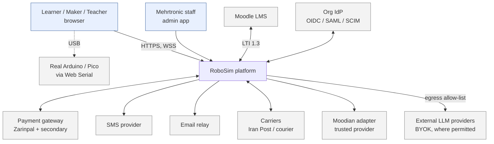
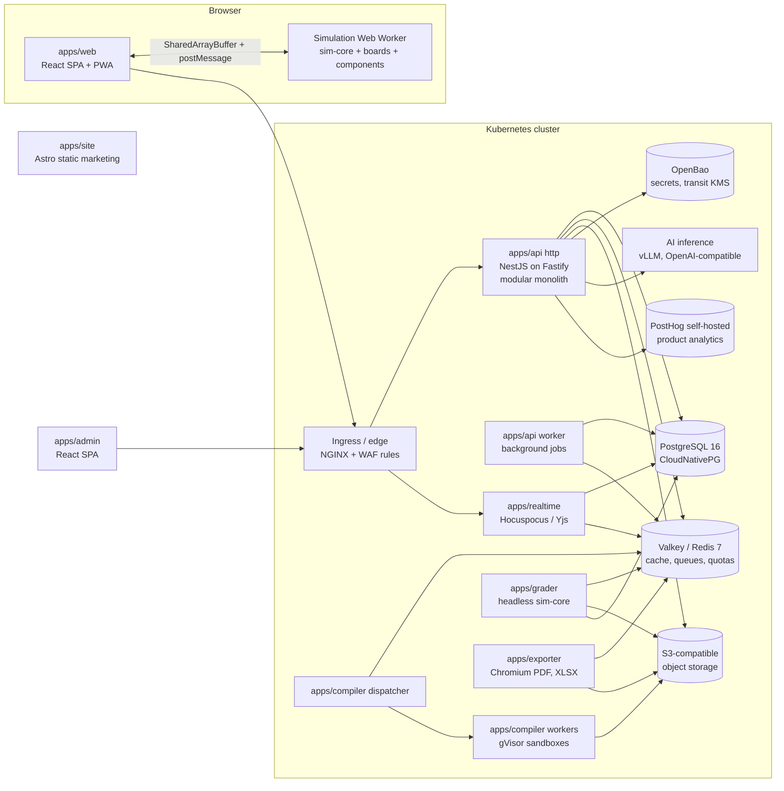
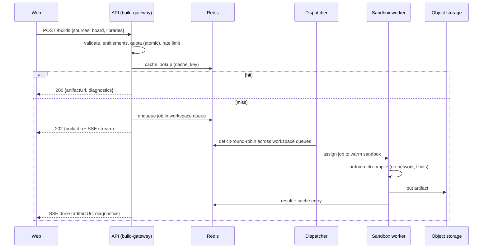
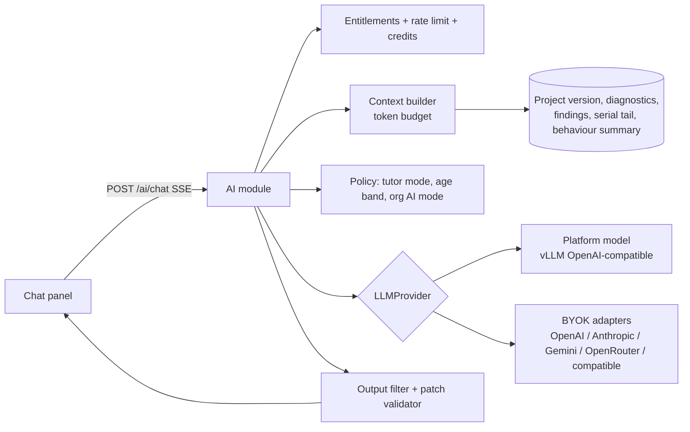

# RoboSim — Technical Design

**Version:** 1.0 · **Date:** 2026-10-13 · **Owner:** Engineering lead · **Status:** Approved for implementation
**Related:** [PRD](PRD.md) · [API Spec](API-Spec.md) · [Security](Security-Privacy-Compliance.md) · [Engineering Guide](Engineering-Guide.md) · [ADRs](decisions.md)

This document is the authoritative technical reference. When code and this document disagree, fix one of them in the same pull request.

---

## 1. Quality goals and architectural drivers

| Priority | Quality goal | Driver | Architectural consequence |
|---|---|---|---|
| 1 | **Simulation correctness and determinism** | Grading and competitions depend on reproducible results (FR-SIM-09) | Framework-free `sim-core` with fixed time steps, seeded PRNG, deterministic math; same package runs in browser and grader |
| 2 | **Security of untrusted code** | Every user submits C++ to our build farm | gVisor-sandboxed, network-less, disposable build containers (§6) |
| 3 | **Tenant isolation** | Schools and institutions | Workspace-scoped data, PostgreSQL RLS + application guards (§8.1) |
| 4 | **Works under poor connectivity** | Iranian network conditions | Client-side simulation, PWA, self-hosted everything, small bundles |
| 5 | **Extensibility by data** | Catalogue follows what Mehrtronic sells | Package registries for components, boards, rules; content registry for arenas/courses |
| 6 | **Operability in SaaS and on-prem** | Institution / Private Cloud editions | One Helm chart, no cloud-proprietary dependencies |

## 2. System context and containers

### 2.1 Context



### 2.2 Containers



| Container | Tech | Responsibility | Scales by |
|---|---|---|---|
| `apps/web` | React 19, Vite, TypeScript, Tailwind v4, shadcn/ui | Workspace, editor, simulator host, all user UI | Static (CDN/edge cache) |
| `apps/admin` | Same stack | Back-office (separate origin `admin.`) | Static |
| `apps/site` | Astro (static, SSR-free) | Marketing pages, docs, SEO in FA/EN | Static |
| `apps/api` (http) | Node.js 24 LTS, NestJS 12 (ESM) on Fastify 5, Drizzle ORM, Zod via Standard Schema | REST API, auth, all business modules | Replicas (HPA on CPU/RPS) |
| `apps/api` (worker) | Same codebase, `worker` entrypoint, BullMQ | Outbox relay, emails/SMS, reconciliation, retention, Moodian, search indexing | Replicas (KEDA on queue depth) |
| `apps/realtime` | Hocuspocus (Yjs) | Real-time collaboration documents and presence | Replicas with Redis extension |
| `apps/compiler` | Node.js dispatcher + worker; `arduino-cli` in sandbox image | Builds, cache, fair-share scheduling | Worker pods (KEDA on queue depth) |
| `apps/grader` | Node.js + `sim-core` | Verified runs for grading/competitions | Pods (KEDA) |
| `apps/exporter` | Node.js + Playwright Chromium, exceljs | PDF/XLSX/CSV/SVG exports | Pods (KEDA) |
| AI inference | vLLM (GPU) or Ollama (CPU/dev) | Platform-hosted open-weight models | GPU nodes |

Why a modular monolith for the API: one team, strong consistency needs across billing/entitlements/learning, and on-prem simplicity. Services are split out only where the runtime profile differs (untrusted code, CPU-bound simulation, headless browser, long-lived WebSockets) — see [ADR-002](decisions.md#adr-002--modular-monolith-api-with-separate-runtime-specific-services).

## 3. Repository layout

pnpm workspaces + Turborepo. Dependency direction is enforced by `dependency-cruiser` rules in CI (§3.1).

```
robosim/
├── apps/
│   ├── web/                    # Learner/teacher SPA (Vite)
│   ├── admin/                  # Back-office SPA (Vite)
│   ├── site/                   # Marketing site (Astro)
│   ├── api/                    # NestJS modular monolith (entrypoints: http, worker)
│   │   └── src/modules/        # iam, org, projects, build-gateway, learning, community,
│   │                           # billing, entitlements, commerce, ai, notifications,
│   │                           # analytics, admin, audit, content, search, lti
│   ├── realtime/               # Hocuspocus collaboration server
│   ├── compiler/               # Build dispatcher + worker + sandbox image (Dockerfile)
│   ├── grader/                 # Headless verified-run service
│   └── exporter/               # PDF/XLSX/CSV export service
├── packages/
│   ├── shared/                 # Domain types, Zod schemas, API contracts, error codes, project schema + migrations
│   ├── sim-core/               # Netlist, electrical solver, scheduler, component bus, world model, physics, sensors,
│   │                           # success-condition engine, deterministic math/PRNG. NO DOM, NO React.
│   ├── boards/
│   │   ├── avr-uno/            # Board impl (avr8js adapter, pin map, power tree, FQBN, upload protocol)
│   │   ├── avr-nano/
│   │   ├── avr-mega/
│   │   └── rp2040-pico/        # rp2040js adapter
│   ├── components/
│   │   └── <slug>/             # manifest.json, model.ts, model.test.ts, assets/ (svg, glb), calibration.json
│   ├── safety-rules/
│   │   └── <rule-id>/          # rule.ts, rule.test.ts, fixtures/, messages (i18n keys)
│   ├── sim-runtime/            # Worker host (SimHost), worker protocol types, circuit builder, demo scenarios + firmware
│   ├── renderer-2d/            # Canvas 2D arena renderer (consumes snapshots only)
│   ├── renderer-3d/            # three.js / @react-three/fiber renderer (consumes snapshots only)
│   ├── circuit-canvas/         # SVG breadboard editor + netlist builder bindings
│   ├── code-analysis/          # tree-sitter C++ (WASM) pin-usage extraction
│   ├── blockly-arduino/        # Block definitions, generators, translations
│   ├── hw-bridge/              # Web Serial STK500v1/v2, UF2 helpers
│   ├── ai-providers/           # LLMProvider adapters (server-only)
│   ├── ui/                     # Design system (shadcn-based, RTL-aware), icons, tokens
│   ├── i18n/                   # en/ and fa/ namespaces, ICU messages, key linter
│   ├── content/                # Built-in arenas, guided projects, courses (JSON + assets), content schema
│   ├── catalog/                # Registry of all component definitions (worker + grader) + cross-component tests
│   ├── test-fixtures/          # Test bench (part.pin wiring), AVR assembler firmware, golden circuits/traces
│   └── config/                 # tsconfig, eslint, prettier, dependency-cruiser presets
├── infra/
│   ├── docker/                 # docker-compose.yml for local dev (WSL2-compatible)
│   ├── helm/robosim/           # Umbrella chart (values: saas, staging, onprem)
│   ├── argocd/                 # GitOps application manifests
│   └── images/                 # Base images (sandbox, chromium, node)
├── tools/                      # Scaffolders (new:component, new:rule, new:board), i18n checks, release scripts
├── Docs/                       # This documentation set
└── .github/workflows/          # CI pipelines
```

### 3.1 Dependency rules

| From | May depend on | Must not depend on |
|---|---|---|
| `sim-core` | `shared` | Anything with DOM, React, Node-only APIs |
| `boards/*`, `components/*`, `safety-rules/*` | `sim-core`, `shared` | `apps/*`, renderers, other component packages |
| `renderer-2d`, `renderer-3d` | `shared` (snapshot types) | `sim-core` internals (consume snapshots only) |
| `apps/web` | all browser packages | `ai-providers`, any server module |
| `apps/api` modules | `shared`, own module internals, other modules' **public** `index.ts` | Another module's repositories/tables |
| `apps/grader` | `sim-core`, `boards/*`, `components/*`, `safety-rules/*`, `shared` | `apps/api` internals |

## 4. Frontend architecture (`apps/web`)

| Concern | Choice | Notes |
|---|---|---|
| Routing | TanStack Router (code-based route tree, type-safe) | No generated route file, so typecheck needs no codegen step; route-level code splitting |
| Server state | TanStack Query | Generated client from OpenAPI (§API-Spec) |
| Editor state | Zustand stores per domain (`circuitStore`, `codeStore`, `simStore`, `uiStore`) | Collaboration mode binds stores to Yjs documents |
| Forms | react-hook-form + Zod (`packages/shared`) | Same schemas as API |
| Circuit canvas | SVG rendered by React with memoized component nodes; pan/zoom by a single transform on the root group | [ADR-005](decisions.md#adr-005--svg-circuit-canvas); hit-testing via DOM, accessible component list mirrors canvas |
| Code editor | Monaco (lazy) | C++ grammar, Arduino completions from `packages/shared/arduino-api.json` |
| Blocks | Blockly (lazy) | `packages/blockly-arduino` |
| Simulation host | Dedicated module Web Worker | §5.8 protocol |
| 2D/3D | `renderer-2d` (Canvas 2D), `renderer-3d` (r3f + drei, lazy) | Both subscribe to the same snapshot buffer |
| i18n | i18next + ICU, namespaces per feature | `dir` attribute on `<html>`; Tailwind logical utilities only |
| Offline | Workbox service worker: app shell, fonts, component assets, last-used arenas; IndexedDB for projects, build cache | Background sync for pending saves |
| Isolation | `Cross-Origin-Opener-Policy: same-origin`, `Cross-Origin-Embedder-Policy: require-corp` | Enables SharedArrayBuffer; all assets same-origin (no third-party CDNs anyway) |

**Bundle budget:** app shell < 300 KB gz; lazy chunks: Monaco (~1 MB gz, cached), Blockly (~350 KB), 3D (~250 KB + models), sim worker (~200 KB + board/component chunks loaded per project).

## 5. Simulation engine (`packages/sim-core`)

### 5.1 Responsibilities

`sim-core` turns a **project** (netlist + properties + mounting), a **firmware artifact**, an **arena**, a **start pose**, a **seed**, and an **input log** into a stream of **snapshots** and **events**. It runs unchanged in a browser Web Worker and in Node (`apps/grader`).

### 5.2 Core interfaces

```ts
// packages/sim-core/src/contracts.ts (abridged)

export type Level = 0 | 1;

export interface FirmwareImage {
  format: 'ihex' | 'uf2' | 'elf';
  bytes: Uint8Array;
  sha256: string;
}

export interface McuCore {
  readonly clockHz: number;
  readonly cycle: number;                     // monotonically increasing CPU cycle count
  run(untilCycle: number): void;              // executes, applying scheduled input events at their exact cycles
  scheduleInput(pin: PinId, value: PinDrive, atCycle: number): void;
  pinOutputs(): ReadonlyMap<PinId, PinOutput>; // mode, level, pwm {dutyRatio, freqHz} derived from timer registers
  onPinEdge(cb: (pin: PinId, level: Level, cycle: number) => void): Unsubscribe; // for software PWM, servo pulses, TRIG
  uart(index: number): UartPort;
  i2c(index: number): I2cBus;
  spi(index: number): SpiBus;
  reset(): void;
}

export interface Board {
  id: string;                                 // 'avr-uno'
  fqbn: string;                               // 'arduino:avr:uno'
  pins: readonly BoardPinDef[];               // id, label, capabilities (pwm, adc, i2c…), absMax, maxCurrentMa
  power: PowerTreeDef;                        // USB 5 V, VIN → regulator → 5 V/3.3 V rails, limits
  createCore(fw: FirmwareImage): McuCore;
  upload: UploadProtocolDef;                  // used by hw-bridge
}

export interface ComponentModel<Props = unknown, State = unknown> {
  readonly type: string;                      // manifest id, e.g. 'driver.l298n'
  init(ctx: ModelContext, props: Props): void;
  stamp(s: MnaStamper): void;                 // electrical contribution (resistors, sources, PWL diodes, behavioural blocks)
  step(dt: number, io: ComponentIO): void;    // reads node voltages / branch currents, MCU signals; writes mechanical outputs
  faults(): readonly Fault[];                 // runtime fault detection feeding the damage model
  snapshot(): State;                          // render + inspector data (plain, structured-clone-able)
}

export interface WorldModel {
  step(dt: number): void;                     // fixed-step physics
  raycast(origin: Vec2, dir: Vec2, maxDist: number): RayHit | null;
  sampleFloor(p: Vec2, radius: number): number; // luminance 0..1
  bodies(): readonly BodySnapshot[];
}

export interface ComponentDefinition {       // exported by every packages/components/<slug>
  manifest: ComponentManifest;                // pins, props (defaults/ranges), inputs, limits, mass, nameKey
  create(): ComponentModel;
  internalConnections?(): [pin, pin][];       // same-conductor pins (breadboard strips) merged by the netlist
}
// WorldModel.componentPose(id) gives a mounted part's arena pose (null on the bench); sim-core/sensors.ts has the
// shared optics (irReflectance, sonarRange). io.scheduleMcuInput(net, level, time) drives MCU inputs at an exact cycle
// (e.g. an HC-SR04 echo), bypassing per-slice thresholding.
// ComponentIO also offers io.pwm(net) (MCU PWM duty on a net) and io.edges(net) (cycle-stamped pin edges),
// and ComponentModel.input(name, value) receives user interaction (button, pot, light level).

export interface SuccessCondition { /* declarative JSON, see §5.7 */ }
```

### 5.3 Scheduler

Fixed slices of simulated time drive everything; wall-clock only decides **how many** slices to run.

```
SLICE      = 1 ms simulated              // MCU ↔ component bus exchange
PHYS_DT    = 2 ms simulated              // planck.js step (every 2nd slice)
SNAPSHOT   ≤ 60 Hz wall-clock            // to renderers

loop (worker, requestAnimationFrame-independent timer):
  target = simTimeAtStart + wallElapsed × speed
  budget = 12 ms wall per tick
  while simTime < target and budget left:
      core.run(cycleAt(simTime + SLICE))            // inputs scheduled with cycle precision
      bus.readMcuOutputs()                          // levels, PWM duty/freq from timer registers
      if bus.dirty: mna.solve()                     // §5.4, only when topology/values/drives changed
      for c in components: c.step(SLICE, io)        // motors → torque, servos → angle, LEDs → brightness
      if slice is even: world.step(PHYS_DT); sensors.sample(world) → core.scheduleInput(...)
      safety.runtime(mna, components)               // §5.6; may set components damaged
      conditions.evaluate(state)                    // §5.7
      simTime += SLICE
  realTimeFactor = (simTime − simTimeAtTickStart) / wallTickElapsed
  publishSnapshot()
```

- If the budget is exhausted before reaching `target`, simulation **slows down**; it never drops cycles (FR-SIM-05).
- The grader runs the same loop without wall-clock pacing (as fast as possible) and with a maximum simulated duration.
- Simulated time is an integer slice counter (`simTime = slice / 1000`), so no floating-point drift accumulates; the MCU cycle at a slice boundary is `round(slice × clockHz / 1000)`. Components that invalidate the circuit during their `step` are re-solved within the same slice, so sensor outputs reach MCU inputs without an extra slice of latency.
- Board adapters (e.g. `boards/avr-uno`) apply scheduled inputs at their exact CPU cycle, between instructions. PWM duty and frequency come from WGM/COM/CS/OCR/ICR registers per the ATmega328P datasheet. avr8js's emulated waveform can differ from the datasheet by one timer tick, which the conformance tests tolerate.
- PWM duty is derived from timer configuration registers (TOP/OCR, prescaler, mode) — not by sampling edges at 1 ms, which would be wrong. Software-generated pulses (Servo library, bit-banged PWM, HC-SR04 TRIG) are measured from cycle-stamped edges via `onPinEdge`.

### 5.4 Electrical model

A small **modified nodal analysis (MNA)** solver covers the whole circuit at DC operating points:

| Element | Stamp |
|---|---|
| Wire / breadboard strip | Node merge (union-find) during netlist build |
| Resistor, potentiometer, LDR | Conductance |
| Battery, regulator output, USB | Voltage source with internal resistance; regulators as behavioural sources with dropout and current limit |
| MCU output pin | Voltage source (0 V / Vcc) with output resistance from the board manifest (~25 Ω for ATmega328P), so pin current falls out of the solution |
| MCU input pin | High impedance + optional internal pull-up (~35 kΩ) when `INPUT_PULLUP` |
| LED, diode | Piecewise-linear model (Vf, Rs), solved by iterating region selection (≤ 10 iterations) |
| DC motor | Resistance + back-EMF source `Ke·ω` (ω from the mechanical model of the previous slice) |
| L298N / TB6612 | Behavioural: logic inputs high-Z, read as MCU PWM duty (`io.pwm`) or as thresholded DC levels. Each enabled output is a PWM-averaged leg (transformer element): `V = f·(Vs − 1.6 V) − 0.5 Ω·I`, drawing `f·I` from VS. That gives a total drop of 1.75 V at 0.15 A and 2.1 V at 0.5 A. The onboard 78M05 needs VS ≥ 7 V; below that the logic browns out. ENA/ENB jumpers are installed by default, as shipped |
| Servo, sensors, modules | Behavioural current sinks from manifest (`idle`, `active`, `stall` currents) |

Besides R/G, current sources, voltage sources and PWL diodes, the stamper offers two branch elements. `voltageSource(…, { supplyFrom })` draws the delivered current from another net, so a linear regulator loads the battery behind it. `transformer(…)` is an ideal averaged DC transformer, `V(sec) = ratio·V(pri) − offset − r·I`, with `ratio·I` drawn from the primary, for PWM-averaged bridges and buck stages.

Implementation notes: every net has GMIN = 10⁻¹² S to ground (as in SPICE), so floating islands solve to 0 V instead of producing a singular matrix. Off diodes leak 10⁻⁹ S. Voltage sources add one branch unknown each; their reported current is the current delivered out of the + terminal. Diode regions warm-start from the previous solve; a result that has not settled after 10 passes is returned with `converged: false`. PWM pins are not stamped at their average voltage, because that is wrong for nonlinear loads: a 25 % LED would sit below Vf and stay dark. Instead the scheduler solves k + 1 operating points (all PWM pins low, then each PWM pin high on its own) and blends them as `avg = base + Σ dutyᵢ·(solᵢ − base)`. This is exact when PWM-driven sub-circuits are independent (separate LEDs, motor channels) and an approximation when they are coupled. Behavioural drivers can still read the duty directly.

Circuits are small (< 200 nodes), so a dense LU decomposition is used; solves only happen when something changed (typically ≤ 1 kHz, microseconds each). Digital levels seen by MCU inputs are thresholded from node voltages using the board's `VIL`/`VIH`.

### 5.5 Physics and sensors

| Model | Implementation |
|---|---|
| Chassis | planck.js dynamic body (`PlanckWorld`, deterministic trig per [ADR-021](decisions.md#adr-021--planckjs-with-trigonometry-routed-through-dmath)), zero gravity (top-down). Mass and inertia come from the chassis geometry plus mounted components (manifest masses), plus the gearbox inertia reflected to each wheel (J/r²). The static load is split between axle and caster by the lever rule |
| Wheels | Longitudinal force `F = τ/r` at each wheel's mount point; lateral friction impulse cancels sideways slip up to `μ·N`; rolling resistance; caster as low-friction contact |
| Motor dynamics | `τ = Kt·i`, `i = (V − Ke·ω)/R`, with gearbox ratio and efficiency. Drive motors implement `WheelActuator`: every physics step the world reads `shaftTorque()`, applies `F = τ/r` capped at μ·N, and imposes the resulting wheel ground speed via `setShaftSpeed()` (no-slip coupling). That speed sets the back-EMF of the next electrical solve. On the bench (no world) the motor integrates its own first-order mechanics |
| Battery | Open-circuit voltage curve by state of charge + internal resistance → sag under load |
| Line sensor | Floor is a luminance raster (1 px = 1 mm), rasterised deterministically from the arena's vector paint (`rasterizeFloor`); built-in arenas live in `packages/content`. Sensor samples a disc whose radius depends on mount height; reflectance → analog voltage via calibration curve; digital modules apply comparator threshold (potentiometer property) with hysteresis |
| Ultrasonic | On a valid TRIG pulse (≥ 10 µs, cycle-stamped), cast 7 rays across a 15° cone; nearest hit distance `d` within 2–400 cm → ECHO HIGH after calibrated latency for `2d / 343 m·s⁻¹`; no hit → timeout pulse like the real module |
| Bump switch | Contact listener on the switch fixture |
| Encoder (P4) | Ticks from wheel angle with slots-per-revolution from manifest |
| IMU (P4) | Body acceleration and yaw rate + seeded noise, exposed over the I²C register map of MPU-6050 |

### 5.6 Safety in the engine

- **Static rules** (`packages/safety-rules`) run on the netlist + manifests + code-analysis facts, in the main thread (debounced 300 ms) and once before each run. *Implementation:* `analyzeCircuit` does not guess from topology. It **solves** the circuit with fresh models at power-on (every MCU pin high-Z), and on demand with one pin driven HIGH or LOW (memoised). Rules then read voltages, pin currents and component faults. Pins sharing a net with a part's `output` pin are inputs by design and are not drive-probed until code analysis (FR-SAF-03) knows the pin modes.
- **Generic rules read manifests** (FR-SAF-05): `traits` (`inductive`, `led`, `source`), `polarity` [+, −], `supplyPins` (with an optional enabling prop, e.g. the L298N regulator jumper), `pinMaxVolts`, and `limits.maxVoltageV` / `limits.peakCurrentMa`. `validateManifest` checks that they reference real pins.
- *Packaging:* one `packages/safety-rules` package with a folder per rule group and trigger/clean fixture tests per rule. The framework (`analyzeCircuit`, `SafetyMonitor`, rule and finding types) lives in `sim-core/src/safety`.
- **Runtime rules** (`SafetyMonitor`, a slice observer evaluated every 5 ms; rules may declare a slower `periodS`) run on MNA results: pin current over limits, rail over-current, two outputs fighting, over-voltage after a battery change. A sustained violation (configurable duration per rule, e.g. 50 ms over 40 mA) marks the component `damaged`; damaged models return a failure behaviour (pin stuck, motor stops) until reset after the fault is removed.
- Rule interface:

```ts
export interface SafetyRule {
  id: string;                                   // 'SAF-PIN-OVERCURRENT'
  severity: 'error' | 'warning';
  kind: 'static' | 'runtime';
  check(ctx: StaticContext | RuntimeContext): readonly Finding[];
}
export interface Finding {
  ruleId: string; severity: 'error' | 'warning';
  componentIds: string[]; wireIds: string[]; pinIds: string[];
  messageKey: string; params: Record<string, string | number>; // i18n
  learnMoreSlug: string;
}
```

### 5.7 Success conditions

Declarative JSON evaluated each slice (no user-supplied code on the server):

```json
{
  "all": [
    { "type": "laps", "track": "main", "count": 1 },
    { "type": "timeLimit", "seconds": 60 },
    { "type": "noCollision", "tolerance": 0 },
    { "type": "onLineRatio", "min": 0.85 }
  ],
  "score": [
    { "type": "laps", "weight": 60 },
    { "type": "timeBonus", "under": 45, "weight": 25 },
    { "type": "onLineRatio", "weight": 15 }
  ]
}
```

Types at GA: `reachZone`, `laps`, `checkpointsInOrder`, `timeLimit`, `noCollision`, `onLineRatio`, `serialMatches` (regex, bounded), `pinState`, `pushOut` (sumo), combined with `all` / `any` / `not`.

**Implementation notes (P1 slice 6, `sim-core/src/challenge`):**

| Topic | Rule |
|---|---|
| Node status | `pending` / `met` / `failed`, each with a `final` flag. Goals start pending and finalise when reached. Constraints (`timeLimit`, `noCollision`, `onLineRatio`) start met and finalise only on violation or at the end of the run. |
| Combinators | `all` fails on the first final failure and succeeds when every child is met *and* final, or at end of run. `any` is the dual. `not` inverts. The run is decided when the root becomes final. |
| `laps` | Every `checkpoint` zone in arena order, then back into the `start` zone. |
| `onLineRatio` | Sampled every 10 ms: on-line = floor darker than 0.5 within ±25 mm of the axle midpoint, along the lateral axis. It stays provisional until the run ends. |
| `noCollision` | Each new contact (planck `begin-contact`) between the robot and a wall or obstacle counts once. `tolerance` = contacts allowed. |
| `serialMatches` | UART0 output is kept as a 4 KB tail. Patterns are ≤ 200 chars with no nested quantifiers (`isSafePattern`). |
| Decision | `Pacer({ stopWhen })` halts on the exact slice the tree decides, so the Lab pauses without overshoot. `maxSimSeconds` ends open-ended specs. |
| Score | `Σ weight × fraction`. `laps` and `checkpoints` use progress; `timeBonus` scales linearly from full at ≤ `under` to 0 at the time limit, and only on success; `onLineRatio` uses the measured ratio; `noCollision` counts only if contacts stayed within `tolerance`. |

### 5.8 Worker protocol

| Direction | Message | Payload |
|---|---|---|
| main → worker | `load` | project (netlist + props + mounting), firmware, arena, startPose, seed, engineVersion |
| main → worker | `control` | `run` · `pause` · `step` · `stop` · `reset` · `speed(x)` |
| main → worker | `input` | user interaction (button, pot, light, obstacle move) — also appended to the input log |
| worker → main | `snapshot` | written into a double-buffered `SharedArrayBuffer` (pose, wheel speeds, component visuals, pin table); sequence number via `Atomics` |
| worker → main | `event` | `serial`, `finding`, `damaged`, `conditionMet`, `rtf`, `error` (postMessage) |

Without cross-origin isolation (rare embed cases) snapshots fall back to transferable `ArrayBuffer` messages.

*Current implementation (Simulator Lab):* `packages/sim-runtime` holds the worker-side `SimHost` (scenario loading, pacing, frames ≤ 30 Hz over `postMessage`) and the message types; `apps/web/src/lab/sim.worker.ts` hosts it. The `SharedArrayBuffer` snapshot path replaces the frame messages when the editor arrives.

### 5.9 Determinism

1. Fixed slices; no wall-clock inside the engine.
2. All randomness from `xoshiro128**` seeded per run. Each component gets its own stream, forked from the run seed and the component id, so adding a component never shifts another component's random numbers.
3. Transcendental functions via `sim-core/dmath` (fdlibm ports that use only correctly rounded IEEE-754 operations), never `Math.sin` etc., so results are bit-identical across JavaScript engines. Golden bit patterns in `dmath.test.ts` guard against accidental changes. `Math.sqrt`, `abs`, `floor`, and `round` are exact and allowed.
4. Stable iteration order (arrays, never object key order or `Set` of objects for logic).
5. Every run records `engineVersion` (package version of sim-core + boards + components). The grader keeps the last 6 engine versions deployable so regrades reproduce the original result.
6. Golden-trace tests in CI compare browser (Playwright) and Node runs for the fixture suite.

## 6. Build service (`apps/compiler`)



| Aspect | Design |
|---|---|
| Cache key | `sha256(normalize(sources) ‖ fqbn ‖ coreVersion ‖ sorted(libraries@version) ‖ buildFlags ‖ toolchainImageDigest)` |
| Normalization | LF line endings, trailing whitespace stripped, file order sorted |
| Fair share | Per-workspace Redis lists; dispatcher uses deficit round robin weighted by `build.priority`; per-user concurrency 2 |
| Sandbox | One disposable container per job from a warm pool; `runsc` (gVisor) RuntimeClass; `--network=none`; read-only root; tmpfs 64 MB for `/work`; 1 vCPU, 512 MB, 128 PIDs, 30 s wall; non-root UID; seccomp default; destroyed after the job |
| Image | Pinned `arduino-cli`, cores (`arduino:avr`, `rp2040:rp2040`), allow-listed libraries pre-installed, **pre-built core archives** per FQBN so a cold build compiles only the sketch (~1–2 s typical) |
| Input limits | ≤ 100 KB total, ≤ 20 files, names `^[A-Za-z0-9_\-]+\.(ino|h|hpp|c|cpp)$`, includes resolved only from sketch dir + allow-list |
| Diagnostics | GCC `file:line:col: severity: message` parsed; arduino-cli preprocessing emits `#line` directives, so lines map to the user's files; known messages mapped to explanation keys (FR-COD-03) |
| Outputs | HEX (AVR) / UF2 + ELF (RP2040), size report (flash/RAM % of board), stored 30 days; content-addressed |
| Scaling | KEDA scales workers on queue depth; warm pool target = p50 arrival rate × 10 s |
| Failure | Sandbox crash → retry once on a fresh sandbox; then `build_internal_error` with correlation ID |

## 7. Backend (`apps/api`)

### 7.1 Module structure

Each module follows the same internal layout and exposes only `index.ts`:

```
modules/<name>/
├── index.ts            # public API: service interfaces, DTO types, event types
├── http/               # controllers, guards, request/response mapping (Zod)
├── application/        # use cases (commands/queries), transactions, authorization checks
├── domain/             # entities, value objects, state machines, domain events
└── infra/              # Drizzle repositories, external adapters, mappers
```

| Module | Owns tables (prefix) | Key collaborators |
|---|---|---|
| `iam` | users, sessions, auth_tokens, mfa, identities, guardian_consents | notifications, org |
| `org` | workspaces, memberships, groups, invitations, domains, sso, scim, policies | iam, billing |
| `entitlements` | entitlement_overrides (+ Redis cache) | billing, org |
| `projects` | projects, versions, shares, comments, crdt, owned_parts | entitlements, build-gateway |
| `build-gateway` | build_jobs, build_artifacts | entitlements, compiler (via Redis) |
| `content` | boards, components, calibrations, libraries, arenas, guided projects, courses | admin |
| `learning` | classes, assignments, submissions, verified_runs, enrollments, progress, certificates | projects, grader (via Redis), lti |
| `lti` | lti_platforms, lti_deployments, lti_contexts, lti_line_items | learning, iam |
| `community` | gallery, likes, comments, follows, reports, competitions, badges | projects, learning (verified runs) |
| `billing` | plans, plan_versions, subscriptions, payments, refunds, invoices, coupons, wallets, quotes | entitlements, notifications |
| `commerce` | products, kits, stock, reservations, carts, orders, shipping, returns | billing (payments), projects (BOM) |
| `ai` | ai_provider_configs, ai_keys, conversations, messages, usage, credit ledger | entitlements, projects |
| `notifications` | notifications, preferences, templates, deliveries | — |
| `analytics` | event pipeline, aggregates | all (consumes events) |
| `audit` | audit_logs (append-only) | all (consumes events) |
| `admin` | impersonation_sessions, feature_flags | all public services |

### 7.2 Cross-cutting

| Concern | Design |
|---|---|
| Transactions | Use-case level; one DB transaction per command; `SET LOCAL app.workspace_id`, `app.user_id` for RLS |
| Domain events | Written to `outbox_events` in the same transaction; relay (worker) publishes to BullMQ; consumers idempotent by event ID |
| Authorization | `@RequirePermission('project.edit')` guard → policy service (role × resource ownership × org policy × age band) |
| Entitlements | `@RequireEntitlement('export.pdf')` guard; quotas via `QuotaService.consume(key, n)` (atomic Lua script in Redis, daily reset at 00:00 Asia/Tehran) |
| Validation | Zod schemas from `packages/shared` at the edge; domain invariants in entities |
| Errors | RFC 9457 problem details with stable `code` ([API Spec §3](API-Spec.md#3-errors)) |
| Idempotency | `Idempotency-Key` header for POSTs that create payments, orders, submissions; stored 24 h |
| IDs | UUIDv7 (time-ordered) everywhere; human-readable numbers for orders/invoices |
| Time | `timestamptz` UTC in storage; Asia/Tehran for business-day boundaries; Jalali only in presentation |
| Money | `bigint` IRR; VAT computed with banker-safe integer arithmetic; display in Toman = IRR / 10 |
| Search | PostgreSQL FTS (`simple` config) + `pg_trgm`, with a `fa_normalize()` SQL function (ي→ی, ك→ک, diacritics removed, ZWNJ → space) applied to documents and queries |
| Feature flags | DB-backed, cached; evaluation context = env, plan, workspace, user hash |

## 8. Data model

PostgreSQL 16. Conventions: UUIDv7 PKs (`id`), `created_at`/`updated_at` `timestamptz`, soft delete `deleted_at` where noted, money in `bigint` IRR, enums as PostgreSQL enums, JSONB only for documents whose shape is validated by Zod schemas in `packages/shared`.

### 8.1 Tenancy and RLS

- Every tenant-owned table has `workspace_id uuid not null`.
- RLS policy on those tables: `workspace_id = current_setting('app.workspace_id')::uuid`. Requests act in exactly one workspace (header `X-Workspace-Id`, validated against membership).
- Cross-workspace reads that are legitimate (public gallery, shared-link projects) go through explicit read models (`gallery_items`, share-token lookups) owned by a separate DB role with narrowly scoped policies.
- The admin API uses a dedicated DB role with `BYPASSRLS`; every query from it is audited.
- CI runs a tenant-isolation test suite that attempts cross-workspace access for every repository method.

### 8.2 Identity & organizations

| Table | Columns (key) |
|---|---|
| `users` | id, email (citext, unique, null), phone (E.164, unique, null), password_hash (argon2id, null for SSO-only), display_name, locale (`fa`/`en`), date_of_birth, age_band (`u13`,`13_15`,`16_17`,`adult`), status (`pending_consent`,`active`,`suspended`,`deleted`), email_verified_at, phone_verified_at, personal_workspace_id, created_at, deleted_at |
| `auth_identities` | id, user_id, kind (`oidc`,`saml`,`lti`), issuer, subject, workspace_id, last_login_at — unique (kind, issuer, subject) |
| `auth_tokens` | id, user_id (null for pre-signup OTP), purpose (`email_verify`,`password_reset`,`otp_login`,`guardian_consent`,`invite`,`email_change`), token_hash, target (email/phone), attempts, expires_at, consumed_at |
| `sessions` | id, user_id, created_at, last_seen_at, expires_at, revoked_at, ip, user_agent, mfa_level, impersonator_id (null) |
| `mfa_factors` | id, user_id, kind (`totp`,`webauthn`,`recovery`), secret_ciphertext / credential_id + public_key + sign_count, label, created_at, last_used_at |
| `guardian_consents` | id, minor_user_id, guardian_name, guardian_contact, channel (`email`,`sms`), status (`pending`,`granted`,`revoked`), token_hash, granted_at, revoked_at |
| `staff_roles` | user_id, role (`platform_admin`,`content_editor`,`shop_operator`,`finance`,`support_agent`,`moderator`), granted_by, granted_at |
| `workspaces` | id, kind (`personal`,`organization`,`branch`), parent_id (branch → org), name, slug (unique), logo_key, owner_user_id, economic_code, national_id, billing_address (jsonb), created_at, deleted_at |
| `memberships` | id, workspace_id, user_id, role (`org_owner`,`org_admin`,`billing_manager`,`teacher`,`assistant_teacher`,`student`), status (`invited`,`active`,`deactivated`), seat_assigned (bool), branch_id, joined_at — unique (workspace_id, user_id) |
| `groups`, `group_members` | id, workspace_id, name, scim_external_id / group_id, user_id |
| `invitations` | id, workspace_id, email/phone, role, class_id (null), token_hash, invited_by, expires_at, status |
| `org_domains` | id, workspace_id, domain, verification_token, verified_at |
| `sso_connections` | id, workspace_id, protocol (`oidc`,`saml`), config (jsonb; secrets as ciphertext), role_mapping (jsonb), enforced, status |
| `scim_tokens` | id, workspace_id, token_hash, created_by, last_used_at, revoked_at |
| `org_policies` | workspace_id (PK), version, policy (jsonb: allowed boards/components, ai mode, tutor default, publishing per age band, external sharing, retention, mfa required, ip allow-list), updated_by, updated_at |

### 8.3 Catalogue & content

| Table | Columns (key) |
|---|---|
| `boards` | id (slug), fqbn, mcu, name_en, name_fa, status, package_version |
| `components` | id (slug), version, category, tier (`basic`,`all`), manifest (jsonb, validated by manifest schema), enabled, package_version — PK (id, version) |
| `component_calibrations` | id, component_id, component_version, params (jsonb), source_note, measured_by, measured_at |
| `libraries` | id, name, version, boards (text[]), allowed, licence, added_by — unique (name, version) |
| `arenas` | id, workspace_id (null = platform), slug, name_en, name_fa, visibility (`platform`,`workspace`,`public`), current_version_id, status |
| `arena_versions` | id, arena_id, version, definition (jsonb: size, walls, obstacles, lines, zones, checkpoints), floor_texture_key, created_at |
| `content_items` | id, kind (`guided_project`,`course`,`lesson`,`article`), slug, tier, status (`draft`,`in_review`,`published`,`archived`), current_version_id, workspace_id (null = platform) |
| `content_versions` | id, content_item_id, version, body_fa (jsonb), body_en (jsonb), locale_status (jsonb), assets (jsonb), starter_project (jsonb), arena_version_id, success_conditions (jsonb), published_at, published_by |
| `course_structure` | course_id, position, lesson_id |

### 8.4 Projects & builds

| Table | Columns (key) |
|---|---|
| `projects` | id, workspace_id, owner_user_id, name, board_id, language (`cpp`,`blocks`), current_version_id, arena_version_id, visibility (`private`,`link`,`workspace`), share_token_hash, link_remixable, tags (text[]), thumbnail_key, schema_version, archived_at, deleted_at, created_at, updated_at |
| `project_versions` | id, project_id, workspace_id, number, label, source (`manual`,`auto_build`,`restore`,`ai_apply`,`submission`,`import`), document (jsonb ≤ 1 MB; larger → `document_key` in object storage), document_sha256, artifact_id, created_by, created_at |
| `project_shares` | project_id, principal_kind (`user`,`workspace`), principal_id, role (`view`,`comment`,`edit`) |
| `project_crdt_docs` | project_id (PK), state (bytea), state_vector (bytea), updated_at |
| `project_comments` | id, project_id, workspace_id, author_id, anchor (jsonb: component/wire/line/version), body, resolved_at, created_at, deleted_at |
| `owned_parts` | user_id, component_id, variant, quantity |
| `build_jobs` | id, workspace_id, user_id, project_id, cache_key, fqbn, status (`queued`,`running`,`succeeded`,`failed`,`cancelled`), queued_at, started_at, finished_at, error_code, diagnostics (jsonb), artifact_id |
| `build_artifacts` | id, cache_key (unique), fqbn, format, storage_key, size_bytes, flash_pct, ram_pct, sha256, toolchain_digest, created_at, expires_at |

### 8.5 Learning & grading

| Table | Columns (key) |
|---|---|
| `classes` | id, workspace_id, branch_id, name, term, join_code_hash, join_enabled, status, archived_at |
| `class_members` | class_id, user_id, role (`teacher`,`assistant_teacher`,`student`), joined_at |
| `assignments` | id, workspace_id, class_id, title, description (jsonb per locale), template_version_id, arena_version_id, success_conditions (jsonb), rubric (jsonb), settings (jsonb: locks, attempts, late policy, group mode, ai_mode, seed), opens_at, due_at, published_at, lti_resource_link_id |
| `submissions` | id, workspace_id, assignment_id, user_id, group_id, attempt, project_version_id, submitted_at, is_late, verified_run_id, auto_score, rubric_scores (jsonb), total_score, feedback, status (`submitted`,`grading`,`graded`,`released`,`returned`), released_at — unique (assignment_id, user_id, attempt) |
| `verified_runs` | id, workspace_id, purpose (`grading`,`competition`,`manual`), project_version_id, artifact_id, arena_version_id, start_pose (jsonb), seed, input_log_key, engine_version, status, result (jsonb: conditions, metrics), score, trace_key, replay_key, requested_by, created_at, finished_at |
| `enrollments`, `lesson_progress` | user_id, workspace_id, course_id / lesson_id, status, score, started_at, completed_at |
| `guided_progress` | user_id, workspace_id, content_version_id, project_id, completed_steps (int[]), completed_at |
| `certificates` | id, user_id, course_id, issued_at, verification_code (unique), pdf_key |
| `guardian_contacts` | id, workspace_id, student_user_id, name, channel, contact, opt_in_at |
| `lti_platforms` | id, workspace_id, issuer, client_id, auth_login_url, auth_token_url, jwks_url, tool_key_id |
| `lti_deployments` | platform_id, deployment_id |
| `lti_contexts` | id, platform_id, context_id, class_id |
| `lti_line_items` | id, assignment_id, line_item_url |

### 8.6 Community

| Table | Columns (key) |
|---|---|
| `gallery_items` | id, project_version_id, author_id, workspace_id, title, description, licence, tags, cover_key, remix_of_id, moderation_status (`pending`,`approved`,`rejected`,`removed`), published_at, like_count, remix_count, view_count |
| `likes`, `follows` | user_id, target id, created_at |
| `comments` | id, target_kind, target_id, author_id, body, status, created_at, deleted_at |
| `reports` | id, target_kind, target_id, reporter_id, reason, details, status, handled_by, handled_at |
| `moderation_actions` | id, moderator_id, target_kind, target_id, action, reason, created_at |
| `competitions` | id, organizer_workspace_id, title (jsonb), rules (jsonb: scoring, limits), arena_version_id, eligibility (jsonb), team_size_max, opens_at, closes_at, frozen_at, status |
| `competition_entries` | id, competition_id, team_name, members (uuid[]), project_version_id, verified_run_id, score, rank, submitted_at |
| `badges`, `user_badges` | id, code, criteria (jsonb); user_id, badge_id, awarded_at |

### 8.7 Billing

| Table | Columns (key) |
|---|---|
| `plans` | id, code (`free`,`maker`,`classroom`,`institution`,`private_cloud`), edition, status |
| `plan_versions` | id, plan_id, version, interval (`month`,`year`,`term`), price_irr, seat_based, min_seats, trial_days, entitlements (jsonb), effective_from, effective_to |
| `subscriptions` | id, workspace_id, plan_version_id, status (`trialing`,`active`,`expired`,`canceled`), seats, source (`self_serve`,`contract`,`pilot`), trial_ends_at, current_period_start, current_period_end, auto_renew_from_wallet, contract_ref |
| `entitlement_overrides` | id, workspace_id, user_id (null), key, value (jsonb), reason, granted_by, expires_at |
| `addon_purchases` | id, workspace_id, kind (`ai_credits`,`competition`,`content_pack`), quantity, payment_id, created_at |
| `ai_credit_ledger` | id, workspace_id, user_id, delta_tokens, reason (`monthly_grant`,`purchase`,`usage`,`adjustment`), ref, created_at |
| `wallets` / `wallet_transactions` | workspace_id, balance_irr / id, wallet_id, delta_irr, reason, ref, created_at |
| `coupons` / `coupon_redemptions` | id, code (unique, case-insensitive), kind (`percent`,`amount`), value, constraints (jsonb), max_redemptions, per_user_limit, expires_at / coupon_id, workspace_id, payment_id |
| `payments` | id, workspace_id, user_id, purpose (`subscription`,`seats`,`order`,`wallet`,`addon`), purpose_ref, amount_irr, provider, provider_authority (unique per provider), provider_ref_id, status (`initiated`,`pending`,`verified`,`failed`,`reversed`,`refunded`,`partially_refunded`), idempotency_key, card_mask, raw (jsonb, redacted), created_at, verified_at |
| `refunds` | id, payment_id, amount_irr, reason, method (`gateway`,`wallet`,`bank_transfer`), status, created_by, created_at |
| `quotes` | id, workspace_id, items (jsonb), valid_until, status, created_by |
| `invoices` | id, workspace_id, number (unique per fiscal year), kind (`receipt`,`proforma`,`official`), buyer (jsonb: name, economic code, national ID, address), lines (jsonb), subtotal_irr, discount_irr, vat_irr, total_irr, issued_at, payment_id, moodian_status (`n_a`,`queued`,`sent`,`accepted`,`rejected`), moodian_ref, pdf_key |

### 8.8 Commerce

| Table | Columns (key) |
|---|---|
| `products` | id, sku (unique), kind (`component`,`kit`,`accessory`), component_id, component_variant, name_en, name_fa, description (jsonb), specs (jsonb), price_irr, weight_g, images (jsonb), max_per_order, status |
| `kit_items` | kit_product_id, product_id, quantity |
| `warehouses` | id, name, province, address |
| `stock_levels` | product_id, warehouse_id, on_hand, reserved — check `reserved ≤ on_hand` |
| `stock_reservations` | id, cart_id, product_id, warehouse_id, quantity, expires_at |
| `carts` / `cart_items` | id, user_id, workspace_id, status (`open`,`checking_out`,`converted`,`abandoned`), source (`manual`,`bom`), source_project_version_id / cart_id, product_id, quantity |
| `addresses` | id, user_id, recipient, phone, province, city, postal_code, line1, line2, is_default |
| `shipping_methods` / `shipping_rates` | id, code, name_en, name_fa, provider / method_id, province, weight_min_g, weight_max_g, price_irr, eta_days |
| `orders` | id, number, user_id, workspace_id, status (`pending_payment`,`paid`,`preparing`,`shipped`,`delivered`,`cancelled`,`return_requested`,`returned`,`refunded`), address (jsonb snapshot), shipping_method_id, shipping_irr, subtotal_irr, discount_irr, vat_irr, total_irr, payment_id, tracking_number, source_project_version_id, created_at |
| `order_items` | order_id, product_id, sku, name_snapshot, quantity, unit_price_irr |
| `order_events` | id, order_id, from_status, to_status, actor_id, note, created_at |
| `returns` | id, order_id, items (jsonb), reason, status, created_at |

### 8.9 AI, notifications, platform

| Table | Columns (key) |
|---|---|
| `ai_provider_configs` | id, provider, enabled, base_url, models (jsonb), is_platform, legal_approved_at, legal_ref |
| `ai_keys` | id, owner_kind (`user`,`workspace`), owner_id, provider, ciphertext, wrapped_dek, key_last4, base_url, status (`pending`,`active`,`invalid`), validated_at, created_at |
| `ai_conversations` / `ai_messages` | id, workspace_id, project_id, user_id, mode (`full`,`hints`), expires_at / id, conversation_id, role, content, provider, model, tokens_in, tokens_out, created_at |
| `ai_usage` | id, workspace_id, user_id, provider, model, tokens_in, tokens_out, latency_ms, created_at |
| `notifications` | id, user_id, workspace_id, type, payload (jsonb), read_at, created_at |
| `notification_preferences` | user_id, category, channel, enabled |
| `message_templates` | id, key, channel, locale, subject, body, version |
| `deliveries` | id, channel, to (hashed), template_key, provider_ref, status, created_at |
| `feature_flags` | key, description, rules (jsonb), updated_by, updated_at |
| `impersonation_sessions` | id, staff_user_id, target_user_id, consent_token_id, reason, started_at, ended_at |
| `audit_logs` | id, at, actor_id, actor_kind, workspace_id, action, target_kind, target_id, ip, user_agent, request_id, before (jsonb), after (jsonb) — append-only (no UPDATE/DELETE grants), monthly partitions |
| `outbox_events` | id, aggregate_kind, aggregate_id, type, payload (jsonb), created_at, published_at |
| `data_requests` | id, user_id, kind (`export`,`delete`), status, requested_at, completed_at, artifact_key |

### 8.10 Project document schema

`project_versions.document` follows `ProjectDocument` (Zod, `packages/shared/project-schema`), versioned by `schemaVersion` with pure forward migrations:

```ts
type ProjectDocument = {
  schemaVersion: number;
  board: { id: string; version: string };
  components: Array<{ id: string; type: string; typeVersion: string; x: number; y: number;
                      rotation: 0 | 90 | 180 | 270; flipped: boolean; props: Record<string, unknown>;
                      mount?: { x: number; y: number; z: number; yaw: number } }>;
  wires: Array<{ id: string; from: PinRef; to: PinRef; color: string; points: Array<[number, number]> }>;
  code: { language: 'cpp' | 'blocks'; files: Array<{ name: string; content: string }>; blocksXml?: string };
  libraries: Array<{ name: string; version: string }>;
  arena: { arenaVersionId: string; startPose: { x: number; y: number; heading: number } };
  successConditions?: SuccessConditionSpec;
  meta: { title: string; description?: string };
};
```

## 9. Billing, entitlements, and payments

### 9.1 Entitlement resolution

```
effective(user, workspace) =
    planVersion(workspace.subscription or Free).entitlements
  ⊕ addons(workspace)
  ⊕ overrides(workspace, user)               // admin grants, contracts
  ⊓ orgPolicy(workspace)                     // org can only restrict
  ⊓ ageBandRestrictions(user.age_band)       // minors' defaults
```

- `⊕` merges by key (numeric quotas add, booleans OR); `⊓` restricts (booleans AND, quotas min).
- Cached in Redis per `(workspace, user)` for 60 s; invalidated by `subscription.changed`, `policy.changed`, `override.changed` events.
- Classroom/Institution quotas such as `build.daily_quota` can be **pooled** at org level (seat count × per-seat quota) with a per-user ceiling.

### 9.2 Payment flow (gateway-agnostic, Zarinpal reference)

```mermaid
sequenceDiagram
  participant U as Browser
  participant A as API (billing)
  participant G as Gateway
  U->>A: POST /billing/checkout (Idempotency-Key)
  A->>A: create payment(initiated), price snapshot, coupon
  A->>G: payment request (amount, callback URL, description)
  G-->>A: authority
  A-->>U: redirect URL
  U->>G: pay
  G-->>U: redirect to callback (authority, status)
  U->>A: GET /billing/callback?authority=…
  A->>G: verify(authority, amount)
  G-->>A: ref_id / failure
  A->>A: tx: payment verified → subscription/order/wallet updated → outbox events
  A-->>U: result page
  Note over A: Reconciliation job every 5 min verifies payments stuck in pending;<br/>gateways reverse unverified transactions after their timeout
```

- `PaymentProvider` interface: `request()`, `verify()`, `inquire()`, `refund()` (where supported), `reconcileReport(date)`.
- Amounts verified server-side against the stored price snapshot; callbacks never trusted without `verify`.
- Renewal: no stored-card recurring billing on Iranian gateways → prepaid periods + reminders + optional wallet auto-renew (FR-BIL-03).

## 10. Commerce

- `CommerceBackend` interface (`catalog`, `inventory`, `orders`) with two implementations: **builtin** (tables in §8.8) and **external** (adapter syncing with an existing Mehrtronic store via its API; catalogue and stock pulled every 5 min and on webhook; orders pushed). Selected by deployment config (FR-SHP-08).
- **BOM → cart:** BOM lines map `component@variant → product` through `products.component_id`; missing mappings are reported to admins; unavailable products are replaced by in-stock products of the same component (never a different component).
- **Reservations:** checkout locks `stock_levels` rows (`SELECT … FOR UPDATE`) in product-ID order to avoid deadlocks, increments `reserved`, and inserts `stock_reservations` with a 15-minute expiry; payment verification converts reservations into stock decrements; an expiry job releases stale reservations.
- **Order state machine** is enforced in the domain layer; every transition writes `order_events` and an outbox event (notifications, analytics).
- **Shipping:** rate tables by province and weight; `ShippingProvider` interface for carrier APIs (label creation, tracking) where carriers provide them.

## 11. Learning, grading, and LTI

### 11.1 Verified runs (`apps/grader`)

1. `learning` creates a `verified_runs` row and enqueues a job with `{projectVersionId, artifactId, arenaVersionId, startPose, seed, inputLog?, engineVersion, maxSimSeconds}`.
2. The grader pod for that `engineVersion` loads `sim-core`, board, components, and runs headless (unpaced) until conditions resolve or `maxSimSeconds` (≤ 300 s) is reached.
3. Outputs: `result` (per-condition outcomes, metrics), `score`, trace (pose at 10 Hz, gzip, object storage), replay (seed + input log).
4. Grader pods: no network except Redis and object storage; 1 vCPU, 1 GB, wall timeout 300 s (unpaced runs execute several times faster than real time); firmware executes only inside the emulator.
5. Throughput target: 40 submissions graded in < 5 min p95 (most runs finish in a few seconds of CPU).

### 11.2 LTI 1.3

Implemented directly per IMS specifications using `jose` (no third-party LTI framework): OIDC third-party-initiated login, `id_token` validation (issuer, audience, nonce, deployment), Deep Linking 2.0 (assignment selection), Names and Role Provisioning Services (roster sync), Assignment and Grade Services (line items, score publish). Tool keys rotate via JWKS endpoint. Certified against Moodle 4.x in CI (Moodle container in the integration test suite).

## 12. Real-time collaboration (`apps/realtime`)

- Yjs document per project: `Y.Map components`, `Y.Map wires`, `Y.Map meta`, `Y.Map files → Y.Text`, `Y.Array blocks`.
- Hocuspocus server with: `onAuthenticate` (session cookie → user → `project.edit` permission + `collab.realtime` entitlement), Redis extension (multi-instance), database extension (debounced 2 s persistence to `project_crdt_docs`), periodic version snapshot into `project_versions` (every 10 min of activity and on build).
- Zustand stores bind to Yjs (`y-zustand` style adapter); undo/redo uses `Y.UndoManager` scoped per user.
- Shared simulation: the session host runs the simulation; pose/visual snapshots are broadcast at 10 Hz as stateless messages; other participants render them read-only.

## 13. AI assistant



| Aspect | Design |
|---|---|
| Context budget | Default 12k tokens: system + policy (fixed) → active guided step → safety findings → diagnostics → current file → netlist summary → behaviour summary → serial tail → older chat (trimmed first) |
| Untrusted content | Project content and serial output are wrapped as quoted data; the system prompt instructs the model to treat them as data; no tools with side effects exist |
| Tools | `propose_code_patch` (unified diff, validated by applying to the current file) and `propose_circuit_change` (JSON Patch over `ProjectDocument`, validated by Zod + netlist build). Results are shown to the user for Apply/Reject |
| Keys | Envelope encryption: per-key DEK (AES-256-GCM), DEK wrapped by OpenBao Transit; decrypted in memory only for the outbound call; never logged; redaction middleware on logs |
| Egress | AI module egress through an allow-list proxy with the hostnames of enabled providers only |
| Metering | Tokens counted from provider responses (or tokenizer estimate); `ai_usage` + credit ledger debit in the same transaction after the stream completes |
| Evaluation | `tools/ai-eval`: 200+ FA/EN tasks with graded rubrics; run in CI for prompt/model changes (FR-AI-09) |

## 14. Deployment and infrastructure

### 14.1 Environments

| Environment | Purpose | Platform |
|---|---|---|
| Local | Development | Docker Compose under WSL2 (Postgres, Valkey, MinIO, OpenBao dev, Mailpit, compiler with Docker runtime fallback, Ollama on host) |
| Preview | Per-PR review (optional for large PRs) | Namespace per PR on staging cluster |
| Staging | Release candidate, load and security tests, payment sandbox | Kubernetes (same chart, `values-staging`) |
| Production | SaaS in Iran | Kubernetes on an Iranian cloud provider, primary site |
| DR | Disaster recovery | Second site/region: Postgres replica + object storage replication; warm standby |
| Private Cloud | Customer-hosted | Same Helm chart, `values-onprem`, bundled dependencies |

### 14.2 Platform components

| Component | Choice | Notes |
|---|---|---|
| Kubernetes | Provider-managed Kubernetes or RKE2 on VMs | Node pools: `general`, `sandbox` (gVisor RuntimeClass, tainted), `gpu` |
| Ingress | ingress-nginx + cert-manager | Rate-limit annotations, ModSecurity CRS rules on public routes |
| PostgreSQL | CloudNativePG (3 instances, synchronous replica) | Continuous WAL archiving to object storage (PITR, RPO ≤ 15 min) |
| Redis | Valkey with Sentinel (3 nodes) | AOF for queues |
| Object storage | Provider S3-compatible or MinIO (on-prem) | Versioning on; lifecycle rules for artifacts/exports |
| Secrets | OpenBao (Transit + KV) + External Secrets Operator | No secrets in Git or images |
| Registry | Harbor in-region with proxy cache | All images mirrored; deploys never pull from public registries |
| Packages | Verdaccio npm mirror for CI | Resilience against upstream outages |
| GitOps | Argo CD | Environments promoted by Git tag |
| Autoscaling | HPA (CPU/RPS) + KEDA (queue depth) | |

### 14.3 Initial production sizing (estimate, revisit after load tests)

| Workload | Initial | Max (autoscale) |
|---|---|---|
| api-http | 3 × (2 vCPU, 4 GB) | 12 |
| api-worker | 2 × (1 vCPU, 2 GB) | 8 |
| realtime | 2 × (1 vCPU, 2 GB) | 8 |
| compiler workers | 8 vCPU warm | 64 vCPU |
| grader | 2 × (1 vCPU, 1 GB) | 20 |
| exporter | 2 × (2 vCPU, 2 GB) | 8 |
| PostgreSQL | 3 × (8 vCPU, 32 GB, NVMe) | vertical |
| Valkey | 3 × (2 vCPU, 4 GB) | vertical |
| AI inference | 1 GPU node (≥ 24 GB VRAM) | 3 |

### 14.4 Private Cloud / on-premise

- Same images and chart; `values-onprem.yaml` enables bundled CloudNativePG, Valkey, MinIO, OpenBao, and the Ollama/vLLM option.
- **Air-gapped bundle:** image tarballs + chart + content packs + checksums, installed with `tools/onprem/install.sh` into the customer's registry.
- **Licence:** Ed25519-signed licence file (edition, seats, expiry, features) verified offline at startup and daily.
- **Updates:** quarterly LTS releases; database migrations backward-compatible for one release (NFR-DEP-01).
- **Minimum footprint:** 3 nodes × (8 vCPU, 32 GB) + 500 GB storage for up to 2,000 users (estimate).

## 15. Exports and notifications

| Concern | Design |
|---|---|
| PDF | `apps/exporter` renders React SSR HTML templates with embedded Vazirmatn and Noto Sans in headless Chromium (Playwright) → PDF. Chromium's HarfBuzz shaping renders Persian correctly ([ADR-008](decisions.md#adr-008--server-side-pdf-rendering-with-headless-chromium)). |
| XLSX / CSV | exceljs; CSV as UTF-8 **with BOM** and CRLF so Excel opens Persian text correctly |
| Delivery | Export jobs via queue; result in object storage; signed URL valid 15 min; entitlement checked at job creation |
| Notifications | `notifications` module renders `message_templates` (ICU, per locale) and dispatches through `EmailProvider` (SMTP relay) and `SmsProvider` (adapters for Iranian SMS providers) with retries and delivery tracking |

## 16. Observability and SLOs

| Signal | Tooling |
|---|---|
| Traces | OpenTelemetry SDK (Node + web) → OTel Collector → Tempo |
| Metrics | Prometheus (RED per endpoint, queue depths, cache hit rate, sandbox failures, gateway errors) → Grafana |
| Logs | JSON logs (pino) with `trace_id`, `request_id`, `workspace_id`, redaction of secrets/PII → Loki |
| Errors | GlitchTip (Sentry-compatible, self-hosted) for web, worker, and services |
| Product analytics | PostHog self-hosted, server-side event capture, consent-aware |
| Alerting | Alertmanager → on-call (SMS + email) |

| SLO | Target | Window |
|---|---|---|
| API availability (non-5xx) | 99.9 % | 30 days |
| API latency p95 | < 300 ms | 30 days |
| Build success (non-user errors) | 99.5 % | 30 days |
| Build latency p95 (cold) | < 5 s | 7 days |
| Grading completion p95 | < 5 min | 7 days |
| Payment verification success | 99.9 % of gateway-approved payments verified within 15 min | 30 days |

## 17. Performance budgets

| Budget | Value | Verified by |
|---|---|---|
| Netlist incremental update | < 16 ms @ 200 components | Vitest benchmark in CI |
| Simulation slice (Uno + 15 components + physics) | < 0.35 ms average on reference laptop (≥ 2.8× real-time headroom) | Benchmark suite, Playwright on reference profile |
| 2D frame | < 8 ms | Playwright trace |
| 3D frame | < 25 ms with adaptive quality | Playwright trace |
| Static safety pass | < 50 ms @ 200 components | Benchmark |
| App shell JS | < 300 KB gz | Bundle-size check in CI |
| Build cold p95 | < 5 s | k6 load test in staging |
