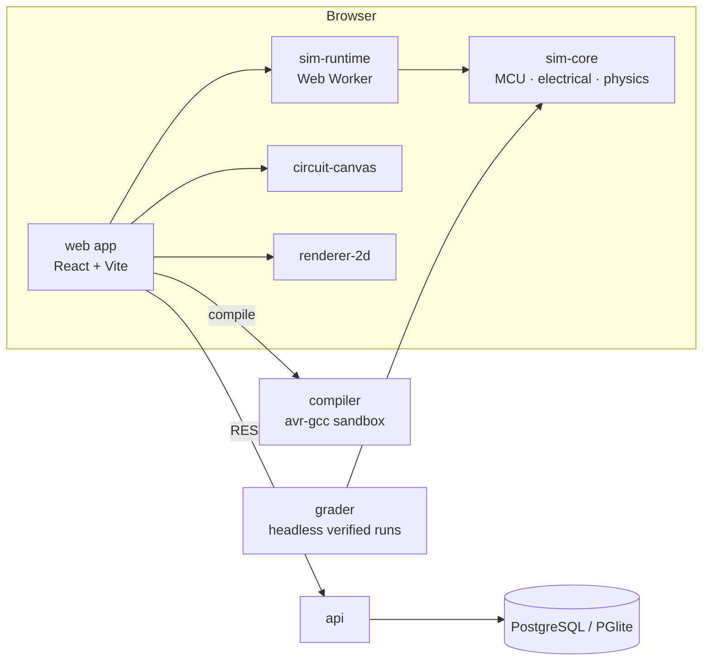

# RoboSim

**RoboSim by [Mehrtronic](../README.md)** is a bilingual (English LTR / Persian RTL) web platform where learners, makers, and schools **design** robot circuits, **program** them in Arduino C++, **simulate** them in a physics arena, **verify** them for hardware safety, and **build** the result from a list of real parts.

> 🚧 **Status:** in active development, phase **P1 — Simulation engine** (12 slices done). See [Release Plan](Docs/Release-Plan.md) for progress.

---

## Table of contents

- [Features](#features)
- [Architecture](#architecture)
- [Tech stack](#tech-stack)
- [Getting started](#getting-started)
- [Common commands](#common-commands)
- [Project structure](#project-structure)
- [Documentation](#documentation)
- [Contributing](#contributing)

---

## Features

### ✅ Available now

| Feature                             | What you get                                                                                                                                                                                                                                                                                                                                                                                                                                                                                                                                                                       |
| ----------------------------------- | ---------------------------------------------------------------------------------------------------------------------------------------------------------------------------------------------------------------------------------------------------------------------------------------------------------------------------------------------------------------------------------------------------------------------------------------------------------------------------------------------------------------------------------------------------------------------------------- |
| 🧩 **Circuit editor**               | SVG breadboard editor: drag parts on a 0.1" grid, rotate, flip, duplicate; band and Shift-click selection with align/distribute; pin-to-pin wiring with bend points and colours; hovering a pin highlights its whole net; movable board, minimap; 200-step undo/redo; 60 FPS at 200 parts                                                                                                                                                                                                                                                                                          |
| 📚 **Parts library**                | Searchable in Persian and English at the same time; property panel driven by part manifests (E12 resistor picker, value ranges, switches)                                                                                                                                                                                                                                                                                                                                                                                                                                          |
| 🖥️ **Editor workspace** (`/editor`) | Parts library, circuit canvas, code pane, simulation view, and a bottom dock (serial monitor, pin inspector, safety findings, challenge). Resizable panes that mirror in RTL; layout saved in the browser                                                                                                                                                                                                                                                                                                                                                                          |
| ✍️ **Code editor**                  | Monaco with Arduino highlighting and completions, multi-file sketches (`.ino` + `.h`/`.cpp` tabs), compile errors underlined in place with a plain-language explanation; always LTR                                                                                                                                                                                                                                                                                                                                                                                                |
| 🔎 **Debugging**                    | Pin inspector for every Uno pin (mode, level, PWM duty and frequency, voltage, `analogRead` value); serial monitor with baud selection, line endings and timestamps — a wrong baud garbles the text just like real hardware                                                                                                                                                                                                                                                                                                                                                        |
| ⚙️ **Build service**                | Compiles Arduino sketches with avr-gcc against the pinned Arduino AVR core and pinned libraries (Servo, NewPing, Stepper, Keypad, Wire/SPI, Adafruit SSD1306 + GFX, LiquidCrystal_I2C, Adafruit MPU6050 and BMP280, VL53L0X, DHT, OneWire + DallasTemperature, NeoPixel), in a sandbox behind a fair-share queue with live progress, with plain-language diagnostics                                                                                                                                                                                                               |
| 🔬 **MCU simulation**               | Cycle-accurate ATmega328P (Arduino Uno) emulation with PWM, USART, ADC, I²C (TWI) and SPI, running in a Web Worker; timed single-wire protocols (DHT11, 1-Wire, WS2812) are answered cycle-exact                                                                                                                                                                                                                                                                                                                                                                                   |
| ⚡ **Electrical model**             | Netlist-based solver (MNA) with diodes, pull-ups and output resistance; capacitors and inductors integrated in time (adaptive BDF2 sub-steps, so a 555 oscillates and a motor coil kicks back); BJT and MOSFET models with junction heating                                                                                                                                                                                                                                                                                                                                        |
| 🚗 **Physics arena**                | Deterministic 2D physics: wheel traction, walls, pushable obstacles, line sensors, and ultrasonic ranging. Eight built-in arenas (line tracks, obstacle course, maze, sumo ring, open floor), a draggable start pose, and a 2D view with zoom, follow, trail, and a sensor overlay. A **Robot** view places sensors, motors, battery and board on the chassis, and their positions drive sensing and the mass distribution                                                                                                                                                         |
| 🎮 **Live interaction**             | While running, hold buttons, toggle switches, and turn knobs on the canvas; LEDs glow, the servo horn turns, motors spin; buzzers play through the speakers (Sound toggle)                                                                                                                                                                                                                                                                                                                                                                                                         |
| 🛡️ **Safety checker**               | Static and runtime rules flag wiring that would damage real parts (over-current, outputs fighting, floating inputs, transistor base without a resistor, missing flyback diode, reversed electrolytic, I²C without pull-ups, address clashes, 5 V on 3.3 V parts…), with _why_ and _how to fix_ in both languages. Damaged parts are shown on the canvas                                                                                                                                                                                                                            |
| 🏁 **Challenges**                   | Declarative success conditions (reach a zone, laps, checkpoints, time limit, no collision, serial output…) with a live checklist and weighted score                                                                                                                                                                                                                                                                                                                                                                                                                                |
| 🔁 **Replay & verify**              | Every run records an input log; replays are bit-identical. **Verify run** re-grades the run headlessly and confirms the result                                                                                                                                                                                                                                                                                                                                                                                                                                                     |
| 🧪 **Simulator Lab** (`/lab`)       | Demos: blink, button, knob → LED/servo, serial monitor, RGB mood light + melody, relay counter, half adder, LED bar, stepper knob, TB6612 motors, keypad lock, encoder + joystick, 555 blinker, capacitor charging, TIP120 and MOSFET motor control, OLED, character LCD, MPU-6050 tilt, BMP280 weather station, two thermometers (DHT11 + DS18B20), NeoPixel rainbow, line follower, bump-and-turn and laser-ranging obstacle avoiders, a wall-following maze solver, a sumo bot, and miswired safety cases (incl. a motor without a flyback diode), each with **Open in editor** |
| 🌐 **Bilingual UI**                 | Full English / Persian with RTL layout, Persian digits, and ي/ك normalization                                                                                                                                                                                                                                                                                                                                                                                                                                                                                                      |
| 📁 **Projects**                     | **My projects** on the server (search, trash, duplicate) with autosave, conflict handling and versions (checkpoints + every successful build); versioned document format; JSON import/export                                                                                                                                                                                                                                                                                                                                                                                       |
| 🔐 **Accounts**                     | Email + password sign-up and sign-in, email verification, password reset, and session management (see and sign out devices); secure cookie sessions with CSRF protection and lockout                                                                                                                                                                                                                                                                                                                                                                                               |

### 🔩 Supported hardware (simulated)

| Category       | Parts                                                                                                                                                                                                                                                                             |
| -------------- | --------------------------------------------------------------------------------------------------------------------------------------------------------------------------------------------------------------------------------------------------------------------------------- |
| Board          | Arduino Uno R3 (ATmega328P)                                                                                                                                                                                                                                                       |
| Power          | 9 V battery, 4×AA pack, on/off switch, LM2596 buck converter                                                                                                                                                                                                                      |
| Semiconductors | 1N4007, 1N4148, 5.1 V Zener, LM7805 and AMS1117-3.3 regulators, 2N2222, BC547, 2N3906, TIP120, IRLZ44N                                                                                                                                                                            |
| Logic ICs      | 74HC00, 74HC08, 74HC32, 74HC86, 74HC14, 74HC595 shift register, CD4017 counter, ULN2003A, NE555 timer                                                                                                                                                                             |
| Actuators      | LED, RGB LED, WS2812B LED strip, TT gear motor, SG90 and MG996R servos, 28BYJ-48 stepper, active and passive buzzer, relay module                                                                                                                                                 |
| Displays       | 7-segment digit, SSD1306 OLED (128×64, I²C), 16×2 LCD with I²C backpack                                                                                                                                                                                                           |
| Drivers        | L298N, TB6612FNG, L9110S, IRF520 MOSFET module                                                                                                                                                                                                                                    |
| Sensors        | HC-SR04 ultrasonic, VL53L0X laser ranger, MPU-6050 IMU, BMP280 pressure, DHT11, DS18B20, TCRT5000, 3- and 5-channel line modules, FC-51 IR obstacle, bump switch, HC-SR501 PIR, KY-038 sound, soil moisture, LDR, push button, KY-023 joystick, KY-040 rotary encoder, 4×4 keypad |
| Passive        | Resistor, potentiometer, ceramic and electrolytic capacitors, half/full breadboard, jumper wires                                                                                                                                                                                  |
| Mechanical     | 2-wheel differential chassis with caster                                                                                                                                                                                                                                          |

### 🗺️ Planned

block-based coding · 2D/3D view toggle · phone (SMS) sign-in and two-factor authentication · project sharing · BOM, wiring guide, and one-click kit purchase · classes, assignments, and autograding · LMS (LTI 1.3) and SSO · community gallery and competitions · AI assistant · upload to a real board · Arduino Nano, Mega, and Raspberry Pi Pico.

Full scope: [PRD](Docs/PRD.md) · timeline: [Release Plan](Docs/Release-Plan.md).

---

## Architecture



One **netlist** drives simulation, safety, and the parts list; one **world model** drives every view. Runs are deterministic: same project + same inputs = same result, in the browser and on the server.

## Tech stack

| Layer         | Technology                                          |
| ------------- | --------------------------------------------------- |
| Monorepo      | pnpm workspaces + Turborepo                         |
| Language      | TypeScript                                          |
| Frontend      | React, Vite, SVG / Canvas 2D                        |
| MCU emulation | avr8js                                              |
| Physics       | planck.js (patched for determinism)                 |
| Backend       | Node.js, Drizzle ORM, PostgreSQL (PGlite in dev)    |
| Build service | avr-gcc + Arduino AVR core, Linux-namespace sandbox |
| Testing       | Vitest, golden simulation traces, Playwright        |

---

## Getting started

### Prerequisites

| Tool                | Version                                       | Notes                                                                                     |
| ------------------- | --------------------------------------------- | ----------------------------------------------------------------------------------------- |
| OS                  | **Linux or Windows 11 + WSL2** (Ubuntu 24.04) | On Windows, run every command **inside WSL**. Native PowerShell/cmd is blocked on purpose |
| Node.js             | **≥ 24**                                      | via `fnm` or `nvm`                                                                        |
| pnpm                | pinned in `package.json`                      | via Corepack: `corepack enable`                                                           |
| AVR toolchain       | `gcc-avr`, `avr-libc`, `binutils-avr`         | Needed by the build service to compile sketches                                           |
| Docker _(optional)_ | Compose v2                                    | Only for full local infrastructure (Mode B)                                               |

### 1. Clone and install

```bash
git clone <repo-url> Mehrtronic
cd Mehrtronic/RoboSim
corepack enable
pnpm install
```

### 2. Configure the environment

Create `.env` from the example, using the in-process database (no Docker needed):

```bash
sed -e 's/^DATABASE_DRIVER=postgres/DATABASE_DRIVER=pglite/' \
    -e 's#^PGLITE_DATA_DIR=.*#PGLITE_DATA_DIR=../../.local/pglite#' \
    .env.example > .env
```

> If port 3000 is already taken, set `API_PORT` (for example `API_PORT=3001`) in `.env`. The dev proxies follow it.

### 3. Set up the compiler

```bash
sudo apt install -y gcc-avr avr-libc binutils-avr
pnpm compiler:setup        # pinned Arduino core + libraries → .local/toolchain
```

To run the browser simulation tests (`pnpm test:sim:browser`), install the Playwright browsers once: `pnpm --filter @robosim/grader exec playwright install --with-deps chromium firefox`.

### 4. Build, seed, and run

```bash
pnpm build                 # first build of shared packages and apps
pnpm db:seed               # demo users and feature flags
pnpm dev                   # start everything with hot reload
```

| App              | URL                                        |
| ---------------- | ------------------------------------------ |
| Web app          | http://localhost:5173                      |
| Editor workspace | http://localhost:5173/editor               |
| Simulator Lab    | http://localhost:5173/lab                  |
| Admin            | http://localhost:5174                      |
| API              | http://localhost:3000 (or your `API_PORT`) |

### Optional: full local infrastructure (Docker)

Keep `DATABASE_DRIVER=postgres` in `.env`, then:

```bash
pnpm dev:infra             # postgres, valkey, minio, openbao, mailpit
pnpm db:migrate && pnpm db:seed
pnpm dev
```

### Troubleshooting

| Problem                                       | Fix                                                                          |
| --------------------------------------------- | ---------------------------------------------------------------------------- |
| `RoboSim must be run from WSL`                | Open a WSL terminal and run the command there                                |
| Hot reload is slow under `/mnt/c` or `/mnt/d` | Expected: Vite uses polling there. Clone inside the WSL filesystem for speed |
| API changes not picked up                     | Restart `pnpm dev` (no file-change events on `/mnt/*`)                       |
| `EADDRINUSE :3000`                            | Set `API_PORT` in `.env`                                                     |

---

## Common commands

| Command                                                  | Description                                                                                 |
| -------------------------------------------------------- | ------------------------------------------------------------------------------------------- |
| `pnpm dev`                                               | Run all apps with hot reload                                                                |
| `pnpm dev --filter web`                                  | Run one app (plus its dependencies)                                                         |
| `pnpm build`                                             | Build everything (cached by Turborepo)                                                      |
| `pnpm test`                                              | Unit tests (Vitest)                                                                         |
| `pnpm test:sim`                                          | All simulation tests: Node + browser legs + 2D and circuit-canvas frame budgets             |
| `pnpm test:sim:node`                                     | Node only: conformance, golden traces, robustness, long run                                 |
| `pnpm test:sim:browser`                                  | Conformance + golden traces in headless Chromium and Firefox                                |
| `pnpm test:perf`                                         | Simulation slice, analysis, and netlist performance budgets                                 |
| `pnpm lint` · `pnpm typecheck` · `pnpm format`           | ESLint, `tsc --noEmit`, Prettier                                                            |
| `pnpm verify`                                            | Everything CI runs: format, i18n, architecture, lint, typecheck, test, build, bundle budget |
| `pnpm i18n:check`                                        | Check EN/FA translation parity                                                              |
| `pnpm arch:check`                                        | Check package boundary rules                                                                |
| `pnpm --filter @robosim/compiler compile <main.ino>`     | Compile a sketch from the command line                                                      |
| `pnpm new:component <slug> <type-id> <category> <Class>` | Scaffold a new simulated component                                                          |
| `pnpm db:generate` · `pnpm db:migrate` · `pnpm db:seed`  | Database migrations and seed data                                                           |

---

## Project structure

```text
RoboSim/
├── apps/
│   ├── web/              # Main web app: editor workspace, Lab
│   ├── admin/            # Admin back-office
│   ├── api/              # Backend API
│   ├── compiler/         # Build service (Arduino → HEX)
│   └── grader/           # Headless verified runs
├── packages/
│   ├── sim-core/         # Simulation engine: scheduler, electrical solver, physics
│   ├── sim-runtime/      # Web Worker runtime, replay, grading
│   ├── boards/           # Board definitions (avr-uno)
│   ├── components/       # One package per simulated part
│   ├── catalog/          # Parts registry with EN/FA names
│   ├── safety-rules/     # Safety checker rules
│   ├── code-analysis/    # Sketch pin-usage analysis (tree-sitter C++, WASM)
│   ├── circuit-canvas/   # Breadboard circuit editor (React)
│   ├── renderer-2d/      # Canvas 2D arena renderer
│   ├── content/          # Arenas and challenges
│   ├── i18n/             # English / Persian translations
│   ├── ui/               # Shared UI components
│   ├── shared/           # Schemas and shared types
│   ├── config/           # Shared tool configs
│   └── test-fixtures/    # Test benches and fixtures
├── infra/docker/         # Docker Compose for local infrastructure
├── tools/                # Repo scripts and scaffolders
└── Docs/                 # Product and engineering documentation
```

---

## Documentation

| Document                                                              | Contents                                              |
| --------------------------------------------------------------------- | ----------------------------------------------------- |
| [Docs/README.md](Docs/README.md)                                      | Documentation map, glossary, and identifiers          |
| [BRD](Docs/BRD.md)                                                    | Business case and Mehrtronic positioning              |
| [PRD](Docs/PRD.md)                                                    | Features, personas, and requirements                  |
| [User Stories](Docs/User-Stories.md)                                  | Epics and acceptance criteria                         |
| [Technical Design](Docs/Technical-Design.md)                          | Architecture, simulation engine, services, data model |
| [API Spec](Docs/API-Spec.md)                                          | REST/WebSocket contracts                              |
| [Security, Privacy & Compliance](Docs/Security-Privacy-Compliance.md) | Threat model, sandboxing, privacy                     |
| [Engineering Guide](Docs/Engineering-Guide.md)                        | Dev setup, conventions, testing, CI                   |
| [Release Plan](Docs/Release-Plan.md)                                  | Phases, progress, and timeline                        |
| [Decisions](Docs/decisions.md)                                        | Architecture Decision Records                         |

## Contributing

1. Read the [Engineering Guide](Docs/Engineering-Guide.md).
2. Work from WSL, on a feature branch.
3. Use [Conventional Commits](https://www.conventionalcommits.org/).
4. Run `pnpm verify` before opening a pull request.

## License

© 2026 Mehrtronic. All rights reserved.
